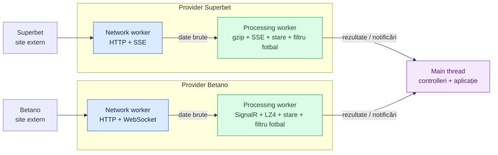

# Advanced betting system

Motor de colectare a meciurilor și cotelor live, scris în TypeScript și compilat în JavaScript pentru Node.js 24. În prezent rulează **Superbet și Betano**, pentru **fotbal, baschet și tenis**.

Acest document explică ansamblul. Pentru componente și fluxuri detaliate:

- [Network](docs/NETWORK.md): conexiuni, transporturi, comunicare între workeri și controlul fluxului de date.
- [Providers](docs/PROVIDERS.md): descoperirea meciurilor, protocoalele fiecărui site și sincronizarea cotelor.
- [Superbet fotbal](docs/SUPERBET-FOOTBALL.md): catalogul explicit, filtrarea liniilor cu exact două selecții și modelul de ieșire.
- [Betano fotbal](docs/BETANO-FOOTBALL.md): catalogul echivalent, parametrii liniilor și actualizările filtrate.
- [Corespondențe fotbal](docs/FOOTBALL-MARKET-MAPPING.md): tipurile comparabile între siteuri și condițiile de asociere.
- Contractele [Superbet](docs/contracts/SUPERBET.md) și [Betano](docs/contracts/BETANO.md): endpointuri, mesaje, câmpuri și regulile de aplicare a actualizărilor.
- [Aggregation](docs/AGGREGATOR.md) (fotbal live, marcajele D și T): asocierea meciurilor între case, normalizarea cotelor și detectarea oportunităților.

## Arhitectura actuală

Fiecare provider deține un worker de networking și unul de procesare. Controllerii rulează pe threadul principal și le gestionează pornirea, interogările și oprirea.



Diagrama urmărește datele primite. Comenzile de request, abonare și confirmare circulă și în sens invers, prin canalele descrise în [Network](docs/NETWORK.md#comunicarea-între-threaduri).

Sunt **patru workeri creați de aplicație și un thread principal**. Node.js și bibliotecile native pot folosi și threaduri interne. Numărul de meciuri nu creează automat threaduri noi.

| Componentă        | Responsabilitate                                                               |
| ----------------- | ------------------------------------------------------------------------------ |
| Main thread       | Pornește providerii, primește rezultate și expune API-ul aplicației.           |
| Network worker    | Conexiuni, requesturi, abonări și transferul datelor către procesare.          |
| Processing worker | Descoperire, decomprimare, parsare, verificarea versiunilor și starea cotelor. |

Separarea ține procesarea mesajelor în afara event loop-ului de networking. Concurența requesturilor este asincronă: un meci poate primi date în timp ce altul așteaptă răspunsul serverului. CPU-ul, conexiunile și capacitatea serverului rămân resurse comune.

## Cum ajungem de la site la cote

1. Providerul cere lista live și selectează sporturile acceptate. Reconcilierea completă se repetă la cinci minute.
2. Deschide abonările pentru actualizări: **un SSE per meci la Superbet**, respectiv **socketuri cu grupuri de meciuri la Betano**.
3. Networkingul transferă payloadurile direct către processing worker printr-un `MessageChannel`. Datele brute ocolesc threadul principal.
4. Procesarea construiește o stare completă și aplică actualizările în ordinea versiunilor.
5. Aplicația cere un snapshot sau primește notificările pentru care a înregistrat handlers.

La ambii provideri, aceeași procesare menține și un model filtrat pentru fotbal: numai tipuri configurate explicit și linii cu exact două selecții distincte. Starea vendor rămâne baza verificării versiunilor. Detaliile sunt în [Superbet fotbal](docs/SUPERBET-FOOTBALL.md) și [Betano fotbal](docs/BETANO-FOOTBALL.md).

La Betano, un socket suplimentar pentru overview poate declanșa descoperirea unor schimbări și între verificările periodice. La ambele siteuri, semnalele de finalizare pot elimina imediat un meci urmărit.

## Contractul pe care se poate baza aplicația

**O conexiune deschisă nu înseamnă automat cote sincronizate.** `start()` confirmă inițializarea providerului și înregistrarea abonărilor; sincronizarea fiecărui meci continuă după aceea.

- `getEvents()` întoarce meciurile urmărite, inclusiv cele aflate încă în sincronizare.
- `getSnapshot(id)` întoarce starea sincronizată sau `null` când meciul lipsește ori starea lui trebuie reparată.
- `onSnapshot` livrează o bază completă; `onUpdate` livrează schimbările ulterioare, în formatul providerului.
- `event-stale` cere invalidarea datelor păstrate de consumator până la următorul snapshot. O versiune lipsă sau o deconectare declanșează resincronizarea.

Prețurile și indicatorii de suspendare păstrează semantica siteului. Providerii au aceeași formă de API, dar structurile meciurilor, piețelor și actualizărilor sunt încă specifice fiecărui site.

Ambii provideri expun suplimentar `getFootballSnapshot(id)`, `onFootballSnapshot` și `onFootballUpdate`: bază filtrată, schimbări de linii și invalidări ale evenimentului. Fluxul brut rămâne disponibil separat. [Corespondențele dintre cataloage](docs/FOOTBALL-MARKET-MAPPING.md) alimentează [agregatorul](docs/AGGREGATOR.md), care primește liniile pe un canal direct, asociază meciurile și raportează oportunitățile.

## Organizarea codului

| Locație                                           | Ce găsești acolo                                                                      |
| ------------------------------------------------- | ------------------------------------------------------------------------------------- |
| [src/index.ts](src/index.ts)                      | Pornirea agregatorului și a providerilor; oprirea providerilor, apoi a agregatorului. |
| [src/network](src/network)                        | Infrastructura comună de networking: transporturi, streaming, polling și worker.      |
| [src/providers](src/providers)                    | Integrarea fiecărui site: controller, worker, protocol, feed și store.                |
| [src/aggregation](src/aggregation)                | Agregarea: protocolul binar, outboxul și adaptorul, asocierea meciurilor, detectorul. |
| `model/` în fiecare modul                         | Interfețele și contractele mesajelor; acestea nu creează threaduri.                   |
| `config.ts` / `*.config.ts` la rădăcina modulului | Parametri de rulare și cataloage explicite de piețe de fotbal pentru ambii provideri. |
| [test](test)                                      | Teste pentru protocoale, versiuni, recuperare și controlul fluxului.                  |

Detaliile despre fișiere și motivele separării lor sunt în cele două documente dedicate.

## Rulare și verificare

```powershell
npm install
npm run build
npm start
```

`npm start` rulează codul din `dist` și pornește ambii provideri. După modificări TypeScript trebuie refăcut buildul. `Ctrl+C` solicită oprirea și eliberarea resurselor.

| Comandă               | Scop                                                            |
| --------------------- | --------------------------------------------------------------- |
| `npm run check`       | Verifică tipurile fără a genera fișiere.                        |
| `npm test`            | Reface buildul și rulează testele automate locale.              |
| `npm run build:watch` | Recompilează la modificarea surselor.                           |
| `npm run dev`         | Rulează JavaScriptul compilat și repornește la modificarea lui. |

Testele automate și verificările live acoperă funcționarea și cazuri de recuperare. Măsurarea latenței locale nu măsoară momentul publicării cotelor la sursă; verificările scurte nu stabilesc stabilitatea pe termen lung.

Implementarea actuală acoperă colectarea și starea locală a cotelor. Normalizarea între case, asocierea acelorași meciuri și calculul oportunităților sunt etape ulterioare.
