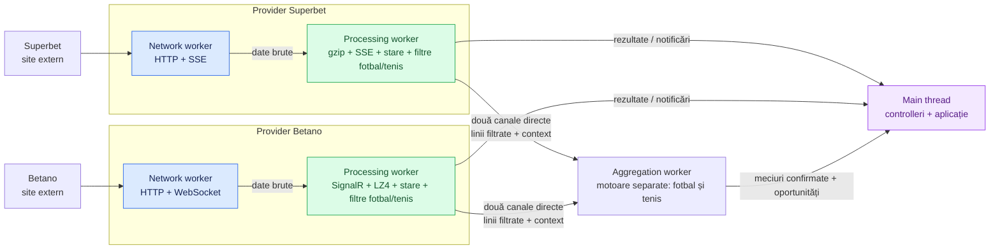

# Advanced betting system

Motor de colectare a meciurilor și cotelor live, scris în TypeScript și compilat în JavaScript pentru Node.js 24. În prezent rulează **Superbet și Betano**, pentru **fotbal, baschet și tenis**.

Acest document explică ansamblul. Pentru componente și fluxuri detaliate:

- [Index documentație](docs/README.md): arhitectură, provideri/sporturi, mapări și rapoarte.
- [Network](docs/architecture/NETWORK.md): conexiuni, transporturi, comunicare între workeri și controlul fluxului de date.
- [Providers](docs/architecture/PROVIDERS.md): descoperirea meciurilor, protocoalele fiecărui site și sincronizarea cotelor.
- [Superbet fotbal](docs/providers/superbet/FOOTBALL.md): catalogul explicit, filtrarea liniilor cu exact două selecții și modelul de ieșire.
- [Superbet tenis](docs/providers/superbet/TENNIS.md): 48 de tipuri binare, totaluri și handicapuri pe meci/set/game, statistici și recuperare.
- [Betano fotbal](docs/providers/betano/FOOTBALL.md): catalogul echivalent, parametrii liniilor și actualizările filtrate.
- [Betano tenis](docs/providers/betano/TENNIS.md): 32 de tipuri binare, praguri prematch/live, scorul de tenis și actualizările filtrate.
- [Corespondențe fotbal](docs/mapping/FOOTBALL.md): tipurile comparabile între siteuri și condițiile de asociere.
- [Corespondențe tenis](docs/mapping/TENNIS.md) și [fluxul de tenis](docs/architecture/TENNIS.md): mapare, context de scor, restricții și oportunități.
- Contractele [Superbet](docs/providers/superbet/CONTRACT.md) și [Betano](docs/providers/betano/CONTRACT.md): endpointuri, mesaje, câmpuri și regulile de aplicare a actualizărilor.
- [Aggregation](docs/architecture/AGGREGATOR.md): infrastructura comună și fotbalul live; tenisul are un motor separat în același worker.

## Arhitectura actuală

Fiecare provider deține un worker de networking și unul de procesare. Controllerii rulează pe threadul principal și le gestionează pornirea, interogările și oprirea.



Diagrama urmărește datele primite. Comenzile de request, abonare și confirmare circulă și în sens invers, prin canalele descrise în [Network](docs/architecture/NETWORK.md#comunicarea-între-threaduri).

Sunt **cinci workeri creați de aplicație și un thread principal**: patru pentru provideri și unul pentru agregare. Fotbalul și tenisul împart workerul de agregare, cu stări izolate. Node.js și bibliotecile native pot folosi și threaduri interne. Numărul de meciuri nu creează automat threaduri noi.

| Componentă        | Responsabilitate                                                               |
| ----------------- | ------------------------------------------------------------------------------ |
| Main thread       | Pornește providerii, primește rezultate și expune API-ul aplicației.           |
| Network worker    | Conexiuni, requesturi, abonări și transferul datelor către procesare.          |
| Processing worker | Descoperire, decomprimare, parsare, verificarea versiunilor și starea cotelor. |
| Aggregation worker | Asociază meciurile și compară liniile eligibile, separat pentru fotbal și tenis. |

Separarea ține procesarea mesajelor în afara event loop-ului de networking. Concurența requesturilor este asincronă: un meci poate primi date în timp ce altul așteaptă răspunsul serverului. CPU-ul, conexiunile și capacitatea serverului rămân resurse comune.

## Cum ajungem de la site la cote

1. Providerul cere lista live și selectează sporturile acceptate. Reconcilierea completă se repetă la cinci minute.
2. Deschide abonările pentru actualizări: **un SSE per meci la Superbet**, respectiv **socketuri cu grupuri de meciuri la Betano**.
3. Networkingul transferă payloadurile direct către processing worker printr-un `MessageChannel`. Datele brute ocolesc threadul principal.
4. Procesarea construiește o stare completă și aplică actualizările în ordinea versiunilor.
5. Aplicația cere un snapshot sau primește notificările pentru care a înregistrat handlers.

La ambii provideri, aceeași procesare menține și un model filtrat pentru fotbal: numai tipuri configurate explicit și linii cu exact două selecții distincte. Starea vendor rămâne baza verificării versiunilor. Detaliile sunt în [Superbet fotbal](docs/providers/superbet/FOOTBALL.md) și [Betano fotbal](docs/providers/betano/FOOTBALL.md).

Ambii provideri mențin în workerul existent și proiecții de tenis: [Superbet](docs/providers/superbet/TENNIS.md), respectiv [Betano](docs/providers/betano/TENNIS.md). Acestea folosesc cataloage fixe, două selecții pe linie și context separat pentru seturi, puncte și serviciu. Expun `getTennisSnapshot`, `onTennisSnapshot` și `onTennisUpdate`. Providerii activi colectează live; proiectarea bazelor prematch complete este disponibilă separat, fără discovery prematch. [Matchingul de tenis](docs/architecture/TENNIS.md) compară 25 de corespondențe active, cu prag identic, scor și serviciu confirmate; nu compară liniile cu rambursare, piețele specifice seturilor 3–5 sau totalul de tiebreak-uri încă neconfirmat.

La Betano, un socket suplimentar pentru overview poate declanșa descoperirea unor schimbări și între verificările periodice. La ambele siteuri, semnalele de finalizare pot elimina imediat un meci urmărit.

Betano folosește fluxul SignalR **eveniment + piețe, fără cronologia incidentelor**. Scorurile, statisticile și cotele rămân disponibile; versiunile REST sunt aliniate la audiența abonată înainte de aplicarea updateurilor. [Raportul de stabilitate](docs/reports/BETANO-STREAM-STABILITY-2026-10-25.md) explică închiderile `1005`/429 investigate, corecția și testele de recuperare.

## Contractul pe care se poate baza aplicația

**O conexiune deschisă nu înseamnă automat cote sincronizate.** `start()` confirmă inițializarea providerului și înregistrarea abonărilor; sincronizarea fiecărui meci continuă după aceea.

- `getEvents()` întoarce meciurile urmărite, inclusiv cele aflate încă în sincronizare.
- `getSnapshot(id)` întoarce starea sincronizată sau `null` când meciul lipsește ori starea lui trebuie reparată.
- `onSnapshot` livrează o bază completă; `onUpdate` livrează schimbările ulterioare, în formatul providerului.
- `event-stale` cere invalidarea datelor păstrate de consumator până la următorul snapshot. O versiune lipsă sau o deconectare declanșează resincronizarea.

Prețurile și indicatorii de suspendare păstrează semantica siteului. Providerii au aceeași formă de API, dar structurile meciurilor, piețelor și actualizărilor sunt încă specifice fiecărui site.

Ambii provideri expun suplimentar `getFootballSnapshot(id)`, `onFootballSnapshot` și `onFootballUpdate`: bază filtrată, schimbări de linii și disponibilitate. `invalidate` blochează temporar cotele până la o bază nouă; `remove` retrage efectiv proiecția. Agregatorul păstrează identitatea meciului la deconectare și reconciliază snapshoturile prin cheia canonică, fără ștergerea liniilor care încă există. Fluxul brut rămâne disponibil separat. [Corespondențele dintre cataloage](docs/mapping/FOOTBALL.md) alimentează [agregatorul](docs/architecture/AGGREGATOR.md), care primește liniile pe un canal direct, asociază meciurile și raportează oportunitățile.

## Organizarea codului

| Locație                                           | Ce găsești acolo                                                                      |
| ------------------------------------------------- | ------------------------------------------------------------------------------------- |
| [src/index.ts](src/index.ts)                      | Pornirea agregatorului și a providerilor; oprirea providerilor, apoi a agregatorului. |
| [src/network](src/network)                        | Infrastructura comună de networking: transporturi, streaming, polling și worker.      |
| [src/providers](src/providers)                    | Integrarea fiecărui site: controller, worker, protocol, feed și store.                |
| [src/aggregation](src/aggregation)                | Agregarea: protocolul binar, outboxul și adaptorul, asocierea meciurilor, detectorul. |
| `model/` în fiecare modul                         | Interfețele și contractele mesajelor; acestea nu creează threaduri.                   |
| `config.ts` / `*.config.ts` la rădăcina modulului | Parametri de rulare și cataloage explicite de piețe, separate pe sport. |
| [test](test)                                      | Teste pentru protocoale, versiuni, recuperare și controlul fluxului.                  |

Documentele sunt grupate în `docs/architecture`, `docs/providers/<site>`, `docs/mapping` și `docs/reports`; [indexul](docs/README.md) indică rolul și starea fiecărei piese.

## Rulare și verificare

```powershell
npm install
npm run build
npm start
```

`npm start` rulează codul din `dist` și pornește ambii provideri. După modificări TypeScript trebuie refăcut buildul. `Ctrl+C` solicită oprirea și eliberarea resurselor.

La pornire, consola afișează rolul și ID-ul fiecărui thread: main, networking și procesare pentru fiecare provider, plus agregatorul care include matchingul și compararea cotelor. Confirmarea indică inițializarea threadului, fără să garanteze sincronizarea tuturor meciurilor sau activitatea sa ulterioară.

Pragul oportunităților este `minMarginBps` din configurația agregatorului, în puncte de bază: `50` = 0,5%, `200` = 2%. Toate piețele activate sunt afișate pe câte o linie: **verde la FOUND**, **albastru la UPDATE**. **CLOSED este mov dacă marja raportată rămâne peste 0,5% și roșu la 0,5% sau mai jos**. Pragul de culoare este separat de `minMarginBps`: de exemplu, o scădere de la 2,2% la 1% închide oportunitatea cu mov, fără să continue urmărirea sub pragul de detecție. Movul nu confirmă disponibilitatea cotelor; motivul închiderii rămâne decisiv inclusiv la suspendare sau retragere. Fiecare linie include ora UTC, ID-ul oportunității, meciul/scorul, piața, linia, siteurile, selecțiile, cotele și marja. Închiderea include durata în secunde, cele mai recente cote disponibile și motivul concret observat: siteul și cota veche → nouă, selecția indisponibilă, linia/starea retrasă, siteul suspendat, scorurile diferite sau batchul întârziat. Culorile se adaptează terminalului; `NO_COLOR` le dezactivează.

La pornire, dacă primul raport de statistici nu are perechi utilizabile, apare un mesaj de inițializare. Primul contor `[MATCHED ACTIVE] Superbet <-> Betano | total=N | football=F | tennis=T` apare când există perechi utilizabile sau, dacă rămâne zero, după cel mult 30 de secunde de la primul raport, plus cadența statisticilor (implicit 5 secunde). Apoi se repetă la fiecare minut. Sincronizarea poate continua după primul rezumat; acesta nu certifică încărcarea tuturor meciurilor. Sunt numărate numai perechile confirmate, sincronizate, live și nesuspendate, cu scor/context compatibil, fără blocaj de stabilizare sau întârziere și cu cel puțin o linie comună cu selecții complementare utilizabile. Marja nu trebuie să depășească deja pragul de oportunitate. Nu se afișează tabel inițial sau loguri la fiecare adăugare/retragere. Tenisul are marcajul `[TENNIS]` în liniile oportunităților; identitatea unei oportunități este `(sport, id)`.

La pierderea sincronizării, oportunitatea devine **PAUSED galben**, cu ultimele cote confirmate; nu este o oportunitate utilizabilă. Revine **RESUMED albastru**, cu același ID, numai după validarea datelor și marjei curente. Altfel se închide cu motivul observat. `durata` include timpul calendaristic de la deschidere; `timp neconfirmat` arată separat pauzele observate în agregator, fără să pretindă continuitatea oportunității în acele intervale.

Măsurarea temporară a fluxului este documentată în [testul de latență de un minut](docs/reports/LATENCY-TEST-2026-10-25.md). Instrumentarea folosită la test nu face parte din aplicația normală.

| Comandă               | Scop                                                            |
| --------------------- | --------------------------------------------------------------- |
| `npm run check`       | Verifică tipurile fără a genera fișiere.                        |
| `npm test`            | Reface buildul și rulează testele automate locale.              |
| `npm run build:watch` | Recompilează la modificarea surselor.                           |
| `npm run dev`         | Rulează JavaScriptul compilat și repornește la modificarea lui. |

Testele automate și verificările live acoperă funcționarea și cazuri de recuperare. Măsurarea latenței locale nu măsoară momentul publicării cotelor la sursă; verificările scurte nu stabilesc stabilitatea pe termen lung.

Implementarea actuală colectează cotele brute pentru cele trei sporturi și include filtrare, matching și oportunități pentru fotbal și tenis. Baschetul rămâne în afara proiecțiilor filtrate și agregării.
