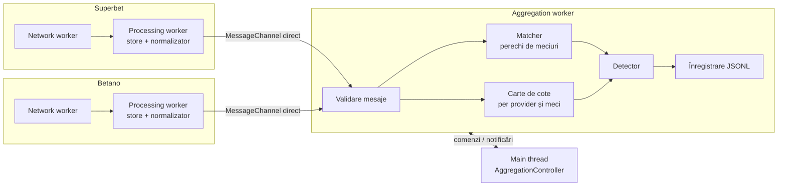
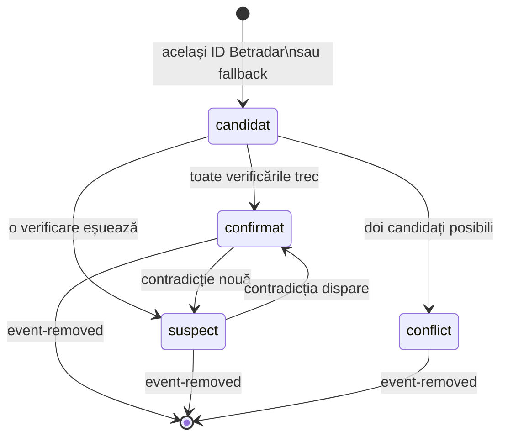

# Aggregation — asocierea meciurilor și oportunitățile

[Ansamblul proiectului](../README.md) · [Conexiuni și comunicare](NETWORK.md) · [Provideri și sincronizare](PROVIDERS.md)

> **Stare: proiect.** Documentul descrie designul aprobat pentru implementare. Nimic din `src/aggregation` nu există încă; secțiunea [Etape](#etape) arată ordinea în care apare.

Agregatorul primește de la fiecare provider meciurile și cotele într-o formă **comună**, recunoaște același meci la case diferite și calculează oportunitățile de arbitraj. Nu plasează pariuri: oportunitățile sunt raportate și înregistrate, iar decizia rămâne manuală.

Providerii rămân responsabili de **corectitudinea stării la casa lor**. Agregatorul decide doar **dacă două stări descriu același lucru** și **dacă pot fi comparate acum**.

## Principii

1. **Nimic nu trece o graniță nevalidat.** Datele siteului sunt validate în normalizatorul providerului. Mesajele dintre threaduri sunt validate din nou la primire, cu aceleași gărzi ca în restul proiectului (`isRecord`, `Number.isSafeInteger`, enumuri închise).
2. **Dacă nu e sigur, nu se folosește.** O asociere sau o cotă îndoielnică este marcată și logată, nu ghicită. Este aceeași regulă ca `event-stale` din store-uri: lipsa unei oportunități e preferabilă unei oportunități false.
3. **Aceeași formă ca restul codului.** Controller pe main thread, worker separat, `model/`, `config.ts`, `logging.ts`, separare procesare/protocol, promisiuni de lifecycle partajate (`??=`), verificări de identitate după fiecare `await`, ACK în `finally`, timere eliberate în `stop()`.
4. **Agregatorul nu poate opri colectarea.** Dacă agregatorul cade, providerii continuă să ruleze și să-și păstreze starea.

## Arhitectura

Agregatorul este un worker propriu. Normalizarea rulează **în processing workerul fiecărui provider**, unde datele siteului sunt deja în memorie; peste granița de thread trece numai forma canonică, mai mică.



### Piesele

| Piesă                        | Unde rulează       | Responsabilitate                                                                                  |
| ---------------------------- | ------------------ | ------------------------------------------------------------------------------------------------- |
| `controller.ts`              | Main thread        | API public, configurare, crearea workerului și a canalelor către provideri, query-uri și cleanup. |
| `workers/worker.ts`          | Aggregation worker | Primește porturile providerilor, leagă componentele, răspunde main threadului.                    |
| `protocol/validation.ts`     | Aggregation worker | Gărzile pentru fiecare mesaj de pe porturile providerilor.                                        |
| `matching/names.ts`          | Aggregation worker | Normalizarea numelor, extragerea marcajelor, comparatorul de tenis.                               |
| `matching/matcher.ts`        | Aggregation worker | Mașina de stări a perechilor de meciuri.                                                          |
| `processing/quotes.ts`       | Aggregation worker | Cartea de cote canonice per `(provider, meci)`, cu momentul primirii.                             |
| `processing/detector.ts`     | Aggregation worker | Condițiile de comparare, calculul oportunităților și ciclul lor de viață.                         |
| `model/`                     | Contracte          | `canonical`, `matching`, `opportunity`, `worker`, `controller`, `config` `.interfaces.ts`.        |
| `config.ts`, `logging.ts`    | Config / main      | Valorile implicite și raportarea concisă în consolă.                                              |
| `providers/*/normalization/` | Processing worker  | `identity.ts`, `live.ts`, `markets.ts`: traducerea din forma siteului în forma canonică.          |

```
src/aggregation/
  config.ts  controller.ts  logging.ts
  model/              *.interfaces.ts
  workers/worker.ts
  protocol/validation.ts
  matching/names.ts  matching/matcher.ts
  processing/quotes.ts  processing/detector.ts
src/providers/{superbet,betano}/normalization/{identity,live,markets}.ts
test/aggregation-*.test.mjs
test/{superbet,betano}-normalization.test.mjs
test/fixtures/                 # mostre reale reduse
```

### Ciclul de viață

1. `src/index.ts` pornește **întâi** `AggregationController`.
2. Controllerul creează câte un `MessageChannel` per provider. Un capăt ajunge la agregator, celălalt este dat controllerului providerului ca opțiunea `aggregationPort`.
3. Controllerul providerului îl transmite processing workerului prin `workerData` și `transferList`, exact ca `networkPort`. Fără `aggregationPort`, providerul funcționează ca acum.
4. La oprire: providerii se opresc și își închid porturile, apoi agregatorul primește `stop`, scrie ce are în buffer și se închide (cu același timeout de 15 s urmat de `terminate()` ca la provideri).

Dacă agregatorul cade, normalizatorul vede portul închis și încetează să trimită; providerul nu este afectat. Reatașarea automată (o comandă `attach-aggregation` trimisă prin main, urmată de `resync`) este planificată pentru o versiune ulterioară.

## Contractul de mesaje

Toate mesajele unui provider pleacă pe **același port**, pentru că ordinea este garantată doar în interiorul unui canal. Dacă invalidarea ar veni pe alt drum decât cotele, s-ar putea întâmpla:

1. meciul devine stale la provider;
2. agregatorul primește încă o cotă veche;
3. invalidarea ajunge după, iar între timp detectorul raportează o oportunitate falsă.

### Provider → agregator

| Mesaj            | Conținut                                                                            | Când                                         |
| ---------------- | ----------------------------------------------------------------------------------- | -------------------------------------------- |
| `hello`          | `provider`, `generation`                                                            | La atașarea portului.                        |
| `event-identity` | sport, participanți, start, ID Betradar, competiție, marcaje                        | La descoperire și la orice schimbare.        |
| `event-live`     | status, perioadă, scor normalizat per sport                                         | La schimbare.                                |
| `event-quotes`   | **toate** cotele canonice ale meciului; înlocuiesc tot ce exista                    | La `onSnapshot` (sincronizare sau reparare). |
| `quote-changes`  | cote modificate sau scoase, grupate pe o fereastră scurtă                           | La actualizările acceptate de store.         |
| `event-stale`    | motiv                                                                               | Direct din store, la invalidare.             |
| `event-removed`  | motiv                                                                               | La eliminarea meciului.                      |

Fiecare mesaj conține `generation` și `sequence`:

- `generation` crește la fiecare atașare. Mesajele cu o generație veche sunt ignorate, ca în networking.
- `sequence` crește cu fiecare mesaj. Un gol nu ar trebui să apară, dar dacă apare, toate meciurile acelui provider devin stale în agregator și se cere `resync`.

### Agregator → provider

| Mesaj    | Efect                                                                                         |
| -------- | --------------------------------------------------------------------------------------------- |
| `resync` | Providerul retrimite `event-identity`, `event-live` și `event-quotes` pentru meciurile sincronizate. |

### Validarea la primire

`protocol/validation.ts` verifică fiecare mesaj înainte să atingă starea:

- ID-uri de meci pozitive și sigure; ID Betradar ca șir de cifre `/^[1-9]\d*$/`.
- Sport, perioadă, tip de piață și rezultat din enumuri închise.
- Prețuri finite și strict mai mari decât 1.
- Linii întregi (vezi [Cote canonice](#cote-canonice)).
- Momente de timp ca `Number.isSafeInteger` în milisecunde epoch.

Un mesaj invalid este respins și numărat în statistici. Dacă era un mesaj de cote, **întregul meci** al acelui provider devine stale în agregator, deoarece un mesaj pierdut înseamnă stare incompletă.

## Normalizarea în provideri

Normalizatorul se leagă în `workers/worker.ts` la handlerele existente ale feed-ului (`onEvents`, `onSnapshot`, `onUpdate`, `onRemove`, `onStatus`). Validează datele siteului, construiește forma canonică și compară cu ultima versiune trimisă, astfel încât pe port pleacă doar diferențele.

### Identitatea canonică

| Câmp            | Superbet                                                   | Betano                                    | Regulă                                                                                                          |
| --------------- | ---------------------------------------------------------- | ----------------------------------------- | --------------------------------------------------------------------------------------------------------------- |
| ID Betradar     | `fixture.betradar_id` (**string**)                         | `event.betradarMatchId` (**number**)      | Normalizat la șir de cifre. Orice altă formă înseamnă „absent”.                                                 |
| Sport           | `5` / `4` / `2`                                            | `FOOT` / `BASK` / `TENN`                  | `football` / `basketball` / `tennis`. Altă valoare: meciul nu este trimis.                                      |
| Gazde / oaspeți | `event_name` despărțit la `·`, plus `home_team_id`/`away_team_id` | `participants` cu `isHome`         | Exact doi participanți. La Betano `isHome` **lipsește** la oaspeți (valoare implicită omisă): trebuie exact un `isHome === true`. |
| Start           | `utc_date` și `unix_date_millis`                           | `startTime`                               | Cele două câmpuri Superbet trebuie să coincidă. `event_date` este oră **locală** și nu se folosește.            |
| Competiție      | `tournament_id`, `category_id`                             | `leagueId`, `zoneId`                      | Spații de ID diferite; comparate doar prin corespondențe învățate.                                              |
| Marcaje         | extrase din nume                                           | extrase din nume                          | Vezi [Participanți](#b-participanți).                                                                           |

Superbet necesită o modificare: store-ul păstrează acum din discovery doar `{id, sportId, name, version}`. `eventFrom()` trebuie extins să rețină câmpurile de identitate, validate. Betano le are deja în overview.

### Starea live

Scorul se normalizează **per sport**, pentru că aceleași câmpuri înseamnă lucruri diferite:

| Sport          | Superbet                                                    | Betano                                                     | Canonic                     |
| -------------- | ----------------------------------------------------------- | ---------------------------------------------------------- | --------------------------- |
| Fotbal, baschet | `home_team_score` / `away_team_score`                      | scorul meciului                                            | total gazde / oaspeți       |
| Tenis          | `home_team_score` = **seturi**, `home_team_game_score` = **puncte** | `score` = **puncte**, `liveInfoHomeScore` = **seturi** | seturi, gameuri, puncte separat |

Statusul canonic are valorile `live`, `suspended`, `ended`. Regulile pentru „terminat” sunt cele din store-uri (la Superbet `ENDED`/`FINISHED`/`CANCELLED`/`POSTPONED` sau `offer_state_status["2"] === 2`).

### Cote canonice

O cotă canonică este identificată prin:

```
{ sport, period, type, line?, outcome }   ex. { basketball, FT_INCL_OT, TOTAL, 962, OVER }
```

- `line` este un număr întreg de **sferturi de punct** (`240.5` → `962`), astfel încât `2.5`, `2.50` și erorile de virgulă mobilă nu produc chei diferite.
- `period` face parte din cheie: `FT_REG` (timp regulamentar) și `FT_INCL_OT` (cu prelungiri) nu se compară niciodată între ele.
- Fiecare cotă are `price` (finit, > 1), `suspended` și `receivedAt`.
- La Betano, o selecție cu `price: 0` (valoarea implicită din patch-ul diff-ului de tip 100) înseamnă „indisponibil” și nu este trimisă.

Piețele acceptate sunt definite într-un **whitelist** per site, cu ID-ul pieței de la site și traducerea ei. O piață necunoscută este ignorată.

| Sport   | Piețe în prima versiune                                                               |
| ------- | ------------------------------------------------------------------------------------- |
| Fotbal  | 1X2, total goluri, ambele marchează                                                   |
| Baschet | câștigător cu prelungiri, total puncte cu prelungiri                                  |
| Tenis   | câștigător meci, doar după verificarea regulilor de abandon la ambele case            |

## Asocierea meciurilor

Fiecare pereche posibilă trece printr-o mașină de stări:



| Stare      | Folosită de detector | Semnificație                                                       |
| ---------- | -------------------- | ------------------------------------------------------------------ |
| `confirmat` | Da                  | ID Betradar identic **și** toate verificările încrucișate trec.    |
| `suspect`  | Nu                   | O verificare eșuează; perechea este logată cu motivul.             |
| `conflict` | Nu                   | Ambiguitate (ID duplicat, mai mulți candidați). Nimic nu se folosește. |

Verificările se refac la fiecare `event-identity` și `event-live`, deci o pereche confirmată poate fi retrogradată oricând. Perechea este legată de `(provider, eventId)`, nu doar de ID-ul Betradar.

Nivelurile de încredere sunt `id` (ID Betradar), `alias` (fallback confirmat prin aliasuri învățate) și `fuzzy` (doar observat).

## Scenarii care pot produce meciuri greșite

Fiecare scenariu are o protecție și un test dedicat. Cele marcate **real** au fost găsite în mostrele live (44 de meciuri Superbet, 34 Betano).

### A. ID-uri

| #   | Scenariu                                                                  | Protecție                                                                                          |
| --- | ------------------------------------------------------------------------- | -------------------------------------------------------------------------------------------------- |
| A1  | **Real:** ID Betradar string la Superbet, number la Betano                | Normalizare la șir de cifre cu validare strictă.                                                   |
| A2  | **Real:** ID lipsă (9 meciuri Superbet, 4 Betano)                         | Doar fallback ([secțiunea F](#f-fallback-pe-nume)). Cheile absente nu se indexează niciodată.      |
| A3  | Același ID la două meciuri ale aceleiași case (meci recreat, duplicat)    | `conflict`: niciunul nu se folosește, iar raportul îl semnalează.                                  |
| A4  | ID greșit introdus de casă                                                | ID-ul singur nu ajunge: sportul, startul, numele și scorul trebuie să concorde.                    |
| A5  | Meciul este șters și readăugat cu alt ID de provider, același Betradar    | La `event-removed` perechea se desface complet și se reconstruiește de la zero.                    |
| A6  | ID-ul Betradar apare sau se schimbă în timpul meciului                    | Reevaluare la fiecare `event-identity`, cu retrogradare la contradicție.                           |

### B. Participanți

| #   | Scenariu                                                                                         | Protecție                                                                                                                                  |
| --- | ------------------------------------------------------------------------------------------------ | ------------------------------------------------------------------------------------------------------------------------------------------ |
| B1  | Gazde și oaspeți inversați între case (teren neutru, eroare de date)                             | Verificare de orientare prin similaritatea numelor. În prima versiune: `suspect`, nefolosit. Inversarea cotelor vine doar cu dovezi.       |
| B2  | **Real:** senior față de tineret, rezerve sau feminin: `Atenas U21` (Superbet) și `Atenas LDD` (Betano), ambele fără ID, ambele la 20:30 | Marcajele (`U19`–`U23`, `(F)`/women, `II`, `B`, `LDD`, `Academy`, `Reserves`) sunt **extrase ca atribute**, nu șterse, și trebuie să fie egale. Echivalențe ca `LDD` ≈ `U21` doar din tabela învățată. |
| B3  | Același nume de club în țări diferite                                                            | Corespondența competițiilor, învățată din perechile confirmate prin Betradar, devine condiție la fallback.                                 |
| B4  | **Real:** tenis la dublu cu partenerii în altă ordine: `R.Garcia Finetto/B.Rodriguez` și `Bruno Rodriguez / Rafael Augusto Garcia Finetto` | Comparator de tenis: mulțimi de nume de familie per echipă, fără ordine, cu inițialele potrivite pe prenume.                               |
| B5  | **Real:** prenume în plus sau lipsă: `Sander Jong` / `Alexander Maarten Jong`                    | Potrivire pe numele de familie plus compatibilitatea prenumelui (inițială sau prefix).                                                     |
| B6  | **Real:** diacritice și grafii: `ș` (virgulă) față de `ş` (sedilă), `Garðabær`, `Asociación`     | Normalizare Unicode NFKD, eliminarea semnelor, apoi `ð`→`d`, `ß`→`ss`, `æ`→`ae`, `ø`→`o`.                                                 |
| B7  | Prescurtări (`PSG` / `Paris Saint-Germain`)                                                      | Doar prin aliasuri învățate din perechi confirmate, niciodată din similaritate brută.                                                      |
| B8  | Aceleași echipe de două ori la interval scurt (playoff, tur-retur, U21 și seniori în aceeași zi) | Fereastră de timp plus regula „**exact un candidat**”. Doi candidați înseamnă `conflict`.                                                  |

### C. Timp

| #   | Scenariu                                                             | Protecție                                                                                     |
| --- | -------------------------------------------------------------------- | --------------------------------------------------------------------------------------------- |
| C1  | **Real:** start diferit între case (19:33 față de 19:40)             | Toleranță configurabilă, combinată obligatoriu cu regula de la B8.                            |
| C2  | Fus orar: `event_date` local față de `utc_date`                      | Se folosesc doar câmpurile UTC/epoch, cu verificarea concordanței lor.                         |
| C3  | Meci reprogramat care își păstrează ID-ul                            | Diferență de start peste prag: perechea devine `suspect`, chiar cu ID identic.                |

### D. Sport și format

| #   | Scenariu                                                                                                      | Protecție                                                                              |
| --- | ------------------------------------------------------------------------------------------------------------- | -------------------------------------------------------------------------------------- |
| D1  | **Real (în scriptul de analiză):** meciurile fără ID se potriveau pe cheia `undefined` și ieșeau perechi fotbal–baschet | Sportul este condiție obligatorie; cheile absente nu se indexează.                     |
| D2  | eSports sau meciuri virtuale cu nume de echipe reale                                                          | Marcaj canonic `virtual`. Betano filtrează deja zonele; la Superbet se adaugă filtru.  |
| D3  | Formate diferite (tenis la 3 sau 5 seturi, durata sferturilor)                                                | Nu schimbă perechea, dar intră în cheia piețelor unde contează.                        |

### E. Starea live

Scorul este cel mai puternic semnal: prinde atât perechea greșită, cât și casa rămasă în urmă după un gol. Al doilea caz este sursa principală de arbitraje false.

| #   | Scenariu                                                                  | Protecție                                                                                        |
| --- | ------------------------------------------------------------------------- | ------------------------------------------------------------------------------------------------ |
| E1  | Scoruri diferite                                                          | Detectorul este blocat pe pereche. Dacă diferența persistă peste `scoreMismatchMs`, perechea devine `suspect`. |
| E2  | **Real:** semantica scorului diferă (tenis: seturi și puncte pe câmpuri inverse) | Normalizare per sport în provider, cu teste pe mostrele reale.                                   |
| E3  | O casă arată meciul terminat sau suspendat, cealaltă live                 | Blocare până când stările se aliniază.                                                           |
| E4  | Imediat după o schimbare de scor                                          | Perioadă de liniște `scoreSettleMs`: casele suspendă și recalculează în ritmuri diferite.        |
| E5  | `event-stale` sau meci eliminat                                           | Cotele meciului sunt șterse imediat din cartea de cote.                                          |

### F. Fallback pe nume

Pentru meciurile fără ID Betradar, o pereche este propusă numai dacă:

- sportul este identic;
- startul este în toleranță;
- marcajele sunt identice;
- ambii participanți se potrivesc, după normalizare, aliasuri și comparatorul de tenis;
- competiția este compatibilă, dacă corespondența ei este cunoscută;
- există **un singur** candidat.

În prima versiune rezultatul este doar **observat**: logat cu motivul, nefolosit de detector. Se activează după ce rata de erori este măsurată pe date reale.

Tabelele învățate (aliasuri de nume, corespondențe de competiții) sunt construite numai din perechi `confirmat` prin ID și salvate pe disc ca JSON, validat la încărcare și la scriere.

### G. Piețe

Nu sunt erori de asociere, dar produc la fel comparații greșite:

| Capcană                        | Exemplu                                                         | Protecție                                                     |
| ------------------------------ | --------------------------------------------------------------- | ------------------------------------------------------------- |
| Prelungiri incluse sau nu      | Superbet `759` față de `777`; Betano `H2HT` față de `ARD1`      | `period` face parte din cheie.                                |
| Convenția de semn la handicap  | Superbet `hcp` pe selecție, Betano `handicap` pe piață          | Excluse până la teste dedicate.                               |
| Handicap asiatic și european   | Linii întregi față de linii cu sferturi                         | Tipuri canonice diferite.                                     |
| Abandon la tenis               | Regulile de decontare pot diferi                                | Piața intră doar dacă regulile sunt identice.                 |
| Piețe de jucători              | Nume de jucători, linii individuale                             | Excluse în prima versiune.                                    |

## Detectorul

O piață a unei perechi este comparată doar dacă:

1. perechea este `confirmat`;
2. ambele meciuri sunt sincronizate, nestale și live;
3. scorul este egal și stabil de cel puțin `scoreSettleMs`;
4. fiecare cotă este mai nouă decât `maxQuoteAgeMs`, nesuspendată, cu preț > 1;
5. există setul complet de rezultate al pieței (de exemplu 1, X și 2).

Pentru fiecare rezultat se alege cel mai bun preț dintre case, apoi:

```
S = Σ 1 / cota_i
arbitraj dacă S < 1, profit = 1/S − 1
miza_i = Total × (1 / cota_i) / S
```

| Rezultat       | Condiție                                    | Efect                                             |
| -------------- | ------------------------------------------- | ------------------------------------------------- |
| sub prag       | profit < `minMargin`                        | Ignorat.                                          |
| oportunitate   | `minMargin` ≤ profit ≤ `suspiciousMargin`   | Raportată și înregistrată.                        |
| suspectă       | profit > `suspiciousMargin`                 | Marcată `suspicious`: de obicei o eroare de mapare. |

O oportunitate are ciclu de viață: apare, se actualizează și se închide când condițiile nu mai sunt îndeplinite. Fiecare tranziție se scrie în JSONL, cu durata totală la închidere.

## Configurare propusă

| Opțiune              | Implicit | Semnificație                                                            |
| -------------------- | -------- | ----------------------------------------------------------------------- |
| `startToleranceMs`   | 30 min   | Diferența maximă de start între case.                                   |
| `scoreSettleMs`      | 5 s      | Liniștea cerută după o schimbare de scor.                               |
| `scoreMismatchMs`    | 60 s     | Durata unei diferențe de scor după care perechea devine `suspect`.      |
| `maxQuoteAgeMs`      | 10 s     | Vârsta maximă a unei cote folosite.                                     |
| `batchWindowMs`      | 75 ms    | Fereastra de grupare pentru `quote-changes`.                            |
| `minMargin`          | 0.5%     | Profitul minim raportat.                                                |
| `suspiciousMargin`   | 10%      | Peste această valoare oportunitatea este marcată `suspicious`.          |
| `fallbackMode`       | `observe` | `off`, `observe` sau `active`.                                          |
| `recordPath`         | —        | Fișierul JSONL; fără el nu se înregistrează nimic.                      |

Ca la provideri, constructorul cere ca toate valorile numerice să fie întregi pozitivi siguri (marjele sunt fracții finite între 0 și 1).

## Etape

| Etapă | Conținut                                                                                                    | Verificare                                                                 |
| ----- | ----------------------------------------------------------------------------------------------------------- | -------------------------------------------------------------------------- |
| 1     | Contracte, worker, controller, porturi, validări, `hello`/`resync`, generații și secvențe.                  | Teste de lifecycle și de mesaje invalide.                                  |
| 2     | Normalizarea identității și a scorului, matcherul pe ID cu verificările A–E, raport live în consolă.        | Un test pentru fiecare scenariu, inclusiv cele reale.                      |
| 3     | Whitelist-ul de piețe și cartea de cote.                                                                    | Teste pe mostre reale.                                                     |
| 4     | Detectorul și înregistrarea JSONL.                                                                          | Teste de calcul, pragurile și ciclul de viață al oportunităților.          |
| 5     | Fallback observat, învățarea aliasurilor și a corespondențelor de competiții.                              | Rata de erori măsurată pe date live.                                       |

La finalul etapei 2, raportul live arată câte meciuri sunt `confirmat`, `suspect`, `conflict` sau neasociate și de ce, înainte să fie comparată vreo cotă.

## Decizii deschise

Implicit este aleasă varianta conservatoare:

1. **Gazde/oaspeți inversați:** `suspect`, nefolosit (implicit), sau inversarea cotelor.
2. **Fallback pe nume:** doar observat în prima versiune (implicit), sau activ de la început.
3. **Tenis:** inclus după verificarea regulilor de abandon la ambele case (implicit), sau amânat.
