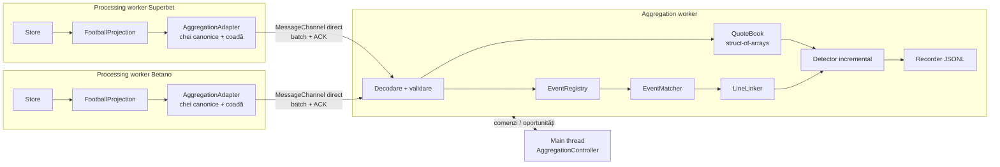
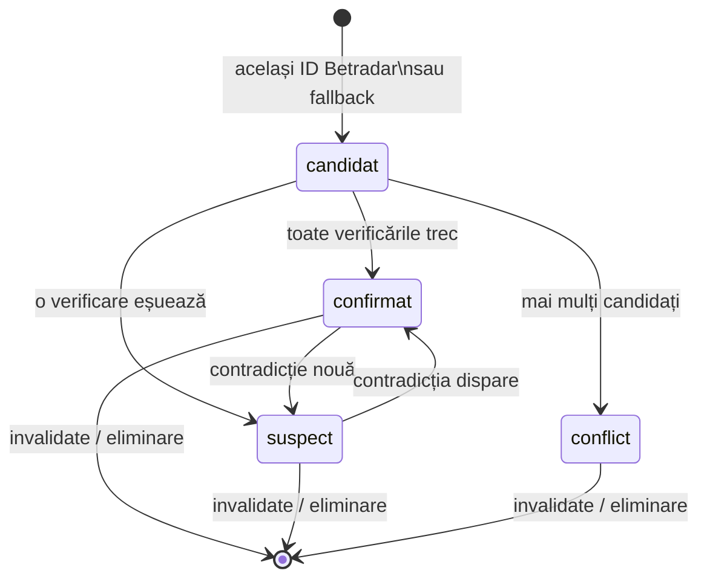

# Aggregation — asocierea meciurilor și oportunitățile

[Ansamblul proiectului](../README.md) · [Network](NETWORK.md) · [Providers](PROVIDERS.md) · [Corespondențe fotbal](FOOTBALL-MARKET-MAPPING.md)

> **Stare: etapa 1 implementată.** Transportul (formatul binar, coada coalescentă, sesiunea, workerul, controllerul, ACK, resincronizarea) există și rulează cu ambii provideri. Adaptoarele, asocierea și detectorul urmează; ordinea de lucru este în [Etape](#13-etape).

Agregatorul primește de la Superbet și Betano liniile de fotbal deja filtrate de proiecțiile existente, recunoaște același meci la ambele case, asociază liniile echivalente și calculează oportunitățile de arbitraj. Nu plasează pariuri: oportunitățile sunt raportate și înregistrate, iar decizia rămâne manuală.

Responsabilitățile rămân separate:

| Strat                       | Răspunde de                                                                 | Există |
| --------------------------- | --------------------------------------------------------------------------- | ------ |
| Store vendor                | Versiuni, patch-uri, recuperare, `stale`.                                   | Da     |
| Proiecția de fotbal         | Catalog fix, linii cu exact două selecții, roluri, handicap orientat.       | Da     |
| Adaptorul de agregare       | Traducerea în chei canonice, internarea liniilor, coada coalescentă.        | Nu     |
| Agregatorul                 | Asocierea meciurilor, asocierea liniilor, detectorul, înregistrarea.        | Nu     |

## 1. Domeniu

Prima versiune acoperă exact ce produc proiecțiile:

- **Fotbal live.** Ambii provideri descoperă numai meciuri live; proiecțiile sunt doar pentru fotbal. Baschetul și tenisul rămân în afara agregatorului până au propriile cataloage.
- **Piețe cu două rezultate:** Peste/Sub, handicap cu două rezultate, Da/Nu. Fără 1X2, handicap european, jucători sau combinații, pentru că proiecțiile nu le emit.
- **Numai perechile din [corespondențe](FOOTBALL-MARKET-MAPPING.md#3-perechile-identificate)**, filtrate după marcaj (vezi [Liniile comparabile](#5-liniile-comparabile)).

O piață cu două rezultate face detectorul **O(1) per linie**: există doar două combinații încrucișate de comparat.

## 2. Principii

1. **Nimic nu trece o graniță nevalidat.** Proiecțiile validează datele siteului. Adaptorul validează traducerea canonică. Agregatorul validează din nou fiecare mesaj și fiecare înregistrare binară.
2. **Dacă nu e sigur, nu se folosește.** O asociere sau o linie îndoielnică este marcată și numărată, nu ghicită. Necunoscut înseamnă exclus.
3. **Aceeași formă ca restul codului.** Controller pe main, worker separat, `model/`, `config.ts`, `logging.ts`, separare procesare/protocol, lifecycle partajat (`??=`), verificări de identitate după `await`, ACK în `finally`, timere eliberate în `stop()`.
4. **Agregatorul nu poate opri colectarea.** Un agregator lent sau căzut nu blochează și nu umflă memoria providerilor.
5. **Calea fierbinte nu alocă.** O schimbare de preț nu creează obiecte, stringuri sau closures nici în provider, nici în agregator.

## 3. Arhitectura



Adaptorul rulează în processing workerul existent, după proiecție. Pe canal trec numai liniile care au o corespondență activă, deci aproximativ jumătate din catalogul Superbet nu părăsește niciodată threadul providerului.

### Fișierele

```
src/aggregation/
  config.ts  controller.ts  logging.ts
  model/                  config / controller / worker / wire / canonical / matching / opportunity .interfaces.ts
  workers/worker.ts       leagă porturile, ACK, comenzi de la main
  protocol/wire.ts        layoutul binar al batch-urilor (offseturi, coduri) — comun ambelor părți
  protocol/validation.ts  gărzile mesajelor de control și ale limitelor
  processing/session.ts   AggregationSession: generație, secvență, ciclul de viață al handle-urilor, ACK
  processing/events.ts    EventRegistry: meciuri per provider, sloturi, starea live
  processing/quotes.ts    QuoteBook: sloturi de linie, prețuri, flaguri
  matching/names.ts       normalizarea numelor și marcajele
  matching/matcher.ts     EventMatcher: mașina de stări a perechilor
  matching/lines.ts       LineLinker: legăturile dintre liniile perechilor confirmate
  processing/detector.ts  calculul incremental și ciclul de viață al oportunităților
  processing/recorder.ts  JSONL cu buffer și backpressure
src/aggregation/mapping.config.ts          corespondențele Betano typeId ↔ Superbet id → cod canonic
src/providers/superbet/processing/aggregation.ts   adaptorul Superbet
src/providers/betano/processing/aggregation.ts     adaptorul Betano
src/aggregation/adapter/outbox.ts                  coada coalescentă, comună ambilor provideri
test/aggregation-*.test.mjs
```

`protocol/wire.ts`, `mapping.config.ts` și `adapter/outbox.ts` sunt importate de ambele părți; nu există altă dependență a providerilor de agregator.

### Ciclul de viață

1. `src/index.ts` creează `AggregationController`, iar `createPort(provider)` creează câte un `MessageChannel` înainte de pornire. `port1` rămâne agregatorului, `port2` este al treilea argument al controllerului providerului.
2. Controllerul providerului transmite portul processing workerului prin `workerData` și `transferList`, exact ca `networkPort`. Fără port, outboxul nu este creat și providerul funcționează ca înainte.
3. La pornire, sesiunea agregatorului trimite `attach` cu generația și limitele. Outboxul nu înregistrează nimic înainte de `attach`: tablourile lui sunt dimensionate după aceste limite, deci ambele părți validează aceleași valori.
4. Un eșec la pornirea agregatorului este logat, dar nu oprește providerii.
5. La oprire: providerii se opresc întâi și își închid porturile, apoi agregatorul primește `stop` și se închide (timeout de 15 s, apoi `terminate()`, ca la provideri).

Dacă agregatorul cade, adaptorul vede portul închis, își eliberează coada și încetează să mai producă. Reatașarea (`attach-aggregation` prin main, urmată de o generație nouă) vine într-o etapă ulterioară.

## 4. Identitatea canonică a meciului

Proiecțiile păstrează deja aproape tot ce trebuie. Lipsește ID-ul Betradar, care trebuie adăugat în `SuperbetFootballEvent` și `BetanoFootballEvent`.

| Câmp            | Superbet                                         | Betano                                      | Regulă                                                                                  |
| --------------- | ------------------------------------------------ | ------------------------------------------- | --------------------------------------------------------------------------------------- |
| ID Betradar     | `fixture.betradar_id` (**string**)               | `event.betradarMatchId` (**number**)        | **De adăugat în proiecție.** Șir `/^[1-9]\d{0,15}$/`, convertit la număr sigur; altfel `null`. |
| Gazde / oaspeți | `home.name`, `away.name` din `event_name`        | `home.name`, `away.name` din `participants` | Deja validate de proiecții: exact două, nume nevide și diferite.                        |
| Start           | `startsAt` din `utc_date`                        | `startsAt` din `startTime`                  | Convertit o singură dată în milisecunde epoch. La Superbet se verifică și `unix_date_millis`. |
| Scor            | `homeScore` / `awayScore` (string)               | `homeScore` / `awayScore` (string)          | `/^\d+$/` → întreg; altfel necunoscut.                                                  |
| Ceas            | `minute`, `stoppageTime`, `period`               | `clockSeconds`, `clockStopped`              | Convertit la secunde de joc, unde se poate.                                             |
| Suspendare      | `offerStatus`                                    | `isSuspended`                               | Flag canonic `suspended`.                                                               |
| Competiție      | `competitionId`, `categoryId`                    | `competitionId`, `categoryId`               | Spații de ID diferite; folosite doar prin corespondențe învățate.                       |

ID-urile echipelor și ale competițiilor nu se compară între case: sunt spații diferite.

Adaptorul trimite identitatea doar când se schimbă (proiecțiile publică deja `event` numai la schimbare). Normalizarea numelor și marcajele se calculează **o singură dată** pe schimbare de identitate, în agregator, și se păstrează în cache.

## 5. Liniile comparabile

### Codul canonic al pieței

[mapping.config.ts](../src/aggregation/mapping.config.ts) transformă tabelul de [corespondențe](FOOTBALL-MARKET-MAPPING.md#3-perechile-identificate) în date:

```ts
{ code: 1, superbet: 200734, betano: 13, condition: "D", transform: "same" }
{ code: 17, superbet: 233942, betano: 51, condition: "T", threshold: 0.5, transform: "yes-no-to-over-under" }
```

- `code` este un întreg mic și stabil (< 4096). Este cheia canonică a tipului de piață.
- Fiecare adaptor construiește la pornire un `Map<vendorId, MappingRow[]>` (Superbet `231045` are două rânduri, pentru pragurile 0,5 și 1,5).
- La încărcare se validează: coduri unice, ID-uri vendor existente în cataloagele providerilor, roluri compatibile, prag prezent exact la `T`.

### Ce marcaje sunt active

| Marcaj | Activ în prima versiune | Motiv                                                                                  |
| ------ | ----------------------- | -------------------------------------------------------------------------------------- |
| D      | Da                      | Același concept, fără conversie.                                                       |
| T(x)   | Da                      | Conversie exactă Da→Peste, Nu→Sub, numai la pragul declarat.                           |
| P      | Nu                      | Regulile de numărare (cartonașe, cornere, șuturi) nu sunt confirmate.                  |
| A      | Nu                      | Regulile de push pe sferturi de linie nu sunt confirmate.                              |
| H      | Nu                      | Betano include scorul curent în handicapul asiatic; baza de decontare nu e confirmată. |
| I      | Nu                      | Limitele intervalelor diferă (`:59` față de `45:00`/`90:00`).                          |

Activarea se face per marcaj în configurație (`enabledConditions`), iar un rând poate fi forțat individual după confirmarea regulilor. Un marcaj dezactivat înseamnă că adaptorul **nu trimite** acele linii.

### Cheia canonică a unei linii

Fiecare linie se reduce la un singur număr întreg, sigur în JavaScript:

```
lineKey = code × 2^20 + (param + 2^15) × 2^4 + variant

code     : 12 biți    codul canonic al pieței
param    : 16 biți    pragul sau handicapul în sferturi de unitate (2.5 → 10, −0.75 → −3), deplasat cu 2^15
variant  : 4 biți     rezervat (interval, după activarea marcajului I)
```

- Sferturile de unitate elimină erorile de virgulă mobilă: `2.5`, `2.50` și `2.4999999` din parsare nu pot produce chei diferite, iar o valoare care nu este multiplu exact de 0,25 este respinsă.
- Handicapul este deja **orientat spre gazde** în ambele proiecții, deci aceeași valoare înseamnă aceeași linie.
- La `T(x)`, linia Betano Da/Nu primește `param = x` și rolurile convertite înainte de calculul cheii.
- O cheie numerică face căutările `Map<number, …>` mai ieftine decât cheile string și nu alocă.

### Rolurile

Fiecare linie are exact două roluri canonice, `A` și `B`:

| Tip       | A      | B      |
| --------- | ------ | ------ |
| Peste/Sub | Peste  | Sub    |
| Handicap  | Gazde  | Oaspeți |
| Da/Nu     | Da     | Nu     |

Asocierea se face prin rol, niciodată prin poziția în array (Superbet publică Sub înaintea lui Peste, Betano invers).

### Când este o cotă utilizabilă

| Provider | Condiții                                                                                                         |
| -------- | ---------------------------------------------------------------------------------------------------------------- |
| Superbet | `price` finit > 1, `display: true`, `status` în valorile active confirmate (**de verificat**: `1` observat activ), `offerStatus` nesuspendat. |
| Betano   | `price` finit > 1 (proiecția pune `null` altfel), selecție, linie și eveniment nesuspendate.                    |

Adaptorul reduce aceste condiții la un singur bit `usable` per selecție. Agregatorul nu cunoaște semantica vendorului.

## 6. Protocolul pe canal

Ordinea este garantată doar în interiorul unui canal, deci **toate** mesajele unui provider pleacă pe același port, în batch-uri. Un singur batch este în zbor; următorul pleacă numai după ACK. Este același model de credit ca `StreamDelivery`, simplificat la o fereastră de un batch.

### Internarea liniilor

Pentru fiecare linie trimisă, adaptorul alocă un **handle** întreg mic (`Uint32`), refolosit printr-o listă de handle-uri libere:

- `line-define` asociază handle-ul cu `(eventHandle, lineKey)` o singură dată.
- Actualizările de preț conțin doar handle-ul și valorile numerice.
- `line-release` eliberează handle-ul; reutilizarea este sigură, pentru că eliberarea și redefinirea trec prin același canal, în ordine.

Meciurile primesc la fel un `eventHandle`. Agregatorul indexează direct în array-uri după handle, fără hash.

### Formatul unui batch

Un batch este un `ArrayBuffer` **transferat** (zero-copy, ca payloadurile din networking), cu două secțiuni:

Formatul este în [protocol/wire.ts](../src/aggregation/protocol/wire.ts), little-endian:

```
Header (32 B)   magic "AGB1" · versiune · provider · generation · sequence · sentAt (f64) · byteLength · segments
Segment         opCount (u32) · valueCount (u32) · operații · valori
  reset            1 B    șterge toată starea providerului; numai ca primă operație a unui batch
  event-identity  45 B + două nume (u16 lungime + UTF-8)   eventHandle, eventId, betradarId, startsAt, competiție, categorie
  event-live      14 B    eventHandle, flags (live, suspended, scor, ceas), scor gazde/oaspeți (u16), ceas (u32)
  event-release    5 B    eventHandle; liniile meciului trebuie eliberate înainte
  line-define     13 B    lineHandle, eventHandle, lineKey (u32)
  line-release     5 B    lineHandle
  valoare         21 B    lineHandle (u32) · priceA (f64) · priceB (f64) · flags (u8: usableA, usableB)
```

- **Valorile conțin ultima stare** a fiecărei linii modificate, nu istoricul. Un preț schimbat de zece ori între două batch-uri trece o singură dată.
- Într-un segment, operațiile preced valorile. O operație scrisă după valori deschide automat un segment nou, deci ordinea nu poate fi încălcată de cel care scrie.
- Prețul lipsă sau inutilizabil este `NaN`, cu bitul `usable` șters. Startul necunoscut este `NaN`; ID-urile absente sunt `0`.
- `sentAt` este momentul trimiterii batch-ului. Pentru că valorile sunt coalescente, este și momentul la care ele erau curente.

Mesajele de control (`attach`, `ack`, `resync`) sunt obiecte simple, validate cu gărzi în [protocol/validation.ts](../src/aggregation/protocol/validation.ts).

### Coada coalescentă din adaptor

```
dirty        Uint8Array indexat după lineHandle
dirtyList    Uint32Array cu handle-urile marcate (fără duplicate)
priceA/B     Float64Array indexat după lineHandle — ultima valoare
structural   lista ordonată a operațiilor structurale
```

| Eveniment în provider                 | Efect în coadă                                                                                   |
| ------------------------------------- | ------------------------------------------------------------------------------------------------ |
| Schimbare de preț sau de `usable`     | Scrie în `priceA/B`, marchează `dirty` dacă nu era. O(1), fără alocare.                          |
| Linie nouă                            | `line-define` în `structural` + `dirty`.                                                         |
| Linie eliminată                       | Șterge `dirty`, adaugă `line-release`.                                                           |
| Scor, fază sau suspendare a meciului  | **Închide segmentul curent**: valorile dinainte pleacă înaintea schimbării de scor (vezi mai jos). |
| Doar ceasul s-a schimbat              | Operație `event-live` în segmentul curent, fără închidere: nu rupe coalescența.                   |
| Starea live nu s-a schimbat           | Nimic; la fel pentru o linie cu aceleași valori.                                                 |
| `invalidate`                          | Eliberează liniile (`line-release`), apoi meciul (`event-release`); trimis imediat.               |

Închiderea segmentului la schimbarea de scor împiedică o cotă de **dinaintea** golului să ajungă după scorul nou și să pară o cotă de după gol. Un batch poate conține mai multe segmente.

Batch-ul pleacă la `batchWindowMs` după prima modificare, sau la sfârșitul ciclului curent (`setImmediate`) la o schimbare de scor sau o invalidare, dacă nu este deja unul în zbor. Cât timp agregatorul nu a confirmat, outboxul continuă să suprascrie aceleași sloturi. **Valorile în așteptare sunt limitate de numărul de linii, nu de numărul de actualizări.**

Operațiile structurale se pot totuși aduna cât timp agregatorul nu răspunde. Dacă batch-ul în așteptare depășește `maxBatchBytes`, outboxul renunță la el, scrie `reset` și cere adaptorului retrimiterea stării din proiecții. Limita este validată să încapă de **două ori** starea completă ([fullStateBytes](../src/aggregation/protocol/wire.ts)), deci o retrimitere nu poate depăși din nou limita.

### Generații, secvențe și resincronizare

- `generation` vine de la agregator în `attach` și este verificată în plic și în header. Reatașarea, cu generație nouă, este o etapă ulterioară.
- `sequence` crește cu fiecare batch. Agregatorul confirmă cu `ack`, care întoarce și bufferul transferat, pentru refolosire.
- Un batch respins (secvență lipsă, header nepotrivit, operație invalidă, încălcarea ciclului de viață) produce `resync` în locul `ack`. Agregatorul șterge **toată** starea providerului; outboxul eliberează handle-urile, scrie `reset` și cere retrimiterea. Până la un batch care începe cu `reset`, sesiunea respinge orice altceva.
- Un plic invalid (fără `sequence` sau buffer) nu poate primi `resync`, pentru că nu se știe ce batch a eșuat: sesiunea închide legătura, iar outboxul se dezactivează.

### Validarea la primire

Decodorul și sesiunea verifică:

- headerul: magic, versiune, provider, generație și secvență egale cu plicul, `sentAt` întreg, lungime care se încadrează în buffer și în `maxBatchBytes`, fără bytes rămași;
- identitatea: ID-uri întregi pozitive sau `0`, start întreg sau `NaN`, nume UTF-8 valide (`fatal`), nevide, de cel mult 128 de caractere și diferite;
- starea live: numai flagurile cunoscute; scorul și ceasul sunt zero când flagul lor lipsește;
- valorile: prețuri `NaN` sau finite în `(1, 10 000]`, preț valid obligatoriu pentru bitul `usable`, numai flagurile cunoscute;
- handle-urile: în limite, meci definit înaintea liniilor, linie nedefinită de două ori, meci eliberat numai fără linii;
- `lineKey` cu codul de piață ≥ 1 (codul existent în `mapping.config.ts` se verifică din etapa 2).

Sesiunea aplică batch-ul pe măsură ce îl decodează, fără o a doua trecere. O eroare oriunde șterge **toată** starea providerului și cere `resync`, deci o aplicare parțială nu supraviețuiește. Consumatorii din etapele următoare (detectorul) lucrează doar la sfârșitul unui batch acceptat.

Outboxul aplică aceleași reguli înainte de scriere: o identitate invalidă, un meci necunoscut sau o cheie invalidă sunt numărate în `rejected` și nu ajung pe canal; un preț inutilizabil devine `NaN`.

## 7. Structurile de date din agregator

Toate structurile fierbinți sunt **struct-of-arrays** indexate după handle: valori contigue în memorie, fără obiecte per linie și fără presiune pe garbage collector.

### QuoteBook

Un set de array-uri per provider, crescute prin dublare la nevoie:

| Array                | Tip            | Conținut                                    |
| -------------------- | -------------- | ------------------------------------------- |
| `lineEvent`          | `Int32Array`   | slotul meciului                             |
| `lineKey`            | `Float64Array` | cheia canonică                              |
| `priceA`, `priceB`   | `Float64Array` | ultima valoare                              |
| `flags`              | `Uint8Array`   | `usableA`, `usableB`, `defined`             |
| `updatedAt`          | `Float64Array` | `projectedAt` al batch-ului care a schimbat linia |
| `peer`               | `Int32Array`   | linkul către linia echivalentă la cealaltă casă, sau −1 |

### EventRegistry

Per provider, un array de obiecte meci indexat după `eventHandle`. Evenimentele sunt puține (zeci–sute) și se schimbă rar, deci aici obiectele sunt acceptabile. Fiecare meci păstrează:

- identitatea canonică și numele normalizate (calculate o dată);
- starea live: scor, ceas, `suspended`, momentul ultimei schimbări de scor;
- `lines: Map<lineKey, lineHandle>` — necesar pentru asocierea liniilor la confirmarea unei perechi;
- `pair`: referința la perechea curentă sau `null`.

### Indexurile de asociere

| Index                     | Structură                                    | Folosire                                               |
| ------------------------- | -------------------------------------------- | ------------------------------------------------------ |
| După Betradar             | `Map<number, EventRef[]>` per provider       | Candidat exact în O(1); lista detectează duplicatele.  |
| După timp (fallback)      | `Map<bucket, EventRef[]>`, bucket de 15 min  | Candidați fără ID: se caută în bucketul propriu și în vecini. |
| Aliasuri învățate         | `Map<string, string>`                        | Nume normalizat → formă canonică.                      |
| Competiții învățate       | `Map<number, number>`                        | `competitionId` Superbet ↔ Betano.                     |

Cheile absente nu sunt introduse niciodată într-un index.

### LineLinker

Când o pereche devine `confirmat`, linkerul parcurge `lines` al meciului mai mic și caută cheia în `Map`-ul celuilalt: O(min(n, m)). Pentru fiecare potrivire scrie `peer` în ambele sensuri. La `line-define` pe un meci deja asociat, linkerul face o singură căutare. La `line-release`, retrogradare sau `event-invalidate`, linkurile sunt șterse în ambele sensuri.

### Coada de lucru a detectorului

```
pending      Uint8Array indexat după slotul global al liniei
pendingList  Uint32Array
```

Aplicarea unui batch doar marchează liniile atinse. La sfârșitul batch-ului, detectorul parcurge `pendingList` o singură dată. Zece schimbări ale aceleiași linii în același batch produc un singur calcul.

## 8. Asocierea meciurilor

Fiecare pereche trece printr-o mașină de stări:



| Stare       | Folosită de detector | Semnificație                                                           |
| ----------- | -------------------- | ---------------------------------------------------------------------- |
| `confirmat` | Da                   | ID Betradar identic **și** toate verificările încrucișate trec.        |
| `suspect`   | Nu                   | O verificare eșuează; motivul este numărat și logat.                   |
| `conflict`  | Nu                   | Ambiguitate (ID duplicat, mai mulți candidați). Nimic nu se folosește. |

Verificările se refac la `event-identity` și `event-live`, deci o pereche confirmată poate fi retrogradată oricând. Perechea este legată de `(provider, eventHandle)` din generația curentă.

Nivelurile de încredere sunt `id` (Betradar), `alias` (fallback confirmat prin aliasuri învățate) și `fuzzy` (doar observat).

## 9. Scenarii care pot produce meciuri greșite

Fiecare scenariu are o protecție și un test dedicat. Cele marcate **real** au fost găsite în mostrele live (44 de meciuri Superbet, 34 Betano).

### A. ID-uri

| #   | Scenariu                                                               | Protecție                                                                                   |
| --- | ---------------------------------------------------------------------- | ------------------------------------------------------------------------------------------- |
| A1  | **Real:** ID Betradar string la Superbet, number la Betano             | Validare strictă și conversie la număr sigur în proiecție.                                  |
| A2  | **Real:** ID lipsă (9 meciuri Superbet, 4 Betano)                      | Doar fallback ([F](#f-fallback-pe-nume)). Cheile absente nu se indexează.                   |
| A3  | Același ID la două meciuri ale aceleiași case                          | `conflict`: niciunul nu se folosește.                                                       |
| A4  | ID greșit introdus de casă                                             | ID-ul singur nu ajunge: startul, numele, scorul și ceasul trebuie să concorde.              |
| A5  | Meci șters și readăugat, alt ID de provider, același Betradar          | La `event-invalidate` perechea se desface complet; asocierea se reface de la zero.          |
| A6  | ID-ul Betradar apare sau se schimbă în timpul meciului                 | Reevaluare la fiecare `event-identity`, cu retrogradare la contradicție.                    |

### B. Participanți

| #   | Scenariu                                                                                       | Protecție                                                                                                                            |
| --- | ---------------------------------------------------------------------------------------------- | ------------------------------------------------------------------------------------------------------------------------------------ |
| B1  | Gazde și oaspeți inversați între case                                                          | Orientare verificată prin similaritatea numelor. `suspect`, nefolosit. Inversarea ar cere și inversarea semnului handicapului (vezi corespondențele). |
| B2  | **Real:** `Atenas U21` (Superbet) și `Atenas LDD` (Betano), fără ID, aceeași oră               | Marcajele (`U19`–`U23`, `(F)`/women, `II`, `B`, `LDD`, `Academy`, `Reserves`) sunt **extrase ca atribute** și trebuie să fie egale. `LDD` ≈ `U21` doar din tabela învățată. |
| B3  | Același nume de club în țări diferite                                                          | Corespondența competițiilor, învățată din perechi confirmate, devine condiție la fallback.                                           |
| B4  | **Real:** diacritice: `ș` (virgulă) față de `ş` (sedilă), `Garðabær`, `Asociación`             | NFKD, eliminarea semnelor, apoi `ð`→`d`, `ß`→`ss`, `æ`→`ae`, `ø`→`o`.                                                                |
| B5  | Prescurtări (`PSG` / `Paris Saint-Germain`)                                                    | Doar prin aliasuri învățate din perechi confirmate, niciodată din similaritate brută.                                                |
| B6  | Aceleași echipe de două ori la interval scurt (tur-retur, U21 și seniori în aceeași zi)        | Fereastră de timp plus regula „**exact un candidat**”. Doi candidați înseamnă `conflict`.                                            |

### C. Timp și ceas

| #   | Scenariu                                                     | Protecție                                                                                       |
| --- | ------------------------------------------------------------ | ----------------------------------------------------------------------------------------------- |
| C1  | **Real:** start diferit între case (19:33 față de 19:40)     | Toleranță `startToleranceMs`, combinată obligatoriu cu B6.                                      |
| C2  | Fus orar: `event_date` local față de `utc_date`              | Proiecția folosește deja `utc_date`; se adaugă verificarea cu `unix_date_millis`.               |
| C3  | Meci reprogramat care își păstrează ID-ul                    | Diferență de start peste prag: `suspect`, chiar cu ID identic.                                  |
| C4  | Ceasuri de joc foarte diferite                               | Diferență între minutul Superbet și `clockSeconds` Betano peste `clockToleranceS`: `suspect`. Prinde atât perechile greșite, cât și un feed blocat. |

### D. Starea live

Scorul este semnalul cel mai puternic: prinde și perechea greșită, și casa rămasă în urmă după un gol. Al doilea caz este sursa principală de arbitraje false.

| #   | Scenariu                                                     | Protecție                                                                                                  |
| --- | ------------------------------------------------------------ | ---------------------------------------------------------------------------------------------------------- |
| D1  | Scoruri diferite                                             | Detectorul este blocat pe pereche. Dacă diferența persistă peste `scoreMismatchMs`, perechea devine `suspect`. |
| D2  | O casă arată meciul suspendat, cealaltă activ                | Blocare până se aliniază.                                                                                  |
| D3  | Imediat după o schimbare de scor                             | Liniște `scoreSettleMs`: casele suspendă și recalculează în ritmuri diferite.                              |
| D4  | Cotă de dinaintea golului sosită după scorul nou             | Închiderea segmentului în adaptor ([coada](#coada-coalescentă-din-adaptor)).                              |
| D5  | `invalidate` sau meci eliminat                               | Liniile meciului și linkurile lor sunt șterse imediat.                                                     |

### E. Linii

Nu sunt erori de asociere a meciurilor, dar produc la fel comparații greșite:

| Capcană                                  | Protecție                                                                                   |
| ---------------------------------------- | ------------------------------------------------------------------------------------------- |
| Reguli de numărare diferite (marcaj P)   | Marcajul este dezactivat până la confirmare.                                                |
| Handicap asiatic cu scor curent (H)      | Dezactivat; Betano păstrează separat `scoreContext`.                                        |
| Intervale cu limite diferite (I)         | Dezactivat; `endsAtPeriodBoundary` nu este rescris drept `:59`.                             |
| Da/Nu convertit la alt prag decât cel declarat | Conversia `T(x)` cere pragul exact din rândul de mapare.                              |
| Semnul handicapului                      | Ambele proiecții orientează linia spre gazde; cheia folosește valoarea liniei, nu a selecției. |
| Erori de virgulă mobilă la prag          | Prag în sferturi de unitate, cu respingerea valorilor nealiniate.                           |

### F. Fallback pe nume

Pentru meciurile fără ID Betradar, o pereche este propusă numai dacă:

- startul este în toleranță (căutare în bucketul de 15 minute și vecini);
- marcajele sunt identice;
- ambii participanți se potrivesc după normalizare și aliasuri;
- competiția este compatibilă, dacă corespondența ei este cunoscută;
- există **un singur** candidat.

În prima versiune, rezultatul este doar **observat**: logat cu motivul, nefolosit de detector. Tabelele învățate sunt construite numai din perechi confirmate prin ID și salvate ca JSON, validat la încărcare și la scriere.

## 10. Detectorul

Pentru o linie `x` din coada de lucru, cu `y = peer[x]`:

```
dacă y = −1 sau perechea nu e confirmat sau meciul e blocat → închide oportunitatea liniei, stop
s1 = 1/priceA[x] + 1/priceB[y]     (doar dacă usableA[x] și usableB[y])
s2 = 1/priceA[y] + 1/priceB[x]     (doar dacă usableA[y] și usableB[x])
S  = min(s1, s2)
profit = 1/S − 1
```

Cu două rezultate există doar două combinații încrucișate. Combinația în aceeași casă nu are sens: marja casei o face mereu > 1. Calculul este O(1), fără alocare.

Condițiile de blocare la nivel de meci sunt evaluate o dată pe schimbare de stare și ținute într-un flag pe pereche, nu recalculate per linie:

1. perechea este `confirmat`;
2. ambele meciuri sunt definite în generația curentă, nesuspendate;
3. scorurile sunt egale și stabile de cel puțin `scoreSettleMs`;
4. întârzierea ultimului batch al fiecărui provider (`acum − sentAt`) este sub `maxLagMs`.

**Vârsta unui preț nu este un semnal de prospețime.** Un preț neschimbat de un minut este valid cât timp meciul este sincronizat; providerii invalidează deja meciul la deconectare, gap sau inactivitate. Ce contează este întârzierea canalului, măsurată per batch.

| Rezultat      | Condiție                                  | Efect                                               |
| ------------- | ----------------------------------------- | --------------------------------------------------- |
| sub prag      | profit < `minMargin`                      | Ignorat; o oportunitate deschisă se închide.        |
| oportunitate  | `minMargin` ≤ profit ≤ `suspiciousMargin` | Deschisă sau actualizată.                           |
| suspectă      | profit > `suspiciousMargin`               | Marcată `suspicious`: de obicei o eroare de mapare. |

Miza pe rezultat este `miza_i = Total × (1 / cota_i) / S`.

### Ciclul de viață al oportunităților

- Oportunitățile deschise sunt ținute într-un `Map<lineSlot, Opportunity>`; sunt puține, deci obiectele sunt acceptabile.
- Un singur timer periodic (`sweepMs`) verifică doar oportunitățile deschise, pentru `maxLagMs` și pentru scorul nestabilizat. Nu există timere per linie.
- Deschiderea, schimbarea de profit peste `reportStep` și închiderea sunt trimise la main și scrise în JSONL, cu durata la închidere.
- Mesajele spre main sunt limitate (`reportIntervalMs`), ca main threadul să nu fie inundat.

### Recorderul

Scrierea JSONL rulează în workerul agregatorului, printr-un `WriteStream` cu buffer. Dacă `write()` cere așteptare, înregistrările se adună într-o listă limitată (`recordBufferLimit`); peste limită, cele mai vechi sunt numărate ca pierdute, nu blochează detectorul.

## 11. Performanță: unde se duce costul

| Cale                       | Frecvență        | Cost țintă                                    | Cum                                                                                   |
| -------------------------- | ---------------- | --------------------------------------------- | ------------------------------------------------------------------------------------- |
| Preț schimbat în provider  | Foarte mare      | O(1), fără alocare                            | Scriere în `Float64Array` și bit `dirty`.                                             |
| Linie nemapată             | Foarte mare      | O(1)                                          | Un `Map.get` pe ID-ul vendor la definire; nu ajunge pe canal.                         |
| Trimiterea unui batch      | ≤ 1 / `batchWindowMs` per provider | O(linii modificate)          | Scriere secvențială într-un buffer preallocat; transfer, nu copiere.                  |
| Aplicarea unui batch       | Idem             | O(linii modificate)                           | Citire din `DataView`; indexare directă după handle.                                  |
| Detector                   | Per linie atinsă | O(1)                                          | Două sume de inverse.                                                                 |
| Schimbare de identitate    | Rară             | O(lungimea numelor)                           | Normalizare o dată, păstrată în cache.                                                |
| Confirmarea unei perechi   | Rară             | O(min(n, m))                                  | Parcurgerea `Map`-ului de linii al meciului mai mic.                                  |
| Sweep                      | Periodic         | O(oportunități deschise)                      | Nu parcurge liniile.                                                                  |

Reguli suplimentare:

- **Bufferele se refolosesc.** Adaptorul păstrează un pool mic de `ArrayBuffer`-e. Agregatorul îl înapoiază transferat în ACK, deci în regim stabil nu se alocă buffere noi.
- **Fără string-uri pe calea fierbinte.** Cheile de linie sunt numere, handle-urile sunt indecși.
- **Forme stabile.** Obiectele rare (meciuri, perechi, oportunități) sunt create cu toate câmpurile inițializate, ca motorul să nu schimbe forma lor.
- **Măsurare, nu presupunere.** Statisticile includ: batch-uri pe secundă, linii pe batch, timpul de aplicare (p50/p99), întârzierea `acum − projectedAt` și dimensiunea cozilor. Un benchmark în `test/` aplică batch-uri sintetice și verifică faptul că nu cresc alocările.

## 12. Configurare propusă

| Opțiune               | Implicit  | Semnificație                                                        |
| --------------------- | --------- | ------------------------------------------------------------------- |
| `batchWindowMs`       | 25 ms     | Fereastra maximă de coalescență în outbox. **Implementat.**         |
| `maxLines`            | 65 536    | Limita de handle-uri de linie per provider. **Implementat.**        |
| `maxEvents`           | 4 096     | Limita de handle-uri de meci per provider. **Implementat.**         |
| `maxBatchBytes`       | 16 MiB    | Limita unui batch; cel puțin dublul stării complete. **Implementat.** |
| `statsIntervalMs`     | 5 s       | Ritmul raportării statisticilor sesiunilor. **Implementat.**        |
| `enabledConditions`   | `D`, `T`  | Marcajele de corespondență active.                                  |
| `startToleranceMs`    | 30 min    | Diferența maximă de start între case.                               |
| `clockToleranceS`     | 180 s     | Diferența maximă de ceas de joc.                                    |
| `scoreSettleMs`       | 5 s       | Liniștea după o schimbare de scor.                                  |
| `scoreMismatchMs`     | 60 s      | Durata unei diferențe de scor după care perechea devine `suspect`.  |
| `maxLagMs`            | 2 s       | Întârzierea maximă a ultimului batch al unui provider.              |
| `minMargin`           | 0.005     | Profitul minim raportat.                                            |
| `suspiciousMargin`    | 0.10      | Peste această valoare oportunitatea este `suspicious`.              |
| `reportStep`          | 0.001     | Schimbarea minimă de profit care produce o actualizare.             |
| `sweepMs`             | 250 ms    | Perioada verificării oportunităților deschise.                      |
| `reportIntervalMs`    | 250 ms    | Ritmul maxim al notificărilor către main.                           |
| `fallbackMode`        | `observe` | `off`, `observe` sau `active`.                                      |
| `recordPath`          | —         | Fișierul JSONL; fără el nu se înregistrează nimic.                  |
| `recordBufferLimit`   | 10 000    | Înregistrări ținute cât timp fișierul cere așteptare.               |

Ca la provideri, constructorul cere întregi pozitivi siguri pentru valorile numerice, fracții finite în `(0, 1)` pentru marje și marcaje din enumul cunoscut. Valorile sunt propuneri de pornire, de ajustat după primele rulări live.

## 13. Etape

| Etapă | Conținut                                                                                                                          | Verificare                                                                                   |
| ----- | --------------------------------------------------------------------------------------------------------------------------------- | -------------------------------------------------------------------------------------------- |
| 1 ✔   | `protocol/wire.ts`, validarea, outbox-ul coalescent, sesiunea, workerul și controllerul, porturile, ACK, generații, `resync`.     | [Teste](../test/aggregation-wire.test.mjs) de codare/decodare, batch-uri corupte, [coalescență și ordine](../test/aggregation-outbox.test.mjs), [ciclu de viață și controller](../test/aggregation-session.test.mjs). |
| 2     | Betradar în proiecții, adaptoarele cu `mapping.config.ts`, `EventRegistry`, `QuoteBook`.                                         | Teste pe mostre reale: aceleași chei canonice la ambele case pentru liniile D și T.          |
| 3     | `EventMatcher` cu verificările A–D și raport live în consolă (confirmate / suspecte / conflicte / neasociate).                   | Un test pentru fiecare scenariu, inclusiv cele reale.                                        |
| 4     | `LineLinker`, detectorul, ciclul de viață, recorderul.                                                                           | Teste de calcul, praguri, blocări, sweep; benchmark de alocări.                              |
| 5     | Fallback observat, învățarea aliasurilor și a competițiilor; activarea marcajelor P/A/H/I pe măsură ce regulile sunt confirmate. | Rata de erori măsurată pe date live.                                                         |

La finalul etapei 3, raportul live arată câte meciuri se asociază și de ce cad celelalte, înainte să fie comparată vreo cotă.

## 14. Decizii deschise

Implicit este aleasă varianta conservatoare:

1. **Gazde/oaspeți inversați:** `suspect`, nefolosit (implicit), sau inversarea rolurilor și a semnului handicapului.
2. **Fallback pe nume:** doar observat în prima versiune (implicit), sau activ de la început.
3. **Statusul Superbet:** ce valori `status` înseamnă selecție activă. Până la confirmare, numai `1`.
4. **Marcajele active:** `D` și `T` (implicit); restul se activează individual după confirmarea regulilor.
