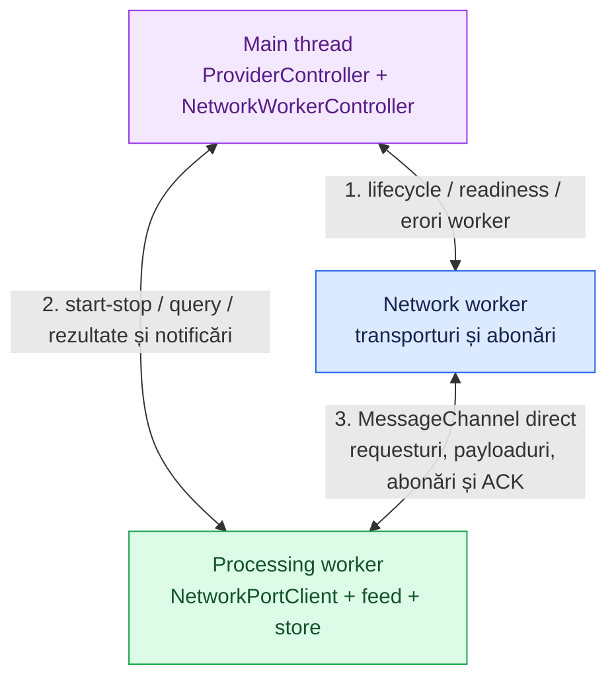
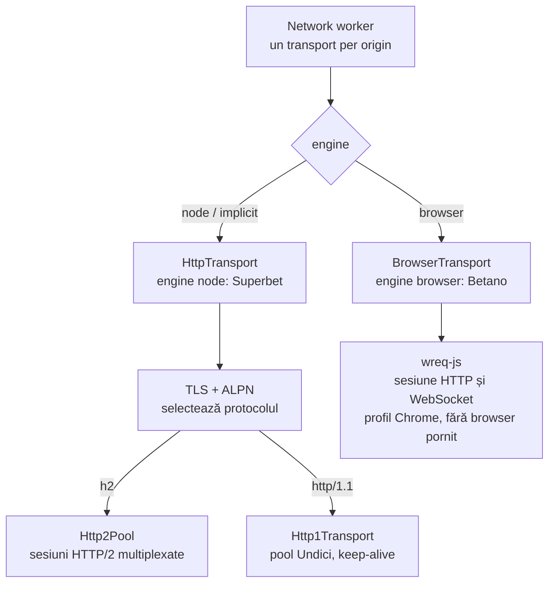
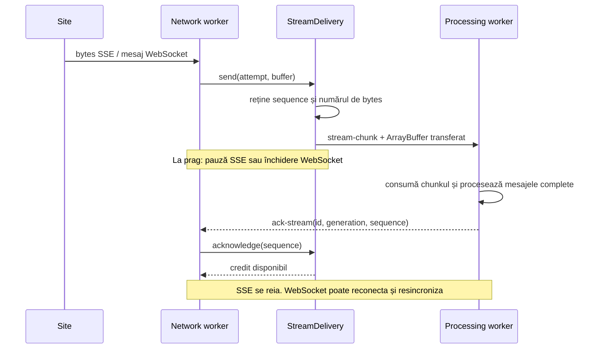

# Network — conexiuni și comunicare

[Ansamblul proiectului](../README.md) · [Provideri și sincronizare](PROVIDERS.md)

Modulul `src/network` execută cereri și livrează payloaduri. Providerul decide **ce date cere și ce înseamnă ele**; networkingul decide **cum deschide, reutilizează și închide conexiunile**.

## Componentele și motivul separării

| Componentă                                                      | Rol și motiv                                                                                                                          |
| --------------------------------------------------------------- | ------------------------------------------------------------------------------------------------------------------------------------- |
| [controller.ts](../src/network/controller.ts)                   | `NetworkWorkerController` rulează pe main thread. Creează workerul, așteaptă readiness și gestionează oprirea/failurile.              |
| [workers/worker.ts](../src/network/workers/worker.ts)           | Deține transporturile per origin, registrele de polling/SSE, socketurile și livrările către consumator.                               |
| [workers/port-client.ts](../src/network/workers/port-client.ts) | `NetworkPortClient` rulează în processing worker. Trimite comenzi direct networkingului și asociază răspunsurile cu promisiunile lor. |
| `transports/`                                                   | Execută HTTP și gestionează conexiunile. Alegerea engine-ului este separată de abonări și procesarea datelor.                         |
| `streaming/`                                                    | Supraveghează conexiunile SSE/WebSocket, reîncercările și creditul de bytes.                                                          |
| `polling/`                                                      | Repetă requesturi independente când un consumator are nevoie de polling.                                                              |
| `model/`                                                        | Contracte pentru requesturi, transporturi, mesaje și configurare.                                                                     |

Controllerul și port clientul sunt două capete diferite: primul deține **ciclul de viață al workerului**, al doilea deservește **traficul direct al procesării**. Registry-urile dețin operațiile după ID, astfel încât să poată opri un meci sau toate operațiile fără a închide accidental conexiunile altor meciuri.

## Comunicarea între threaduri

În integrarea providerilor există trei canale:

Controllerul providerului creează `MessageChannel` și transferă câte un port fiecărui worker. Mesajele de date și răspunsurile se întorc pe portul de pe care a venit comanda. Astfel, un HTTP body sau un chunk SSE nu trebuie retransmis prin main thread.

Networkingul poate fi folosit și separat, prin `NetworkWorkerController.startLoop()` sau `startSubscription()` cu handlers pe main thread. Aceasta este calea generică; providerii folosesc portul direct pentru procesarea lor.

### Cele trei moduri de lucru

| Mod          | Comenzi                                                                                    | Comportament                                                                                                                                       |
| ------------ | ------------------------------------------------------------------------------------------ | -------------------------------------------------------------------------------------------------------------------------------------------------- |
| Request unic | `request`                                                                                  | Întoarce status, headers și body complet, fără parsare JSON. Folosit pentru discovery și snapshoturi.                                              |
| Polling      | `start-loop`, `stop-loop`                                                                  | Maximum un request activ în fiecare buclă. La succes continuă imediat sau după interval; la eșec așteaptă retry. Buclele nu se așteaptă între ele. |
| Streaming    | `start-subscription` / `stop-subscription`; `start-socket` / `send-socket` / `stop-socket` | Conexiune persistentă, mesaje de lifecycle și livrare incrementală.                                                                                |

`commandId` corelează comanda cu `command-success`, `command-error` sau `request-response`. Confirmarea unei abonări înseamnă că a fost înregistrată; deschiderea efectivă este anunțată separat prin `stream-open`. `ack-stream` eliberează credit și nu primește o altă confirmare.

## Transporturile: două engine-uri, același contract HTTP

### Engine-ul Node

[transport.ts](../src/network/transports/transport.ts) este fațada comună. [tls.ts](../src/network/transports/tls.ts) deschide TLS, verifică certificatul și negociază HTTP/2 sau HTTP/1.1 prin **ALPN în handshake-ul TLS**. Socketul negociat este reutilizat de transportul selectat.

| Piesă                   | Ce rezolvă                                                                                                                                     |
| ----------------------- | ---------------------------------------------------------------------------------------------------------------------------------------------- |
| `http2/http2-pool.ts`   | Distribuie operațiile după capacitatea anunțată de server. Refolosește sesiunile și deschide altele când sunt necesare, în limita configurată. |
| `http2/http2.ts`        | Gestionează o sesiune HTTP/2, streamurile active și schimbările de stare, inclusiv GOAWAY.                                                     |
| `http2/http2-stream.ts` | Controlează corpul unui răspuns incremental: pauză, reluare și anulare pentru acel stream.                                                     |
| `http1/http1.ts`        | Pool Undici cu keep-alive și `pipelining: 1`; fiecare request activ ocupă o conexiune.                                                         |
| `http1/http1-stream.ts` | Livrează incremental corpul unei conexiuni HTTP/1.1.                                                                                           |

**Un SSE per meci nu implică o conexiune TCP per meci pe HTTP/2.** Mai multe streamuri împart o sesiune. Poolul păstrează implicit un slot pentru requesturi scurte în fiecare sesiune, când limita serverului permite, ca discovery și reparațiile REST să aibă loc lângă SSE-urile persistente.

Sesiunile care primesc GOAWAY nu mai primesc operații noi. Streamurile existente pot termina, iar operațiile noi folosesc alte sesiuni. Limita de conexiuni privește sesiunile care acceptă trafic nou; cele în curs de golire se închid separat.

Pe HTTP/1.1 nu există multiplexare ca în HTTP/2. Un SSE ocupă conexiunea până la închidere; poolul trebuie dimensionat pentru abonări **și** requesturile REST. Capacitatea conexiunilor și limitele serverului pot pune operațiile în așteptare, chiar dacă buclele lor sunt independente.

### Engine-ul browser

[browser-transport.ts](../src/network/transports/browser-transport.ts) folosește `wreq-js` cu un profil Chrome/Windows pentru compatibilitatea cerută de Betano. Nu pornește Chrome și nu depinde de browserul utilizatorului sau de MCP.

HTTP folosește o sesiune nativă reutilizabilă; WebSocketurile folosesc același profil și pot primi cookies din acea sesiune. Poolingul și negocierea HTTP sunt administrate de bibliotecă, separat de `Http2Pool`. Limitele poolului Node nu configurează poolul nativ `wreq-js`.

`BrowserTransport` oferă requesturi complete și `openSocket()`; calea generică SSE folosește transportul Node. În ambele engine-uri, parsarea cotelor și regulile providerului sunt în processing worker. Decompresia de transport pe care o face biblioteca nativă este distinctă de decodarea LZ4 a mesajelor Betano.

## Livrarea și controlul fluxului

Un chunk SSE este un fragment arbitrar de bytes: poate conține o parte de mesaj sau mai multe mesaje. Networkingul îl transferă fără să caute evenimente SSE sau să parseze JSON. WebSocketurile livrează payloadul mesajelor prin aceeași familie de mesaje `stream-*`.

[StreamDelivery](../src/network/streaming/stream-delivery.ts) numără bytes trimiși, dar neconfirmați. `ArrayBuffer` este transferat între workeri, schimbând proprietarul memoriei la acea graniță. Pot exista în continuare alocări și copii în transport, decodoare sau notificările către main thread.

ACK confirmă consumul fragmentului, chiar dacă decoderul așteaptă alte fragmente pentru a completa un mesaj SSE. Nu așteaptă completarea întregului eveniment și nici executarea handlerilor de pe main thread.

| Identificator | De ce există                                                                                  |
| ------------- | --------------------------------------------------------------------------------------------- |
| `id`          | Identifică abonarea logică: un meci Superbet sau un grup Betano.                              |
| `generation`  | Distinge o abonare recreată sub același ID. Un ACK vechi nu eliberează bytes ai noii abonări. |
| `attempt`     | Distinge reconectările aceleiași abonări. Scrierile WebSocket verifică tentativa curentă.     |
| `sequence`    | Identifică fragmentul confirmat. ACK-urile duplicate nu scad creditul de două ori.            |

`maxInFlightBytes` este un prag de oprire, nu o limită exactă: ultimul fragment acceptat îl poate depăși. Este credit între networking și consumator, nu un plafon pentru toată memoria procesului sau pentru callbacks pe main thread.

**SSE:** citirea acelui stream poate fi oprită și reluată după ACK. **WebSocket:** biblioteca folosită nu oferă pauză la citire; atingerea pragului închide socketul, așteaptă credit și permite reconectarea. Providerul repară apoi starea evenimentelor afectate.

## Reîncercări, timeouturi și oprire

| Situație                                                                      | Responsabilitate                                                                                                      |
| ----------------------------------------------------------------------------- | --------------------------------------------------------------------------------------------------------------------- |
| Conexiune nativă indisponibilă                                                | `HttpTransport` partajează încercarea de reconectare între apelanți; poolul HTTP/2 înlocuiește sesiunile individuale. |
| Request complet lent                                                          | Deadline pentru așteptare și I/O. Un request eșuat este raportat; providerul sau bucla decide reîncercarea.           |
| SSE: EOF sau eroare                                                           | `ReconnectingSseSubscription` reîncearcă după delay. EOF curat este diferit de o eroare de transport.                 |
| SSE: HTTP 204                                                                 | Încheie permanent acea abonare și emite `stream-stopped`.                                                             |
| WebSocket: deschidere lentă, inactivitate, închidere sau depășirea creditului | `ReconnectingSocket` închide tentativa și supraveghează reconectarea.                                                 |
| Mesaje lipsă sau date nevalide                                                | Providerul invalidează și repară cotele; transportul nu cunoaște versiunile meciului.                                 |
| HTTP 429/503 și `Retry-After`                                                 | Providerul aplică un cooldown comun cererilor sale REST.                                                              |

Timeoutul de headers SSE limitează deschiderea, nu întreaga viață a streamului. Supravegherea inactivității Superbet este în feed; pentru WebSocket, deadline-ul de inactivitate este în networking, iar heartbeat-ul SignalR este în procesare.

La oprire, networkingul refuză operații noi, anulează pollingul și abonările, apoi închide transporturile și porturile. Providerul solicită mai întâi procesării să-și elibereze abonările. Promisiunile și timerele de lifecycle împiedică dublarea pornirii/opririi și permit raportarea eșecurilor de cleanup.

## Configurarea efectivă

[network/config.ts](../src/network/config.ts) rămâne o configurație demonstrativă pentru `nodejs.org`. **Providerii construiesc propriile setări pentru network worker din `providers/<site>/config.ts`.** Pentru trafic real se modifică acele configurări sau opțiunile constructorului providerului.

La Superbet contează în special numărul conexiunilor HTTP/1.1, plafonul sesiunilor HTTP/2 și creditul per SSE. La Betano contează gruparea meciurilor pe socket, limita mesajelor și creditul per socket. Valorile actuale și efectul lor asupra sincronizării sunt în [Providers](PROVIDERS.md#configurări-care-contează).
