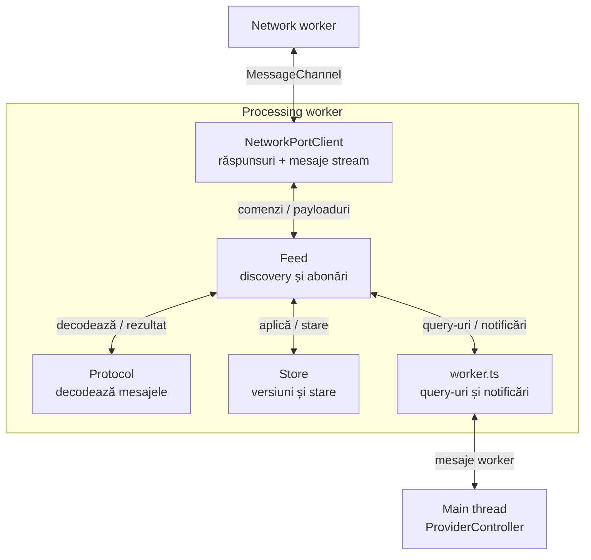
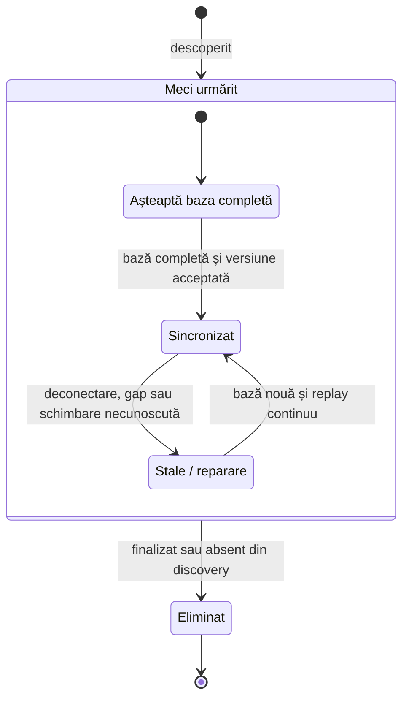
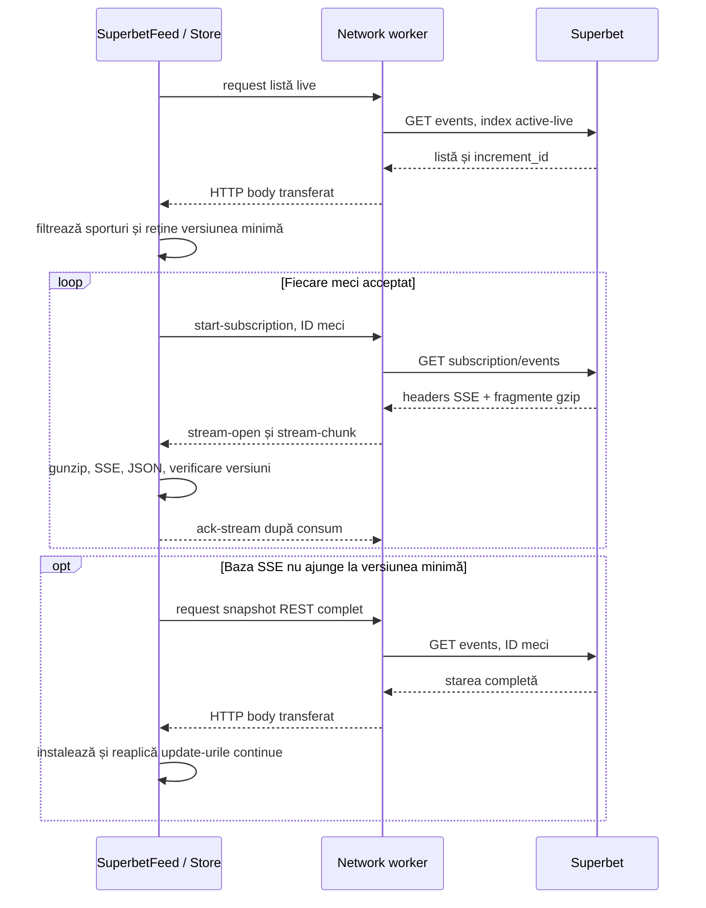
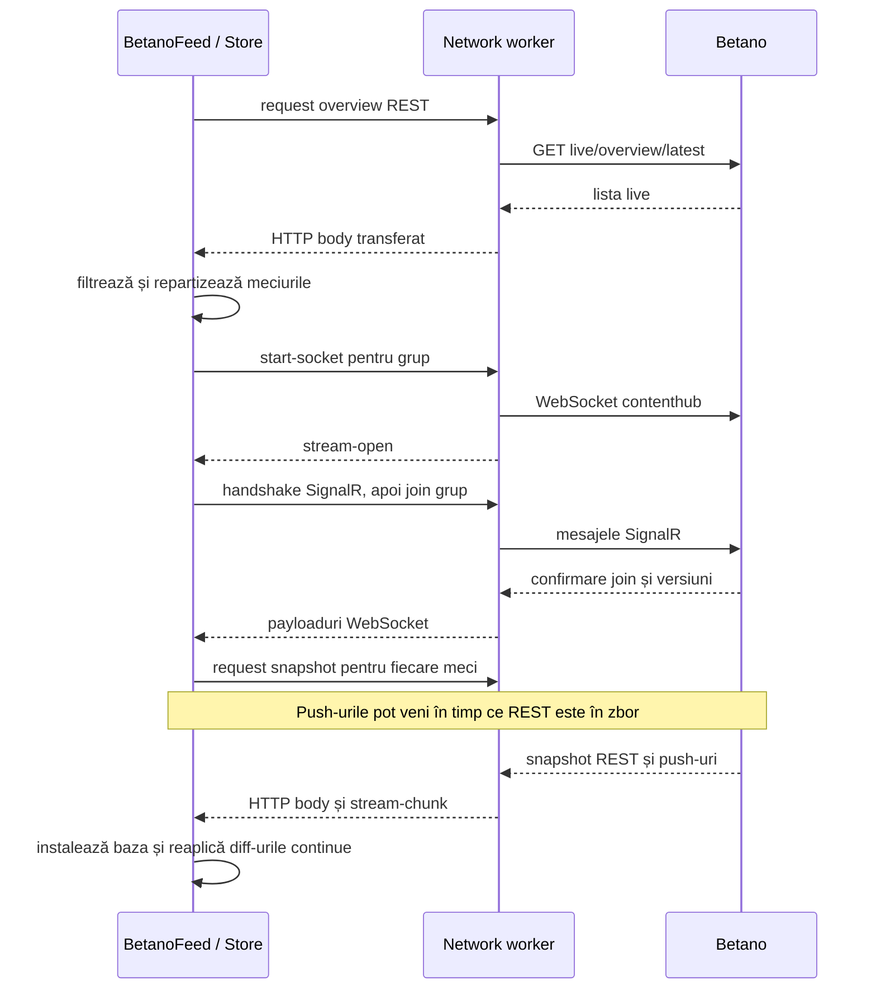

# Providers — de la mesaje la starea cotelor

[Ansamblul proiectului](../README.md) · [Conexiuni și comunicare](NETWORK.md)

Un provider este integrarea completă a unui site: știe unde găsește meciurile, cum se abonează la ele, cum interpretează mesajele și când starea cotelor poate fi folosită. Superbet și Betano folosesc aceeași infrastructură de networking, dar protocoale și modele de date diferite.

## Piesele unui provider

Ambele foldere, `src/providers/superbet` și `src/providers/betano`, au aceeași organizare:

| Piesă                     | Unde rulează              | Responsabilitate                                                                                    |
| ------------------------- | ------------------------- | --------------------------------------------------------------------------------------------------- |
| `controller.ts`           | Main thread               | API public, configurare, crearea celor doi workeri, canale, query-uri și cleanup.                   |
| `workers/worker.ts`       | Processing worker         | Leagă portul de networking de feed; răspunde main threadului și publică notificări.                 |
| `processing/feed.ts`      | Processing worker         | Descoperă și filtrează meciurile, gestionează abonările și programează snapshoturile/reîncercările. |
| `processing/state.ts`     | Processing worker         | Store-ul: starea fiecărui meci, aplicarea schimbărilor și verificarea versiunilor.                  |
| `protocol/`               | Processing worker         | Decodarea specifică siteului: SSE/gzip sau SignalR/LZ4, plus erorile HTTP specifice.                |
| `model/`                  | Contracte TypeScript      | Formele opțiunilor, datelor, mesajelor și handlerilor.                                              |
| `config.ts`, `logging.ts` | Configurare / main thread | Valorile implicite și raportarea concisă în consolă.                                                |

Feed-ul decide **când cere date**, protocolul decide **cum le citește**, iar store-ul decide **cum schimbă starea**. Sunt obiecte în același processing worker; fiecare fișier nu creează un thread separat.

Diagrama arată responsabilitățile. În cod, feed-ul leagă decodoarele și callbackurile store-ului, iar `workers/worker.ts` transmite rezultatele către controller. Query-urile cer starea store-ului prin worker.

## API-ul comun și comunicarea cu aplicația

| Apel / handler           | Semnificație                                                                                                    |
| ------------------------ | --------------------------------------------------------------------------------------------------------------- |
| `start()`                | Pornește workerii, discovery și înregistrarea abonărilor. Nu așteaptă sincronizarea tuturor cotelor.            |
| `stop()`                 | Oprește feed-ul și processing workerul, apoi networkingul. O instanță oprită nu se repornește; se creează alta. |
| `getEvents()`            | Meciurile urmărite; prezența în listă nu garantează un snapshot disponibil.                                     |
| `getSnapshot(id)`        | Starea sincronizată sau `null` dacă lipsește ori este invalidată. La Superbet se cere și un SSE conectat.       |
| `getStats()`             | Numărul de meciuri, starea abonărilor și contoarele de procesare/recuperare.                                    |
| `reconnect()`            | Repornește abonările și declanșează resincronizarea.                                                            |
| `onEvents`, `onRemove`   | Lista după discovery și eliminarea unui meci.                                                                   |
| `onSnapshot`, `onUpdate` | Starea completă, apoi actualizările acceptate de store.                                                         |
| `onStatus`, `onError`    | Conectare, deconectare, `event-stale`, statistici și erori.                                                     |

Snapshoturile și actualizările sunt copiate către main thread **numai dacă există handlerul corespunzător**. Query-urile copiază rezultatul cerut. Store-ul se actualizează în processing worker indiferent dacă aplicația ascultă notificările.

La `event-stale`, un consumator care păstrează propria copie trebuie să o invalideze și să aștepte un nou `onSnapshot`. A rămâne cu ultimul preț afișat nu îl face sincronizat. Handlerii de pe main thread nu au același mecanism de credit ca payloadurile brute dintre workeri.

### Starea unui meci

**Snapshot** înseamnă baza completă; **update/diff**, o schimbare aplicată acelei baze; **stale**, o stare care nu mai poate fi expusă drept sincronizată.

În `Waiting` și `Repair`, `getSnapshot()` întoarce `null`. În `Current`, următoarea versiune validă păstrează meciul sincronizat. Duplicatele și versiunile vechi sunt ignorate. O versiune lipsă invalidează starea; actualizările ulterioare sunt păstrate într-un buffer limitat și reaplicate numai când formează o secvență continuă după noul snapshot. Dacă bufferul se umple, rămâne necesară repararea; nu se expune o stare incompletă.

Nu există o limită de 100 de meciuri în logica providerilor. Creșterea numărului de meciuri este gestionată prin abonări, pooluri și cozi cu limite, fără thread per meci.

## Superbet: un SSE pentru fiecare meci

[Controller](../src/providers/superbet/controller.ts) · [Feed](../src/providers/superbet/processing/feed.ts) · [Store](../src/providers/superbet/processing/state.ts) · [Decoder](../src/providers/superbet/protocol/sse.ts)

Discovery folosește ID-urile `5` pentru fotbal, `4` pentru baschet și `2` pentru tenis. Feed-ul cere evenimente active live, apoi verifică sportul și statusul `STARTED`; exclude evenimentele finalizate și outright. Repetă reconcilierea la cinci minute și elimină meciurile finalizate și prin mesajele SSE.

### Traseul inițial și actualizările

Blocul `loop` reprezintă același flux pentru mai multe abonări independente, active concurent. Pe HTTP/2, aceste SSE-uri pot împărți conexiunile TCP. Fiecare meci are propria coadă de procesare, astfel încât ordinea fragmentelor sale să fie păstrată fără a aștepta decomprimarea altui meci.

### De ce sunt necesare baza REST și verificarea versiunilor

SSE poate începe cu date din cache mai vechi decât lista REST. Providerul reține `increment_id` din discovery drept versiune minimă și nu publică o bază mai veche. Dacă mesajele nu ajung la acea versiune în zece secunde, cere un snapshot REST; un gap poate declanșa repararea mai devreme.

La reconectare invalidează baza veche. `revision` respinge snapshoturi REST pornite pe conexiunea anterioară, iar `epoch` și suspendarea acceptării mesajelor protejează restarturile explicite de fragmente rămase în coadă. Aceste verificări completează identificatorii de livrare din networking.

### Semantica datelor care contează

- SSE este text încadrat în evenimente, transportat de regulă cu gzip. Decoderul gestionează fragmente, UTF-8 împărțit, comentarii și separatori de linii; limitează dimensiunea decodată a unui eveniment.
- `is_full_market_update` înlocuiește piețele obișnuite. `superbets` și `priceboosts` au colecții și indicatori de înlocuire separați.
- Piețele sunt identificate prin ID **și nume**; selecțiile, prin UUID. Schimbările parțiale păstrează câmpurile omise, iar `display: false` elimină o selecție.
- Zero piețe **și** zero cote live declarate explicit reprezintă o stare validă, cu liste goale, chiar dacă lipsește indicatorul de actualizare completă. Lipsa unui câmp, singură, nu dovedește o bază completă.
- Prețul și `status` rămân în forma vendorului. Trebuie luate în calcul și suspendarea selecției și starea ofertei evenimentului.

EOF curat provoacă redeschiderea SSE și resincronizare; nu este numărat drept eroare de transport. Inactivitatea prelungită provoacă restart. Un `stream-stopped` permanent, inclusiv cazul HTTP 204, elimină evenimentul urmărit fără o buclă imediată de reconectare; discovery ulterior îl poate găsi din nou.

### Endpointurile folosite

Origin implicit: `https://production-superbet-offer-ro.freetls.fastly.net`.

| Scop             | Cale                                                           |
| ---------------- | -------------------------------------------------------------- |
| Discovery        | `/v3/ro-RO/events?index=active-live&startDate=...&endDate=...` |
| Snapshot complet | `/v3/ro-RO/events?events=<id>`                                 |
| SSE per meci     | `/v3/subscription/ro-RO/events?events=<id>`                    |

Intervalul discovery acoperă șapte zile în urmă până la începutul zilei UTC următoare. Lista este filtrată la live după răspuns; intervalul nu schimbă frecvența de refresh.

## Betano: WebSocketuri cu grupuri de meciuri

[Controller](../src/providers/betano/controller.ts) · [Feed](../src/providers/betano/processing/feed.ts) · [Store](../src/providers/betano/processing/state.ts) · [SignalR](../src/providers/betano/protocol/signalr.ts) · [LZ4](../src/providers/betano/protocol/compression.ts)

Discovery selectează sporturile `FOOT`, `BASK`, `TENN`, cu `isLive: true` și fără `isEnded: true`. Zonele identificate ca virtuale sau esports sunt excluse.

Providerul folosește un socket de **overview** și socketuri de evenimente cu maximum **50 de meciuri fiecare**, implicit. Overview-ul urmărește apariții și eliminări; celelalte socketuri urmăresc versiunile și schimbările meciurilor. Grupurile își păstrează membrii când este posibil și sunt eliberate când devin goale.

### Abonarea înaintea snapshotului

Feed-ul face join, apoi cere snapshoturile pentru membrii grupului. Astfel, push-urile primite în timpul cererii REST pot fi reținute și reaplicate peste versiunea snapshotului. Varianta cu un singur REST, urmat abia apoi de abonare, ar lăsa un interval între cele două surse.

### Straturile protocolului

| Strat        | Rol                                                                                                                                  |
| ------------ | ------------------------------------------------------------------------------------------------------------------------------------ |
| WebSocket    | Conexiunea și livrarea payloadurilor; supravegheate de networking.                                                                   |
| SignalR JSON | Handshake, separarea înregistrărilor cu `0x1e`, apeluri `join`/`leave`, confirmări și heartbeat; procesate în workerul de procesare. |
| Base64 + LZ4 | Conținutul comprimat al notificărilor de diff este decodat înainte de verificarea datelor.                                           |
| Store        | Aplică tipurile de schimbări cunoscute, verifică versiuni și cere reparare pentru gap-uri sau schimbări neacceptate.                 |

`NewLiveEventDiff` actualizează meciurile; `NewLiveOverviewDiffs` poate elimina evenimente sau programa discovery, cu o scurtă grupare a semnalelor apropiate. `OnActiveLiveEventVersion` semnalează versiunea pe care trebuie să o atingă starea locală.

La deconectarea unui socket sunt invalidate meciurile lui. După handshake și join se cer baze noi. La deschiderea noii conexiuni se schimbă revizia, iar răspunsurile REST din revizia anterioară sunt ignorate. Resetul de eveniment permite și refacerea bazei după restartarea numerotării versiunilor. Un reset global declanșează repararea stărilor și discovery.

Store-ul păstrează separat evenimentul, piețele și selecțiile. Aplică prețuri, suspendări, adăugări/eliminări, ordonare și metadate cunoscute; nu presupune că un tip necunoscut poate fi ignorat în siguranță. Consumatorul primește diff-ul original acceptat sau un snapshot nou după reparare.

### Endpointurile folosite

Origin implicit: `https://ro.betano.com`. Requesturile HTTP folosesc `x-language: 4`, `x-operator: 3` și `Accept: application/json`.

| Scop            | Cale / apel                                                                                        |
| --------------- | -------------------------------------------------------------------------------------------------- |
| Discovery       | `/danae-webapi/api/live/overview/latest?includeVirtuals=false&queryLanguageId=4&queryOperatorId=3` |
| Snapshot        | `/danae-webapi/api/live/events/<id>/latest`                                                        |
| WebSocket       | `/contenthub?platformType=1`                                                                       |
| Grup overview   | `joinLiveOverviewGroupWithOptions`                                                                 |
| Grup de meciuri | `joinLiveEventGroup`; eliminare prin `leaveLiveEventGroup`                                         |

Transportul browser folosește `wreq-js`, nu browserul utilizatorului. Conexiunea WebSocket, sesiunea SignalR și sincronizarea meciurilor sunt trei stări distincte: deschiderea primei nu le garantează pe celelalte.

## Configurări care contează

Valorile implicite sunt în [Superbet config](../src/providers/superbet/config.ts) și [Betano config](../src/providers/betano/config.ts); constructorii acceptă suprascrieri parțiale.

| Opțiune / comportament       | Superbet                           | Betano                                        | De ce contează                                                            |
| ---------------------------- | ---------------------------------- | --------------------------------------------- | ------------------------------------------------------------------------- |
| Discovery complet            | 5 minute                           | 5 minute + semnale overview                   | Reconciliere a meciurilor urmărite.                                       |
| Abonări                      | 1 SSE / meci                       | 1 overview + grupuri de 50                    | Costul conexiunilor și aria afectată de o reconectare.                    |
| Request timeout              | 10 s                               | 10 s                                          | Limitează cererile REST și așteptările de deschidere relevante.           |
| Retry de bază                | 1 s                                | 1 s                                           | Evită o buclă imediată la eșec. Reparațiile REST au backoff până la 30 s. |
| Snapshoturi REST concurente  | 8                                  | 8                                             | Controlează încărcarea în timpul recuperării.                             |
| Actualizări în buffer / meci | 256                                | 256                                           | Păstrează schimbările în zbor cu o limită de număr.                       |
| Credit de date brute         | 256 KiB / SSE                      | 1 MiB / socket                                | Limitează bytes neconfirmați între workeri.                               |
| Limită mesaj decodat         | 32 MiB                             | 32 MiB                                        | Protejează parsarea/decompresia; este diferită de creditul brut.          |
| Recuperare bază inițială     | REST după 10 s fără catch-up       | REST după join                                | Obține o bază utilizabilă fără a aștepta indefinit un push.               |
| Supraveghere inactivitate    | 45 s, verificare periodică în feed | 45 s în networking; heartbeat SignalR la 15 s | Detectează conexiuni care nu mai livrează.                                |

La Superbet, poolul Node permite implicit 8 sesiuni HTTP/2 care acceptă operații noi și un slot rezervat REST pe sesiune când este posibil. Fallback-ul HTTP/1.1 are 256 de conexiuni configurate; la extindere trebuie să rămână loc pentru REST pe lângă SSE-uri. Betano folosește poolul nativ al bibliotecii, nu acest pool Node.

La HTTP 429/503, ambele feed-uri respectă `Retry-After` printr-un cooldown REST comun providerului. Abonările deja deschise nu sunt oprite de acel cooldown.

## Cum citim statisticile și limitele actuale

`events` arată câte meciuri sunt urmărite; `synchronizedEvents`, câte au starea disponibilă. Diferența poate apărea la pornire, deconectare sau reparare, fără ca fiecare astfel de caz să fie o eroare HTTP.

La Superbet, `reconnects` include redeschideri după EOF curat; `streamErrors`, `snapshotErrors` și `decodeErrors` separă tipurile de eșec. La Betano, `connectedSockets` reflectă sesiunile SignalR pregătite, iar `resynchronizations` numără invalidările unor stări anterior sincronizate. Ambele publică statistici periodic, la cinci secunde.

Providerii păstrează starea în memorie și folosesc API-uri nedocumentate ale siteurilor. Nu persistă istoric și nu oferă încă un model unic de cote între case. Testele din [test](../test) acoperă protocoalele, ordinea versiunilor, recuperarea și anularea operațiilor; verificarea accesului real și a latenței sursei este o verificare live separată.
