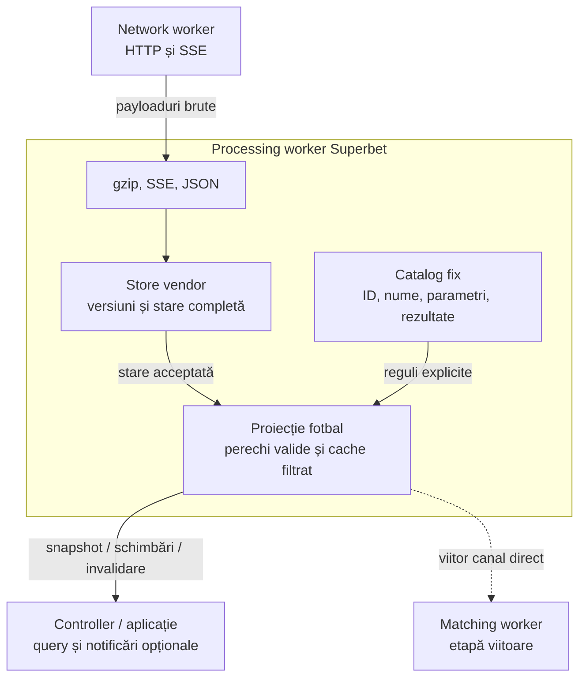
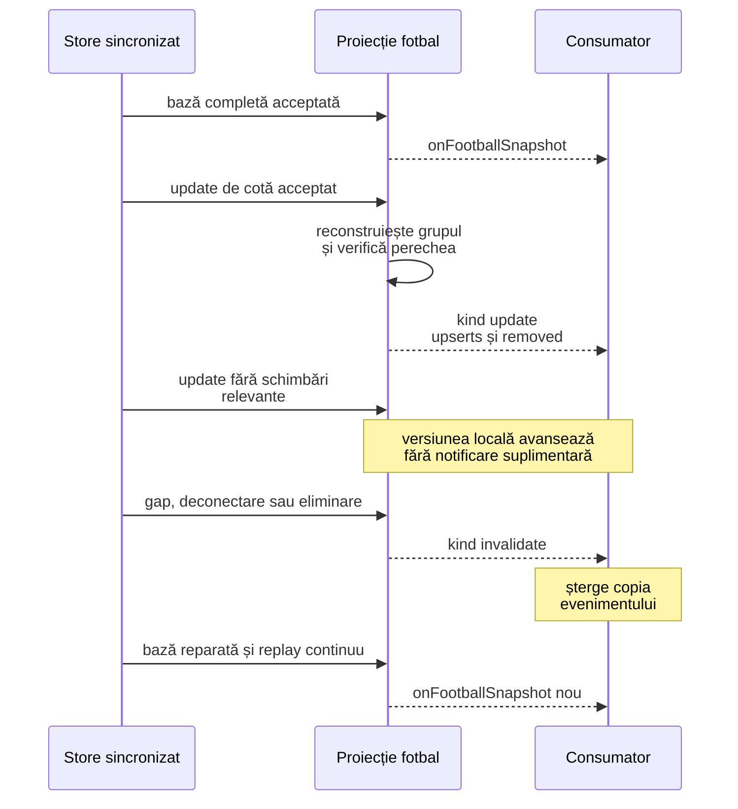

# Superbet fotbal — catalog și model filtrat

[Ansamblu](../README.md) · [Provideri](PROVIDERS.md) · [Contract Superbet](contracts/SUPERBET.md)

Procesarea Superbet păstrează o vedere structurată a piețelor de fotbal recunoscute. **Fiecare linie publicată are exact două selecții distincte**, cu roluri verificate. Catalogul nu face matching între site-uri.

## 1. Unde rulează și ce este implementat

Filtrarea rulează în workerul de procesare existent. Numărul de workeri rămâne neschimbat. Store-ul vendor rămâne baza pentru patchuri și verificarea versiunilor; cache-ul filtrat conține numai datele necesare ieșirii. Nu se filtrează bytes comprimați înainte de decodare.

Providerul activ descoperă în continuare numai meciuri live. Proiecția poate interpreta și snapshoturi prematch complete, cum au fost cele folosite pentru verificarea catalogului; acest pas nu adaugă discovery sau abonare prematch.

## 2. Catalog explicit și regula exact două

Configurația este în [football-markets.config.ts](../src/providers/superbet/football-markets.config.ts). Conține **165 de definiții**, verificate pe răspunsurile publice pentru Chelsea–Tottenham, Napoli–AS Roma, Barcelona–Real Madrid, RB Leipzig–Elversberg, Paderborn–Hamburger și FC Koln–Schalke, la 24 octombrie 2026.

Fiecare definiție fixează ID-ul vendor, șablonul exact al numelui, tipul statisticii, perioada, echipa vizată, parametrii acceptați și cele două perechi `outcome_id → rol`. Nu clasificăm automat o piață nouă după cuvinte precum „total” sau „handicap”.

Placeholder-ele sunt limitate la:

- `<HOME_TEAM>` și `<AWAY_TEAM>`: numele exacte din fixture.
- `<FROM>` și `<TO>`: minutele întregi din parametrii structurați ai piețelor pe interval.

Prefixele pentru reprize și variantele de nume sunt declarate individual; existența unei variante R1 nu creează automat una R2. Parametrii, cotele și intervalele sunt valori ale instanței; tipul pieței și regulile sale rămân fixe.

O piață vendor poate avea multe linii. „Total goluri” cu 0.5, 1.5 și 2.5 este eligibil dacă fiecare linie are perechea sa Sub/Peste. **Nu cerem ca întregul obiect `markets[]` să aibă numai două odds.**

Filtrul verifică, în ordine:

1. Fotbal, două nume valide de echipe și fază `STARTED` sau `NOT_STARTED`; oferta încheiată este exclusă.
2. ID de piață prezent în catalog și identificatori de selecție/linie valizi.
3. Selecții din faza curentă: `offer_state_id: 1` prematch, respectiv `2` live. Fazele nu se combină.
4. Grupare după `market_line_uuid` în cadrul pieței.
5. Exact două selecții, cu UUID-uri diferite și exact cele două rezultate configurate. Ordinea primită și textele selecțiilor nu stabilesc rolurile.
6. Ambele selecții au `display: true`. O selecție ascunsă elimină linia, nu produce o pereche parțială.
7. Parametrii celor două selecții corespund, iar numele instanței coincide exact cu șablonul completat.

Selecțiile suspendate intră în verificarea cardinalității. O piață cu trei rezultate nu devine eligibilă dacă unul este suspendat sau ascuns. Handicapul european și celelalte piețe cu trei rezultate nu sunt în catalog. Piețele cu un singur „Da”, combinațiile de tip GG & total, piețele pe jucători și promoțiile nu sunt incluse.

Tipul „Fiecare echipă va primi peste X cartonașe” are ambele rezultate în catalog, dar fiecare prag este verificat separat: o linie cu numai „Da” este exclusă.

### Parametri și handicap

- `specifiers.total`: prag numeric nenegativ, separat de cota selecției.
- `specifiers.hcp`: handicap numeric orientat către gazde. Selecția gazdelor folosește valoarea, iar a oaspeților valoarea opusă; zero este păstrat ca zero.
- `specifiers.from/to`: minute inclusive, între 0 și 89, cu durată și aliniere conforme definiției. De exemplu, 30–39 corespunde textului 30:00–39:59. Variantele de prelungiri cu o reprezentare diferită necesită verificare și configurare explicită.
- `specifiers.xnr`: primele X minute, întreg între 1 și 90.

Se folosesc numai parametrii structurați verificați. Parametrii suplimentari, lipsă, de tip greșit sau incompatibili între cele două selecții exclud linia. `special_bet_value` poate combina mai multe valori într-un singur text și nu este folosit drept număr generic. Un handicap european precum `0:1` nu este convertit într-un handicap cu două rezultate.

`status` rămâne valoarea vendorului; perechea completă nu dovedește disponibilitatea. Consumatorul verifică și starea ofertei, statusul selecțiilor și sincronizarea. Un preț zero sau suspendat nu este înlocuit cu o cotă inventată.

## 3. Ce păstrăm

Interfețele sunt în [football-projection.interfaces.ts](../src/providers/superbet/model/football-projection.interfaces.ts); definițiile catalogului sunt în [football-markets.interfaces.ts](../src/providers/superbet/model/football-markets.interfaces.ts).

| Nivel            | Date păstrate                                                                                                                              |
| ---------------- | ------------------------------------------------------------------------------------------------------------------------------------------ |
| Snapshot filtrat | Provider, eveniment, versiune sursă, momentul proiecției și liniile eligibile.                                                             |
| Eveniment        | ID, ID-urile și numele gazdelor/oaspeților, competiție și categorie, început UTC, fază, stare ofertă, scor, perioadă, minut și prelungiri. |
| Linie            | Cheie, ID de piață, UUID de linie, fază ofertă, prag/handicap și parametrii de timp aplicabili.                                            |
| Selecție         | UUID, outcome ID, rol fix, cotă, status, display și handicapul semnat pentru selecția respectivă.                                          |

Cheia liniei este `marketId:offerStateId:market_line_uuid`. Numărul vendor de piață, singur, nu identifică un prag. UUID-ul selecției identifică obiectul actualizat; outcome ID-ul identifică rolul și se poate repeta între linii.

Statistica, perioada, echipa vizată și numele șablonului se citesc din catalog prin `marketId`; nu sunt duplicate în fiecare update. Metadatele vendor complete, textele explicative și etichetele promoționale nu sunt copiate în modelul filtrat.

`projectedAt` este timpul local al proiecției, în milisecunde Unix. **Nu este timpul publicării la Superbet, al recepției în network worker sau o măsurare a latenței end-to-end.** Un eveniment sincronizat fără linii eligibile are snapshot cu `lines: []`; `null` înseamnă că proiecția nu este disponibilă.

## 4. Snapshot, schimbări și invalidare

API-ul Superbet adaugă:

| API                            | Contract                                                                                              |
| ------------------------------ | ----------------------------------------------------------------------------------------------------- |
| `getFootballSnapshot(eventId)` | Copie filtrată sau `null` pentru eveniment lipsă, alt sport, deconectat ori nesincronizat.            |
| `onFootballSnapshot(snapshot)` | Bază filtrată completă, inițial și după resincronizare. Înlocuiește copia anterioară a evenimentului. |
| `onFootballUpdate(change)`     | Schimbări relevante sau invalidarea întregului eveniment.                                             |

Pe un update acceptat de store, proiecția reconstruiește numai grupurile vendor afectate și compară liniile lor. Un `upsert` conține întreaga linie compactă cu cele două selecții; consumatorul o înlocuiește după cheie. `removed` conține cheile care trebuie șterse. O schimbare de scor/minut/date meci poate include `event`, fără retrimiterea liniilor neschimbate.

O linie care pierde un membru este eliminată complet. Înlocuirile integrale și declararea explicită a ofertei goale elimină și liniile care nu mai apar. La gap, deconectare, metadate de eveniment neproiectabile, eliminare sau oprire, `kind: "invalidate"` cere ștergerea întregului eveniment filtrat; consumatorul așteaptă o bază nouă.

`sourceVersion` aparține fluxului vendor. Poate să sară între notificări filtrate, deoarece updateurile irelevante nu sunt transmise. La invalidare poate desemna ultima versiune cunoscută. **Nu este o secvență proprie de livrare și nu trebuie verificată ca un șir consecutiv de mesaje filtrate.**

Publicarea prin controller este opțională și nu schimbă API-ul brut `getSnapshot/onSnapshot/onUpdate`. Handlerii pentru snapshot și update filtrat se înregistrează împreună dacă aplicația menține o copie. Fără handlerul de snapshot filtrat, nu se construiește pentru export un tablou complet de linii doar pentru a-l arunca.

În această etapă, notificările merg prin canalul existent processing–controller. **Matching workerul, canalul său direct, ACK-urile și combinarea valorilor în așteptare nu sunt încă implementate.** Acestea sunt transportul etapei următoare; filtrarea nu adaugă acum un worker sau un timer de grupare. Consumatorul actual nu primește o garanție de coadă limitată pentru notificările prin main thread.

## 5. Catalogul verificat

Prezența în catalog nu garantează oferta la fiecare meci sau în fiecare moment. Denumirile și ID-urile sunt specifice Superbet; nu reprezintă încă o schemă comună cu Betano.

| ID piață | Șablon exact                                                                      | Rezultate       |
| -------- | --------------------------------------------------------------------------------- | --------------- |
| 529      | `Total goluri asiatice`                                                           | Sub / Peste     |
| 530      | `Handicap asiatic`                                                                | Gazde / Oaspeți |
| 535      | `Total goluri <AWAY_TEAM>`                                                        | Sub / Peste     |
| 539      | `Ambele echipe marchează (GG)`                                                    | Da / Nu         |
| 544      | `Total goluri <HOME_TEAM>`                                                        | Sub / Peste     |
| 549      | `A doua repriză - Ambele echipe marchează (GG)`                                   | Da / Nu         |
| 550      | `Prima repriză - Total goluri asiatice`                                           | Sub / Peste     |
| 559      | `A doua repriză - Total goluri asiatice`                                          | Sub / Peste     |
| 564      | `Prima repriză - Handicap asiatic`                                                | Gazde / Oaspeți |
| 565      | `Prima repriză - Ambele echipe marchează (GG)`                                    | Da / Nu         |
| 690      | `Total cartonașe`                                                                 | Sub / Peste     |
| 693      | `Următoarele 10 minute - Total goluri de la <FROM>:00 la <TO>:59`                 | Sub / Peste     |
| 695      | `Următoarele 10 minute - Total cartonașe de la <FROM>:00 la <TO>:59`              | Sub / Peste     |
| 700      | `Total cartonașe <HOME_TEAM>`                                                     | Sub / Peste     |
| 704      | `Total cornere`                                                                   | Sub / Peste     |
| 708      | `Total cartonașe <AWAY_TEAM>`                                                     | Sub / Peste     |
| 711      | `Următoarele 10 minute - Total cornere de la <FROM>:00 la <TO>:59`                | Sub / Peste     |
| 713      | `Total cornere <HOME_TEAM>`                                                       | Sub / Peste     |
| 715      | `Următoarele 5 minute - Total goluri de la <FROM>:00 la <TO>:59`                  | Sub / Peste     |
| 729      | `Următoarele 15 minute - Total goluri de la <FROM>:00 la <TO>:59`                 | Sub / Peste     |
| 732      | `Handicap cornere`                                                                | Gazde / Oaspeți |
| 733      | `Total cornere <AWAY_TEAM>`                                                       | Sub / Peste     |
| 872      | `Prima repriză - Handicap cornere`                                                | Gazde / Oaspeți |
| 873      | `Prima repriză - Total cornere <HOME_TEAM>`                                       | Sub / Peste     |
| 878      | `Prima repriză - Total cornere`                                                   | Sub / Peste     |
| 884      | `Prima repriză - Total cornere <AWAY_TEAM>`                                       | Sub / Peste     |
| 1007     | `Prima repriză - Total cartonașe <AWAY_TEAM>`                                     | Sub / Peste     |
| 1009     | `Prima repriză - Total cartonașe`                                                 | Sub / Peste     |
| 1010     | `Prima repriză - Total cartonașe <HOME_TEAM>`                                     | Sub / Peste     |
| 1135     | `Câștigă <HOME_TEAM>`                                                             | Da / Nu         |
| 1136     | `Câștigă <AWAY_TEAM>`                                                             | Da / Nu         |
| 1137     | `Oricare echipă câștigă`                                                          | Da / Nu         |
| 2528     | `Marchează <HOME_TEAM>`                                                           | Da / Nu         |
| 2529     | `Prima repriză - Total goluri <HOME_TEAM>`                                        | Sub / Peste     |
| 2530     | `Marchează <AWAY_TEAM>`                                                           | Da / Nu         |
| 2531     | `Prima repriză - Total goluri <AWAY_TEAM>`                                        | Sub / Peste     |
| 200242   | `Prima repriză - Marchează <AWAY_TEAM>`                                           | Da / Nu         |
| 200248   | `Total goluri în primele X minute`                                                | Sub / Peste     |
| 200255   | `Prima repriză - Marchează <HOME_TEAM>`                                           | Da / Nu         |
| 200689   | `Handicap faulturi`                                                               | Gazde / Oaspeți |
| 200690   | `Total faulturi`                                                                  | Sub / Peste     |
| 200691   | `Total faulturi <HOME_TEAM>`                                                      | Sub / Peste     |
| 200692   | `Total faulturi <AWAY_TEAM>`                                                      | Sub / Peste     |
| 200701   | `Handicap șuturi pe poartă`                                                       | Gazde / Oaspeți |
| 200702   | `Total șuturi pe poartă`                                                          | Sub / Peste     |
| 200703   | `Șuturi pe poartă <HOME_TEAM>`                                                    | Sub / Peste     |
| 200704   | `Șuturi pe poartă <AWAY_TEAM>`                                                    | Sub / Peste     |
| 200714   | `Total ofsaiduri`                                                                 | Sub / Peste     |
| 200715   | `Total ofsaiduri <HOME_TEAM>`                                                     | Sub / Peste     |
| 200716   | `Total ofsaiduri <AWAY_TEAM>`                                                     | Sub / Peste     |
| 200733   | `Fiecare echipă marchează 2+`                                                     | Da / Nu         |
| 200734   | `Total goluri`                                                                    | Sub / Peste     |
| 200735   | `Prima repriză - Total goluri`                                                    | Sub / Peste     |
| 200736   | `Handicap`                                                                        | Gazde / Oaspeți |
| 200737   | `Prima repriză - Handicap`                                                        | Gazde / Oaspeți |
| 200738   | `A doua repriză - Total goluri`                                                   | Sub / Peste     |
| 200739   | `A doua repriză - Handicap`                                                       | Gazde / Oaspeți |
| 200742   | `Total autogoluri`                                                                | Sub / Peste     |
| 200743   | `Total penaltiuri acordate`                                                       | Sub / Peste     |
| 200751   | `GG în oricare repriză`                                                           | Da / Nu         |
| 200794   | `Câștigă ambele reprize <AWAY_TEAM>`                                              | Da / Nu         |
| 200809   | `Câștigă oricare repriză <HOME_TEAM>`                                             | Da / Nu         |
| 200811   | `Marchează în ambele reprize <HOME_TEAM>`                                         | Da / Nu         |
| 200821   | `Marchează în ambele reprize <AWAY_TEAM>`                                         | Da / Nu         |
| 200826   | `Câștigă oricare repriză <AWAY_TEAM>`                                             | Da / Nu         |
| 200830   | `Câștigă ambele reprize <HOME_TEAM>`                                              | Da / Nu         |
| 200940   | `A doua repriză - Marchează <HOME_TEAM>`                                          | Da / Nu         |
| 200941   | `A doua repriză - Marchează <AWAY_TEAM>`                                          | Da / Nu         |
| 201506   | `A doua repriză - Total goluri <HOME_TEAM>`                                       | Sub / Peste     |
| 201507   | `A doua repriză - Total goluri <AWAY_TEAM>`                                       | Sub / Peste     |
| 201526   | `Prima repriză - Total șuturi pe poartă`                                          | Sub / Peste     |
| 201527   | `Prima repriză - Total șuturi pe poartă <HOME_TEAM>`                              | Sub / Peste     |
| 201568   | `Prima repriză - Total faulturi`                                                  | Sub / Peste     |
| 201569   | `Prima repriză - Total faulturi <HOME_TEAM>`                                      | Sub / Peste     |
| 201570   | `Prima repriză - Total faulturi <AWAY_TEAM>`                                      | Sub / Peste     |
| 201589   | `Handicap șuturi`                                                                 | Gazde / Oaspeți |
| 201590   | `Total șuturi`                                                                    | Sub / Peste     |
| 201591   | `Total șuturi <HOME_TEAM>`                                                        | Sub / Peste     |
| 201592   | `Total șuturi <AWAY_TEAM>`                                                        | Sub / Peste     |
| 201613   | `Prima repriză - Handicap șuturi`                                                 | Gazde / Oaspeți |
| 201614   | `Prima repriză - Total șuturi`                                                    | Sub / Peste     |
| 201615   | `Prima repriză - Total șuturi <HOME_TEAM>`                                        | Sub / Peste     |
| 201616   | `Prima repriză - Total șuturi <AWAY_TEAM>`                                        | Sub / Peste     |
| 201659   | `Total deposedări`                                                                | Sub / Peste     |
| 201660   | `Total deposedări <HOME_TEAM>`                                                    | Sub / Peste     |
| 201661   | `Total deposedări <AWAY_TEAM>`                                                    | Sub / Peste     |
| 201763   | `Prima repriză - Total ofsaiduri`                                                 | Sub / Peste     |
| 201764   | `Prima repriză - Total ofsaiduri <HOME_TEAM>`                                     | Sub / Peste     |
| 201765   | `Prima repriză - Total ofsaiduri <AWAY_TEAM>`                                     | Sub / Peste     |
| 230900   | `Total aruncări de la margine`                                                    | Sub / Peste     |
| 230901   | `Total aruncări de la margine <HOME_TEAM>`                                        | Sub / Peste     |
| 230902   | `Total aruncări de la margine <AWAY_TEAM>`                                        | Sub / Peste     |
| 230909   | `Prima repriză - Total aruncări de margine`                                       | Sub / Peste     |
| 230910   | `Prima repriză - Total aruncări de margine <HOME_TEAM>`                           | Sub / Peste     |
| 230911   | `Prima repriză - Total aruncări de margine <AWAY_TEAM>`                           | Sub / Peste     |
| 230933   | `Total lovituri de poartă`                                                        | Sub / Peste     |
| 230934   | `Total lovituri de poartă <HOME_TEAM>`                                            | Sub / Peste     |
| 230935   | `Total lovituri de poartă <AWAY_TEAM>`                                            | Sub / Peste     |
| 230942   | `Prima repriză - Total lovituri de poartă`                                        | Sub / Peste     |
| 230995   | `A doua repriză - Handicap asiatic`                                               | Gazde / Oaspeți |
| 231044   | `Ambele echipe primesc cartonaș roșu`                                             | Da / Nu         |
| 231045   | `Fiecare echipă va primi peste X cartonașe`                                       | Da / Nu         |
| 232507   | `Înscrie goluri consecutive <HOME_TEAM>`                                          | Da / Nu         |
| 232508   | `Înscrie goluri consecutive <AWAY_TEAM>`                                          | Da / Nu         |
| 232509   | `Gol marcat în ambele reprize`                                                    | Da / Nu         |
| 232510   | `Egalitate în ambele reprize`                                                     | Da / Nu         |
| 232513   | `Câștigă după ce a fost condusă <HOME_TEAM>`                                      | Da / Nu         |
| 232514   | `Câștigă după ce a fost condusă <AWAY_TEAM>`                                      | Da / Nu         |
| 232515   | `Conduce oricând <HOME_TEAM>`                                                     | Da / Nu         |
| 232516   | `Conduce oricând <AWAY_TEAM>`                                                     | Da / Nu         |
| 232924   | `Handicap cartonașe`                                                              | Gazde / Oaspeți |
| 232978   | `Prima repriză - Total șuturi pe poartă <AWAY_TEAM>`                              | Sub / Peste     |
| 233455   | `Total penaltiuri acordate pentru <HOME_TEAM>`                                    | Sub / Peste     |
| 233456   | `Total penaltiuri acordate pentru <AWAY_TEAM>`                                    | Sub / Peste     |
| 233489   | `Prima repriză - Total penaltiuri acordate`                                       | Sub / Peste     |
| 233490   | `Prima repriză - Total penaltiuri acordate pentru <HOME_TEAM>`                    | Sub / Peste     |
| 233491   | `Prima repriză - Total penaltiuri acordate pentru <AWAY_TEAM>`                    | Sub / Peste     |
| 233527   | `Lovituri în bară`                                                                | Sub / Peste     |
| 233528   | `Lovește bara - <HOME_TEAM>`                                                      | Sub / Peste     |
| 233529   | `Lovește bara - <AWAY_TEAM>`                                                      | Sub / Peste     |
| 233941   | `Total cartonașe roșii`                                                           | Sub / Peste     |
| 233942   | `Total cartonașe roșii <HOME_TEAM>`                                               | Sub / Peste     |
| 233943   | `Total cartonașe roșii <AWAY_TEAM>`                                               | Sub / Peste     |
| 233944   | `Prima repriză - Total cartonașe roșii`                                           | Sub / Peste     |
| 233945   | `Prima repriză - Total cartonașe roșii <HOME_TEAM>`                               | Sub / Peste     |
| 233946   | `Prima repriză - Total cartonașe roșii <AWAY_TEAM>`                               | Sub / Peste     |
| 238549   | `Următoarele 10 minute - Total lovituri de poartă de la <FROM>:00 la <TO>:59`     | Sub / Peste     |
| 238567   | `Următoarele 10 minute - Total șuturi pe poartă de la <FROM>:00 la <TO>:59`       | Sub / Peste     |
| 238573   | `Următoarele 10 minute - Total aruncări de la margine de la <FROM>:00 la <TO>:59` | Sub / Peste     |
| 238591   | `Următoarele 10 minute - Total faulturi de la <FROM>:00 la <TO>:59`               | Sub / Peste     |
| 238707   | `Prima repriză - Handicap cartonașe`                                              | Gazde / Oaspeți |
| 239801   | `Următorul minut - Gol de la <FROM>:00 la <TO>:59`                                | Da / Nu         |
| 239802   | `Următorul minut - Corner de la <FROM>:00 la <TO>:59`                             | Da / Nu         |
| 239803   | `Următorul minut - Cartonaș de la <FROM>:00 la <TO>:59`                           | Da / Nu         |
| 239804   | `Următorul minut - Fault de la <FROM>:00 la <TO>:59`                              | Da / Nu         |
| 239805   | `Următorul minut - Lovitură de poartă de la <FROM>:00 la <TO>:59`                 | Da / Nu         |
| 239807   | `Următorul minut - Ofsaid de la <FROM>:00 la <TO>:59`                             | Da / Nu         |
| 240082   | `A doua repriză - Total cornere`                                                  | Sub / Peste     |
| 240083   | `A doua repriză - Total cornere <HOME_TEAM>`                                      | Sub / Peste     |
| 240084   | `A doua repriză - Total cornere <AWAY_TEAM>`                                      | Sub / Peste     |
| 240085   | `A doua repriză - Handicap cornere`                                               | Gazde / Oaspeți |
| 240087   | `A doua repriză - Total cartonașe`                                                | Sub / Peste     |
| 240088   | `A doua repriză - Total cartonașe <HOME_TEAM>`                                    | Sub / Peste     |
| 240089   | `A doua repriză - Total cartonașe <AWAY_TEAM>`                                    | Sub / Peste     |
| 240090   | `A doua repriză - Handicap cartonașe`                                             | Gazde / Oaspeți |
| 240092   | `A doua repriză - Total șuturi pe poartă`                                         | Sub / Peste     |
| 240093   | `A doua repriză - Total șuturi pe poartă <HOME_TEAM>`                             | Sub / Peste     |
| 240094   | `A doua repriză - Total șuturi pe poartă <AWAY_TEAM>`                             | Sub / Peste     |
| 240095   | `A doua repriză - Handicap șuturi pe poartă`                                      | Gazde / Oaspeți |
| 240097   | `A doua repriză - Total șuturi`                                                   | Sub / Peste     |
| 240098   | `A doua repriză - Total șuturi <HOME_TEAM>`                                       | Sub / Peste     |
| 240099   | `A doua repriză - Total șuturi <AWAY_TEAM>`                                       | Sub / Peste     |
| 240100   | `A doua repriză - Handicap șuturi`                                                | Gazde / Oaspeți |
| 240102   | `A doua repriză - Total faulturi`                                                 | Sub / Peste     |
| 240103   | `A doua repriză - Total faulturi <HOME_TEAM>`                                     | Sub / Peste     |
| 240104   | `A doua repriză - Total faulturi <AWAY_TEAM>`                                     | Sub / Peste     |
| 240112   | `A doua repriză - Total lovituri de poartă`                                       | Sub / Peste     |
| 240113   | `A doua repriză - Total lovituri de poartă <HOME_TEAM>`                           | Sub / Peste     |
| 240114   | `A doua repriză - Total lovituri de poartă <AWAY_TEAM>`                           | Sub / Peste     |
| 240117   | `A doua repriză - Total aruncări de margine`                                      | Sub / Peste     |
| 240118   | `A doua repriză - Total aruncări de margine <HOME_TEAM>`                          | Sub / Peste     |
| 240119   | `A doua repriză - Total aruncări de margine <AWAY_TEAM>`                          | Sub / Peste     |
| 240122   | `A doua repriză - Total ofsaiduri`                                                | Sub / Peste     |
| 240123   | `A doua repriză - Total ofsaiduri <HOME_TEAM>`                                    | Sub / Peste     |
| 240124   | `A doua repriză - Total ofsaiduri <AWAY_TEAM>`                                    | Sub / Peste     |

## 6. Verificare

[npm test](../package.json) rulează și [testele proiecției](../test/superbet-football.test.mjs) și [integrarea feed-ului](../test/superbet-feed.test.mjs). Acoperă cardinalitatea per linie, membrii suspendați/ascunși, rolurile fixe, semnul handicapului, zero, intervalele, fazele distincte, schimbările parțiale, eliminările și recuperarea după gap/reconectare.

Verificarea separată pe cele șase răspunsuri API complete a acoperit toate cele 165 de definiții și a produs 2.585 de linii, fiecare cu exact două selecții. Aceste numere descriu snapshoturile cercetate, nu disponibilitatea curentă sau exhaustivitatea ofertei Superbet. Fișierele temporare folosite pentru verificare nu fac parte din proiect.
