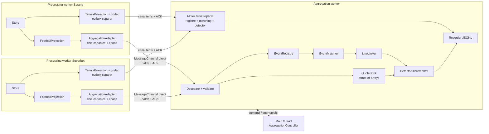
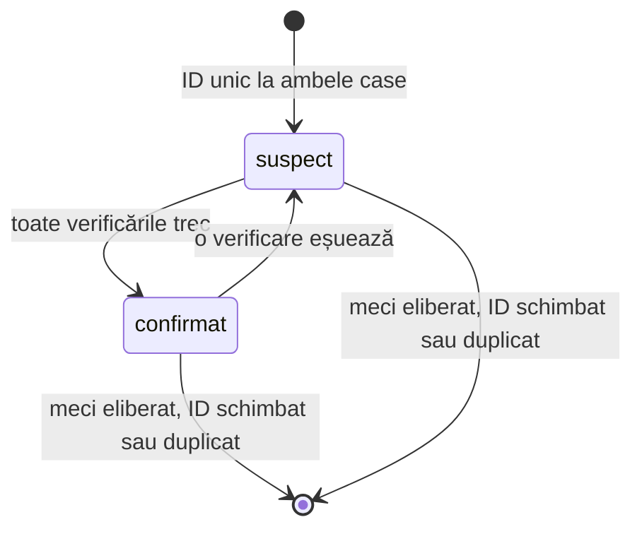
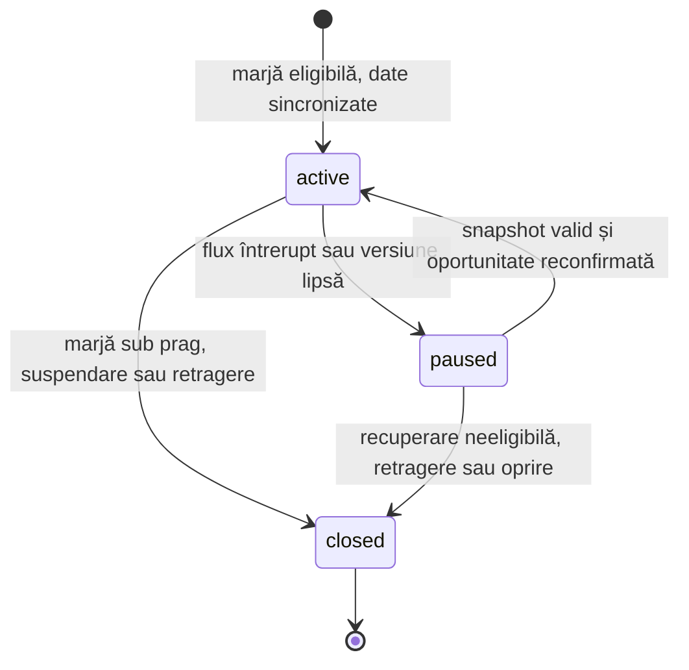

# Aggregation — asocierea meciurilor și oportunitățile

[Ansamblul proiectului](../../README.md) · [Network](NETWORK.md) · [Providers](PROVIDERS.md) · [Corespondențe fotbal](../mapping/FOOTBALL.md)

[Fluxul de tenis](TENNIS.md) și [maparea tenisului](../mapping/TENNIS.md) descriu particularitățile noului sport. Acest document detaliază infrastructura comună și regulile de fotbal; ceasul, marcajele echipelor și învățarea din secțiunile de matching sunt specifice fotbalului.

> **Stare: implementat.** Transportul, adaptoarele, asocierea meciurilor, detectorul și fallback-ul observat rulează cu ambii provideri. Pentru catalogul de fotbal, marcajele D, P și T sunt active; A, H și I rămân dezactivate. Tenisul folosește maparea proprie, inclusiv handicapuri la jumătăți de unitate. Perechile fără ID Betradar sunt doar raportate. Rezultatele rulărilor de fotbal sunt în [Observații live](#15-observații-live); tenisul are [verificarea separată](TENNIS.md#7-verificare).

Agregatorul primește de la Superbet și Betano liniile deja filtrate de fotbal și tenis, în motoare separate din același worker. Recunoaște meciurile, asociază liniile echivalente și calculează oportunitățile. Nu plasează pariuri: oportunitățile sunt raportate și înregistrate, iar decizia rămâne manuală.

Responsabilitățile rămân separate:

| Strat                       | Răspunde de                                                                 | Există |
| --------------------------- | --------------------------------------------------------------------------- | ------ |
| Store vendor                | Versiuni, patch-uri, recuperare, `stale`.                                   | Da     |
| Proiecția pe sport          | Catalog fix, linii cu exact două selecții, roluri, handicap orientat.       | Da     |
| Adaptorul de agregare       | Traducerea în chei canonice, internarea liniilor, coada coalescentă.        | Da     |
| Agregatorul                 | Asocierea meciurilor, asocierea liniilor, detectorul, înregistrarea.        | Da     |

## 1. Domeniu

Prima versiune acoperă exact ce produc proiecțiile:

- **Fotbal și tenis live.** Ambii provideri descoperă numai meciuri live. Fotbalul și tenisul au canale, registre, cotații și detectoare separate în același aggregation worker. Baschetul rămâne în afara proiecțiilor și agregatorului.
- **Piețe cu două rezultate:** Peste/Sub, handicap cu două rezultate, Da/Nu. Fără 1X2, handicap european, piețe pe jucători de fotbal sau combinații. La tenis, subiectul poate fi unul dintre cei doi participanți.
- **Numai perechile din [corespondențe](../mapping/FOOTBALL.md#3-perechile-identificate)**, filtrate după marcaj (vezi [Liniile comparabile](#5-liniile-comparabile)).

O piață cu două rezultate face detectorul **O(1) per linie**: există doar două combinații încrucișate de comparat.

## 2. Principii

1. **Nimic nu trece o graniță nevalidat.** Proiecțiile validează datele siteului. Adaptorul validează traducerea canonică. Agregatorul validează din nou fiecare mesaj și fiecare înregistrare binară.
2. **Dacă nu e sigur, nu se folosește.** O asociere sau o linie îndoielnică este marcată și numărată, nu ghicită. Necunoscut înseamnă exclus.
3. **Aceeași formă ca restul codului.** Controller pe main, worker separat, `model/`, `config.ts`, `logging.ts`, separare procesare/protocol, lifecycle partajat (`??=`), verificări de identitate după `await`, ACK în `finally`, timere eliberate în `stop()`.
4. **Agregatorul nu poate opri colectarea.** Un agregator lent sau căzut nu blochează și nu umflă memoria providerilor.
5. **Cost proporțional cu schimbările.** Adaptorul refolosește obiectul de cotație și tablourile pentru prețuri; detectorul reverifică liniile atinse. Contextul de tenis se transmite numai la modificare, separat de prețuri.

## 3. Arhitectura



Adaptorul rulează în processing workerul existent, după proiecție. Pe fiecare canal trec numai liniile cu o corespondență activă pentru sportul respectiv. Cele două motoare sunt izolate ca stare, dar împart CPU-ul aggregation workerului.

### Fișierele

```
src/aggregation/
  config.ts  controller.ts  logging.ts
  mapping.config.ts       cele 80 de corespondențe, documentate în docs/mapping/FOOTBALL.md
  mapping.ts              validarea încrucișată cu ambele cataloage și indexul rândurilor active
  model/                  adapter / config / controller / mapping / matching / opportunity / outbox / session / wire / worker
  adapter/outbox.ts       coada coalescentă, în processing workerul fiecărui provider
  adapter/projection.ts   adaptorul comun: proiecție → identitate, stare live, chei canonice
  adapter/football.ts     chei de fotbal și export compatibil FootballAggregationAdapter
  adapter/tennis.ts       chei de tenis, praguri, seturi și normalizarea contextului
  tennis-mapping.config.ts / tennis-mapping.ts   corespondențele de tenis și validatorul
  protocol/wire.ts        formatul binar al batch-urilor, comun ambelor părți
  protocol/validation.ts  gărzile mesajelor de control și ale limitelor
  protocol/tennis.ts      contextul de tenis, codare și verificarea egalității
  workers/worker.ts       sesiunile, timerele (sweep, rapoarte, statistici), oprirea ordonată
  processing/session.ts   AggregationSession: generație, secvență, ciclul de viață al handle-urilor, ACK
  processing/engine.ts    AggregationEngine: leagă starea validată de asociere, linkare și detecție
  processing/events.ts    EventRegistry: meciuri per provider, nume normalizate, starea live
  processing/quotes.ts    QuoteBook: liniile unui provider în tablouri tipizate
  processing/detector.ts  calculul incremental și ciclul de viață al oportunităților
  processing/recorder.ts  JSONL cu coadă limitată
  matching/names.ts       normalizarea numelor, marcajele, similaritatea
  matching/tennis-names.ts normalizarea separată a jucătorilor și perechilor de dublu
  matching/matcher.ts     EventMatcher: perechi după Betradar și verificările continue
  matching/lines.ts       LineLinker: legăturile dintre liniile perechilor confirmate
  matching/learning.ts    aliasuri și competiții învățate, salvate atomic
src/providers/superbet/processing/aggregation.ts   codecul Superbet: status, ceas, roluri, chei
src/providers/betano/processing/aggregation.ts     codecul Betano: suspendări, ceas, roluri, chei
src/providers/*/processing/tennis-aggregation.ts   codecurile de tenis: roluri, seturi și context
test/aggregation-*.test.mjs, test/helpers/aggregation.mjs
```

Providerii importă din agregare doar outboxul, adaptorul generic, maparea și formatul binar. Codecul fiecărui provider este singurul loc care cunoaște semantica siteului: statusuri, suspendări, ceas.

### Ciclul de viață

1. `src/index.ts` creează `AggregationController`. `createPort(provider)` creează canalul de fotbal, iar `createPort(provider, "tennis")` canalul de tenis, înainte de pornire. Capetele trimise providerului sunt argumentele trei și patru ale controllerului său.
2. Controllerul providerului transmite porturile processing workerului prin `workerData` și `transferList`, exact ca `networkPort`. Fără portul unui sport, outboxul corespunzător nu este creat; API-ul providerului rămâne disponibil.
3. La pornire, sesiunea agregatorului trimite `attach` cu generația și limitele. Outboxul nu înregistrează nimic înainte de `attach`: tablourile lui sunt dimensionate după aceste limite, deci ambele părți validează aceleași valori.
4. Un eșec la pornirea agregatorului este logat, dar nu oprește providerii.
5. La oprire: providerii se opresc întâi și își închid porturile, apoi agregatorul primește `stop` și se închide (timeout de 15 s, apoi `terminate()`, ca la provideri).

Dacă agregatorul cade, adaptorul vede portul închis, își eliberează coada și încetează să mai producă. Reatașarea (`attach-aggregation` prin main, urmată de o generație nouă) vine într-o etapă ulterioară.

## 4. Identitatea canonică a meciului

Proiecțiile păstrează tot ce trebuie, inclusiv ID-ul Betradar (`betradarId`), adăugat în `SuperbetFootballEvent` și `BetanoFootballEvent` pentru agregare.

| Câmp            | Superbet                                         | Betano                                      | Regulă                                                                                  |
| --------------- | ------------------------------------------------ | ------------------------------------------- | --------------------------------------------------------------------------------------- |
| ID Betradar     | `fixture.betradar_id` (**string**)               | `event.betradarMatchId` (**number**)        | Superbet: șir `/^[1-9]\d{0,15}$/`, convertit la număr sigur. Betano: întreg sigur pozitiv. Altfel `null`. |
| Gazde / oaspeți | `home.name`, `away.name` din `event_name`        | `home.name`, `away.name` din `participants` | Deja validate de proiecții: exact două, nume nevide și diferite.                        |
| Start           | `startsAt` din `utc_date`                        | `startsAt` din `startTime`                  | Milisecunde epoch. La Superbet, dacă `unix_date_millis` contrazice `utc_date`, startul devine necunoscut. |
| Scor            | `homeScore` / `awayScore` (string)               | `homeScore` / `awayScore` (string)          | `/^\d+$/` → întreg; altfel necunoscut.                                                  |
| Ceas            | `minute` în `1H`/`2H` (curge), `HT` (oprit la 45:00) | `clockSeconds`; `clockStopped` lipsă = curge | Secunde de joc plus bitul `running`; vezi [Ceasul](#ceasul).                   |
| Suspendare      | `offerStatus` ≠ 1                                | `isSuspended`                               | Flag canonic `suspended`.                                                               |
| Competiție      | `competitionId`, `categoryId`                    | `competitionId`, `categoryId`               | Spații de ID diferite; folosite doar prin corespondențe învățate.                       |

ID-urile echipelor și ale competițiilor nu se compară între case: sunt spații diferite.

Adaptorul trimite identitatea doar când se schimbă (proiecțiile publică deja `event` numai la schimbare). Normalizarea numelor și marcajele se calculează **o singură dată** pe schimbare de identitate, în agregator, și se păstrează în cache.

## 5. Liniile comparabile

### Codul canonic al pieței

[mapping.config.ts](../../src/aggregation/mapping.config.ts) transformă tabelul de [corespondențe](../mapping/FOOTBALL.md#3-perechile-identificate) în date:

```ts
{ code: 1, betano: 13, superbet: 200734, conditions: ["D"], concept: "Total goluri" }
{ code: 14, betano: 51, superbet: 233942, conditions: ["T"], threshold: 0.5, concept: "Total cartonașe roșii <HOME_TEAM>" }
```

- Fișierul este **generat** din tabelul documentului de corespondențe, ca cele două să nu poată diverge. Codurile se adaugă, nu se renumerotează.
- `code` este un întreg mic și stabil (1–4095). Este cheia canonică a tipului de piață.
- Fiecare adaptor construiește un `Map<vendorId, rânduri[]>` din rândurile active (Superbet `231045` are două rânduri, pentru pragurile 0,5 și 1,5).
- `AggregationController` refuză să pornească dacă un rând contrazice cataloagele. [validateMapping](../../src/aggregation/mapping.ts) verifică: coduri și perechi unice, tipuri existente în ambele cataloage, aceeași statistică, perioadă, subiect și durată de interval, câte un rol A și unul B, tipuri compatibile, parametrii Superbet potriviți tipului, prag prezent exact la `T`.
- La `T`, Superbet poate fi un total sau un Da/Nu cu parametru `total` (`231045`); validarea a găsit acest caz la prima rulare.

### Ce marcaje sunt active

| Marcaj | Activ implicit          | Motiv                                                                                  |
| ------ | ----------------------- | -------------------------------------------------------------------------------------- |
| D      | Da                      | Același concept, fără conversie.                                                       |
| T(x)   | Da                      | Conversie exactă Da→Peste, Nu→Sub, numai la pragul declarat; inclusiv rândurile `T` cu `P`. |
| P      | Da                      | Statisticile deja mapate sunt incluse în comparație, conform activării cerute în proiect. |
| A      | Nu                      | Regulile de push pe sferturi de linie nu sunt confirmate.                              |
| H      | Nu                      | Betano include scorul curent în handicapul asiatic; baza de decontare nu e confirmată. |
| I      | Nu                      | Limitele intervalelor diferă (`:59` față de `45:00`/`90:00`).                          |

Activarea se face per marcaj în configurație (`enabledConditions`, implicit `["D", "P", "T"]`): **73 din cele 80 de rânduri**. Sunt incluse cornerele, cartonașele, șuturile și șuturile pe poartă, faulturile, ofsaidurile, aruncările de la margine și loviturile de poartă, cu variantele pe echipe/reprize și handicapurile statistice deja mapate. Intră și cele două conversii „fiecare echipă primește cartonașe” (`T` + `P`), la pragurile 0,5 și 1,5.

Un rând este activ doar dacă **toate** marcajele lui sunt active. Cele două intervale statistice (`I` + `P`) rămân excluse, la fel ca intervalul de goluri (`I`), cele două totaluri asiatice (`A`) și cele două handicapuri asiatice (`H`). Lista ajunge la provideri în `attach`, deci adaptorul **nu trimite** liniile rândurilor oprite. Activarea `P` nu schimbă validarea liniilor, suspendările, asocierea meciurilor sau pragurile detectorului și nu reprezintă o verificare nouă a regulilor de decontare ale siteurilor.

### Cheia canonică a unei linii

Fiecare linie se reduce la un singur număr întreg, sigur în JavaScript:

```
lineKey = code × 2^20 + (param + 2^15) × 2^4 + variant

code     : 12 biți    codul canonic al pieței
param    : 16 biți    pragul sau handicapul în sferturi de unitate (2.5 → 10, −0.75 → −3), deplasat cu 2^15
variant  : 4 biți     slotul intervalului la fotbal; numărul setului la tenis (0 = meci)
```

- Sferturile de unitate elimină erorile de virgulă mobilă: `2.5`, `2.50` și `2.4999999` din parsare nu pot produce chei diferite, iar o valoare care nu este multiplu exact de 0,25 este respinsă.
- Handicapul este deja **orientat spre gazde** în ambele proiecții, deci aceeași valoare înseamnă aceeași linie.
- La `T(x)`, linia Betano Da/Nu primește `param = x`; linia Superbet intră doar dacă pragul ei este exact `x`.
- Codecul Betano exclude liniile cu `scoreContext` (handicap pe scorul curent) și intervalele terminate la `45:00`/`90:00`; codecul Superbet exclude liniile „primele X minute”.
- Două linii vendor care produc aceeași cheie în același meci sunt **amândouă** retrase până la următoarea bază: compararea oricăreia ar fi o presupunere.
- O cheie numerică face căutările `Map<number, …>` mai ieftine decât cheile string și nu alocă.

### Rolurile

Fiecare linie are exact două roluri canonice, `A` și `B`:

| Tip       | A      | B      |
| --------- | ------ | ------ |
| Peste/Sub | Peste  | Sub    |
| Handicap  | Gazde  | Oaspeți |
| Da/Nu     | Da     | Nu     |

Asocierea se face prin rol, niciodată prin poziția în array (Superbet publică Sub înaintea lui Peste, Betano invers).

### Când este o cotă utilizabilă

| Provider | Condiții                                                                                                         |
| -------- | ---------------------------------------------------------------------------------------------------------------- |
| Superbet | `price` finit > 1, `display: true`, `status === 1`. În 44 de snapshoturi live, `1` domină, iar `2` apare pe selecții blocate; orice altă valoare este indisponibilă. |
| Betano   | `price` finit > 1 (proiecția pune `null` altfel), selecție și linie nesuspendate.                               |

Codecul reduce aceste condiții la un bit `usable` per selecție; prețul este trimis oricum, pentru referință. Suspendarea **meciului** circulă în starea live și blochează perechea, fără retrimiterea liniilor. Agregatorul nu cunoaște semantica vendorului.

## 6. Protocolul pe canal

Ordinea este garantată în interiorul unui canal: toate mesajele unui **provider/sport** pleacă pe același port, în batchuri. Există câte o fereastră independentă de un batch pentru fotbal și tenis; următorul pleacă numai după ACK. Este același model de credit ca `StreamDelivery`, simplificat la o fereastră de un batch.

### Internarea liniilor

Pentru fiecare linie trimisă, adaptorul alocă un **handle** întreg mic (`Uint32`), refolosit printr-o listă de handle-uri libere:

- `line-define` asociază handle-ul cu `(eventHandle, lineKey)` o singură dată.
- Actualizările de preț conțin doar handle-ul și valorile numerice.
- `line-release` eliberează handle-ul; reutilizarea este sigură, pentru că eliberarea și redefinirea trec prin același canal, în ordine.

Meciurile primesc la fel un `eventHandle`. Agregatorul indexează direct în array-uri după handle, fără hash.

### Formatul unui batch

Un batch este un `ArrayBuffer` **transferat** (zero-copy, ca payloadurile din networking), cu două secțiuni:

Formatul este în [protocol/wire.ts](../../src/aggregation/protocol/wire.ts), little-endian:

```
Header (32 B)   magic "AGB1" · versiune · provider · generation · sequence · sentAt (f64) · byteLength · segments
Segment         opCount (u32) · valueCount (u32) · operații · valori
  reset            1 B    șterge toată starea providerului; numai ca primă operație a unui batch
  event-identity  45 B + două nume (u16 lungime + UTF-8)   eventHandle, eventId, betradarId, startsAt, competiție, categorie
  event-live      14 B    eventHandle, flags (live, suspended, scor, ceas, running, stale), scor gazde/oaspeți (u16), ceas (u32)
  event-tennis    37 B    eventHandle și context de 32 B: game-uri pe set, puncte, serviciu și set curent
  event-release    5 B    eventHandle; liniile meciului trebuie eliberate înainte
  line-define     13 B    lineHandle, eventHandle, lineKey (u32)
  line-release     5 B    lineHandle
  valoare         21 B    lineHandle (u32) · priceA (f64) · priceB (f64) · flags (u8: usableA, usableB)
```

- **Valorile conțin ultima stare** a fiecărei linii modificate, nu istoricul. Un preț schimbat de zece ori între două batch-uri trece o singură dată.
- Într-un segment, operațiile preced valorile. O operație scrisă după valori deschide automat un segment nou, deci ordinea nu poate fi încălcată de cel care scrie.
- Prețul lipsă sau inutilizabil este `NaN`, cu bitul `usable` șters. Startul necunoscut este `NaN`; ID-urile absente sunt `0`.
- `sentAt` este momentul trimiterii batch-ului. Pentru că valorile sunt coalescente, este și momentul la care ele erau curente.

Mesajele de control (`attach`, `ack`, `resync`) sunt obiecte simple, validate cu gărzi în [protocol/validation.ts](../../src/aggregation/protocol/validation.ts).

Formatul binar este versiunea **3**, cu operație separată pentru contextul de tenis; prețurile și `event-live` își păstrează dimensiunile. Bitul `stale: 32` separă sincronizarea de suspendarea pariurilor. Păstrează identitatea și starea cunoscută, dar blochează comparațiile. Cele două capete rulează același build.

### Coada coalescentă din adaptor

```
dirty        Uint8Array indexat după lineHandle
dirtyList    Uint32Array cu handle-urile marcate (fără duplicate)
priceA/B     Float64Array indexat după lineHandle — ultima valoare
structural   lista ordonată a operațiilor structurale
```

| Eveniment în provider                 | Efect în coadă                                                                                   |
| ------------------------------------- | ------------------------------------------------------------------------------------------------ |
| Schimbare de preț sau de `usable`     | Scrie în `priceA/B`, marchează `dirty` dacă nu era. O(1), fără alocare.                          |
| Linie nouă                            | `line-define` în `structural` + `dirty`.                                                         |
| Linie eliminată                       | Șterge `dirty`, adaugă `line-release`.                                                           |
| Scor, fază sau suspendare a meciului  | **Închide segmentul curent**: valorile dinainte pleacă înaintea schimbării de scor (vezi mai jos). |
| Doar ceasul s-a schimbat              | Operație `event-live` în segmentul curent, fără închidere: nu rupe coalescența.                   |
| Starea live nu s-a schimbat           | Nimic; la fel pentru o linie cu aceleași valori.                                                 |
| `invalidate`                          | Păstrează handle-urile și trimite urgent `event-live` cu bitul `stale`.                         |
| `remove`                              | Eliberează liniile (`line-release`), apoi meciul (`event-release`); trimis urgent.                 |
| Snapshot de înlocuire                 | Reconciliază cheile canonice: păstrează liniile existente, actualizează valori, retrage doar lipsurile. |

Închiderea segmentului la schimbarea de scor împiedică o cotă de **dinaintea** golului să ajungă după scorul nou și să pară o cotă de după gol. Un batch poate conține mai multe segmente.

Batch-ul pleacă la `batchWindowMs` după prima modificare, sau la sfârșitul ciclului curent (`setImmediate`) la o schimbare de scor sau o invalidare, dacă nu este deja unul în zbor. Cât timp agregatorul nu a confirmat, outboxul continuă să suprascrie aceleași sloturi. **Valorile în așteptare sunt limitate de numărul de linii, nu de numărul de actualizări.**

Operațiile structurale se pot totuși aduna cât timp agregatorul nu răspunde. Dacă batch-ul în așteptare depășește `maxBatchBytes`, outboxul renunță la el, scrie `reset` și cere adaptorului retrimiterea stării din proiecții. Dimensiunea finală este verificată din nou înainte de transfer, după codarea valorilor pending: nici acestea nu pot împinge batch-ul trimis peste limită. Limita este validată să încapă de **două ori** starea completă ([fullStateBytes](../../src/aggregation/protocol/wire.ts)), deci o retrimitere nu poate depăși din nou limita.

Replay-ul intern include și proiecțiile reținute cu `synchronized: false`; query-urile publice continuă să întoarcă `null` pentru ele. La un snapshot valid, adaptorul construiește mai întâi setul canonic nou și exclude cheile ambigue, apoi retrage lipsurile și actualizează valorile. Disponibilitatea este restaurată după aceste valori; detectorul reevaluează la commit. Schimbarea unui UUID vendor nu retrage o linie canonică încă prezentă.

### Generații, secvențe și resincronizare

- `generation` vine de la agregator în `attach` și este verificată în plic și în header. Reatașarea, cu generație nouă, este o etapă ulterioară.
- `sequence` crește cu fiecare batch. Agregatorul confirmă cu `ack`, care întoarce și bufferul transferat, pentru refolosire.
- Un batch respins (secvență lipsă, header nepotrivit, operație invalidă, încălcarea ciclului de viață) produce `resync` în locul `ack`. Agregatorul șterge **toată** starea providerului; outboxul eliberează handle-urile, scrie `reset` și cere retrimiterea. Până la un batch care începe cu `reset`, sesiunea respinge orice altceva.
- Un plic invalid (fără `sequence` sau buffer) nu poate primi `resync`, pentru că nu se știe ce batch a eșuat: sesiunea închide legătura, iar outboxul se dezactivează.

### Validarea la primire

Decodorul și sesiunea verifică:

- headerul: magic, versiune, provider, generație și secvență egale cu plicul, `sentAt` întreg, lungime care se încadrează în buffer și în `maxBatchBytes`, fără bytes rămași;
- identitatea: ID-uri întregi pozitive sau `0`, start întreg sau `NaN`, nume UTF-8 valide (`fatal`), nevide, de cel mult 128 de caractere și diferite;
- starea live: numai flagurile cunoscute; scorul și ceasul sunt zero când flagul lor lipsește;
- valorile: prețuri `NaN` sau finite în `(1, 10 000]`, preț valid obligatoriu pentru bitul `usable`, numai flagurile cunoscute;
- handle-urile: în limite, meci definit înaintea liniilor, linie nedefinită de două ori, meci eliberat numai fără linii;
- `lineKey` cu codul de piață ≥ 1; o cheie repetată în același meci este eroare de protocol.

Sesiunea aplică batch-ul pe măsură ce îl decodează, fără o a doua trecere. O eroare oriunde șterge **toată** starea providerului și cere `resync`, deci o aplicare parțială nu supraviețuiește. Motorul primește operațiile numai după validare, iar detectorul lucrează doar la sfârșitul unui batch acceptat.

Outboxul aplică aceleași reguli înainte de scriere: o identitate invalidă, un meci necunoscut sau o cheie invalidă sunt numărate în `rejected` și nu ajung pe canal; un preț inutilizabil devine `NaN`.

## 7. Structurile de date din agregator

Structurile fierbinți sunt **struct-of-arrays** indexate după handle: valori contigue în memorie, fără obiecte per linie și fără presiune pe garbage collector. Toate tablourile sunt alocate o singură dată, la dimensiunea din `attach`.

### QuoteBook

[processing/quotes.ts](../../src/aggregation/processing/quotes.ts), câte unul per provider:

| Array                | Tip            | Conținut                                                |
| -------------------- | -------------- | ------------------------------------------------------- |
| `lineEvent`          | `Int32Array`   | handle-ul meciului, sau −1 pentru o linie liberă        |
| `lineKey`            | `Uint32Array`  | cheia canonică                                          |
| `priceA`, `priceB`   | `Float64Array` | ultima valoare                                          |
| `flags`              | `Uint8Array`   | `usableA`, `usableB`                                    |
| `updatedAt`          | `Float64Array` | momentul aplicării ultimei schimbări de preț            |
| `peer`               | `Int32Array`   | linia echivalentă la cealaltă casă, sau −1              |

### EventRegistry

[processing/events.ts](../../src/aggregation/processing/events.ts): per provider, un array de obiecte meci indexat după handle. Meciurile sunt puține (zeci–sute) și se schimbă rar, deci aici obiectele sunt acceptabile. Fiecare meci păstrează:

- identitatea canonică și numele normalizate, recalculate doar când numele se schimbă;
- starea live: `synchronized`, scor, ceas (valoare, `running`, momentul ultimei schimbări), `suspended`, momentul ultimei schimbări de scor;
- `lines: Map<lineKey, lineHandle>`, folosit la linkarea liniilor; o cheie duplicată în același meci este eroare de protocol;
- `pair` și `conflict`.

### Indexurile de asociere

| Index                     | Structură                                         | Folosire                                                      |
| ------------------------- | ------------------------------------------------- | ------------------------------------------------------------- |
| După Betradar             | `Map<number, AggregationEvent[]>` per provider    | Candidatul exact în O(1); lista detectează duplicatele.       |
| După timp (fallback)      | `Map<bucket, AggregationEvent[]>`, 15 min, refăcut la fiecare scanare | Candidați fără ID: bucketul propriu și vecinii din toleranță. |
| Aliasuri învățate         | `Map<string, Set<string>>`, în ambele sensuri     | Nume normalizat → nume normalizate echivalente.               |
| Competiții învățate       | `Map<number, number>`                             | `competitionId` Superbet → Betano; o contradicție o elimină.  |

Cheile absente (ID `0`, start necunoscut) nu sunt introduse niciodată într-un index.

### LineLinker

[matching/lines.ts](../../src/aggregation/matching/lines.ts): când o pereche devine `confirmat`, linkerul parcurge `lines` al meciului cu mai puține linii și caută cheia în celălalt: O(min(n, m)). Pentru fiecare potrivire scrie `peer` în ambele cărți. La `line-define` într-un meci deja confirmat face o singură căutare. La `line-release`, retrogradare sau eliberarea meciului, linkurile sunt șterse în ambele sensuri, iar oportunitatea liniei se închide.

### Coada de lucru a detectorului

```
pending      Uint8Array, indexat după linia Superbet a unui link
pendingList  Uint32Array
```

Aplicarea unui batch doar marchează liniile atinse. La sfârșitul batch-ului acceptat, detectorul parcurge `pendingList` o singură dată. Zece schimbări ale aceleiași linii în același batch produc un singur calcul.

## 8. Asocierea meciurilor

[matching/matcher.ts](../../src/aggregation/matching/matcher.ts) formează o pereche numai când un ID Betradar apare la **exact un** meci din fiecare casă. Mai multe meciuri cu același ID, la oricare casă, marchează ID-ul ca **conflict**: niciunul nu este asociat până când duplicatul dispare.



| Stare       | Folosită de detector | Semnificație                                                       |
| ----------- | -------------------- | ------------------------------------------------------------------ |
| `confirmat` | Da                   | ID Betradar identic **și** nicio verificare nu eșuează.            |
| `suspect`   | Nu                   | Cel puțin un motiv, raportat la fiecare schimbare.                 |

Verificările se refac la fiecare `event-identity`, `event-live` și sweep, deci o pereche confirmată poate fi retrogradată oricând și revine singură când contradicția dispare.

| Motiv         | Când apare                                                                                                    |
| ------------- | ------------------------------------------------------------------------------------------------------------- |
| `start`       | Ambele starturi sunt cunoscute și diferă cu mai mult de `startToleranceMs`.                                  |
| `markers`     | Marcajele de lot (U21, feminin, II, LDD...) diferă la gazde sau la oaspeți.                                  |
| `orientation` | Numele se potrivesc mult mai bine inversat: similaritatea inversată ≥ 0,5 și cu cel puțin 0,25 peste cea directă. |
| `clock`       | Ambele ceasuri sunt cunoscute și proaspete și diferă cu mai mult de `clockToleranceSeconds`.                 |
| `score`       | Scorurile diferă de cel puțin `scoreMismatchMs`.                                                             |
| `unverified`  | Numele nu ajung la 0,5 și nici startul și ceasul nu confirmă împreună ID-ul.                                  |

### Numele

[matching/names.ts](../../src/aggregation/matching/names.ts) aplică NFKD, elimină semnele diacritice, înlocuiește `ð`, `đ`, `ß`, `æ`, `œ`, `ø`, `ł`, `ı`, `þ` și scoate formele juridice și conectorii (`fc`, `cf`, `sc`, `ad`, `ec`, `clube`, `esporte`, `de`, `la`...). Marcajele de lot sunt **extrase**, nu șterse. Un `II`/`B`/`III` contează ca marcaj doar la finalul numelui.

Similaritatea dintre două nume, între 0 și 1:

- cheie identică sau alias învățat: 1; acronim complet (`PSG`): 0,9;
- pe cuvinte: identic 1; prefix de minim 3 litere 0,9; o literă diferită (`Gabala`/`Qabala`) 0,8; abreviere ca subsecvență (`Utd`) sau prefix comun de 4 litere 0,7; inițiale ale unor cuvinte consecutive (`NY` = New York) 0,9;
- scorul se împarte la numărul de cuvinte al numelui mai scurt, plus **jumătate** din cuvintele rămase nefolosite din numele mai lung (`Alianza` față de `Alianza San Salvador` = 0,5);
- un cuvânt semnificativ fără corespondent plafonează scorul la 0,4 (`Rapid București` față de `Dinamo București`);
- un cod de două litere fără corespondent (`SP`, `GO`) nu contează nici pentru, nici contra.

Exonimele (`Munich`/`München`) nu sunt ghicite: rămân la 0,4 până când un alias este învățat.

### Ceasul

Ceasurile vin ca **ancoră**: valoarea, momentul primirii și bitul `running`.

- Superbet: în `1H`/`2H`, minutul × 60 și curge; la `HT`, 45:00 oprit; altfel necunoscut.
- Betano: `secondsSinceStart`; `clockStopped` lipsă înseamnă că ceasul curge. În datele live, `clockStopped: true` apare explicit la pauză, iar în timpul jocului câmpul lipsește (Betano omite valorile implicite).
- Un ceas care curge este extrapolat de la momentul primirii; o ancoră mai veche de 10 minute nu mai este folosită. Toleranța implicită de 300 s acoperă granularitatea de un minut a Superbet.

### Fallback și învățare

`scan()` rulează la fiecare raport de statistici, peste meciurile live neasociate și fără conflict. O pereche **observată** cere: start în toleranță, marcaje egale, similaritate de cel puțin 0,7 la ambele echipe, competiție compatibilă dacă este cunoscută, niciun ID diferit la cele două meciuri și unicitate în ambele sensuri. Este raportată o singură dată și nu ajunge niciodată la detector.

[matching/learning.ts](../../src/aggregation/matching/learning.ts) învață aliasuri și competiții doar din perechi confirmate **continuu** și sincronizate de cel puțin 5 minute, cu marcaje egale. Intervalul începe la confirmare, nu la crearea perechii; trecerea în starea suspectă sau pierderea sincronizării îl anulează, iar revenirea pornește alte 5 minute. Cu `learningPath`, tabelele sunt încărcate înaintea primei sesiuni, validate și salvate atomic (fișier temporar + `rename`) la fiecare raport și la oprire. Un fișier invalid este raportat și ignorat în întregime.

## 9. Scenarii care pot produce meciuri greșite

Fiecare scenariu are o protecție și un test. Cele marcate **real** au fost găsite în datele live. Testele sunt în [aggregation-engine](../../test/aggregation-engine.test.mjs), [aggregation-names](../../test/aggregation-names.test.mjs), [aggregation-adapter](../../test/aggregation-adapter.test.mjs) și testele de proiecție.

### A. ID-uri

| #   | Scenariu                                                               | Protecție                                                                                   |
| --- | ---------------------------------------------------------------------- | ------------------------------------------------------------------------------------------- |
| A1  | **Real:** ID Betradar string la Superbet, number la Betano             | Validare strictă în proiecții. Un test a prins o expresie regulată stricată la implementare. |
| A2  | **Real:** ID lipsă (9 meciuri Superbet, 4 Betano în mostră)            | Doar fallback observat. Cheile absente nu se indexează.                                     |
| A3  | Același ID la două meciuri ale aceleiași case                          | Conflict: niciunul nu este asociat până dispare duplicatul.                                 |
| A4  | ID greșit introdus de casă                                             | ID-ul singur nu ajunge: numele sau startul și ceasul împreună trebuie să-l confirme; scorul și marcajele trebuie să concorde. |
| A5  | Meci șters și readăugat, alt ID de provider, același Betradar          | Eliberarea meciului desface perechea; asocierea se reface de la zero.                       |
| A6  | ID-ul Betradar apare sau se schimbă în timpul meciului                 | Reindexare la fiecare `event-identity`, cu desfacerea perechii vechi.                       |

### B. Participanți

| #   | Scenariu                                                                                       | Protecție                                                                                                                            |
| --- | ---------------------------------------------------------------------------------------------- | ------------------------------------------------------------------------------------------------------------------------------------ |
| B1  | Gazde și oaspeți inversați între case                                                          | Motivul `orientation`: perechea nu este folosită. Inversarea ar cere și inversarea semnului handicapului.                             |
| B2  | **Real:** `Atenas U21` (Superbet) și `Atenas LDD` (Betano), fără ID, aceeași oră               | Marcajele trebuie să fie egale, atât la perechile cu ID, cât și la fallback. `LDD` nu este echivalat cu `U21`.                        |
| B3  | Același nume de club în țări diferite                                                          | Fallback-ul cere competiția compatibilă când corespondența ei a fost învățată.                                                        |
| B4  | **Real:** `ș` față de `ş`, `Garðabær`, `Asociación`                                            | Normalizarea de mai sus.                                                                                                             |
| B5  | **Real:** nume scurtate sau completate (`NY Cosmos`/`New York Cosmos`, `Novorizontino SP`/`Gremio Novorizontino`, `Alianza FC`/`Alianza San Salvador`) | Inițiale de cuvinte, coduri de două litere neutre, cuvinte în plus la jumătate de greutate. Toate cazurile reale sunt teste.         |
| B6  | Nume diferite ale aceluiași club (`Genesis Policia Nacional`/`Genesis Comayagua`)             | Sub 0,5: perechea are nevoie de start și ceas care să confirme ID-ul. Live a devenit confirmată când ambele ceasuri erau cunoscute.    |
| B7  | Același oraș, cluburi diferite (`Rapid`/`Dinamo București`)                                    | Cuvântul fără corespondent plafonează similaritatea la 0,4.                                                                           |
| B8  | Aceleași echipe de două ori la interval scurt (tur-retur, U21 și seniori în aceeași zi)        | Conflict la ID duplicat; la fallback, unicitate în ambele sensuri.                                                                    |

### C. Timp și ceas

| #   | Scenariu                                                     | Protecție                                                                                       |
| --- | ------------------------------------------------------------ | ----------------------------------------------------------------------------------------------- |
| C1  | **Real:** start diferit între case (19:33 față de 19:40)     | Toleranță `startToleranceMs`.                                                                   |
| C2  | Fus orar: `event_date` local față de `utc_date`              | Doar `utc_date`; dacă `unix_date_millis` îl contrazice, startul devine necunoscut.               |
| C3  | Meci reprogramat care își păstrează ID-ul                    | Motivul `start`.                                                                                |
| C4  | Ceasuri de joc foarte diferite                               | Motivul `clock`, cu extrapolare și ancore proaspete.                                            |
| C5  | **Real:** Betano omite `clockStopped` cât timp ceasul curge  | Lipsa câmpului înseamnă „curge”. Înainte de corecție, ceasul Betano era necunoscut în 40 din 47 de meciuri. |

### D. Starea live

Scorul este semnalul cel mai puternic: prinde și perechea greșită, și casa rămasă în urmă după un gol. Al doilea caz este sursa principală de arbitraje false.

| #   | Scenariu                                                     | Protecție                                                                                                  |
| --- | ------------------------------------------------------------ | ---------------------------------------------------------------------------------------------------------- |
| D1  | Scoruri diferite                                             | Poarta `score` blochează imediat; după `scoreMismatchMs`, perechea devine `suspect`.                       |
| D2  | O casă arată meciul suspendat, cealaltă activ                | Poarta `suspended`.                                                                                        |
| D3  | Imediat după o schimbare de scor                             | Poarta `settling` pentru `scoreSettleMs`; sweep-ul reevaluează liniile când liniștea expiră.               |
| D4  | Cotă de dinaintea golului sosită după scorul nou             | Închiderea segmentului în outbox.                                                                          |
| D5  | Meci temporar nesincronizat                                  | Identitatea și linkurile rămân; comparațiile sunt blocate, oportunitățile sunt `pause`.                    |
| D6  | Meci eliminat efectiv                                        | Liniile și linkurile sunt retrase; oportunitățile sunt închise.                                             |

### E. Linii

| Capcană                                         | Protecție                                                                                   |
| ----------------------------------------------- | ------------------------------------------------------------------------------------------- |
| Reguli de numărare diferite (P)                 | Marcaj activat explicit; verificarea decontării rămâne deschisă.                              |
| Handicap asiatic cu scor curent (H)             | Marcaj dezactivat; liniile Betano cu `scoreContext` sunt oricum excluse de codec.           |
| Intervale cu limite diferite (I)                | Marcaj dezactivat; intervalele Betano terminate la limita reprizei sunt excluse.            |
| Da/Nu convertit la alt prag decât cel declarat  | Linia Superbet intră numai la pragul exact al rândului.                                     |
| Două linii vendor pe aceeași cheie              | Amândouă retrase până la următoarea bază.                                                   |
| Semnul handicapului                             | Cheia folosește valoarea liniei, orientată spre gazde în ambele proiecții.                  |
| Erori de virgulă mobilă la prag                 | Prag în sferturi de unitate; valorile nealiniate sunt respinse.                             |

## 10. Detectorul

[processing/detector.ts](../../src/aggregation/processing/detector.ts), pentru o linie Superbet `x` din coada de lucru, cu `y = peer[x]`:

```
dacă y = −1 → închide („unlinked”)
dacă datele perechii confirmate sunt stale → pune în pauză, fără comparație
dacă o poartă este închisă → închide (motivul porții)
s1 = 1/priceA[x] + 1/priceB[y]     (doar dacă usableA[x] și usableB[y])
s2 = 1/priceA[y] + 1/priceB[x]     (doar dacă usableA[y] și usableB[x])
S  = min(s1, s2);  marjă = (1/S − 1) în puncte de bază
dacă marjă < minMarginBps → închide („margin”)
```

Cu două rezultate există doar două combinații încrucișate; combinația în aceeași casă poartă mereu marja casei. Calculul este O(1).

La fotbal, porțile sunt `pair`, `stale`, `not-live`, `suspended`, `score`, `settling`, `lag`. La tenis se adaugă `tennis-context` după scor și verificarea setului liniei. `stale` pune în pauză o oportunitate urmărită și nu deschide una nouă; celelalte porți închid oportunitatea cu motivul respectiv. `lag` privește întârzierea ultimului batch, nu vârsta cotei.

**Vârsta unui preț nu blochează comparația.** Un preț neschimbat este valid cât timp meciul este sincronizat; providerii invalidează meciul la deconectare, gap sau inactivitate. Vârsta fiecărui preț este însă raportată (`ageMs`), pentru decizia manuală: un preț vechi față de unul proaspăt indică de obicei o casă rămasă în urmă.

| Rezultat      | Condiție                                     | Efect                                                 |
| ------------- | -------------------------------------------- | ----------------------------------------------------- |
| sub prag      | marjă < `minMarginBps`                       | Ignorat; o oportunitate deschisă se închide.          |
| oportunitate  | `minMarginBps` ≤ marjă ≤ `suspiciousMarginBps` | Deschisă sau actualizată.                           |
| suspectă      | marjă > `suspiciousMarginBps`                | Marcată `suspicious`: eroare de mapare sau casă în urmă. |

Fiecare picior raportează casa, rolul (`A`/`B` și eticheta: over, under, yes...), cota, partea din miza totală (`(1/cotă)/S`) și vârsta prețului.

### Ciclul de viață al oportunităților



Tranziția `paused → active` emite `resume` cu același ID; nu dovedește că oportunitatea a existat și în intervalul fără date confirmate.

- Oportunitățile deschise stau într-un `Map<linie Superbet, stare>`; sunt puține.
- Un singur timer (`sweepMs`) reevaluează matcherul, liniile perechilor a căror liniște tocmai a expirat și oportunitățile deschise. Nu există timere per linie.
- Se raportează `open`, `update`, `pause`, `resume` și `close`. Actualizările obișnuite folosesc pragul `reportStepBps`; revenirea din pauză se raportează chiar și cu prețuri identice.
- `pause` păstrează ID-ul și ultimele cote confirmate, dar exclude oportunitatea din `open`; statisticile o numără separat în `paused`. Actualizările celeilalte case nu sunt comparate cu datele stale. Nu există timere per oportunitate, iar stările reținute rămân limitate de numărul de linii.
- La recuperare se verifică toate porțile și prețurile curente. `resume` păstrează ID-ul și `openedAt` numai dacă oportunitatea este din nou eligibilă; altfel urmează `close`, cu motivul actual. Retragerea efectivă, resetarea canalului de agregare și oprirea aplicației închid și oportunitățile puse în pauză.
- `durationMs` este timpul calendaristic de la deschidere; `unconfirmedMs` cumulează separat intervalele de pauză observate în agregator. Nu dovedește existența oportunității pe durata întreruperii și nu măsoară exact indisponibilitatea la sursă.
- Închiderea citește cele mai recente cote din quote books pentru combinația folosită de oportunitate, inclusiv mișcarea care a coborât sub prag. Dacă o cotă nu mai este disponibilă, păstrează ultima valoare cunoscută. Raportul actualizează marja, scorul disponibil și durata până la închidere.
- `reason` păstrează codul stabil, iar `reasonDetail` explică observația concretă: marja și pragul, siteul/selecția și cota veche → nouă față de ultima stare urmărită, selecțiile devenite inutilizabile, siteul care a retras linia sau starea, suspendarea meciului, scorurile de pe ambele siteuri ori întârzierea batchului și limita depășită. Linkerul transmite cauza și providerul la dezlegare; detaliile se construiesc numai la închiderea unei oportunități.
- Explicația respectă informația disponibilă: bitul `usable` nu deosebește suspendarea selecției de ascundere sau preț invalid, iar retragerea stării din agregator nu dovedește finalizarea meciului. La o retragere efectivă, liniile pot fi retrase înaintea evenimentului; logul arată în acest caz retragerea liniei și siteul, fără a inventa un motiv de pe server.
- Rapoartele (perechi, candidați observați, oportunități) se adună și pleacă spre main la cel mult `reportIntervalMs`; coada lor este limitată, iar depășirile sunt numărate.

### Recorderul

Cu `recordPath`, fiecare raport este scris ca o linie JSON, printr-un `WriteStream` în modul append. Cât timp fișierul cere așteptare, liniile stau într-o coadă limitată (`recordBufferLimit`); peste limită, cele mai vechi sunt numărate ca pierdute. Detecția nu așteaptă niciodată după disc.

Matchingul și compararea cotelor rulează în același worker de agregare, cu o singură confirmare de inițializare în consolă. Handlerul implicit afișează oportunitățile tuturor piețelor activate, de la pragul configurat (**2%** în prezent). Fiecare raport este o singură linie: **FOUND verde**, **UPDATE / RESUMED albastru**, **PAUSED galben**, **CLOSED mov numai la motivul `margin` cu marja raportată peste 0,5%, roșu la 0,5% sau mai jos ori la orice alt motiv de închidere**, cu oră UTC, ID, meci/scor, concept, linie, siteuri, selecții, cote și marjă. Pragul vizual este `closeMarginColorBps: 50` în handlerul de logging, separat de `minMarginBps`; nu schimbă detectorul și nu continuă urmărirea sub pragul configurat. De exemplu, scăderea sub 2% până la 1% produce un `CLOSED` mov. Retragerile (`unlinked`), suspendările și celelalte motive de închidere sunt întotdeauna roșii, inclusiv când ultimele cote cunoscute indică o marjă peste 0,5%. Pauza etichetează explicit ultimele cote confirmate; revenirea și închiderea arată separat timpul neconfirmat acumulat. Închiderea adaugă durata calendaristică în secunde și motivul. Culorile folosesc `node:util.styleText`, respectând terminalul și `NO_COLOR`; la redirecționare textul poate fi fără culori. Erorile rămân vizibile.

### Rezumatul perechilor active

Handlerul implicit folosește statisticile periodice și afișează o singură linie: `[MATCHED ACTIVE] Superbet <-> Betano | total=N | football=F | tennis=T`. Dacă primul raport (implicit la aproximativ 5 secunde de la pornire) are zero perechi utilizabile, se afișează o singură dată mesajul de inițializare, fără contor numeric. Primul contor apare la primul raport cu perechi utilizabile sau la expirarea a 30 de secunde de la primul raport, chiar dacă totalul rămâne zero. Verificarea are loc la cadența statisticilor, fără timer nou pe main thread. Astfel, pauza inițială de stabilizare a scorurilor nu este prezentată imediat ca o lipsă de perechi. Rezumatul nu garantează încheierea sincronizării tuturor meciurilor. Ulterior, emiterea are loc la primul raport de statistici disponibil după un minut de la rezumatul numeric precedent (rapoartele vin implicit la 5 secunde). Nu se mai afișează tabelul inițial sau adăugările/retragerile individuale.

`getStats().sports.football.activeMatches` și `.sports.tennis.activeMatches` sunt calculate din starea curentă, nu din numărul de identități confirmate sau din comparațiile ferestrei precedente. Fiecare pereche este numărată o singură dată dacă trece aceleași porți ca detectorul și are cel puțin o linie comună cu selecții complementare utilizabile între case. Pentru tenis sunt excluse și liniile seturilor deja încheiate. Pragul de profit nu intră în contor: acesta arată meciurile care ar putea produce oportunități, nu doar cele care au deja una. Calculul este doar de citire și nu modifică rapoartele, marjele sau contoarele de comparații.

API-ul opțional `onMatches` rămâne disponibil pentru consumatori proprii: trimite prima listă confirmată la primul ciclu de statistici, apoi numai la modificarea apartenenței. Aplicația implicită nu îl configurează, deci nu mai transferă aceste liste spre main.

Pierderea temporară a sincronizării păstrează asocierea deja verificată, dar scoate perechea din `activeMatches` până la recuperare. Ceasurile și scorurile stale nu pot declanșa retrogradarea sau învățarea; verificările statice de identitate rămân active. O pereche nouă așteaptă date sincronizate de la ambele case. După recuperare, scorul, ceasul și toate porțile sunt verificate din nou. Lista opțională `onMatches` reprezintă identități asociate; rezumatul implicit reprezintă perechi cu cote comparabile la momentul raportării.

[Testul de latență](../reports/LATENCY-TEST-2026-10-25.md) documentează separat timpii etapelor până la aplicarea batchului și evaluarea din agregator. Instrumentarea a fost folosită numai într-o copie temporară a buildului.

## 11. Performanță: unde se duce costul

| Cale                       | Frecvență        | Cost                                          | Cum                                                                                   |
| -------------------------- | ---------------- | --------------------------------------------- | ------------------------------------------------------------------------------------- |
| Preț schimbat în provider  | Foarte mare      | O(1), fără alocare                            | Două căutări în `Map`, scriere în `Float64Array`, bit `dirty`.                         |
| Linie nemapată             | Foarte mare      | O(1)                                          | Un `Map.get` pe tipul vendor; nu ajunge pe canal.                                     |
| Trimiterea unui batch      | ≤ 1 / `batchWindowMs` per provider | O(linii modificate)          | Scriere secvențială în bufferul curent; transfer, nu copiere.                         |
| Aplicarea unui batch       | Idem             | O(operații + valori)                          | `DataView`; indexare directă după handle.                                             |
| Detector                   | Per linie atinsă | O(1)                                          | Două sume de inverse.                                                                 |
| Schimbare de identitate    | Rară             | O(lungimea numelor)                           | Normalizare o dată, păstrată pe meci.                                                 |
| Confirmarea unei perechi   | Rară             | O(min(n, m))                                  | Parcurgerea liniilor meciului mai mic.                                                |
| Sweep                      | La `sweepMs`     | O(perechi + oportunități deschise)            | Nu parcurge liniile.                                                                  |
| Fallback                   | La `statsIntervalMs` | O(meciuri neasociate × candidați din buckete) | Doar meciurile live neasociate.                                                  |

- **Bufferele se refolosesc.** Agregatorul întoarce bufferul transferat în ACK; outboxul păstrează până la două în pool.
- **Fără string-uri pe calea fierbinte.** Cheile de linie sunt numere, handle-urile sunt indecși.
- **Măsurare.** Statisticile periodice includ, per provider, batch-urile, operațiile, valorile, bytes, întârzierea ultimului batch și maximele ferestrei pentru întârziere și timpul de aplicare. Detectorul raportează liniile linkate, liniile comparate în fereastră și cea mai bună marjă văzută, inclusiv negativă. Un benchmark de alocări nu există încă.

## 12. Configurare

Valorile sunt în [config.ts](../../src/aggregation/config.ts). Numerele trebuie să fie întregi pozitivi siguri, ca la provideri, cu excepția pragului `minMarginBps`, care acceptă și valori negative pentru diagnostic, strict peste −10 000 bps (−100%). Marjele sunt în puncte de bază.

| Opțiune                 | Implicit  | Semnificație                                                        |
| ----------------------- | --------- | ------------------------------------------------------------------- |
| `batchWindowMs`         | 25 ms     | Fereastra maximă de coalescență în outbox.                          |
| `maxEvents`             | 4 096     | Handle-uri de meci per provider.                                    |
| `maxLines`              | 65 536    | Handle-uri de linie per provider.                                   |
| `maxBatchBytes`         | 16 MiB    | Limita unui batch; cel puțin dublul stării complete.                |
| `enabledConditions`     | `D`, `P`, `T` | Marcajele de corespondență active.                              |
| `statsIntervalMs`       | 5 s       | Statistici, scanarea fallback, salvarea tabelelor învățate.         |
| `startToleranceMs`      | 30 min    | Diferența maximă de start.                                          |
| `clockToleranceSeconds` | 300 s     | Diferența maximă de ceas de joc.                                    |
| `scoreSettleMs`         | 5 s       | Liniștea după o schimbare de scor.                                  |
| `scoreMismatchMs`       | 60 s      | Diferența de scor după care perechea devine `suspect`.              |
| `maxLagMs`              | 2 s       | Întârzierea maximă a ultimului batch al unui provider.              |
| `minMarginBps`          | 200       | Marja minimă raportată: 2%; același prag pentru ambele sporturi.       |
| `suspiciousMarginBps`   | 1 000     | Peste 10%, oportunitatea este `suspicious`.                         |
| `reportStepBps`         | 10        | Schimbarea minimă de marjă care produce o actualizare.              |
| `sweepMs`               | 250 ms    | Perioada sweep-ului.                                                |
| `reportIntervalMs`      | 250 ms    | Ritmul maxim al rapoartelor către main.                             |
| `recordBufferLimit`     | 10 000    | Linii JSONL ținute cât timp fișierul cere așteptare.                |
| `fallbackMode`          | `observe` | `off` sau `observe`. Un mod activ nu există.                        |
| `recordPath`            | `null`    | Fișierul JSONL; fără el nu se înregistrează nimic.                  |
| `learningPath`          | `null`    | Fișierul tabelelor învățate; fără el, învățarea ține doar în memorie. |

Constructorul mai verifică: marcaje din enum, `minMarginBps` sub `suspiciousMarginBps`, căi nevide, limitele de batch coerente și maparea validă față de ambele cataloage.

## 13. Etape

| Etapă | Conținut                                                                                                       | Teste                                                                                         |
| ----- | -------------------------------------------------------------------------------------------------------------- | --------------------------------------------------------------------------------------------- |
| 1 ✔   | Formatul binar, validarea, outboxul, sesiunea, workerul, controllerul, ACK, generații, `resync`.               | [wire](../../test/aggregation-wire.test.mjs), [outbox](../../test/aggregation-outbox.test.mjs), [session](../../test/aggregation-session.test.mjs) |
| 2 ✔   | Betradar în proiecții, maparea validată, adaptorul generic și codecurile, `EventRegistry`, `QuoteBook`.        | [mapping](../../test/aggregation-mapping.test.mjs), [adapter](../../test/aggregation-adapter.test.mjs), testele de proiecție |
| 3 ✔   | `EventMatcher` cu verificările A–D și raportul live.                                                           | [engine](../../test/aggregation-engine.test.mjs), [names](../../test/aggregation-names.test.mjs)    |
| 4 ✔   | `LineLinker`, detectorul, porțile, ciclul de viață, recorderul.                                                | [engine](../../test/aggregation-engine.test.mjs), [files](../../test/aggregation-files.test.mjs)    |
| 5 ✔   | Fallback observat, aliasuri și competiții învățate, salvate atomic.                                            | [engine](../../test/aggregation-engine.test.mjs), [files](../../test/aggregation-files.test.mjs)    |

Rămân deschise: verificarea regulilor de decontare ale statisticilor activate, activarea marcajelor A/H/I după confirmarea regulilor, reatașarea agregatorului după o cădere și un benchmark de alocări.

## 14. Decizii aplicate

Implicit este aleasă varianta conservatoare:

1. **Gazde/oaspeți inversați:** perechea este `suspect` și nu este folosită.
2. **Fallback pe nume:** doar observat.
3. **Statusul Superbet:** numai `status === 1` este utilizabil.
4. **Marcaje active:** `D`, `P` și `T`, inclusiv combinațiile `T` + `P`; rândurile care cer `I`, `A` sau `H` rămân excluse.

## 15. Observații live

Rulările de mai jos și [testul de latență](../reports/LATENCY-TEST-2026-10-25.md) au precedat activarea `P`; valorile lor descriu configurația anterioară cu `D` și `T`.

Rulări de 1–2 minute pe ofertele live, după corecțiile de nume și ceas:

- 46 de meciuri Superbet și 48 Betano urmărite de agregator; **43 de perechi confirmate**, 0 suspecte, 0 conflicte, 2 candidați doar pe nume.
- 389 de linii linkate; cea mai bună marjă dintr-o fereastră obișnuită a fost −4,2%, adică nicio oportunitate, cum este normal.
- Întârzierea batch-urilor: 0–1 ms.
- Un episod pe un singur meci: cinci linii de goluri în prima repriză au deschis oportunități în aceeași direcție (1,9–11,5%) și s-au închis toate după 12 s, la scor egal. Tiparul indică o casă care a reacționat mai repede la o fază, nu o eroare de mapare; de aceea fiecare picior raportează acum vârsta prețului. Cea de 11,5% a fost marcată `suspicious`.
- Rulările inițiale desfăceau și refăceau perechile Superbet la reparațiile de stream. Comportamentul a fost corectat: invalidarea temporară păstrează identitatea și blochează comparațiile, iar snapshotul nou este reconciliat fără retragerea liniilor încă prezente.

### Verificarea recuperării după corecție — 25 octombrie 2026

Rulare cu ambii provideri, 15 s înainte și 45 s după o reconectare Superbet provocată intenționat: 33 de perechi confirmate înainte, 34 după recuperare. **Nicio pereche existentă nu a fost retrasă în timpul testului**; s-a confirmat suplimentar un meci aflat în sincronizare. O oportunitate a parcurs `open → pause → resume`, fără închidere/redeschidere; zero erori de provider, zero resetări ale protocolului de agregare și zero rapoarte pierdute.

La prelevarea finală erau sincronizate 67/68 de evenimente Superbet și 53/53 Betano; un SSE Superbet era în reconectare. Cele 97 de redeschideri Superbet includ reconectarea forțată a celor 68 de abonări. Aceste numere descriu acea rulare, nu garantează disponibilitatea permanentă a fluxurilor. Retragerile afișate la oprirea providerilor sunt cleanup, în afara ferestrei măsurate. Scriptul testului a rulat din stdin și nu a fost păstrat în proiect.
