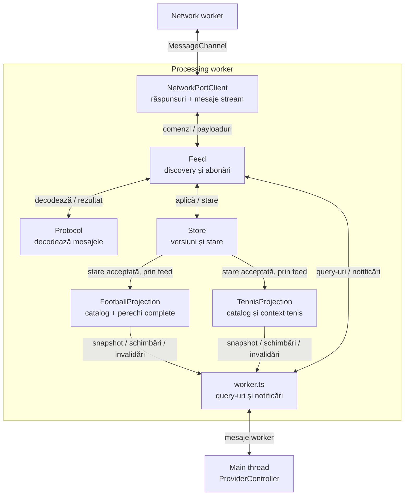
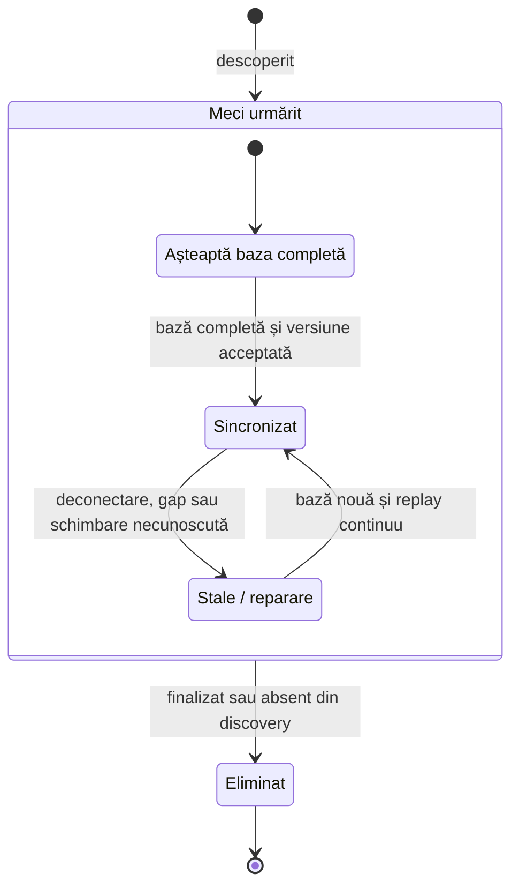
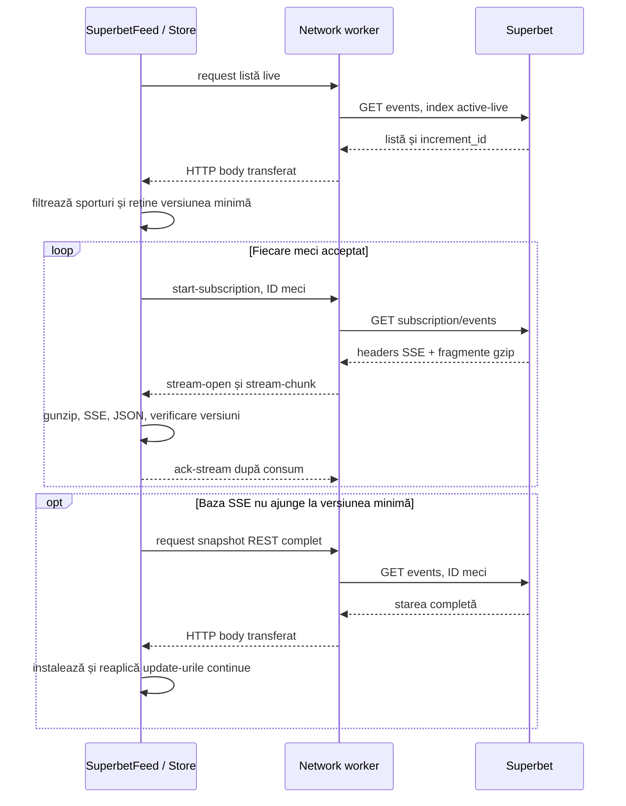
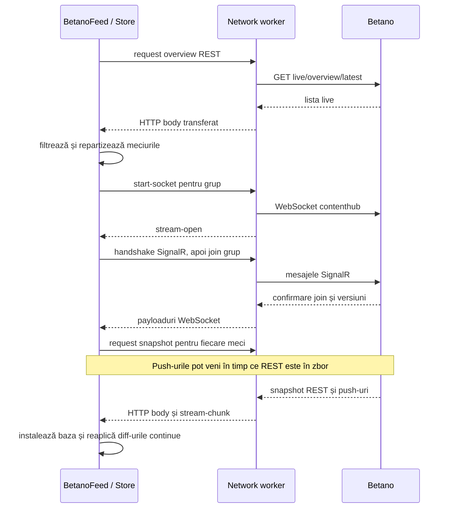

# Providers — de la mesaje la starea cotelor

[Ansamblul proiectului](../../README.md) · [Conexiuni și comunicare](NETWORK.md)

Contracte detaliate cu siteurile: [Superbet](../providers/superbet/CONTRACT.md) · [Betano](../providers/betano/CONTRACT.md). Acestea explică payloadurile, indicatorii și codurile de schimbări aplicate în store-uri.

[Superbet fotbal](../providers/superbet/FOOTBALL.md) și [Betano fotbal](../providers/betano/FOOTBALL.md) explică selecția explicită a piețelor, regula de exact două rezultate per linie și notificările filtrate. [Corespondențele dintre siteuri](../mapping/FOOTBALL.md) descriu tipurile comparabile și condițiile necesare.

[Superbet tenis](../providers/superbet/TENNIS.md) și [Betano tenis](../providers/betano/TENNIS.md) descriu separat cataloagele și proiecțiile acestui sport. [Matchingul de tenis](TENNIS.md) și [maparea](../mapping/TENNIS.md) sunt integrate până la oportunități, în motorul separat din aggregation worker.

Un provider este integrarea completă a unui site: știe unde găsește meciurile, cum se abonează la ele, cum interpretează mesajele și când starea cotelor poate fi folosită. Superbet și Betano folosesc aceeași infrastructură de networking, dar protocoale și modele de date diferite.

## Piesele unui provider

Ambele foldere, `src/providers/superbet` și `src/providers/betano`, au aceeași organizare:

| Piesă                      | Unde rulează              | Responsabilitate                                                                                    |
| -------------------------- | ------------------------- | --------------------------------------------------------------------------------------------------- |
| `controller.ts`            | Main thread               | API public, configurare, crearea celor doi workeri, canale, query-uri și cleanup.                   |
| `workers/worker.ts`        | Processing worker         | Leagă portul de networking de feed; răspunde main threadului și publică notificări.                 |
| `processing/feed.ts`       | Processing worker         | Descoperă și filtrează meciurile, gestionează abonările și programează snapshoturile/reîncercările. |
| `processing/state.ts`      | Processing worker         | Store-ul: starea fiecărui meci, aplicarea schimbărilor și verificarea versiunilor.                  |
| `processing/football-*.ts` | Processing worker         | Validarea catalogului, modelul filtrat de fotbal și actualizarea perechilor complete.               |
| `processing/tennis-*.ts`   | Processing worker         | Contextul de tenis, catalogul binar și actualizarea liniilor, separat de fotbal.                    |
| `protocol/`                | Processing worker         | Decodarea specifică siteului: SSE/gzip sau SignalR/LZ4, plus erorile HTTP specifice.                |
| `model/`                   | Contracte TypeScript      | Formele opțiunilor, datelor, mesajelor și handlerilor.                                              |
| `config.ts`, `logging.ts`  | Configurare / main thread | Valorile implicite și raportarea erorilor în consolă.                                               |

Feed-ul decide **când cere date**, protocolul decide **cum le citește**, iar store-ul decide **cum schimbă starea**. Sunt obiecte în același processing worker; fiecare fișier nu creează un thread separat.

La confirmarea inițializării, controllerul afișează câte o linie cu providerul, rolul (`network` sau `processing`) și ID-ul threadului. Aceste mesaje apar o singură dată la pornire și nu indică sincronizarea tuturor meciurilor.

După pornire, handlerii impliciți afișează numai erorile. Listele, eliminările și statisticile continuă să fie transmise către handlerii aplicației, fără tabele automate. [Testul de latență](../reports/LATENCY-TEST-2026-10-25.md) descrie separat măsurarea temporară a requesturilor și procesării.

Diagrama arată responsabilitățile. În cod, feed-ul leagă decodoarele și callbackurile store-ului, iar `workers/worker.ts` transmite rezultatele către controller. Query-urile cer starea store-ului prin worker.

## API-ul comun și comunicarea cu aplicația

| Apel / handler                           | Semnificație                                                                                                    |
| ---------------------------------------- | --------------------------------------------------------------------------------------------------------------- |
| `start()`                                | Pornește workerii, discovery și înregistrarea abonărilor. Nu așteaptă sincronizarea tuturor cotelor.            |
| `stop()`                                 | Oprește feed-ul și processing workerul, apoi networkingul. O instanță oprită nu se repornește; se creează alta. |
| `getEvents()`                            | Meciurile urmărite; prezența în listă nu garantează un snapshot disponibil.                                     |
| `getSnapshot(id)`                        | Starea sincronizată sau `null` dacă lipsește ori este invalidată. La Superbet se cere și un SSE conectat.       |
| `getStats()`                             | Numărul de meciuri, starea abonărilor și contoarele de procesare/recuperare.                                    |
| `getFootballSnapshot(id)`                | Modelul filtrat de fotbal sincronizat sau `null`; disponibil la ambii provideri.                                |
| `getTennisSnapshot(id)`                  | Modelul filtrat de tenis sincronizat sau `null`; disponibil la ambii provideri.                                  |
| `onTennisSnapshot`, `onTennisUpdate`      | Bază, linii schimbate și disponibilitate pentru tenis; publicare opțională către main la ambii provideri.         |
| `onFootballSnapshot`, `onFootballUpdate` | Bază filtrată, perechi schimbate, chei eliminate și invalidarea întregului meci.                                |
| `reconnect()`                            | Repornește abonările și declanșează resincronizarea.                                                            |
| `onEvents`, `onRemove`                   | Lista după discovery și eliminarea unui meci.                                                                   |
| `onSnapshot`, `onUpdate`                 | Starea completă, apoi actualizările acceptate de store.                                                         |
| `onStatus`, `onError`                    | Conectare, deconectare, `event-stale`, statistici și erori.                                                     |

Snapshoturile și actualizările sunt copiate către main thread **numai dacă există handlerul corespunzător**. Query-urile copiază rezultatul cerut. Store-ul se actualizează în processing worker indiferent dacă aplicația ascultă notificările.

La `event-stale`, un consumator care păstrează propria copie trebuie să o invalideze și să aștepte un nou `onSnapshot`. A rămâne cu ultimul preț afișat nu îl face sincronizat. Handlerii de pe main thread nu au același mecanism de credit ca payloadurile brute dintre workeri.

### Starea unui meci

**Snapshot** înseamnă baza completă; **update/diff**, o schimbare aplicată acelei baze; **stale**, o stare care nu mai poate fi expusă drept sincronizată.

În `Waiting` și `Repair`, `getSnapshot()` întoarce `null`. În `Current`, următoarea versiune validă păstrează meciul sincronizat. Duplicatele și versiunile vechi sunt ignorate. O versiune lipsă invalidează starea; actualizările ulterioare sunt păstrate într-un buffer limitat și reaplicate numai când formează o secvență continuă după noul snapshot. Dacă bufferul se umple, rămâne necesară repararea; nu se expune o stare incompletă.

Nu există o limită de 100 de meciuri în logica providerilor. Creșterea numărului de meciuri este gestionată prin abonări, pooluri și cozi cu limite, fără thread per meci.

## Superbet: un SSE pentru fiecare meci

[Controller](../../src/providers/superbet/controller.ts) · [Feed](../../src/providers/superbet/processing/feed.ts) · [Store](../../src/providers/superbet/processing/state.ts) · [Decoder](../../src/providers/superbet/protocol/sse.ts)

Discovery folosește ID-urile `5` pentru fotbal, `4` pentru baschet și `2` pentru tenis. Feed-ul cere evenimente active live, apoi verifică sportul și statusul `STARTED`; exclude evenimentele finalizate și outright. Repetă reconcilierea la cinci minute și elimină meciurile finalizate și prin mesajele SSE.

### Traseul inițial și actualizările

Blocul `loop` reprezintă același flux pentru mai multe abonări independente, active concurent. Pe HTTP/2, aceste SSE-uri pot împărți conexiunile TCP. Fiecare meci are propria coadă de procesare, astfel încât ordinea fragmentelor sale să fie păstrată fără a aștepta decomprimarea altui meci.

### De ce sunt necesare baza REST și verificarea versiunilor

SSE poate începe cu date din cache mai vechi decât lista REST. Providerul reține `increment_id` din discovery drept versiune minimă și nu publică o bază mai veche. Dacă mesajele nu ajung la acea versiune în zece secunde, cere un snapshot REST; un gap poate declanșa repararea mai devreme.

La reconectare invalidează baza veche. `revision` respinge snapshoturi REST pornite pe conexiunea anterioară, iar `epoch` și suspendarea acceptării mesajelor protejează restarturile explicite de fragmente rămase în coadă. Aceste verificări completează identificatorii de livrare din networking.

### Semantica datelor care contează

- SSE este text încadrat în evenimente, transportat de regulă cu gzip. Decoderul gestionează fragmente, UTF-8 împărțit, comentarii și separatori de linii; limitează dimensiunea decodată a unui eveniment.
- `is_full_market_update` înlocuiește piețele obișnuite. `superbets` și `priceboosts` au colecții și indicatori de înlocuire separați.
- Piețele sunt identificate prin ID **și nume**; selecțiile, prin UUID. Schimbările parțiale păstrează câmpurile omise, iar `display: false` elimină o selecție.
- Zero piețe **și** zero cote live declarate explicit reprezintă o stare validă, cu liste goale, chiar dacă lipsește indicatorul de actualizare completă. Lipsa unui câmp, singură, nu dovedește o bază completă.
- Prețul și `status` rămân în forma vendorului. Trebuie luate în calcul și suspendarea selecției și starea ofertei evenimentului.

EOF curat provoacă redeschiderea SSE și resincronizare; nu este numărat drept eroare de transport. Inactivitatea prelungită provoacă restart. Un `stream-stopped` permanent, inclusiv cazul HTTP 204, elimină evenimentul urmărit fără o buclă imediată de reconectare; discovery ulterior îl poate găsi din nou.

### Modelul filtrat pentru fotbal

În același processing worker, [proiecția](../../src/providers/superbet/processing/football-projection.ts) primește numai starea acceptată de store și aplică [catalogul explicit](../../src/providers/superbet/football-markets.config.ts). Fiecare linie publicată are exact două selecții și rolurile configurate; handicapul european, combinațiile, piețele pe jucători și liniile incomplete sunt excluse. Starea protocolului rămâne completă.

`getFootballSnapshot(id)` returnează modelul filtrat sau `null`, cu aceeași condiție de conectare și sincronizare ca snapshotul brut. `onFootballSnapshot` publică o bază completă; `onFootballUpdate` publică linii schimbate, chei eliminate, `kind: "invalidate"` pentru blocarea temporară a cotelor sau `kind: "remove"` pentru retragerea efectivă a proiecției. La invalidare se păstrează intern identitatea și liniile, marcate `synchronized: false`; query-ul public întoarce în continuare `null`. Replay-ul intern către agregator include acest marcaj, astfel încât o resincronizare a canalului nu reactivează cotele vechi. Notificările sunt copiate către main numai când există handlerii respectivi. Modelul de selecție este explicat în [documentul dedicat](../providers/superbet/FOOTBALL.md).

Proiecția poate interpreta separat snapshoturi prematch, dar providerul activ urmărește în continuare doar live. Livrarea directă către [agregator](AGGREGATOR.md), cu ACK și coalescență, pornește doar când controllerul primește un port de agregare.

### Modelul filtrat pentru tenis

Superbet aplică și [catalogul de tenis](../providers/superbet/TENNIS.md) în processing workerul existent, după acceptarea versiunilor de către store. Sunt 48 de definiții explicite: totaluri, handicapuri și Da/Nu, cu două selecții distincte și parametri structurați pentru set și game. Sunt păstrate scorurile pe seturi, punctele și jucătorul la serviciu; perioadele nu sunt folosite pentru a ghici formatul meciului.

`getTennisSnapshot`, `onTennisSnapshot` și `onTennisUpdate` au același ciclu `update / invalidate / remove` ca proiecția de fotbal. O deconectare blochează query-ul public până la o bază acceptată, iar terminarea retrage proiecția. Exportul este opțional; nu apar conexiuni sau workeri suplimentari. Providerul activ urmărește live, deși proiecția poate interpreta separat snapshoturi prematch.

Tenisul folosește un codec, outbox și canal direct proprii, până la motorul separat din aggregation worker. Nu este trimis motorului de fotbal. Controllerii primesc opțional portul de fotbal ca argument trei și pe cel de tenis ca argument patru; fără port, API-ul providerului funcționează în continuare. Replay-ul intern păstrează marcajul stale; cote vechi nu devin eligibile prin retrimitere.

### Endpointurile folosite

Origin implicit: `https://production-superbet-offer-ro.freetls.fastly.net`.

| Scop             | Cale                                                           |
| ---------------- | -------------------------------------------------------------- |
| Discovery        | `/v3/ro-RO/events?index=active-live&startDate=...&endDate=...` |
| Snapshot complet | `/v3/ro-RO/events?events=<id>`                                 |
| SSE per meci     | `/v3/subscription/ro-RO/events?events=<id>`                    |

Intervalul discovery acoperă șapte zile în urmă până la începutul zilei UTC următoare. Lista este filtrată la live după răspuns; intervalul nu schimbă frecvența de refresh.

## Betano: WebSocketuri cu grupuri de meciuri

[Controller](../../src/providers/betano/controller.ts) · [Feed](../../src/providers/betano/processing/feed.ts) · [Store](../../src/providers/betano/processing/state.ts) · [SignalR](../../src/providers/betano/protocol/signalr.ts) · [LZ4](../../src/providers/betano/protocol/compression.ts)

Discovery selectează sporturile `FOOT`, `BASK`, `TENN`, cu `isLive: true` și fără `isEnded: true`. Zonele identificate ca virtuale sau esports sunt excluse.

Providerul folosește un socket de **overview** și socketuri de evenimente cu maximum **50 de meciuri fiecare**, implicit. Overview-ul urmărește apariții și eliminări; celelalte socketuri urmăresc versiunile și schimbările meciurilor. Grupurile își păstrează membrii când este posibil și sunt eliberate când devin goale.

### Abonarea înaintea snapshotului

Feed-ul face join cu `includeEvent: true`, `IncludeMarkets: true`, `IncludeIncidents: false`, apoi așteaptă versiunea split a fiecărui membru înainte de cererea REST. Astfel, push-urile primite în timpul cererii REST pot fi reținute și reaplicate peste versiunea snapshotului. Varianta cu un singur REST, urmat abia apoi de abonare, ar lăsa un interval între cele două surse. [protocol/audience.ts](../../src/providers/betano/protocol/audience.ts) aliniază versiunea REST la audiența eveniment + piețe; cronologia incidentelor nu este menținută de feed. Scorurile, statisticile și cotele rămân în flux.

### Straturile protocolului

| Strat        | Rol                                                                                                                                  |
| ------------ | ------------------------------------------------------------------------------------------------------------------------------------ |
| WebSocket    | Conexiunea și livrarea payloadurilor; supravegheate de networking.                                                                   |
| SignalR JSON | Handshake, separarea înregistrărilor cu `0x1e`, apeluri `join`/`leave`, confirmări și heartbeat; procesate în workerul de procesare. |
| Base64 + LZ4 | Conținutul comprimat al notificărilor de diff este decodat înainte de verificarea datelor.                                           |
| Store        | Aplică tipurile de schimbări cunoscute, verifică versiuni și cere reparare pentru gap-uri sau schimbări neacceptate.                 |

`NewLiveEventSplitDiff` actualizează meciurile; `NewLiveOverviewDiffs` poate elimina evenimente sau programa discovery, cu o scurtă grupare a semnalelor apropiate. `OnActiveLiveEventSplitVersion` semnalează versiunea pe care trebuie să o atingă starea locală.

La deconectarea unui socket sunt invalidate meciurile lui și revizia se schimbă imediat; răspunsurile REST vechi sunt ignorate chiar dacă sosesc înaintea reconectării. Handshake-ul și join-ul nu deblochează singure starea: confirmarea audienței și versiunii permite reutilizarea bazei numai dacă aceasta și diff-urile continue acoperă versiunea confirmată. Se cer snapshoturi numai pentru golurile rămase. Notificarea de deconectare nu se dublează pentru `stream-end` și `stream-error`, iar eroarea identifică socketul. Resetul de eveniment permite și refacerea bazei după restartarea numerotării versiunilor. Un reset global declanșează repararea stărilor și discovery. Discovery este amânat în cooldownul REST fără a raporta fiecare semnal drept o nouă eroare 429.

Store-ul păstrează separat evenimentul, piețele și selecțiile. Aplică prețuri, suspendări, adăugări/eliminări, ordonare și metadate cunoscute; nu presupune că un tip necunoscut poate fi ignorat în siguranță. Consumatorul primește diff-ul original acceptat sau un snapshot nou după reparare.

### Modelul filtrat pentru fotbal

[Catalogul Betano](../../src/providers/betano/football-markets.config.ts) fixează `typeId`, codul, numele și cele două roluri. `market.id` identifică instanța, nu tipul reutilizabil. [Proiecția](../../src/providers/betano/processing/football-projection.ts) primește starea după patch și păstrează copii mici, separate de obiectele brute modificate în loc.

Prețurile și setările recalculează numai piețele afectate; schimbările structurale refac referințele. Fiecare upsert conține o pereche completă. Un gap, o deconectare sau un reset emite `invalidate`: identitatea rămâne, cotele sunt blocate și query-ul public întoarce `null` până la baza nouă. Eliminarea, metadatele neproiectabile și oprirea emit `remove`. Query-urile și handlerii au același stil ca la Superbet și transferă către main numai datele cerute.

HTML-ul prematch grupează mai multe praguri într-o piață și poate repeta aceeași piață în mai multe secțiuni. Adaptorul separat validează perechile și copiile identice, fără să inventeze versiuni și fără să adauge un feed prematch. [Documentul Betano fotbal](../providers/betano/FOOTBALL.md) descrie modelul, catalogul și verificările.

### Modelul filtrat pentru tenis

[Catalogul Betano tenis](../providers/betano/TENNIS.md) conține 32 de definiții explicite: 23 totaluri, 3 handicapuri și 6 piețe Da/Nu. Aceeași stare brută acceptată alimentează proiecția de tenis în workerul existent, cu indexuri pentru recalcularea piețelor afectate. API-ul `getTennisSnapshot`, `onTennisSnapshot`, `onTennisUpdate` aplică aceleași reguli de invalidare, recuperare și eliminare ca la fotbal.

Contextul distinge punctele game-ului de seturile câștigate și numărul game-ului în set de numărul global pe meci. Se păstrează participanții de simplu/dublu fără reordonarea numelor. Adaptorul pur prematch validează separat pragurile grupate și copiile SSR; nu adaugă discovery prematch. Codecul de tenis transmite numai liniile cu o corespondență activă, pe canalul dedicat, către motorul și detectorul de tenis. Contextul și disponibilitatea circulă separat de valorile cotelor.

### Endpointurile folosite

Origin implicit: `https://ro.betano.com`. Requesturile HTTP folosesc `x-language: 4`, `x-operator: 3` și `Accept: application/json`.

| Scop            | Cale / apel                                                                                        |
| --------------- | -------------------------------------------------------------------------------------------------- |
| Discovery       | `/danae-webapi/api/live/overview/latest?includeVirtuals=false&queryLanguageId=4&queryOperatorId=3` |
| Snapshot        | `/danae-webapi/api/live/events/<id>/latest`                                                        |
| WebSocket       | `/contenthub?platformType=1`                                                                       |
| Grup overview   | `joinLiveOverviewGroupWithOptions`                                                                 |
| Grup de meciuri | `joinLiveEventGroup`; eliminare prin `leaveLiveEventGroup`                                         |

Transportul browser folosește `wreq-js`, nu browserul utilizatorului. Conexiunea WebSocket, sesiunea SignalR și sincronizarea meciurilor sunt trei stări distincte: deschiderea primei nu le garantează pe celelalte.

## Configurări care contează

Valorile implicite sunt în [Superbet config](../../src/providers/superbet/config.ts) și [Betano config](../../src/providers/betano/config.ts); constructorii acceptă suprascrieri parțiale.

| Opțiune / comportament       | Superbet                           | Betano                                        | De ce contează                                                            |
| ---------------------------- | ---------------------------------- | --------------------------------------------- | ------------------------------------------------------------------------- |
| Discovery complet            | 5 minute                           | 5 minute + semnale overview                   | Reconciliere a meciurilor urmărite.                                       |
| Abonări                      | 1 SSE / meci                       | 1 overview + grupuri de 50                    | Costul conexiunilor și aria afectată de o reconectare.                    |
| Request timeout              | 10 s                               | 10 s                                          | Limitează cererile REST și așteptările de deschidere relevante.           |
| Retry de bază                | 1 s                                | 1 s                                           | Evită o buclă imediată la eșec. Reparațiile REST au backoff până la 30 s. |
| Snapshoturi REST concurente  | 8                                  | 8                                             | Controlează încărcarea în timpul recuperării.                             |
| Actualizări în buffer / meci | 256                                | 256                                           | Păstrează schimbările în zbor cu o limită de număr.                       |
| Credit de date brute         | 256 KiB / SSE                      | 1 MiB / socket                                | Limitează bytes neconfirmați între workeri.                               |
| Limită mesaj decodat         | 32 MiB                             | 32 MiB                                        | Protejează parsarea/decompresia; este diferită de creditul brut.          |
| Recuperare bază inițială     | REST după 10 s fără catch-up       | REST după join                                | Obține o bază utilizabilă fără a aștepta indefinit un push.               |
| Supraveghere inactivitate    | 45 s, verificare periodică în feed | 45 s în networking; heartbeat SignalR la 15 s | Detectează conexiuni care nu mai livrează.                                |

La Superbet, poolul Node permite implicit 8 sesiuni HTTP/2 care acceptă operații noi și un slot rezervat REST pe sesiune când este posibil. Fallback-ul HTTP/1.1 are 256 de conexiuni configurate; la extindere trebuie să rămână loc pentru REST pe lângă SSE-uri. Betano folosește poolul nativ al bibliotecii, nu acest pool Node.

La HTTP 429/503, ambele feed-uri respectă `Retry-After` printr-un cooldown REST comun providerului. Abonările deja deschise nu sunt oprite de acel cooldown.

## Cum citim statisticile și limitele actuale

`events` arată câte meciuri sunt urmărite; `synchronizedEvents`, câte au starea disponibilă. Diferența poate apărea la pornire, deconectare sau reparare, fără ca fiecare astfel de caz să fie o eroare HTTP.

La Superbet, `reconnects` include redeschideri după EOF curat; `streamErrors`, `snapshotErrors` și `decodeErrors` separă tipurile de eșec. La Betano, `connectedSockets` reflectă sesiunile SignalR pregătite, iar `resynchronizations` numără invalidările unor stări anterior sincronizate. Ambele publică statistici periodic, la cinci secunde.

Providerii păstrează starea în memorie și folosesc API-uri nedocumentate ale siteurilor. Nu persistă istoric și nu oferă încă un model unic de cote între case. Testele din [test](../../test) acoperă protocoalele, ordinea versiunilor, recuperarea și anularea operațiilor; verificarea accesului real și a latenței sursei este o verificare live separată.
