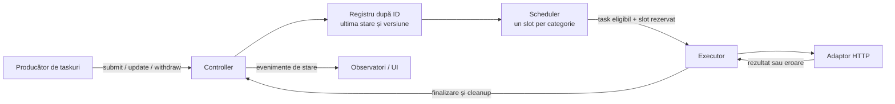
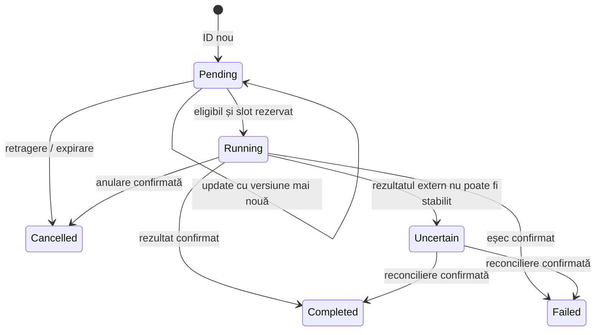

# Executor de taskuri HTTP — propunere de arhitectură

**Stare:** document de proiectare; componenta nu este implementată.

Componenta gestionează taskuri HTTP în categorii independente. Fiecare categorie permite o singură execuție în curs. Taskurile care așteaptă sunt actualizate, retrase sau finalizate după ID; schedulerul selectează cea mai veche intrare eligibilă la momentul pornirii.

Exemple de categorii sunt sincronizarea unui catalog și generarea unor rapoarte. Categoria descrie limita de concurență, fără să impună un thread separat.

## 1. Componente și comunicare



| Componentă | Responsabilitate |
| --- | --- |
| Controller | Primește comenzile, coordonează pornirea și oprirea, publică schimbările de stare. |
| Registru | Păstrează o singură intrare pentru fiecare ID și cea mai recentă versiune a datelor. |
| Scheduler | Aplică politica FIFO între taskurile eligibile și rezervă slotul categoriei. |
| Executor | Rulează un task selectat, gestionează rezultatul și cleanup-ul. |
| Adaptor HTTP | Traduce operația în cereri și răspunsuri; nu decide prioritatea sau concurența. |

Controllerul și schedulerul pot rula asincron pe main. Networkingul execută I/O prin infrastructura existentă. Un worker suplimentar se introduce numai dacă măsurătorile arată procesare CPU costisitoare sau o nevoie concretă de izolare.

## 2. Datele păstrate

### Task

| Câmp | Rol |
| --- | --- |
| `id` | Identificator stabil, folosit pentru deduplicare. |
| `category` | Categoria care limitează concurența. |
| `version` | Versiune crescătoare a datelor taskului. |
| `createdSequence` | Ordine locală de sosire; nu depinde de modificarea ceasului sistemului. |
| `active` | Indică dacă taskul mai poate fi selectat. |
| `status` | `pending`, `running`, `completed`, `failed`, `cancelled` sau `uncertain`. |
| `payload` | Datele necesare operației, păstrate numai în registru până la selecție. |
| `attemptId` | Identifică execuția în curs și permite respingerea rezultatelor întârziate. |
| `result` / `error` | Rezultatul final și cauza observată a eșecului, după caz. |

### Categorie

Fiecare categorie are un `runningTaskId`, inițial gol, un indicator de oprire/blocare și o ordine a ID-urilor care așteaptă. Coada păstrează ID-uri, nu copii ale payloadurilor; înaintea pornirii, datele sunt citite din registru.

Categoria unui ID rămâne fixă pe durata lui de viață. Schimbarea categoriei se reprezintă prin retragerea intrării vechi și trimiterea unui task nou.

## 3. Reguli de concurență și selecție

1. Există maximum un task `running` în fiecare categorie.
2. Categorii diferite pot executa simultan. Pentru două categorii, plafonul implicit este de două taskuri; fiecare task poate avea mai multe etape interne.
3. Un update al unui ID existent nu adaugă încă o poziție în coadă și nu modifică ordinea inițială.
4. Se selectează cel mai vechi ID care este încă `pending`, activ și eligibil conform precondițiilor operației.
5. La selecție se verifică starea curentă din registru. Taskurile retrase, expirate sau deja finalizate sunt sărite.
6. Slotul se rezervă sincron, înaintea primului `await`. O singură funcție de selecție deține această rezervare.
7. Slotul este eliberat numai după tratarea rezultatului și cleanup. Un callback al unei încercări vechi nu poate elibera slotul alteia noi.

FIFO este politica inițială de planificare. Nu presupune că cel mai vechi task are valoare sau probabilitate de succes mai mare. Dacă se schimbă politica, ea trebuie separată de mecanismul care garantează concurența.

## 4. Ciclul de viață



### Sosire și actualizare

Un ID nou primește `createdSequence` și intră în `pending`. Pentru un ID existent, se acceptă numai versiuni mai noi; duplicatele și mesajele vechi sunt ignorate.

Un task aflat în așteptare folosește payloadul cel mai recent când este selectat. La pornire, executorul primește o copie stabilă a datelor și versiunea selectată. Updateurile ulterioare pot fi păstrate în registru, dar nu rescriu pe ascuns parametrii unei operații deja trimise.

### Retragere

Retragerea unui task `pending` îl marchează `cancelled` și îl face neeligibil. El poate fi eliminat din coadă imediat sau sărit la următoarea selecție.

Pentru un task `running`, retragerea înregistrează o cerere de anulare. Categoria rămâne ocupată până când executorul încheie tratarea operației. Anularea locală a așteptării nu demonstrează anularea unei acțiuni deja primite de un serviciu extern.

### Finalizare și repetare

După un rezultat confirmat, controllerul înregistrează starea terminală și eliberează slotul corespunzător aceluiași `attemptId`. Apoi solicită o nouă selecție în acea categorie.

Un task finalizat nu revine automat în `pending` la următorul update al aceluiași ID. O nouă execuție trebuie cerută explicit, cu un ID sau o generație nouă. Reluările automate rămân dezactivate inițial.

Un timeout poate lăsa rezultatul extern necunoscut. În acest caz, taskul devine `uncertain`, categoria se blochează și este necesară reconcilierea înaintea continuării. Concurența locală de unu nu garantează singură că un serviciu extern nu mai procesează o cerere expirată local.

## 5. Exemple

### Două categorii independente

| Ordine | Task | Categorie | Rezultat al planificării |
| --- | --- | --- | --- |
| 1 | `catalog-1` | `catalog-sync` | Pornește. |
| 2 | `catalog-2` | `catalog-sync` | Așteaptă după `catalog-1`. |
| 3 | `report-1` | `report-export` | Poate porni în paralel cu `catalog-1`. |
| 4 | `catalog-3` | `catalog-sync` | Așteaptă după `catalog-2`. |

### Update și retragere în timpul execuției

`catalog-1` este în lucru. `catalog-2` primește o versiune nouă, apoi este retras. `catalog-3` rămâne activ.

Când `catalog-1` se încheie, schedulerul citește registrul, sare peste `catalog-2` și pornește `catalog-3`. Categoria rapoartelor își continuă independent execuția.

### Rezultat întârziat

O finalizare este aplicată numai dacă ID-ul, versiunea de execuție și `attemptId` corespund operației urmărite. Mesajele duplicate sau rezultatele unei generații vechi nu modifică slotul curent și nu pornesc un task suplimentar.

## 6. Structura propusă

```text
src/tasks/
  config.ts
  controller.ts
  model/
    task.interfaces.ts
    scheduler.interfaces.ts
    executor.interfaces.ts
  processing/
    registry.ts
    scheduler.ts
    executor.ts
  adapters/
    http.ts
```

`index.ts` creează componenta și îi coordonează lifecycle-ul. Selecția, validarea stării și tratarea rezultatelor rămân în modul. Configurația include categoriile, capacitatea maximă a cozii, timeouturile și politica de păstrare a rezultatelor.

## 7. Ce trebuie implementat

1. **Contractele și configurația:** taskuri, versiuni, stări, rezultate și categoriile acceptate.
2. **Registrul:** deduplicare după ID, respingerea versiunilor vechi, updateuri și retrageri.
3. **Schedulerul:** FIFO între intrările eligibile, slot separat per categorie și rezervare înainte de operațiile asincrone.
4. **Executorul și adaptorul:** copie stabilă a datelor, rezultat explicit, cleanup și identificarea încercării.
5. **Lifecycle-ul și observabilitatea:** oprirea selecției, terminarea operațiilor în curs, număr de taskuri în așteptare, timp de așteptare, durată și cauze de eșec.
6. **Verificările:** execuții simultane în aceeași categorie, independența categoriilor, updateuri duplicate, retrageri, rezultate întârziate, timeout și oprire în timpul execuției.

Capacitatea cozii trebuie limitată. La depășire, taskurile noi sunt refuzate explicit; operațiile în curs nu sunt eliminate pentru a face loc. Rezultatele terminale sunt păstrate după o politică limitată de timp sau număr, pentru a evita creșterea nelimitată a memoriei.

La oprire se refuză taskurile noi și nu mai începe următoarea execuție. Componenta așteaptă operațiile în curs până la termenul de shutdown, înregistrează rezultatele confirmate și raportează separat operațiile rămase incerte.

## 8. Criterii de acceptare

- Nicio categorie nu are două execuții simultane.
- Un update de payload nu dublează un task și nu îi resetează ordinea.
- Un task retras în așteptare nu ajunge la adaptor.
- Finalizarea unei categorii nu modifică slotul alteia.
- Erorile sunt tratate înaintea continuării cozii; rezultatele incerte blochează categoria.
- Taskurile finalizate nu sunt relansate implicit.
- Oprirea nu permite pornirea unor taskuri noi și nu lasă rezultate incerte ascunse.
