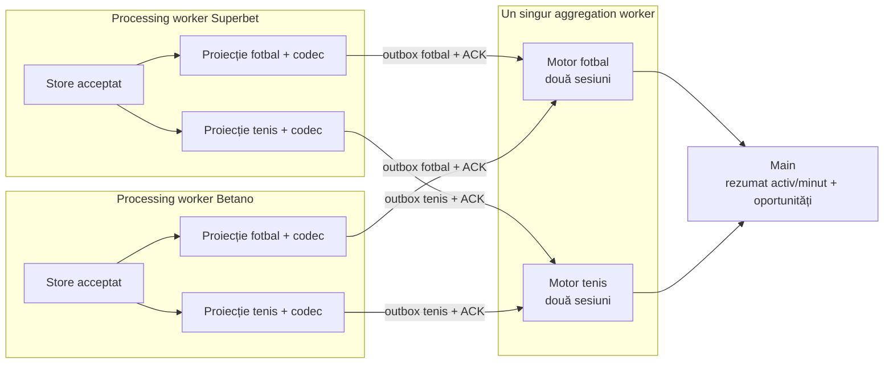
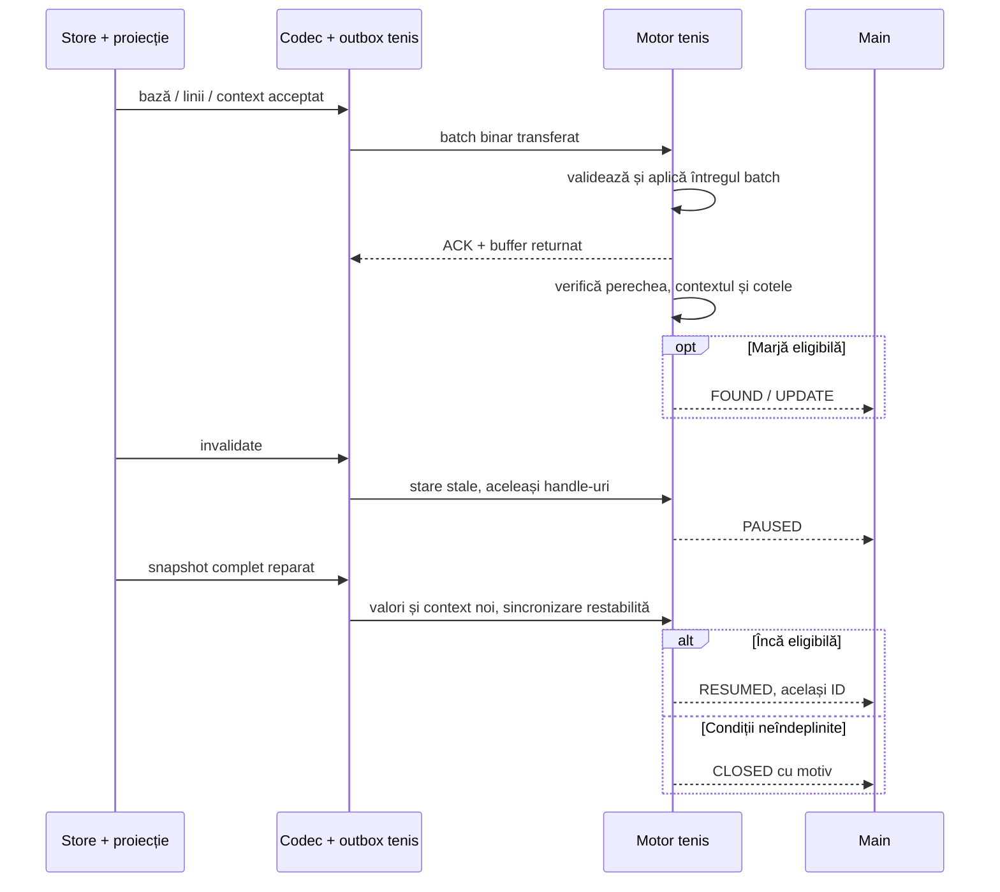

# Tenis — de la proiecții la oportunități

[Index](../README.md) · [Agregator comun](AGGREGATOR.md) · [Mapare tenis](../mapping/TENNIS.md) · [Providers](PROVIDERS.md)

## 1. Ce rulează

Tenisul folosește **workerii existenți**: câte unul de networking și procesare pentru fiecare provider, plus un singur worker de agregare. În agregator, fotbalul și tenisul au instanțe separate ale motorului, cu registru de meciuri, cotații, matching, detector și sesiuni proprii.

Sunt două canale directe per provider, unul per sport. Acestea nu sunt conexiuni noi către siteuri. Fiecare are propriul outbox, generație, secvență, ACK și limite de memorie. Datele brute și actualizările filtrate ocolesc main threadul; pe main ajung rapoartele și rezultatele query-urilor.

Separarea împiedică amestecarea sporturilor chiar dacă ID-urile de eveniment, Betradar, handle-urile sau numerele locale de oportunitate coincid. O eroare pe canalul de tenis elimină starea acelui canal; nu oprește networkingul sau canalul de fotbal. Ambele motoare împart CPU-ul workerului, deci nu există izolare de timp CPU între sporturi.

## 2. Fișiere și responsabilități

| Fișier                                                                                                                                                             | Responsabilitate                                                                                    |
| ------------------------------------------------------------------------------------------------------------------------------------------------------------------ | --------------------------------------------------------------------------------------------------- |
| [tennis-mapping.config.ts](../../src/aggregation/tennis-mapping.config.ts) și [tennis-mapping.ts](../../src/aggregation/tennis-mapping.ts)                         | Cele 26 de corespondențe și verificarea lor; 25 active.                                             |
| [adapter/projection.ts](../../src/aggregation/adapter/projection.ts)                                                                                               | Adaptor comun pentru ambele sporturi: identitate, proprietatea cheilor și reconciliere la snapshot. |
| [adapter/tennis.ts](../../src/aggregation/adapter/tennis.ts)                                                                                                       | Cheile cu set, pragurile acceptate și normalizarea contextului.                                     |
| [Codecul Superbet](../../src/providers/superbet/processing/tennis-aggregation.ts) și [codecul Betano](../../src/providers/betano/processing/tennis-aggregation.ts) | Traduc structurile vendor în context și cotații canonice.                                           |
| [matching/tennis-names.ts](../../src/aggregation/matching/tennis-names.ts)                                                                                         | Nume de jucători, inițiale și perechi de dublu, fără regulile de cluburi din fotbal.                |
| [protocol/tennis.ts](../../src/aggregation/protocol/tennis.ts)                                                                                                     | Validarea, codarea și egalitatea contextului.                                                       |
| [processing/engine.ts](../../src/aggregation/processing/engine.ts) și [processing/detector.ts](../../src/aggregation/processing/detector.ts)                       | Matching, linkarea liniilor, porțile și ciclul oportunității, parametrizate pe sport.               |
| [workers/worker.ts](../../src/aggregation/workers/worker.ts)                                                                                                       | Cele două motoare într-un worker, rutarea canalelor, rapoarte și statistici.                        |
| [Interfețe tenis](../../src/aggregation/model/tennis.interfaces.ts)                                                                                                | Sportul și contextul canonic; celelalte contracte rămân în `model/`.                                |

`FootballAggregationAdapter` rămâne un export compatibil al adaptorului comun. Tipurile comune se numesc `ProjectionCodec`, `ProjectionSnapshotLike` etc.; aliasurile vechi de tip rămân disponibile. Fișierul `adapter/football.ts` păstrează funcția specifică de construire a cheilor de fotbal.

## 3. Asocierea meciurilor

Motorul de tenis cere un **Betradar valid comun**, exact un eveniment per provider pentru acel ID și dovezi suficiente pentru ambii participanți în aceeași orientare. Ora de început, dacă este cunoscută la ambele siteuri, trebuie să respecte `startToleranceMs`. Un ID duplicat blochează asocierea.

Numele sunt normalizate la schimbarea identității, fără eliminarea tokenurilor de club din fotbal. Diacriticele și punctuația nu schimbă sensul; inițialele sunt permise numai împreună cu cel puțin un token complet comun. Similaritatea minimă este `0.8` pentru fiecare participant. La dublu se verifică separat cei doi membri ai fiecărui participant, chiar dacă ordinea internă diferă; nu se amestecă membri între adversari.

O orientare inversată a adversarilor este suspectă. Nu inversăm automat numele, handicapurile sau scorul. Fără ID comun, un candidat bazat pe nume poate fi doar observat, niciodată trimis detectorului. Aliasurile și competițiile învățate pentru fotbal nu sunt folosite sau învățate în motorul de tenis.

Asocierea confirmă identitatea, nu disponibilitatea. O deconectare păstrează o pereche cunoscută dacă identitatea nu este contrazisă; cotele sunt blocate separat. Diferențele persistente la scorul seturilor pot face perechea suspectă, ca la fotbal.

## 4. Contextul înaintea comparării

| Date             | Regulă                                                                                               |
| ---------------- | ---------------------------------------------------------------------------------------------------- |
| Seturi câștigate | Ambele scoruri trebuie să fie cunoscute și egale între siteuri.                                      |
| Game-uri pe set  | Liste contigue începând cu setul 1, aceeași lungime și aceleași scoruri cunoscute.                   |
| Set curent       | Același set; numărul intrărilor din lista de scor trebuie să îl confirme.                            |
| Puncte           | Cunoscut la ambele siteuri și identic pentru fiecare participant; `A` și `AD` devin aceeași valoare. |
| Serviciu         | Același participant la serviciu; necunoscutul blochează comparația.                                  |
| Simplu/dublu     | Doi indicatori cunoscuți care se contrazic blochează comparația.                                     |

Superbet nu publică în model un număr separat de set curent: codecul folosește ultima perioadă din lista contiguă. Betano folosește `currentSetNumber`. Nu deducem de aici formatul meciului sau tratamentul setului decisiv. Scorul necunoscut rămâne necunoscut; nu devine zero. Un `/` în numele perechii poate marca conservator contextul ca dublu, fără să autorizeze un format de decontare.

Porțile sunt: pereche confirmată, sincronizare, live, suspendare, scor la seturi, `tennis-context`, stabilizare după schimbarea seturilor și întârzierea batchului. Linia unui set trecut este blocată separat. O diferență de puncte sau serviciu blochează imediat, fără perioada de toleranță a identității.

Schimbarea fiecărui punct nu pornește pauza de cinci secunde a fotbalului. `scoreSettleMs` se aplică aici schimbării scorului **la seturi**; celelalte elemente sunt comparate exact când ajung. Dacă două fluxuri avansează la momente diferite, poate exista o scurtă fereastră fără comparație.

## 5. Traseul unui update

O schimbare de preț recalculează numai liniile legate atinse. O schimbare de context marchează liniile perechii pentru reverificare. Nu se rescanează toate meciurile pentru fiecare cotă. Coada păstrează ultima valoare, cu un singur batch în zbor per provider/sport.

Protocolul comun este versiunea **3**. Prețurile au în continuare înregistrări de **21 bytes**. Operația nouă `event-tennis` are **37 bytes**: cod, handle și context fix de 32 bytes, inclusiv până la cinci scoruri de set. Se trimite numai când contextul se schimbă; nu este repetat pentru fiecare cotă. Contextul este material și poate grăbi trimiterea, la fel ca invalidarea.

Receiverul validează dimensiunile, scorurile, sentinelele, coordonatele și ciclul handle-urilor. Contextul de tenis pe un canal de fotbal este respins. O eroare cere resincronizare și elimină starea acelui canal. Limita de batch include contextul maxim și segmentele posibile la replay. Cele două înregistrări de context/stare se încheie înainte ca o depășire să poată declanșa resetul sincron, astfel încât handle-urile reatribuite nu primesc starea altui meci. Un context nevalid primit de outbox blochează sincronizarea, iar codecurile transformă scorurile care depășesc formatul în necunoscute.

## 6. Oportunități și ce apare în consolă

Detectorul compară numai două selecții opuse din case diferite, de pe aceeași cheie canonică. Formula și fracțiile de miză sunt aceleași ca la fotbal. [Maparea](../mapping/TENNIS.md) explică pragurile acceptate și piețele excluse.

Pragul rămâne cel din [config.ts](../../src/aggregation/config.ts): `minMarginBps: 200` în configurația curentă, adică **2%**. Nu a fost coborât pentru activarea tenisului.

- Tabelul inițial conține meciurile confirmate și coloana `sport`; după aceea apar numai modificările de apartenență.
- Oportunitățile de tenis au marcajul `[TENNIS]`, nume de participanți, scor pe seturi/game-uri/puncte, piață, prag și cote cu etichete explicite.
- Verde `FOUND`, albastru `UPDATE`/`RESUMED`, galben `PAUSED`; `CLOSED` mov dacă marja raportată rămâne peste 0,5%, roșu la 0,5% sau mai jos, cu durata, ultimele cote și cauza observată. Acest prag vizual nu schimbă `minMarginBps` și nu prelungește urmărirea sub pragul configurat; movul nu confirmă disponibilitatea cotelor dacă motivul închiderii este o suspendare, retragere sau altă poartă.
- O pierdere de sincronizare pune în pauză oportunitatea existentă. O schimbare de scor/context neeligibil, suspendare, marjă sau retragere o închide; o nouă deschidere după această închidere primește un ID nou.

Identitatea unui raport este `(sport, id)`, deoarece motoarele au contoare independente. `onOpportunity`, `onPair`, `onObserved` și `onMatches` includ `sport`; se pot înregistra în același fișier fără a amesteca identificatorii.

`getStats().sports.tennis` și `.sports.football` conțin separat sesiuni, matching, comparații, oportunități și `activeMatches`. Acesta numără perechile care trec porțile detectorului și au cel puțin o linie comună utilizabilă, excluzând seturile încheiate, indiferent de marjă. Handlerul implicit așteaptă primele perechi utilizabile înaintea contorului inițial; dacă totalul rămâne zero, așteptarea este limitată la 30 de secunde de la primul raport de statistici. Totalul și valorile pe sport se repetă apoi la fiecare minut, fără tabel sau loguri de apartenență. Câmpurile istorice de la rădăcina statisticilor continuă să descrie fotbalul; recorderul este comun. `compared` și `bestMarginBps` sunt valori de fereastră, resetate la raportarea periodică, nu totaluri de la pornire.

## 7. Verificare

[Testele dedicate](../../test/aggregation-tennis.test.mjs) acoperă cataloagele reale, chei, roluri, nume de simplu/dublu, context, mesaje malformate, praguri, excluderi și ciclul oportunității. Un test trece prin adaptor, outbox, batch transferat, sesiune și detector; altul pornește workerul real și folosește intenționat aceleași ID-uri și handle-uri în cele două sporturi.

Verificarea live de **25 secunde** a rulat ambele siteuri și sporturi în același timp: 11 perechi de tenis, 128 linii comune și 466 comparații eligibile; în paralel, 42 perechi de fotbal. Nu a apărut o marjă peste 2% și nu au existat erori sau resincronizări ale canalelor de agregare. Betano a raportat o închidere WebSocket `1005` în timpul colectării; fluxul a continuat. Acest test scurt nu stabilește stabilitatea pe termen lung sau momentul real al publicării cotelor la sursă.

Testele cu cote controlate confirmă `open/update/close` și `pause/resume` fără a modifica pragul aplicației. Providerii și workerul agregatorului sunt opriți după verificări; capturile și scripturile brute temporare sunt șterse. Exemplele reduse de vendor folosite de testele automate rămân în `test/fixtures/`.
