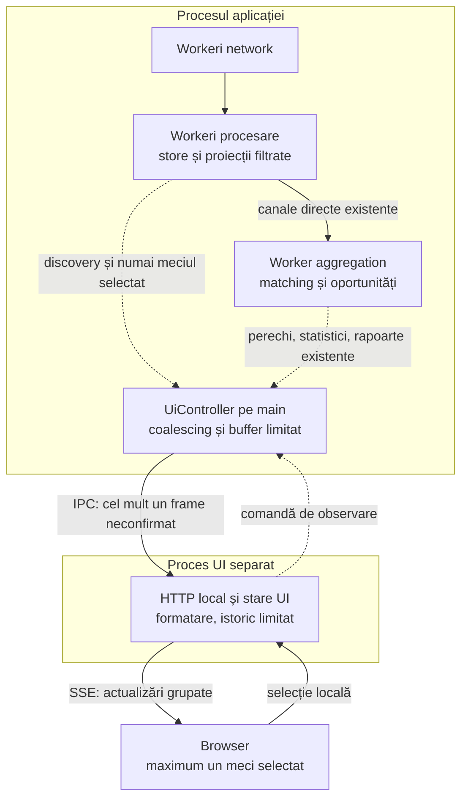

# UI local de observare

Interfața este un consumator al datelor existente. Nu cere cote de la siteuri și nu comandă operații comerciale. Serverul HTTP și formatarea datelor rulează într-un **proces Node separat**, iar browserul afișează trei taburi.

## Pornire

```powershell
npm run build
npm start
```

Aplicația anunță adresa **http://127.0.0.1:4310** în consolă. Browserul se deschide manual. `npm start` păstrează comportamentul componentelor existente; adăugarea UI-ului nu dezactivează alte componente ale aplicației.

Configurarea este în `src/ui/config.ts`. În PowerShell, pentru oprirea completă a procesului și observării UI:

```powershell
$env:UI_ENABLED = "0"
```

`UI_PORT` schimbă portul local. Eliminarea variabilei `UI_ENABLED` sau valoarea `1` reactivează UI-ul la următoarea pornire. `build` compilează TypeScript și copiază HTML/CSS în `dist/ui/browser/`; nu există server de dezvoltare sau dependențe frontend suplimentare. După schimbarea HTML/CSS se rulează din nou build.

## Flux și responsabilități



| Componentă                    | Responsabilitate                                                                                            |
| ----------------------------- | ----------------------------------------------------------------------------------------------------------- |
| `ui/controller.ts`            | Cache de identități/statistici, buffer de rapoarte, selecție globală, generații și ciclul procesului copil. |
| `ui/observation/events.ts`    | Reduce discovery la site, sport, ID și nume. Nu copiază payloadurile vendor în UI.                          |
| `ui/observation/quotes.ts`    | În workerul providerului, citește proiecția numai pentru selecția curentă și numai după schimbări.          |
| `ui/server/process.ts`        | Servește fișiere statice, gestionează SSE, verifică comenzile locale și păstrează istoricul limitat.        |
| `ui/server/quotes.ts`         | Traduce proiecțiile în rânduri pentru afișare; această muncă nu rulează în networking sau aggregation.      |
| `ui/server/canonical.ts`      | Refolosește mapările active și codec-urile existente pentru chei de market/linie identice între siteuri.    |
| `ui/browser/paired-quotes.ts` | Unește liniile canonice prezente la ambele surse; fiecare rând conține două selecții pentru fiecare site.   |
| `ui/browser/`                 | Filtre, paginare și actualizarea celulelor. Nu deschide conexiuni către provideri.                          |

## Taburile

### Meciuri și matching

- Totaluri discovery pentru fiecare site și pentru fotbal, tenis și baschet.
- Perechi confirmate pe sport, cu ID-urile ambelor siteuri.
- Numărul perechilor **comparabile acum**, din statisticile detectorului. Confirmarea identității și eligibilitatea curentă sunt lucruri diferite; statisticile nu oferă un verdict individual pentru fiecare rând.
- Căutare după nume sau ID, filtre de sport/site și paginare de 60 de rânduri.
- Baschetul este doar colectat brut; nu are matching sau cote filtrate pentru acest tab de detalii.

### Cotele meciului

Un singur meci poate fi urmărit global. Dintr-o pereche confirmată se selectează ambele ID-uri. **Un rând reprezintă un market și o linie comune ambelor siteuri**, cu două coloane de selecții pentru Superbet și două pentru Betano. Liniile fără corespondent sunt excluse; un meci fără pereche selectată nu produce rânduri în acest tabel.

Asocierea folosește `mappingIndex`, condițiile activate din configurația agregării și funcțiile `lineKey` ale codec-urilor existente. Acestea păstrează pragul, orientarea handicapului și coordonatele setului/intervalului, inclusiv regulile de excludere. Nu se compară numele marketurilor. Selecțiile sunt ordonate semantic A/B, independent de ordinea vendorului; mapările Da/Nu la un prag fix rămân aliniate prin cheia canonică. Liniile ambigue sau sursele trunchiate nu sunt asociate.

Rândurile rezultă din asocierea structurală a snapshoturilor UI. La fotbal, coloana **Statistici** primește pentru meciul deschis starea verificării din agregator, pe cod de piață. **Statistici diferite** indică o diferență de contor, iar **Statistică indisponibilă** include lipsa, expirarea și piețele fără un contor validat. **Statistici egale** arată rezultatul acestei verificări. Eligibilitatea completă ține și de suspendare, prospețimea fluxului, pauza după schimbarea scorului și disponibilitatea cotelor. [Regulile detectorului](AGGREGATOR.md#statistici-de-fotbal-pe-piață)

La selectare se primește un snapshot inițial. Ulterior, observerul grupează modificările și citește cel mult un snapshot filtrat la 250 ms per provider. Nu publică fiecare patch brut. Snapshoturile selectate sunt stări complete, iar procesul UI le transformă în rânduri; browserul schimbă numai celulele diferite.

O generație nouă invalidează mesajele selecției anterioare. Starea nesincronizată sau lipsa meciului livrează `null`; fără ambele surse sincronizate, tabelul comun este golit. Suspendarea păstrează liniile asociate, cu selecțiile afectate marcate indisponibile. Aceste marcaje nu garantează eligibilitatea pentru comparație; verificările de context rămân în aggregator.

Ieșirea din tabul cotelor, închiderea meciului, ascunderea paginii sau deconectarea opresc abonarea. Revenirea în tab/pagină cere o bază curentă. Timestampul afișat este momentul observării, nu timpul de confirmare al disponibilității la sursă.

### Oportunități

Consumă rapoartele deja emise de detector, în ordinea primită de consolă. Nu recalculează oportunități. Ultimele 500 de evenimente rămân în memorie; pagina afișează maximum 60 simultan, cele recente primele.

| Eveniment                             | Culoare  |
| ------------------------------------- | -------- |
| Apariție                              | Verde    |
| Actualizare / reluare                 | Albastru |
| Pauză                                 | Galben   |
| Închidere pentru `margin`, peste 0,5% | Mov      |
| Celelalte închideri                   | Roșu     |

Închiderile includ durata și motivul primit de la detector. Un ID este local sportului; două sporturi pot avea același număr. Istoricul este de diagnostic, fără persistență și fără garanție de audit complet. Depășirea bufferului către UI este semnalată ca evenimente omise; rotirea normală a istoricului la 500 este separată.

## Limitele care protejează fluxul

| Mecanism                      | Comportament                                                                                                                                              |
| ----------------------------- | --------------------------------------------------------------------------------------------------------------------------------------------------------- |
| Niciun browser conectat       | Fără snapshoturi de cote și fără frame-uri IPC periodice către server. Se rețin identitățile și un istoric limitat.                                       |
| Discovery și statistici       | Grupate cel mult o dată pe secundă, fără polling suplimentar către siteuri. Statisticile sursă păstrează intervalul existent, de regulă 5 s.              |
| Observer cote                 | Maximum un mesaj neconfirmat per provider; schimbările ulterioare rămân în starea existentă și sunt citite ulterior.                                      |
| Main → proces UI              | Maximum un frame neconfirmat. La blocare peste 5 s, UI-ul este dezactivat fără oprirea providerilor.                                                      |
| Browser lent                  | Nu se acumulează frame-uri în spatele unui write blocat; conexiunea se închide și revine cu o stare inițială.                                             |
| Limite de volum               | 2.048 linii per sursă selectată, 10.000 identități per site, 500 rapoarte în așteptare și maximum 4 MiB per mesaj SSE. Trunchierea listelor este afișată. |
| Proces UI căzut / port ocupat | Eroare vizibilă, anularea observării și continuarea aplicației.                                                                                           |
| Mai multe ferestre            | Ultima conexiune SSE o înlocuiește pe cea anterioară; există o singură selecție globală.                                                                  |

Schimbările intermediare ale unei cote se pot comprima înainte de afișare. Tranzițiile oportunităților nu se comprimă între ele, dar pot fi omise dacă bufferul limitat se umple. Aceste limite afectează numai observarea, nu starea providerului sau regulile detectorului.

Serverul ascultă numai pe `127.0.0.1`. Nu expune API de plasare, reconnect vendor sau modificare a configurației. Comenzile de selecție verifică originea locală, conexiunea curentă și identitatea/sportul din discovery. Datele se inserează ca text în DOM.

## Validare și cost

Testele verifică lipsa citirilor fără selecție, limitarea mesajelor neconfirmate, schimbarea generației, eliminarea cotelor nesincronizate, trunchierea fără mutarea sursei, istoricul limitat, comenzile locale și independența la eșecul serverului.

Asocierea UI este testată pentru linii diferite, roluri în ordine inversă, chei ambigue, suspendare, praguri fixe Da/Nu, handicapuri de tenis, seturi diferite și coordonate de game excluse.

Interfața este verificată în browser cu date sintetice, fără pornirea componentelor de plasare. Colectarea și agregarea au teste de regresie separate. **Izolarea nu înseamnă cost zero:** copierea snapshotului selectat, IPC-ul și browserul consumă resurse comune. Nu este stabilită încă o limită măsurată a impactului asupra latenței live; pentru aceasta se compară aceleași metrici de lag, aplicare batch, CPU și memorie cu UI dezactivat, deschis fără meci și deschis pe un meci.
