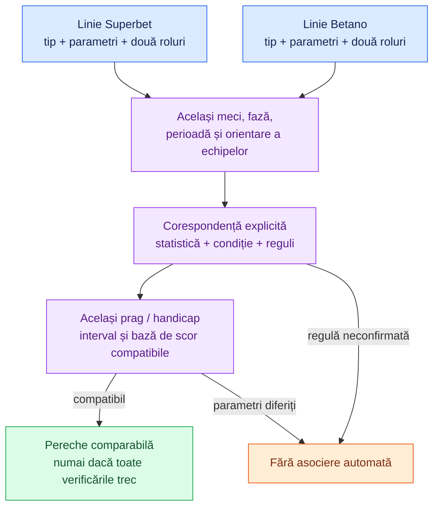

# Fotbal — corespondențe Superbet și Betano

[Superbet: catalog și model](../providers/superbet/FOOTBALL.md) · [Betano: catalog și model](../providers/betano/FOOTBALL.md) · [Providers](../architecture/PROVIDERS.md)

## 1. Ce reprezintă aceste corespondențe

Documentul compară **cele 165 de definiții Superbet și 94 Betano** verificate în proiect. Pentru **80 de tipuri Betano** există o corespondență conceptuală cu **79 de tipuri Superbet**; două piețe Betano pot folosi același tip Superbet cu praguri diferite. Alte 14 tipuri Betano sunt enumerate separat.

Numele, ID-urile și structura selecțiilor au fost verificate în datele publice. **Datele de cote nu confirmă singure toate regulile de decontare.** Tabelele stabilesc ce tipuri comparăm și ce condiții trebuie îndeplinite; nu constituie un motor de matching și nu aprobă automat o pereche de cote.

ID-urile sunt în spații diferite: în coloana Superbet este `market.id` de **tip**, iar în coloana Betano este `market.typeId`. Instanța Betano `market.id` și ID-urile selecțiilor concrete nu se compară între siteuri.

Diagrama descrie verificările aplicate de [agregator](../architecture/AGGREGATOR.md). Tabelul din secțiunea 3 este sursa fișierului `src/aggregation/mapping.config.ts`, validat la pornire față de ambele cataloage.

## 2. Condițiile de asociere

Toate rândurile cer același eveniment, aceeași fază live/prematch, aceeași perioadă și aceiași participanți în aceeași orientare. Pentru live, ambele stări trebuie să fie sincronizate, iar suspendările și prețurile inutilizabile trebuie respectate.

| Marcaj | Ce trebuie verificat                                                                                                                                               |
| ------ | ------------------------------------------------------------------------------------------------------------------------------------------------------------------ |
| D      | Corespondență directă de concept; comparăm aceeași condiție și același prag, dacă există.                                                                          |
| P      | Statistică: trebuie confirmat același mod de numărare și aceeași regulă de decontare. La cartonașe contează inclusiv al doilea galben, roșul și cine este numărat. |
| A      | Total asiatic: același prag și aceleași reguli pentru push, jumătăți și sferturi de linie.                                                                         |
| H      | Handicap asiatic live: pe lângă semn și prag, trebuie confirmat dacă se decontează întregul interval sau doar restul lui și ce înseamnă scorul din numele Betano.  |
| I      | Interval: limitele în secunde și tratamentul prelungirilor trebuie să coincidă; aceeași durată nominală nu este suficientă.                                        |
| T(x)   | Da/Nu Betano corespunde unei linii Superbet la pragul exact x; Da → Peste, Nu → Sub.                                                                               |

Marcajul D nu înlocuiește verificarea regulilor casei; indică faptul că nu este necesară o conversie suplimentară a conceptului.

Rolurile se asociază prin nume semantic: `over ↔ over`, `under ↔ under`, `yes ↔ yes`, `no ↔ no`, `home ↔ home`, `away ↔ away`. Superbet publică de regulă Sub înainte de Peste; Betano publică Peste înainte de Sub. **Poziția în array nu este cheia de asociere.**

La handicap, valoarea liniei este orientată spre gazde în ambele proiecții, iar selecțiile au semne opuse. Dacă viitorul matcher inversează echipele, trebuie să inverseze subiectul, rolurile home/away și semnul handicapului. Implementarea actuală nu face această inversare.

## 3. Perechile identificate

Șabloanele Superbet din tabel ajută citirea; numele și codurile exacte Betano sunt în [catalogul Betano](../providers/betano/FOOTBALL.md#5-catalog-verificat). Abrevierile de echipă din cele două configurații reprezintă același rol, nu aceeași denumire textuală obligatorie între siteuri.

| Betano typeId | Superbet ID | Concept / șablon Superbet                                            | Condiție   |
| ------------- | ----------- | -------------------------------------------------------------------- | ---------- |
| 13            | 200734      | `Total goluri`                                                       | D          |
| 14            | 200735      | `Prima repriză - Total goluri`                                       | D          |
| 15            | 539         | `Ambele echipe marchează (GG)`                                       | D          |
| 34            | 704         | `Total cornere`                                                      | P          |
| 37            | 878         | `Prima repriză - Total cornere`                                      | P          |
| 38            | 240082      | `A doua repriză - Total cornere`                                     | P          |
| 39            | 713         | `Total cornere <HOME_TEAM>`                                          | P          |
| 40            | 733         | `Total cornere <AWAY_TEAM>`                                          | P          |
| 41            | 873         | `Prima repriză - Total cornere <HOME_TEAM>`                          | P          |
| 42            | 884         | `Prima repriză - Total cornere <AWAY_TEAM>`                          | P          |
| 43            | 732         | `Handicap cornere`                                                   | P          |
| 48            | 711         | `Următoarele 10 minute - Total cornere de la <FROM>:00 la <TO>:59`   | I + P      |
| 49            | 233941      | `Total cartonașe roșii`                                              | P          |
| 51            | 233942      | `Total cartonașe roșii <HOME_TEAM>`                                  | T(0,5)     |
| 52            | 233943      | `Total cartonașe roșii <AWAY_TEAM>`                                  | T(0,5)     |
| 53            | 233944      | `Prima repriză - Total cartonașe roșii`                              | T(0,5)     |
| 56            | 200743      | `Total penaltiuri acordate`                                          | T(0,5)     |
| 58            | 233489      | `Prima repriză - Total penaltiuri acordate`                          | T(0,5)     |
| 65            | 690         | `Total cartonașe`                                                    | P          |
| 66            | 1009        | `Prima repriză - Total cartonașe`                                    | P          |
| 67            | 232924      | `Handicap cartonașe`                                                 | P          |
| 68            | 700         | `Total cartonașe <HOME_TEAM>`                                        | P          |
| 69            | 708         | `Total cartonașe <AWAY_TEAM>`                                        | P          |
| 72            | 200742      | `Total autogoluri`                                                   | T(0,5)     |
| 84            | 544         | `Total goluri <HOME_TEAM>`                                           | D          |
| 85            | 535         | `Total goluri <AWAY_TEAM>`                                           | D          |
| 114           | 565         | `Prima repriză - Ambele echipe marchează (GG)`                       | D          |
| 115           | 2529        | `Prima repriză - Total goluri <HOME_TEAM>`                           | D          |
| 116           | 2531        | `Prima repriză - Total goluri <AWAY_TEAM>`                           | D          |
| 130           | 729         | `Următoarele 15 minute - Total goluri de la <FROM>:00 la <TO>:59`    | I          |
| 131           | 200738      | `A doua repriză - Total goluri`                                      | D          |
| 137           | 549         | `A doua repriză - Ambele echipe marchează (GG)`                      | D          |
| 141           | 232509      | `Gol marcat în ambele reprize`                                       | D          |
| 185           | 530         | `Handicap asiatic`                                                   | H          |
| 186           | 564         | `Prima repriză - Handicap asiatic`                                   | H          |
| 189           | 529         | `Total goluri asiatice`                                              | A          |
| 196           | 232514      | `Câștigă după ce a fost condusă <AWAY_TEAM>`                         | D          |
| 270           | 232513      | `Câștigă după ce a fost condusă <HOME_TEAM>`                         | D          |
| 293           | 695         | `Următoarele 10 minute - Total cartonașe de la <FROM>:00 la <TO>:59` | I + P      |
| 338           | 240083      | `A doua repriză - Total cornere <HOME_TEAM>`                         | P          |
| 339           | 240084      | `A doua repriză - Total cornere <AWAY_TEAM>`                         | P          |
| 343           | 200702      | `Total șuturi pe poartă`                                             | P          |
| 351           | 200714      | `Total ofsaiduri`                                                    | P          |
| 364           | 200821      | `Marchează în ambele reprize <AWAY_TEAM>`                            | D          |
| 384           | 200811      | `Marchează în ambele reprize <HOME_TEAM>`                            | D          |
| 395           | 550         | `Prima repriză - Total goluri asiatice`                              | A          |
| 431           | 200794      | `Câștigă ambele reprize <AWAY_TEAM>`                                 | D          |
| 434           | 200830      | `Câștigă ambele reprize <HOME_TEAM>`                                 | D          |
| 436           | 200715      | `Total ofsaiduri <HOME_TEAM>`                                        | P          |
| 437           | 200716      | `Total ofsaiduri <AWAY_TEAM>`                                        | P          |
| 449           | 200704      | `Șuturi pe poartă <AWAY_TEAM>`                                       | P          |
| 457           | 233527      | `Lovituri în bară`                                                   | P          |
| 460           | 230900      | `Total aruncări de la margine`                                       | P          |
| 493           | 200692      | `Total faulturi <AWAY_TEAM>`                                         | P          |
| 535           | 200703      | `Șuturi pe poartă <HOME_TEAM>`                                       | P          |
| 536           | 200691      | `Total faulturi <HOME_TEAM>`                                         | P          |
| 643           | 230933      | `Total lovituri de poartă`                                           | P          |
| 4049          | 201506      | `A doua repriză - Total goluri <HOME_TEAM>`                          | D          |
| 4050          | 201507      | `A doua repriză - Total goluri <AWAY_TEAM>`                          | D          |
| 4104          | 230942      | `Prima repriză - Total lovituri de poartă`                           | P          |
| 4106          | 230909      | `Prima repriză - Total aruncări de margine`                          | P          |
| 4107          | 201763      | `Prima repriză - Total ofsaiduri`                                    | P          |
| 4108          | 201526      | `Prima repriză - Total șuturi pe poartă`                             | P          |
| 4115          | 200701      | `Handicap șuturi pe poartă`                                          | P          |
| 4151          | 231045      | `Fiecare echipă va primi peste X cartonașe`                          | T(0,5) + P |
| 4152          | 231045      | `Fiecare echipă va primi peste X cartonașe`                          | T(1,5) + P |
| 4155          | 1010        | `Prima repriză - Total cartonașe <HOME_TEAM>`                        | P          |
| 4156          | 1007        | `Prima repriză - Total cartonașe <AWAY_TEAM>`                        | P          |
| 4157          | 240088      | `A doua repriză - Total cartonașe <HOME_TEAM>`                       | P          |
| 4158          | 240089      | `A doua repriză - Total cartonașe <AWAY_TEAM>`                       | P          |
| 4159          | 201590      | `Total șuturi`                                                       | P          |
| 4160          | 201591      | `Total șuturi <HOME_TEAM>`                                           | P          |
| 4161          | 201592      | `Total șuturi <AWAY_TEAM>`                                           | P          |
| 4165          | 230934      | `Total lovituri de poartă <HOME_TEAM>`                               | P          |
| 4166          | 230935      | `Total lovituri de poartă <AWAY_TEAM>`                               | P          |
| 4167          | 230901      | `Total aruncări de la margine <HOME_TEAM>`                           | P          |
| 4168          | 230902      | `Total aruncări de la margine <AWAY_TEAM>`                           | P          |
| 4629          | 200690      | `Total faulturi`                                                     | P          |
| 5025          | 233455      | `Total penaltiuri acordate pentru <HOME_TEAM>`                       | T(0,5)     |
| 5026          | 233456      | `Total penaltiuri acordate pentru <AWAY_TEAM>`                       | T(0,5)     |

### Conversiile Da/Nu ↔ Peste/Sub

- Betano `51/52/53`: există cartonaș roșu pentru subiectul și perioada respectivă. Superbet `233942/233943/233944` trebuie să aibă linia **0,5** și exact două selecții.
- Betano `56/58/5025/5026`: penalty acordat. Superbet `200743/233489/233455/233456` trebuie să aibă linia **0,5**, cu același mod de numărare.
- Betano `72` Autogol ↔ Superbet `200742` total autogoluri la **0,5**.
- Betano `4151`, fiecare echipă cel puțin un cartonaș ↔ Superbet `231045` cu parametrul **total = 0,5**.
- Betano `4152`, fiecare echipă cel puțin două cartonașe ↔ același tip Superbet `231045` cu **total = 1,5**.

Ultimele două sunt condiții despre **fiecare echipă**, nu totalul cartonașelor meciului. Superbet trebuie să ofere efectiv ambele rezultate pe acel prag; catalogul singur nu garantează existența liniei.

O conversie suplimentară posibilă este Betano `84` total goluri gazde la **0,5** ↔ Superbet `2528` „Marchează gazdele”, iar `85` ↔ `2530` pentru oaspeți. Există aceeași relație la R1 (`115/116` ↔ `200255/200242`) și R2 (`4049/4050` ↔ `200940/200941`). Se păstrează strict perioada, pragul și rolurile; nu aplicăm transformarea oricărui total.

### Cazurile care cer atenție suplimentară

**Handicapul golurilor.** Betano `185/186` include „Scorul actual …” în denumire. Proiecția păstrează acest scor separat. Nu transformăm automat handicapul într-un handicap Superbet asupra scorului final. Tipurile Superbet obișnuite `200736/200737/200739` nu au fost declarate implicit echivalente cu acestea.

**Intervalele.** Betano `130` are intervale de 15 minute, dar unele se încheie la `45:00` sau `90:00`; Superbet `729` folosește limite cu `:59`. Perechile cu limite sau reguli diferite rămân neasociate până la confirmare. La `48 ↔ 711` și `293 ↔ 695` sunt necesare aceleași verificări pentru intervalele de zece minute.

**Cartonașele și statisticile.** Perechile cu marcajul P sunt activate în agregatorul actual, conform configurației proiectului. Sunt comparate numai tipurile explicit mapate, pe același prag, perioadă și subiect. Activarea nu constituie o verificare nouă a includerii rezervelor, staffului, cartonașelor după fluier sau corecțiilor furnizorului de statistici. Rândurile P care cer și I rămân excluse cât timp intervalele sunt dezactivate.

## 4. Tipuri Betano fără pereche verificată în catalogul Superbet

| Betano typeId | Șablon Betano                                             | Motiv                                                                               |
| ------------- | --------------------------------------------------------- | ----------------------------------------------------------------------------------- |
| 142           | `Peste 1,5 Goluri Marcate în Fiecare Repriză`             | Condiție pe fiecare repriză; nu este același lucru cu GG sau totalul pe meci.       |
| 143           | `Sub 1.5 goluri marcate în fiecare repriză`               | Condiție pe fiecare repriză; nu o compunem din două piețe separate.                 |
| 275           | `Gol marcat în prelungiri, Repriza a doua`                | Doar minutele de prelungire ale R2; nu este întreaga repriză sau extra time.        |
| 613           | `Gol marcat în minutele de prelungire ale primei reprize` | Doar minutele de prelungire ale R1.                                                 |
| 4111          | `Lovituri de poartă Handicap 2-Way`                       | Catalogul Superbet cercetat nu conține un handicap de lovituri de poartă verificat. |
| 4113          | `Aruncări de la margine Handicap 2-Way`                   | Nu avem un handicap de aruncări de la margine verificat în catalogul Superbet.      |
| 4114          | `Ofsaiduri Handicap 2-Way`                                | Nu avem un handicap de ofsaiduri verificat în catalogul Superbet.                   |
| 5014          | `Cartonaș acordat în ambele reprize`                      | Cartonaș în ambele reprize; nu totalul cartonașelor.                                |
| 5016          | `{HOME} Interval cornere Peste/Sub ({FROM} - {TO})`       | Interval de cornere doar pentru gazde; Superbet 711 este totalul ambelor echipe.    |
| 5017          | `{AWAY} Interval cornere Peste/Sub ({FROM} - {TO})`       | Interval de cornere doar pentru oaspeți; Superbet 711 este totalul ambelor echipe.  |
| 1000617       | `Asiatic (Peste/Sub) Total cornere`                       | Total asiatic cornere; nu egalăm automat cu totalul obișnuit Superbet.              |
| 1000618       | `Asiatic (Peste/Sub) Total cartonașe`                     | Total asiatic cartonașe; nu egalăm automat cu totalul obișnuit Superbet.            |
| 1000619       | `Asiatic (Peste/Sub) - Total Cornere Prima Repriză`       | Total asiatic cornere R1; fără definiție asiatică Superbet verificată.              |
| 1000620       | `Asiatic (Peste/Sub) - Total Cartonașe Prima Repriză`     | Total asiatic cartonașe R1; fără definiție asiatică Superbet verificată.            |

Lipsa unei perechi aici nu afirmă că piața nu există pe site. Înseamnă că nu avem o definiție compatibilă verificată în **catalogul implementat**. Nu compunem artificial o piață din mai multe alte piețe.

În sens invers, Superbet are tipuri fără corespondent verificat în catalogul Betano: de exemplu totaluri de deposedări, mai multe piețe pe R2, intervale de un minut, handicapuri de șuturi/faulturi și totaluri pe primele X minute. Inventarul complet rămâne în [documentul Superbet](../providers/superbet/FOOTBALL.md#5-catalogul-verificat).

## 5. Limita implementării actuale

Configurațiile fixe identifică fiecare piață în propriul provider; proiecțiile livrează baze, upserturi de perechi și invalidări. [Agregatorul](../architecture/AGGREGATOR.md) aplică maparea explicită și asociază evenimentele. Configurația implicită activează D, P și T: **73 de rânduri din 80**, inclusiv statisticile mapate și conversiile T + P. A, H și I rămân oprite; două timestampuri locale nu confirmă simultaneitatea cotelor la sursă.

Corespondențele se verifică din nou când se adaugă un tip, se schimbă numele/structura lui sau se confirmă reguli de decontare. Necunoscut înseamnă exclus până la verificare, nu potrivire aproximativă după text.
