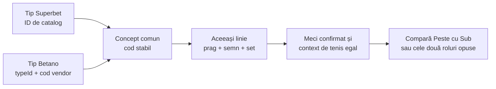

# Tenis — corespondențe Superbet–Betano

[Index](../README.md) · [Fluxul de tenis](../architecture/TENNIS.md) · [Superbet](../providers/superbet/TENNIS.md) · [Betano](../providers/betano/TENNIS.md)

## 1. Domeniu

[tennis-mapping.config.ts](../../src/aggregation/tennis-mapping.config.ts) declară **26 de corespondențe**, dintre care **25 active**. Codurile `1001–1026` sunt stabile, separate de cele de fotbal. Un cod nu se renumerotează și nu se refolosește pentru alt concept.

Activarea unui rând înseamnă că se poate compara o linie eligibilă, nu că există permanent o cotă live la ambele siteuri. Catalogul Betano include multe statistici observate numai prematch; feed-urile active urmăresc numai live. Un meci sau un prag absent nu este completat artificial.

Marcajele sunt `D` pentru concepte directe și `P` pentru statistici. `enabledConditions` din configurația agregatorului trebuie să includă toate condițiile rândului. Rândul `1014` are suplimentar `enabled: false`: marcajul `D` nu îl poate activa accidental. În configurația actuală sunt permise `D`, `P`, `T`; `T` nu este folosit de maparea tenisului.

[Validatorul de tenis](../../src/aggregation/tennis-mapping.ts) verifică ambele cataloage înainte de pornire: existență, cod unic, kind, statistică, perioadă, participant, roluri, parametri și restricția de set fix. Numele nu sunt folosite pentru a descoperi dinamic perechi noi.

## 2. Când două linii sunt aceeași piață

- Același meci este confirmat prin Betradar, nume, orientare și verificarea startului cunoscut; numele singure nu autorizează comparații.
- Totalul sau handicapul trebuie să fie **identic**. Nu se compară `22.5` cu `23.5`, nici `+1.5` cu `-1.5` orientat către același jucător.
- Sunt eligibile numai praguri `x.5`; întregii, sferturile și handicapul zero sunt excluse. Detectorul cu două rezultate nu modelează rambursările sau împărțirea mizei.
- O linie de set are setul explicit în cheie. Setul 1 nu se compară cu setul 2. Tipurile Betano „primul set” se mapează numai la Superbet `setnr = 1`.
- În acest stadiu, liniile specifice setului sunt limitate la **seturile 1 și 2**. Seturile 3–5 sunt blocate până când formatul normal versus match tiebreak poate fi verificat din date.
- Un set deja depășit de contextul curent nu mai este eligibil, chiar dacă o linie veche persistă în ofertă. Un set viitor 1/2 poate rămâne eligibil dacă ambele siteuri îl oferă.
- Selecția `A` înseamnă Peste / primul participant / Da; `B` înseamnă Sub / al doilea participant / Nu. Ordinea vendorului nu stabilește sensul.

## 3. Tabelul corespondențelor

„Set 1” fixează perioada. „Set 1/2” permite exact același set la ambele siteuri. Handicapurile folosesc semnul către primul participant al meciului.

| Cod  | Superbet | Betano | Concept                                        | Domeniu suplimentar | Stare      |
| ---- | -------- | ------ | ---------------------------------------------- | ------------------- | ---------- |
| 1001 | 1002     | 1541   | `Total game-uri`                               | Meci                | D          |
| 1002 | 520      | 162    | `Handicap game-uri`                            | Meci                | D          |
| 1003 | 999      | 1445   | `Total game-uri <PLAYER_1>`                    | Meci                | D          |
| 1004 | 996      | 1476   | `Total game-uri <PLAYER_2>`                    | Meci                | D          |
| 1005 | 524      | 1512   | `Setul <SET> - Total game-uri`                 | Set 1/2             | D          |
| 1006 | 1003     | 1381   | `Setul <SET> - Handicap game-uri`              | Set 1/2             | D          |
| 1007 | 230656   | 1435   | `Setul <SET> - Total game-uri <PLAYER_1>`      | Set 1               | D          |
| 1008 | 230663   | 1466   | `Setul <SET> - Total game-uri <PLAYER_2>`      | Set 1               | D          |
| 1009 | 2392     | 1408   | `Total seturi`                                 | Meci                | D          |
| 1010 | 200776   | 1405   | `Handicap seturi`                              | Meci                | D          |
| 1011 | 518      | 1439   | `Minim un set <PLAYER_1>`                      | Meci                | D          |
| 1012 | 522      | 1470   | `Minim un set <PLAYER_2>`                      | Meci                | D          |
| 1013 | 548      | 1359   | `Orice set la zero`                            | Meci                | D          |
| 1014 | 230641   | 3876   | `Total tiebreak-uri`                           | Meci                | Dezactivat |
| 1015 | 235336   | 1424   | `Total ași`                                    | Meci                | P          |
| 1016 | 232681   | 1440   | `Total ași <PLAYER_1>`                         | Meci                | P          |
| 1017 | 232682   | 1471   | `Total ași <PLAYER_2>`                         | Meci                | P          |
| 1018 | 230678   | 1531   | `Setul <SET> - Total ași`                      | Set 1               | P          |
| 1019 | 230679   | 1441   | `Setul <SET> - Total ași <PLAYER_1>`           | Set 1               | P          |
| 1020 | 230680   | 1472   | `Setul <SET> - Total ași <PLAYER_2>`           | Set 1               | P          |
| 1021 | 235338   | 1534   | `Total duble greșeli`                          | Meci                | P          |
| 1022 | 233658   | 1431   | `Total duble greșeli <PLAYER_1>`               | Meci                | P          |
| 1023 | 233659   | 1462   | `Total duble greșeli <PLAYER_2>`               | Meci                | P          |
| 1024 | 230683   | 1535   | `Setul <SET> - Total duble greșeli`            | Set 1               | P          |
| 1025 | 230684   | 1444   | `Setul <SET> - Total duble greșeli <PLAYER_1>` | Set 1               | P          |
| 1026 | 230685   | 1475   | `Setul <SET> - Total duble greșeli <PLAYER_2>` | Set 1               | P          |

## 4. Ce rămâne în afara matchingului

| Piață                                                           | Motiv                                                                                                                              |
| --------------------------------------------------------------- | ---------------------------------------------------------------------------------------------------------------------------------- |
| Total tiebreak-uri: Superbet `230641` ↔ Betano `3876`           | Corespondență semantică înregistrată, dar dezactivată: includerea match tiebreak-ului în acest total nu este confirmată suficient. |
| „Va fi un tiebreak?” ↔ total tiebreak-uri `0.5`                 | Conversia Da/Nu ↔ Peste/Sub nu este presupusă; rândul direct de total este oricum dezactivat.                                      |
| Game-uri și handicapuri în seturile 3–5                         | Feed-urile nu confirmă formatul decisiv; Betano are o excepție explicită pentru game-urile din setul 3 jucat ca match tiebreak.    |
| „Ambii câștigă un set” ↔ total seturi `2.5`                     | Nu sunt echivalente pentru toate formatele de meci; nu avem un format comun verificat.                                             |
| Betano „câștigă două seturi” ↔ Superbet total seturi jucător    | Nu presupunem „exact două” versus „cel puțin două” dintr-o etichetă și nu facem conversia.                                         |
| Break-uri Betano `1551`, `1454`, `1486`                         | Catalogul Superbet aprobat nu are contraparte directă.                                                                             |
| Puncte, game la avantaj/deuce, handicapuri de ași/duble greșeli | Catalogul Betano aprobat nu are perechile corespunzătoare.                                                                         |
| Ași + duble greșeli, `X+`, scoruri și combinații                | În afara cataloagelor binare aprobate.                                                                                             |
| Praguri întregi / sferturi                                      | Plata poate include rambursare sau fracționare; formula actuală nu le compară.                                                     |
| Perechi cu orientarea jucătorilor inversată                     | Sunt suspecte; nu inversăm automat subiectele, scorul și semnele handicapului.                                                     |

## 5. Decontare și limite

Au fost consultate paginile oficiale: [Superbet, 7.2 Tenis](https://superbet.ro/wiki/regulament-de-joc-pariuri-cap-7) și [Betano, 3.3 Tenis](https://ro.betano.com/articol/reguli-de-pariere/271527/#Paragraph3_3), la 25 octombrie 2026.

Ambele descriu numărarea unui tie-break/match tiebreak ca un game și tratarea match tiebreak-ului ca set decisiv. Betano precizează însă anularea pariurilor pe numărul de game-uri în setul 3 când acesta este Champions Tie-break; aceasta motivează restricția de set. Nici această regulă, nici numărarea unui game nu confirmă automat includerea sa în piața „total tiebreak-uri”.

Regulile de retragere și descalificare au excepții pentru rezultate stabilite și formulări specifice pieței. Ele nu sunt un motor de decontare în cod. Marja raportată este calculul cotelor pentru două rezultate opuse; nu garantează rezultatul decontării în situații excepționale, acceptarea cotelor sau absența corecțiilor ulterioare.

## 6. Verificare

[Testele de tenis ale agregatorului](../../test/aggregation-tennis.test.mjs) proiectează independent exemplele vendor din ambele siteuri și verifică fiecare rând, rolurile, pragurile, semnele, seturile și respingerile. Separat, testează contextul, protocolul, izolarea sporturilor și întregul ciclu al oportunității.

În verificarea live de 25 de secunde au existat **11 perechi de tenis confirmate**, **128 de linii comune** și **466 de comparații eligibile**. Pragul de rulare a rămas `minMarginBps: 200` (2%); nicio oportunitate nu l-a depășit. Deschiderea și închiderea oportunităților au fost demonstrate cu cote controlate în teste, nu prin modificarea pragului aplicației.
