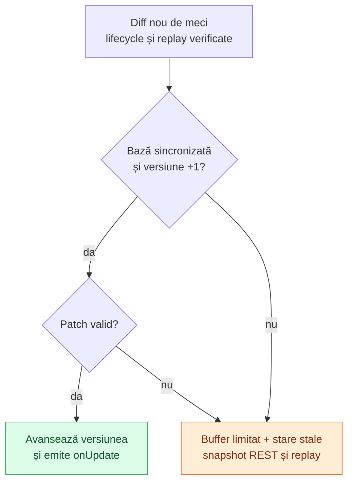

# Contract Betano — snapshoturi, SignalR și diff-uri

[Ansamblu](../../../README.md) · [Arhitectura providerilor](../../architecture/PROVIDERS.md) · [Contract Superbet](../superbet/CONTRACT.md)

[Betano fotbal](FOOTBALL.md) descrie filtrarea ulterioară a piețelor; [corespondențele cu Superbet](../../mapping/FOOTBALL.md) sunt documentate separat.

Acest document descrie contractul tehnic folosit de implementarea noastră: ce trimitem către Betano, ce primim și cum transformăm mesajele în stare locală. API-ul este nedocumentat public; regulile de mai jos descriu comportamentul implementat, fără a reprezenta o specificație oficială Betano.

Exemplele JSON sunt minime, cu ID-uri și valori fictive. Numele câmpurilor și structurile relevante corespund codului.

## 1. Cele trei niveluri de date

| Nivel         | Ce reprezintă                                   | Exemplu                                         |
| ------------- | ----------------------------------------------- | ----------------------------------------------- |
| Snapshot REST | Baza completă a unui meci la o versiune.        | Eveniment, piețe și selecții la versiunea `40`. |
| Mesaj SignalR | Învelișul de comunicare peste WebSocket.        | Invocă targetul `NewLiveEventSplitDiff`.             |
| Diff de meci  | Schimbarea din interiorul notificării decodate. | La versiunea `41`, selecția `123` are alt preț. |

**`type` din SignalR și `type` din diff sunt două coduri diferite.** De exemplu, SignalR `type: 3` confirmă un apel, iar diff `type: 3` modifică suspendarea meciului.

```mermaid
flowchart LR
    WS["WebSocket"]
    SR["SignalR JSON<br/>separator 0x1e"]
    TARGET["NewLiveEventSplitDiff<br/>arguments[0]"]
    DECODE["Base64 + LZ4<br/>→ JSON"]
    DIFF["Diff-uri<br/>decodate"]
    STORE["Store<br/>receive → patch"]

    WS --> SR --> TARGET --> DECODE --> DIFF --> STORE

    classDef wire fill:#dbeafe,stroke:#2563eb,color:#172554
    classDef decoded fill:#dcfce7,stroke:#16a34a,color:#14532d
    classDef state fill:#f3e8ff,stroke:#9333ea,color:#581c87
    class WS,SR,TARGET wire
    class DECODE,DIFF decoded
    class STORE state
```

Un mesaj WebSocket poate transporta mai multe înregistrări SignalR, iar o înregistrare poate necesita reasamblare. O notificare comprimată poate conține mai multe diff-uri. Limitele acestor niveluri nu sunt identice.

## 2. HTTP: discovery și snapshot

Origin: `https://ro.betano.com`. Requesturile sunt `GET`, prin `BrowserTransport`, cu profilul nativ `wreq-js` configurat în proiect.

| Scop          | Cale                                                                                               |
| ------------- | -------------------------------------------------------------------------------------------------- |
| Lista live    | `/danae-webapi/api/live/overview/latest?includeVirtuals=false&queryLanguageId=4&queryOperatorId=3` |
| Snapshot meci | `/danae-webapi/api/live/events/<eventId>/latest`                                                   |

Headers trimise: `x-language: 4`, `x-operator: 3`, `accept: application/json`.

Discovery citește `events` din răspuns și folosește și `zones` pentru excluderea zonelor virtuale/esports. Sunt acceptate `FOOT`, `BASK`, `TENN`, cu `isLive: true` și fără `isEnded: true`. Lista de discovery identifică meciurile; baza completă a cotelor vine din endpointul de snapshot.

### Forma snapshotului

```json
{
  "version": 40,
  "versionsPerAudience": { "1": 10, "2": 5, "4": 22, "7": 3, "8": 1 },
  "event": {
    "id": 11,
    "sportId": "FOOT",
    "isLive": true,
    "isSuspended": false,
    "marketIdList": [50]
  },
  "markets": {
    "50": { "id": 50, "selectionIdList": [123], "isSuspended": false }
  },
  "selections": {
    "123": { "id": 123, "price": 1.85, "isSuspended": false }
  }
}
```

Exemplul de mai sus este răspunsul REST: feed-ul îi aliniază versiunea la audiența selectată înainte de instalare, conform secțiunii despre versiuni de mai jos.

| Câmp                 | Contract relevant                                                             |
| -------------------- | ----------------------------------------------------------------------------- |
| `version`            | Versiunea bazei complete; integer sigur, nenegativ.                           |
| `event.id`           | Trebuie să fie meciul cerut.                                                  |
| `event.marketIdList` | Referințe și ordine pentru piețele meciului.                                  |
| `markets`            | Dicționar după ID; fiecare piață referă selecții prin `selectionIdList`.      |
| `selections`         | Dicționar după ID; păstrează prețul, suspendarea și celelalte câmpuri vendor. |

Cheile dicționarelor JSON sunt stringuri, chiar când ID-urile din obiecte sunt numere. Relația este **meci → piețe → selecții**; o selecție este rezultatul pe care se găsește cota.

Pentru fotbal, `market.typeId` împreună cu `market.type` identifică tipul reutilizabil. `market.id` identifică instanța concretă și nu este potrivit pentru un catalog comun tuturor meciurilor. `selection.typeId` identifică rolul rezultatului când este prezent; `selection.id` rămâne identitatea concretă folosită de diff-uri.

Pragul Peste/Sub se găsește în `handicap`, egal pe ambele selecții. La handicapul cu două rezultate, valorile selecțiilor sunt semnate pentru fiecare echipă și opuse; valoarea pieței este orientată spre gazde. Numele pieței și `participants` permit validarea echipelor, iar `liveData` furnizează contextul scorului/ceasului.

Un răspuns HTTP 200 fără structura necesară, inclusiv un răspuns de indisponibilitate cu `result` și fără `event`, nu devine snapshot valid.

## 3. WebSocket și SignalR

Conexiune: `wss://ro.betano.com/contenthub?platformType=1`.

Fiecare înregistrare SignalR se termină cu byte-ul **`0x1e`**. În exemple separatorul este omis pentru lizibilitate; în trafic se adaugă după JSON. Nu este textul literal `"0x1e"` și nu este un newline.

| Mesaj SignalR                     | Sens în implementare                                                |
| --------------------------------- | ------------------------------------------------------------------- |
| `{"protocol":"json","version":1}` | Handshake trimis după deschiderea WebSocketului.                    |
| `{}`                              | Răspuns de handshake reușit. Abia apoi se fac apelurile de abonare. |
| `type: 1`                         | Invocation: `target`, `arguments`, opțional `invocationId`.         |
| `type: 3`                         | Completion: confirmă sau respinge apelul cu acel `invocationId`.    |
| `type: 6`                         | Ping SignalR; clientul îl trimite periodic.                         |
| `type: 7`                         | Închidere SignalR; declanșează recuperarea conexiunii.              |

### Abonarea la meciuri

```json
{
  "type": 1,
  "invocationId": "1",
  "target": "joinLiveEventGroup",
  "arguments": [
    {
      "language": 4,
      "platformType": 1,
      "includeEvent": true,
      "IncludeMarkets": true,
      "IncludeIncidents": false,
      "maxQueueSize": 30,
      "eventIds": [11, 12]
    }
  ]
}
```

Capitalizarea câmpurilor este intenționată. Providerul grupează implicit maximum 50 de meciuri pe socket; aceasta este alegerea noastră de configurare. Abonarea selectează datele evenimentului și piețele, fără cronologia incidentelor. Scorul, statisticile și cotele necesare proiecțiilor sunt incluse. Confirmarea join-ului nu certifică sincronizarea: fiecare meci așteaptă și `OnActiveLiveEventSplitVersion`, cu `includeEvent: true`, `includeMarkets: true`, `includeIncidents: false`, înainte de a putea cere sau reutiliza baza.

Overview-ul are un socket separat și apelează `joinLiveOverviewGroupWithOptions` cu `{language: 4, platformType: 1, includeVirtuals: false}`. `leaveLiveEventGroup` primește `language`, `platformType` și `eventIds` pentru eliminarea membrilor.

### Notificările utilizate

| Target                     | Conținut și utilizare                                                                                                                           |
| -------------------------- | ----------------------------------------------------------------------------------------------------------------------------------------------- |
| `NewLiveEventSplitDiff`         | `arguments[0]` este un string base64 cu frame LZ4 și apoi o listă JSON de diff-uri. Se aplică meciurilor din acel grup.                         |
| `NewLiveOverviewDiffs`     | Același mecanism de decodare, dar feed-ul tratează apariții, eliminări și cereri de refresh, fără a aplica toate mesajele ca patch-uri de cote. |
| `OnActiveLiveEventSplitVersion` | `arguments[0]` conține `eventId` și `version`; indică versiunea de atins și poate declanșa repararea stării.                                    |

Decoderul verifică frame-ul LZ4, limita de dimensiune și forma listei. Un `payload` nul este normalizat la `{}`. Metadatele globale din intervalul `200–299` și resetul `9999` pot primi intern `eventId: 0`, `version: 0` când aceste câmpuri lipsesc; aceasta nu le transformă în schimbări ale unui meci.

### Versiunea REST și versiunea fluxului selectat

`NewLiveEventDiff` / `OnActiveLiveEventVersion` aparțin variantei complete cu incidente și nu intră în store-ul abonamentului split. Nu se amestecă cele două secvențe.

REST returnează `version` și `versionsPerAudience`. [protocol/audience.ts](../../../src/providers/betano/protocol/audience.ts) validează metadatele și calculează versiunea pentru masca `1 | 4 = 5`: eveniment și piețe. Se adună contoarele ale căror chei au intersecție de biți cu masca 5; contorul comun `7` intră o singură dată. Masca `2` reprezintă incidentele. Contorul `8` observat în răspunsuri este separat și nu se adună nici la versiunea completă `1 | 2 | 4`, nici la cea selectată.

Exemplu verificat: `{1: 33, 2: 17, 4: 91, 7: 9, 8: 0}` înseamnă versiune REST `150`, dar versiune split `133`. Un update split `134` urmează baza `133`, nu baza `150`. Răspunsul este respins dacă metadatele lipsesc, sunt invalide sau suma audiențelor complete contrazice versiunea REST.

Snapshotul publicat de feed are `version` în secvența split și `restVersion` pentru versiunea REST a ultimei baze. `versionsPerAudience` rămâne metadata ultimei baze, nu un contor întreținut la fiecare patch. Listele `event.incidents` și `event.incidentFilters` sunt eliminate din bază, deoarece acest abonament nu le actualizează. Celelalte câmpuri REST nu sunt rescrise ca să pară contoare split.

Motivul schimbării și testele live sunt în [raportul de stabilitate Betano](../../reports/BETANO-STREAM-STABILITY-2026-10-25.md).

## 4. Diff-ul și ce înseamnă patch

```json
{
  "eventId": 11,
  "version": 41,
  "type": 100,
  "payload": {
    "selectionChanges": {
      "50": [{ "id": 123, "price": 1.9 }]
    }
  }
}
```

`eventId` identifică meciul, `version` poziția schimbării, `type` regula de aplicare, iar `payload` datele ei. În exemplu, `patch()` actualizează selecția `123`; nu reconstruiește întregul meci. Variabilele locale numite `patch` reprezintă câte o modificare individuală din payload.

### Piețe și selecții

Acestea sunt toate cazurile de piață/selecție tratate în prezent de `patch()`:

| `diff.type` | Payload relevant                                     | Efect                                                                                                                     |
| ----------- | ---------------------------------------------------- | ------------------------------------------------------------------------------------------------------------------------- |
| `100`       | `marketChanges[]`, `selectionChanges{}`              | Actualizează piețe și selecții existente; poate actualiza și `totalMarketsAvailable`.                                     |
| `101`       | `markets[]` cu `selections[]`, sau `selections{}`    | Adaugă piețe/selecții și întreține listele de ID-uri. Selecțiile încorporate în piețe sunt mutate în dicționarul separat. |
| `102`       | `marketIds[]`, `selectionIds{}`                      | Elimină piețe/selecții și referințele lor; ștergerea unei piețe elimină și selecțiile ei.                                 |
| `105`       | `id` și proprietățile pieței                         | Actualizează setările unei piețe existente.                                                                               |
| `106`       | `marketIds`, `selectionIds`, `liveBalancedMarketIds` | Actualizează ordinea/referințele și `isBalanced`; nu reprezintă adăugarea de obiecte complete.                            |
| `107`       | `marketId`, `notes`                                  | Setează notele pieței; notes omis devine `[]`.                                                                            |
| `108`       | `marketsToMatchComboMap`                             | Setează `matchComboExclude` pentru piețele cunoscute.                                                                     |
| `109`       | Mapare ID piață → valoare                            | Setează `hasZeroRake`.                                                                                                    |
| `111`       | Mapare ID piață → valoare                            | Setează `ranking`.                                                                                                        |
| `110`       | `selectionChanges`, `marketChanges`                  | Setează `renderingLayout`.                                                                                                |
| `150`       | `id` și proprietățile selecției                      | Aplică proprietățile peste o selecție cunoscută.                                                                          |
| `151`       | `selectionChanges`                                   | Setează `columnIndex` pentru selecțiile cunoscute.                                                                        |

### Proprietăți de meci și date live

| `diff.type`                                            | Efect în store                                                                                                     |
| ------------------------------------------------------ | ------------------------------------------------------------------------------------------------------------------ |
| `3`                                                    | `event.isSuspended` devine `payload.isSuspended === true`.                                                         |
| `6`                                                    | Aplică setările evenimentului, cu defaulturi `isSuspended: false`, `willGoLive: false`.                            |
| `2`, `7`, `8`, `9`, `10`, `11`, `13`, `14`, `15`, `19` | Aplică proprietățile payloadului peste `event`, după verificările de lifecycle.                                    |
| `16`                                                   | Actualizează statisticile `event`, `teams`, `players`; pentru jucători îmbină și câmpurile obiectului existent.    |
| `17`                                                   | Înlocuiește `event.roster` cu payloadul.                                                                           |
| `300`, `301`                                           | Înlocuiește `event.liveData` cu `payload.liveData`.                                                                |
| `302`                                                  | Adaugă `incidents`; dacă `reset: true`, înlocuiește lista anterioară. Setează și `incidentFilters`, implicit `[]`. |

### Lifecycle: în afara patch-ului obișnuit

| Cod / context                               | Comportament                                                                                                 |
| ------------------------------------------- | ------------------------------------------------------------------------------------------------------------ |
| `0`, pe meci                                | Invalidează baza, golește bufferul și reține versiunea resetului. Permite refacerea bazei după renumerotare. |
| `5`, pe meci                                | Elimină meciul, după regula de ignorare a versiunilor vechi.                                                 |
| `2`, cu `isEnded: true` sau `isLive: false` | Elimină meciul înainte de aplicarea unui patch normal.                                                       |
| `9999`, în notificări                       | Feed-ul invalidează stările urmărite, programează reparații și refresh de discovery.                         |
| Overview `0`, `1` sau început live prin `2` | Poate programa discovery; overview `5` și finalizarea prin `2` elimină meciuri.                              |

Un cod absent din tabele nu este presupus sigur pentru actualizarea store-ului de meci. Dacă ajunge acolo și nu este recunoscut, `patch()` întoarce `false`, starea devine stale și feed-ul cere un snapshot.

## 5. Câmpurile omise au reguli specifice

**Patch Betano nu înseamnă simplu merge care păstrează întotdeauna valorile vechi.** Implementarea aplică aceste defaulturi înaintea câmpurilor primite:

| Caz                          | Defaulturi înainte de aplicarea payloadului |
| ---------------------------- | ------------------------------------------- |
| `100`, schimbare de piață    | `isSuspended: false`                        |
| `100`, schimbare de selecție | `isSuspended: false`, `price: 0`            |
| `105`, setări de piață       | `isSuspended: false`                        |
| `6`, setări de eveniment     | `isSuspended: false`, `willGoLive: false`   |

Un câmp explicit în payload suprascrie defaultul. De exemplu, la `100`, `{id: 123, price: 1.90}` elimină o suspendare veche omisă din mesaj. Dacă lipsește și `price`, implementarea pune `0`, fără a reutiliza prețul anterior. Alte câmpuri se păstrează prin merge superficial. Cazul `150` nu folosește defaulturile cazului `100`.

Consumatorul trebuie să respecte suspendarea la nivel de eveniment, piață și selecție; simpla prezență a unui preț nu dovedește disponibilitatea lui.

## 6. Acceptare, ordine și recuperare



Înaintea acestui flux, `receive()` tratează resetul `0`, ignoră versiunile deja aplicate și verifică eliminările de meci. Resetul este verificat înainte de filtrarea versiunilor vechi, pentru a permite renumerotarea.

La o bază locală `40`, un diff `41` acceptat avansează starea. Dacă vine `43` fără `42`, `getSnapshot()` devine `null`; un snapshot REST `42` permite replay pentru `43`. Un snapshot care încă nu acoperă versiunea țintă lasă starea stale.

Join-ul și confirmarea audienței se fac înaintea cererii snapshotului: diff-urile sosite în timpul REST sunt păstrate și reaplicate în ordine. Bufferul are implicit 256 de versiuni per meci. Reconnectul reface SignalR și abonările, apoi verifică versiunile. Dacă baza păstrată și diff-urile continue acoperă versiunea confirmată, `confirmVersion` o poate reinstala fără REST; altfel cere o bază nouă. Datele rămân stale până la verificare. Revizia se schimbă și la pierderea conexiunii, iar o cerere din vechea revizie nu poate reactiva cotele. Erorile de încadrare/decompresie pot reporni socketul; un patch neacceptat declanșează repararea stării meciului.

## 7. Unde se verifică acest contract

- [Modelul datelor](../../../src/providers/betano/model/state.interfaces.ts): tipurile snapshotului și diff-ului.
- [SignalR](../../../src/providers/betano/protocol/signalr.ts) și [decodarea LZ4](../../../src/providers/betano/protocol/compression.ts): încadrare și validare.
- [Audiența](../../../src/providers/betano/protocol/audience.ts) și [testele ei](../../../test/betano-audience.test.mjs): conversia verificată a versiunii REST în secvența split.
- [Feed](../../../src/providers/betano/processing/feed.ts): endpointuri, grupuri, notificări și reîncercări.
- [Store](../../../src/providers/betano/processing/state.ts): toate regulile `receive`, `install`, `patch`.
- [Teste de stare](../../../test/betano-state.test.mjs) și [de protocol](../../../test/betano-protocol.test.mjs): exemple executabile ale regulilor implementate.

HTTP 429/503 aplică `Retry-After` pentru cererile REST ale providerului. Semnalele de discovery din timpul cooldownului sunt amânate fără cerere HTTP și fără repetarea artificială a erorii 429. O închidere de socket produce o singură notificare `disconnected`; eroarea include ID-ul socketului. Configurarea limitelor, threadurilor și controlului de bytes este explicată în [Providers](../../architecture/PROVIDERS.md#configurări-care-contează) și [Network](../../architecture/NETWORK.md).

## 8. Proiecția filtrată și diferența față de prematch

După acceptarea snapshotului sau a unui diff continuu, feed-ul actualizează modelele filtrate de fotbal și tenis în același processing worker. Store-ul păstrează datele brute pentru audiența eveniment + piețe, fără cronologia incidentelor. `getFootballSnapshot`, `onFootballSnapshot` și `onFootballUpdate`, respectiv `getTennisSnapshot`, `onTennisSnapshot` și `onTennisUpdate` expun cataloagele fixe și liniile cu exact două selecții. Invalidarea brută blochează proiecțiile (`invalidate`, identitate reținută); eliminarea efectivă le șterge (`remove`). Query-urile publice întorc `null` cât timp datele nu sunt sincronizate.

Această ieșire nu schimbă regulile patch-urilor: defaulturile `100`, `105` sau `6` se aplică înaintea filtrării. Un preț brut `0` devine `null` în proiecție, iar suspendările se păstrează la toate cele trei niveluri.

Oferta prematch cercetată se află în `initial_state.data.event` din pagina publică `/cote/<slug>/<id>/?bt=13`, fila Toate. Este o structură HTML/SSR diferită de REST-ul live: ID-uri string, selecții încorporate, mai multe praguri per piață, copii repetate între secțiuni și fără versiune live sau ID-uri de rezultat. Adaptoarele pure pentru acest format nu pornesc colectare prematch. Exemplele și limitele validării sunt în [Betano fotbal](FOOTBALL.md) și [Betano tenis](TENNIS.md). La tenis, `liveData.score` reprezintă punctele game-ului; seturile câștigate vin separat din `liveData.results.liveInfoHomeScore/liveInfoAwayScore`.
