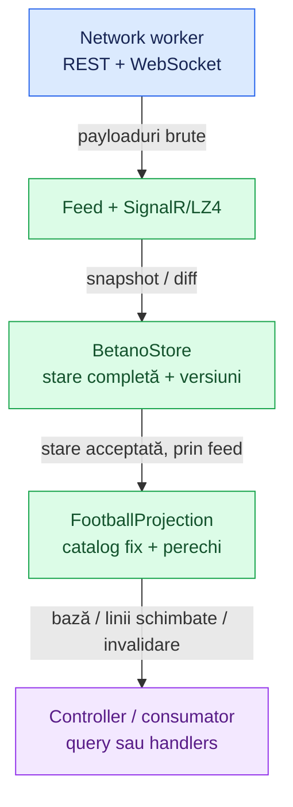

# Betano fotbal — catalog și model filtrat

[Ansamblu](../../../README.md) · [Providers](../../architecture/PROVIDERS.md) · [Contract Betano](CONTRACT.md) · [Corespondențe Superbet–Betano](../../mapping/FOOTBALL.md)

## 1. Scop și locul în arhitectură

[Catalogul fix](../../../src/providers/betano/football-markets.config.ts) conține **94 de definiții** verificate în oferta publică de fotbal. Păstrăm numai Peste/Sub, handicap cu două rezultate și Da/Nu, fără jucători, combinații de condiții diferite, handicap european, par/impar sau piețe cu o singură variantă.

Filtrarea rulează în **processing workerul Betano existent**, după verificarea versiunilor. Nu adaugă threaduri sau requesturi. Store-ul brut păstrează audiența eveniment + piețe pentru patch-uri, referințe și recuperarea sincronizării; cronologia incidentelor este exclusă din abonament.



Providerul activ urmărește în continuare **numai live**, pentru fotbal, baschet și tenis. Proiecția descrisă aici privește fotbalul; [tenisul are un model separat](TENNIS.md), în același processing worker. [Adaptorul prematch](../../../src/providers/betano/processing/football-prematch.ts) poate interpreta separat un eveniment public deja extras; nu pornește discovery sau actualizări prematch.

## 2. Identitatea unei piețe și selecția explicită

| Câmp                            | Ce identifică                                                             |
| ------------------------------- | ------------------------------------------------------------------------- |
| `market.typeId` + `market.type` | Tipul reutilizabil: de exemplu `13 / HCTG`, total goluri.                 |
| `market.id`                     | Instanța concretă a pieței unui meci; nu este ID de catalog.              |
| `selection.id`                  | Instanța selecției, folosită de patch-uri.                                |
| `selection.typeId`              | Tipul rezultatului, când este disponibil în datele sursă.                 |
| `nameTemplate`                  | Numele exact, cu substituții controlate pentru echipe, interval sau scor. |

**Nu clasificăm după cuvinte găsite liber în nume.** Trebuie să corespundă ID-ul tipului, codul, șablonul exact și cele două roluri configurate. `{HOME}` și `{AWAY}` folosesc participanții evenimentului; caracterele speciale din numele echipelor sunt tratate literal.

Pentru 57 de definiții am verificat și am fixat ambele ID-uri de rezultat din răspunsurile live. Restul de 37 au fost observate complet numai în HTML-ul prematch, care omite aceste ID-uri: catalogul folosește etichetele exacte și parametrii numerici, fără ID-uri inventate. Dacă un ID este configurat, proiecția live îl cere și îl verifică. Adaptorul prematch păstrează `outcomeId: null`.

Pentru Peste/Sub, rolul trebuie să aibă eticheta `Peste N` sau `Sub N`, iar numărul din etichetă trebuie să fie egal cu `selection.handicap`. Pentru handicap, echipa și `teamId` trebuie să corespundă rolului, iar semnul din etichetă trebuie să corespundă parametrului. Da/Nu are etichete fixe, inclusiv `Da (GG)` / `Nu (NG)` pentru GG.

## 3. Exact două selecții per linie

Live, fiecare instanță de piață referă selecțiile din dicționar. În HTML-ul prematch, aceeași piață poate grupa mai multe praguri: opt selecții pot forma patru linii valide. Validarea se face **per prag**, nu prin tăierea listei la primele două poziții.

O linie trebuie să aibă două ID-uri distincte, câte unul pentru fiecare rol configurat. Un membru suspendat rămâne membru al perechii; nu eliminăm o a treia selecție suspendată ca să obținem artificial două. Referințele lipsă, rolurile neașteptate, numele schimbate și parametrii nevalizi exclud piața sau linia, după caz.

| Tip                     | Parametri păstrați și verificați                                                                                                |
| ----------------------- | ------------------------------------------------------------------------------------------------------------------------------- |
| Peste/Sub               | Același prag numeric pe ambele selecții. Prag nenegativ; tipurile obișnuite acceptă pași de 0,5, cele asiatice și pași de 0,25. |
| Handicap                | Valoarea liniei este orientată spre gazde; selecția oaspeților are opusul. Zero se păstrează și `-0` devine `0`.                |
| Da/Nu                   | Perechea fixă de roluri și etichete; nu transformăm implicit alte variante în Da/Nu.                                            |
| Interval                | Secunda de început și de sfârșit din șablon; durata și alinierea trebuie să corespundă definiției.                              |
| Handicap asiatic goluri | Păstrăm separat scorul scris în numele pieței, fără să deducem automat baza de decontare.                                       |

La live verificăm și acordul cu `market.handicap`. Prematch, acesta poate descrie primul prag al grupului, deci fiecare linie se bazează pe parametrii selecțiilor sale.

Un interval terminat la `45:00` sau `90:00` primește `endsAtPeriodBoundary: true`. Nu îl rescriem drept un interval terminat la `:59` și nu presupunem ce prelungiri acoperă; această diferență contează la matching.

Prețurile finite mai mari decât 1 sunt păstrate, restul devin `null`. Suspendarea rămâne distinctă la eveniment, piață și selecție. Un preț prezent nu anulează suspendarea și nu dovedește sincronizarea.

## 4. Modelul de ieșire și actualizările

[Interfețele proiecției](../../../src/providers/betano/model/football-projection.interfaces.ts) descriu complet modelul.

| Nivel     | Date păstrate                                                                                                         |
| --------- | --------------------------------------------------------------------------------------------------------------------- |
| Snapshot  | `provider`, contextul evenimentului, `sourceVersion`, `projectedAt`, `synchronized`, `lines`.                         |
| Eveniment | ID, ID Betradar, echipe și ID-uri, competiție/zonă, ora de început, fază, suspendare, scor și ceasul primit.          |
| Linie     | Cheie, ID de instanță și tip, total/handicap, interval, scorul din numele pieței, suspendare și perechea de selecții. |
| Selecție  | ID de instanță, ID de rezultat disponibil, rol, preț, suspendare și handicap semnat.                                  |
| Schimbare | `kind`, ID meci, versiune/timp, context numai dacă s-a schimbat, `upserts` și `removed`.                              |

Cheia liniei este `marketId:prag`, respectiv `marketId:binary`. Pentru handicap, pragul cheii este cel orientat spre gazde. Acestea sunt chei locale Betano, nu chei comune celor două siteuri.

`sourceVersion` în feed-ul live este versiunea split Betano pentru eveniment + piețe, acceptată de store; nu se compară direct cu versiunea completă a răspunsului REST. `projectedAt` este momentul local al procesării, nu ora publicării cotei la sursă. HTML-ul prematch nu furnizează o versiune și adaptorul întoarce `null`.

```mermaid
sequenceDiagram
    participant S as Store sincronizat
    participant P as FootballProjection
    participant C as Consumator

    S->>P: snapshot acceptat
    P-->>C: onFootballSnapshot: bază completă
    S->>P: diff acceptat la versiunea următoare
    P->>P: reconstruiește și compară liniile afectate
    opt Schimbare relevantă
        P-->>C: onFootballUpdate: perechi complete / chei eliminate
    end
    S->>P: gap, reset sau deconectare
    P-->>C: kind: invalidate
    Note over C: Păstrează identitatea; cotele sunt blocate
    S->>P: snapshot nou + replay continuu acceptat
    P-->>C: bază completă nouă
    S->>P: eliminare definitivă sau metadate invalide
    P-->>C: kind: remove
    Note over C: Șterge proiecția
```

[Proiecția](../../../src/providers/betano/processing/football-projection.ts) primește starea **după** patch-ul store-ului. Păstrează copii mici ale liniilor și un index selecție → piață, deoarece datele brute sunt modificate în loc.

- `100`, `105` și `150`: recalculează piețele afectate de prețuri sau setări.
- `101`, `102`, `106`: refac membershipul pentru adăugări, eliminări și înlocuirea referințelor.
- Contextul modificat, inclusiv scorul sau suspendarea evenimentului, este publicat fără retransmiterea cotelor neschimbate.
- Schimbările fără efect în modelul filtrat nu emit notificări; versiunea internă avansează.
- O selecție eliminată poate scoate întreaga linie. Recuperarea sau schimbarea identității echipelor instalează o bază nouă.

Defaulturile Betano se aplică întâi în store: de exemplu `100` poate pune `price: 0` când lipsește prețul, iar proiecția îl expune drept `null`. Nu reutilizează implicit cota veche.

Controllerul expune `getFootballSnapshot(id)`, `onFootballSnapshot` și `onFootballUpdate`, în același stil ca Superbet. Query-ul întoarce `null` când meciul lipsește, nu este fotbal, este stale sau providerul se oprește; un meci valid fără linii eligibile are `lines: []`.

`invalidate` păstrează intern identitatea și liniile cu `synchronized: false`, fără a permite compararea cotelor. `remove` retrage efectiv proiecția la eliminare, metadate neproiectabile sau oprire. Replay-ul intern către agregator include identitățile stale cu marcajul lor; baza sincronizată nouă este reconciliată prin cheia canonică, fără ștergerea liniilor supraviețuitoare. Câmpul opțional `synchronized` lipsește din unele rezultate prematch construite separat; numai valoarea explicită `false` marchează datele reținute ca indisponibile.

Notificările filtrate sunt trimise către main numai dacă handlerii respectivi sunt înregistrați. Cu un port de agregare, aceleași notificări alimentează și [adaptorul de agregare](../../architecture/AGGREGATOR.md), pe un canal direct cu ACK și coalescență, independent de handlerii aplicației.

## 5. Catalog verificat

`{FROM}` / `{TO}` sunt ore în format `mm:ss`; `{SCORE_HOME}` / `{SCORE_AWAY}` sunt numerele din șablon. Ordinea rolurilor de mai jos este ordinea publicată. Numerele dintre paranteze sunt ID-uri de rezultat **verificate**, nu ID-urile selecțiilor concrete.

| typeId  | Cod       | Șablon exact                                                                    | Familie / perioadă       | Roluri                           |
| ------- | --------- | ------------------------------------------------------------------------------- | ------------------------ | -------------------------------- |
| 13      | `HCTG`    | `Total goluri Peste/Sub`                                                        | Peste/Sub · meci         | over (39) / under (40)           |
| 14      | `OUH1`    | `Goluri prima repriză Peste/Sub`                                                | Peste/Sub · R1           | over (41) / under (42)           |
| 15      | `BTSC`    | `Ambele echipe înscriu`                                                         | Da/Nu · meci             | yes (43) / no (44)               |
| 34      | `CNOU`    | `Cornere Peste/Sub`                                                             | Peste/Sub · meci         | over (153) / under (154)         |
| 37      | `COU1`    | `Cornere prima repriză Sub/Peste`                                               | Peste/Sub · R1           | over (163) / under (164)         |
| 38      | `COU2`    | `Cornere a doua repriză Sub/Peste`                                              | Peste/Sub · R2           | over / under                     |
| 39      | `XOF2`    | `{HOME} Cornere Peste/Sub`                                                      | Peste/Sub · meci         | over (167) / under (168)         |
| 40      | `YOF2`    | `{AWAY} Cornere Peste/Sub`                                                      | Peste/Sub · meci         | over (169) / under (170)         |
| 41      | `FXH2`    | `Prima Repriză {HOME} Cornere Peste/Sub`                                        | Peste/Sub · R1           | over (171) / under (172)         |
| 42      | `FYH2`    | `Prima Repriză {AWAY} Cornere Peste/Sub`                                        | Peste/Sub · R1           | over (173) / under (174)         |
| 43      | `FCH2`    | `Handicap cornere (2-Way)`                                                      | Handicap 2-way · meci    | home / away                      |
| 48      | `OTCO`    | `Interval cornere Peste/Sub ({FROM} - {TO})`                                    | Peste/Sub · interval     | over (186) / under (187)         |
| 49      | `RCOU`    | `Total cartonașe roșii`                                                         | Peste/Sub · meci         | over (188) / under (189)         |
| 51      | `HRED`    | `{HOME} Cartonaș roșu`                                                          | Da/Nu · meci             | yes (192) / no (193)             |
| 52      | `ARED`    | `{AWAY} Cartonaș roșu`                                                          | Da/Nu · meci             | yes (194) / no (195)             |
| 53      | `1RED`    | `Cartonaș roșu Prima Repriză`                                                   | Da/Nu · R1               | yes (196) / no (197)             |
| 56      | `PNAW`    | `Penalty acordat`                                                               | Da/Nu · meci             | yes (202) / no (203)             |
| 58      | `X130`    | `Penalty acordat Prima Repriză`                                                 | Da/Nu · R1               | yes (206) / no (207)             |
| 65      | `TCOU`    | `Total cartonașe Peste/Sub`                                                     | Peste/Sub · meci         | over (1886) / under (1887)       |
| 66      | `1COU`    | `Total cartonașe (Peste/Sub) - Prima repriză`                                   | Peste/Sub · R1           | over (223) / under (224)         |
| 67      | `AHCA`    | `Handicap - Cartonașe`                                                          | Handicap 2-way · meci    | home (225) / away (226)          |
| 68      | `HCOU`    | `{HOME} Total cartonașe (Peste/Sub)`                                            | Peste/Sub · meci         | over (227) / under (228)         |
| 69      | `ACOU`    | `{AWAY} Total cartonașe (Peste/Sub)`                                            | Peste/Sub · meci         | over (229) / under (230)         |
| 72      | `OWNG`    | `Autogol`                                                                       | Da/Nu · meci             | yes / no                         |
| 84      | `OUHG`    | `{HOME} - Total goluri Peste/Sub`                                               | Peste/Sub · meci         | over (263) / under (264)         |
| 85      | `OUAG`    | `{AWAY} - Total goluri Peste/Sub`                                               | Peste/Sub · meci         | over (265) / under (266)         |
| 114     | `BTS1`    | `Ambele echipe înscriu în prima repriză`                                        | Da/Nu · R1               | yes (347) / no (348)             |
| 115     | `OU1H`    | `Goluri prima repriză Peste/Sub {HOME}`                                         | Peste/Sub · R1           | over (349) / under (350)         |
| 116     | `OU1A`    | `Goluri prima repriză Peste/Sub {AWAY}`                                         | Peste/Sub · R1           | over (351) / under (352)         |
| 130     | `OTGO`    | `Interval goluri Peste/Sub ({FROM} - {TO})`                                     | Peste/Sub · interval     | over (395) / under (396)         |
| 131     | `OUH2`    | `Goluri a doua repriză Peste/Sub`                                               | Peste/Sub · R2           | over (397) / under (398)         |
| 137     | `BTS2`    | `Ambele echipe înscriu în a doua repriză`                                       | Da/Nu · R2               | yes (411) / no (412)             |
| 141     | `GSBH`    | `Gol marcat în ambele reprize`                                                  | Da/Nu · meci             | yes (420) / no (421)             |
| 142     | `O1BH`    | `Peste 1,5 Goluri Marcate în Fiecare Repriză`                                   | Da/Nu · meci             | yes (422) / no (423)             |
| 143     | `U1BH`    | `Sub 1.5 goluri marcate în fiecare repriză`                                     | Da/Nu · meci             | yes (424) / no (425)             |
| 185     | `AHRF`    | `Handicap Asiatic (Scorul actual {SCORE_HOME} - {SCORE_AWAY})`                  | Handicap asiatic · meci  | home (6766) / away (6767)        |
| 186     | `AHRH`    | `Handicap Asiatic - Prima Repriză  (Scorul actual {SCORE_HOME} - {SCORE_AWAY})` | Handicap asiatic · R1    | home (1517) / away (1518)        |
| 189     | `ASOU`    | `Asiatic (Peste/Sub) Total goluri`                                              | Peste/Sub asiatic · meci | over (1525) / under (1526)       |
| 196     | `AWFB`    | `{AWAY} Câștigă după ce a fost condusă`                                         | Da/Nu · meci             | yes / no                         |
| 270     | `HWFB`    | `{HOME} Câștigă după ce a fost condusă`                                         | Da/Nu · meci             | yes / no                         |
| 275     | `INGS`    | `Gol marcat în prelungiri, Repriza a doua`                                      | Da/Nu · R2               | yes (781) / no (780)             |
| 293     | `OTCA`    | `Interval cartonaș Peste/Sub ({FROM} - {TO})`                                   | Peste/Sub · interval     | over / under                     |
| 338     | `XO22`    | `A doua repriză {HOME} Cornere Peste/Sub`                                       | Peste/Sub · R2           | over (1152) / under (1153)       |
| 339     | `YO22`    | `A doua repriză {AWAY} Cornere Peste/Sub`                                       | Peste/Sub · R2           | over (1322) / under (1323)       |
| 343     | `X002`    | `Șuturi pe poartă`                                                              | Peste/Sub · meci         | over / under                     |
| 351     | `X013`    | `Total ofsaiduri`                                                               | Peste/Sub · meci         | over / under                     |
| 364     | `ASBH`    | `{AWAY} Marchează în ambele reprize`                                            | Da/Nu · meci             | yes (1405) / no (1406)           |
| 384     | `HSBH`    | `{HOME} Marchează în ambele reprize`                                            | Da/Nu · meci             | yes (711) / no (710)             |
| 395     | `AOH1`    | `Asiatic (Peste/Sub) - Total goluri marcate în Prima repriză`                   | Peste/Sub asiatic · R1   | over (1493) / under (1494)       |
| 431     | `AWBH`    | `{AWAY} câştigă ambele reprize`                                                 | Da/Nu · meci             | yes (1407) / no (1408)           |
| 434     | `HWBH`    | `{HOME} câştigă ambele reprize`                                                 | Da/Nu · meci             | yes (728) / no (729)             |
| 436     | `X131`    | `{HOME} Total ofsaiduri`                                                        | Peste/Sub · meci         | over / under                     |
| 437     | `X132`    | `{AWAY} Total ofsaiduri`                                                        | Peste/Sub · meci         | over / under                     |
| 449     | `X134`    | `{AWAY} Șuturi pe poartă`                                                       | Peste/Sub · meci         | over / under                     |
| 457     | `X088`    | `Loveşte bara`                                                                  | Peste/Sub · meci         | over / under                     |
| 460     | `X128`    | `Total aruncări de la margine`                                                  | Peste/Sub · meci         | over / under                     |
| 493     | `X136`    | `{AWAY} Total faulturi comise`                                                  | Peste/Sub · meci         | over / under                     |
| 535     | `X133`    | `{HOME} Șuturi pe poartă`                                                       | Peste/Sub · meci         | over / under                     |
| 536     | `X135`    | `{HOME} Total faulturi comise`                                                  | Peste/Sub · meci         | over / under                     |
| 613     | `INGF`    | `Gol marcat în minutele de prelungire ale primei reprize`                       | Da/Nu · R1               | yes (778) / no (779)             |
| 643     | `X328`    | `Total lovituri de poartă`                                                      | Peste/Sub · meci         | over / under                     |
| 4049    | `4049`    | `A doua repriză - Total goluri Peste/Sub {HOME}`                                | Peste/Sub · R2           | over (10922) / under (10923)     |
| 4050    | `4050`    | `A doua repriză - Total goluri Peste/Sub {AWAY}`                                | Peste/Sub · R2           | over (10924) / under (10925)     |
| 4104    | `4104`    | `Prima Repriză Total lovituri de poartă`                                        | Peste/Sub · R1           | over / under                     |
| 4106    | `4106`    | `Prima Repriză Total aruncări de la margine`                                    | Peste/Sub · R1           | over / under                     |
| 4107    | `4107`    | `Prima Repriză Ofsaiduri peste/sub`                                             | Peste/Sub · R1           | over / under                     |
| 4108    | `4108`    | `Prima Repriză Șuturi pe poartă`                                                | Peste/Sub · R1           | over / under                     |
| 4111    | `4111`    | `Lovituri de poartă Handicap 2-Way`                                             | Handicap 2-way · meci    | home / away                      |
| 4113    | `4113`    | `Aruncări de la margine Handicap 2-Way`                                         | Handicap 2-way · meci    | home / away                      |
| 4114    | `4114`    | `Ofsaiduri Handicap 2-Way`                                                      | Handicap 2-way · meci    | home / away                      |
| 4115    | `4115`    | `Șuturi pe poartă Handicap 2-Way`                                               | Handicap 2-way · meci    | home / away                      |
| 4151    | `4151`    | `Ambele echipe să primească un cartonaș`                                        | Da/Nu · meci             | yes (11378) / no (11379)         |
| 4152    | `4152`    | `Ambele echipe să primească 2+ cartonașe`                                       | Da/Nu · meci             | yes (11380) / no (11381)         |
| 4155    | `4155`    | `{HOME} Total cartonașe în prima repriză`                                       | Peste/Sub · R1           | over (11447) / under (11448)     |
| 4156    | `4156`    | `{AWAY} Total cartonașe în prima repriză`                                       | Peste/Sub · R1           | over (11449) / under (11450)     |
| 4157    | `4157`    | `{HOME} Total Cartonașe Repriza a Doua Peste/Sub`                               | Peste/Sub · R2           | over (11451) / under (11452)     |
| 4158    | `4158`    | `{AWAY} Total Cartonașe Repriza a Doua Peste/Sub`                               | Peste/Sub · R2           | over (11453) / under (11454)     |
| 4159    | `4159`    | `Total șuturi`                                                                  | Peste/Sub · meci         | over / under                     |
| 4160    | `4160`    | `{HOME} Total șuturi`                                                           | Peste/Sub · meci         | over / under                     |
| 4161    | `4161`    | `{AWAY} Total șuturi`                                                           | Peste/Sub · meci         | over / under                     |
| 4165    | `4165`    | `{HOME} Total lovituri de poartă`                                               | Peste/Sub · meci         | over / under                     |
| 4166    | `4166`    | `{AWAY} Total lovituri de poartă`                                               | Peste/Sub · meci         | over / under                     |
| 4167    | `4167`    | `{HOME} Total aruncări de la margine`                                           | Peste/Sub · meci         | over / under                     |
| 4168    | `4168`    | `{AWAY} Total aruncări de la margine`                                           | Peste/Sub · meci         | over / under                     |
| 4629    | `4629`    | `Total faulturi comise`                                                         | Peste/Sub · meci         | over / under                     |
| 5014    | `5014`    | `Cartonaș acordat în ambele reprize`                                            | Da/Nu · meci             | yes (13339) / no (13340)         |
| 5016    | `5016`    | `{HOME} Interval cornere Peste/Sub ({FROM} - {TO})`                             | Peste/Sub · interval     | over / under                     |
| 5017    | `5017`    | `{AWAY} Interval cornere Peste/Sub ({FROM} - {TO})`                             | Peste/Sub · interval     | over / under                     |
| 5025    | `5025`    | `{HOME} Penalty acordat`                                                        | Da/Nu · meci             | yes (13363) / no (13364)         |
| 5026    | `5026`    | `{AWAY} Penalty acordat`                                                        | Da/Nu · meci             | yes (13365) / no (13366)         |
| 1000617 | `1000617` | `Asiatic (Peste/Sub) Total cornere`                                             | Peste/Sub asiatic · meci | over / under                     |
| 1000618 | `1000618` | `Asiatic (Peste/Sub) Total cartonașe`                                           | Peste/Sub asiatic · meci | over (1001912) / under (1001913) |
| 1000619 | `1000619` | `Asiatic (Peste/Sub) - Total Cornere Prima Repriză`                             | Peste/Sub asiatic · R1   | over (1001914) / under (1001915) |
| 1000620 | `1000620` | `Asiatic (Peste/Sub) - Total Cartonașe Prima Repriză`                           | Peste/Sub asiatic · R1   | over / under                     |

Absența unui tip nu dovedește că Betano nu îl oferă. Catalogul este o listă de tipuri verificate, nu o clasificare dinamică a întregii oferte. Adăugăm alte tipuri numai după verificarea structurii și a ambelor rezultate.

## 6. Cercetare și verificare

Răspunsurile publice au fost verificate pe **24 octombrie 2026**:

| Fază     | Meci                            | ID       | Linii filtrate |
| -------- | ------------------------------- | -------- | -------------- |
| Live     | FC Argeș Pitești – UTA Arad     | 93756452 | 102            |
| Live     | Coventry City – Fulham          | 93917478 | 57             |
| Live     | Racing Santander – RCD Espanyol | 91668573 | 59             |
| Prematch | Chelsea FC – Tottenham Hotspur  | 93917475 | 331            |
| Prematch | SSC Napoli – AS Roma            | 92996827 | 327            |
| Prematch | FC Barcelona – Real Madrid      | 91668574 | 242            |

Live: endpointul `/danae-webapi/api/live/events/<id>/latest`. Prematch: paginile publice de eveniment cu `?bt=13` — fila **Toate**, nu doar Populare — și obiectul `initial_state.data.event` din HTML. Acesta poate repeta aceeași piață în mai multe secțiuni: adaptorul elimină copiile identice și respinge copiile conflictuale. Nu este implementat un client prematch în feed.

Cele șase răspunsuri acoperă toate cele **94 de definiții** și produc **1.118 linii cu exact două selecții**. Sunt observații asupra acelor răspunsuri, nu o promisiune despre oferta curentă.

[Testele locale](../../../test/betano-football.test.mjs) verifică perechile, ID-urile, numele, semnele, zero, intervalele, gruparea prematch, copiile HTML, patch-urile, versiunile, invalidarea și shutdownul. O verificare live separată a exercitat query-ul filtrat și reconectarea cu workerii reali, fără erori de snapshot sau de provider. Workerii și datele temporare de cercetare au fost închise/șterse după verificare.
