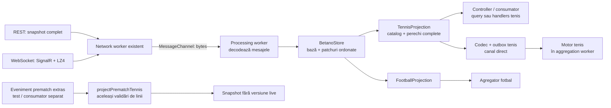
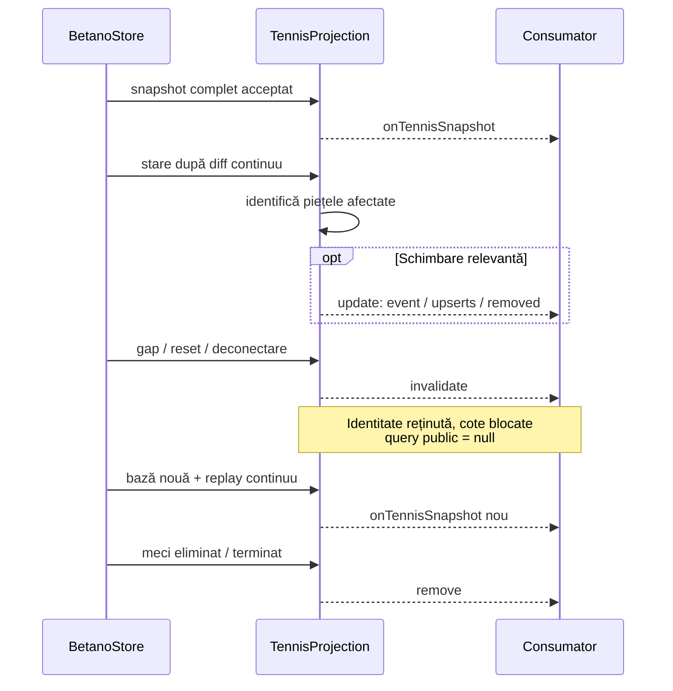

# Betano tenis — catalogul și modelul filtrat

[Index documentație](../../README.md) · [Providers](../../architecture/PROVIDERS.md) · [Contract Betano](CONTRACT.md) · [Superbet tenis](../superbet/TENNIS.md)

## 1. Domeniu și stare

[Catalogul explicit](../../../src/providers/betano/tennis-markets.config.ts) conține **32 de definiții**: 23 totaluri, 3 handicapuri și 6 piețe Da/Nu. Fiecare linie păstrată are exact două selecții distincte și complementare. Include game-uri, seturi, ași, duble greșeli, tiebreak-uri, seturi la zero și break-uri, pentru meci sau set și pentru total ori participant.

Filtrarea rulează în **processing workerul Betano existent**, după acceptarea versiunilor de către store. Folosește aceleași snapshoturi REST și grupuri SignalR deja colectate; nu adaugă conexiuni, workeri sau requesturi în aplicația normală. Starea vendor acoperă audiența eveniment + piețe, inclusiv contextul scorului; cronologia incidentelor nu este colectată.

Providerul activ colectează în continuare **numai live**. Adaptorul pur `projectPrematchTennis` interpretează separat un eveniment public prematch deja extras; nu implementează discovery, descărcare HTML sau abonări prematch.

**Matchingul și oportunitățile de tenis sunt integrate.** [Maparea](../../mapping/TENNIS.md) declară 26 de corespondențe, dintre care 25 active. [Motorul de tenis](../../architecture/TENNIS.md) rulează separat de fotbal în același aggregation worker. Liniile de tenis nu intră în adaptorul de fotbal.

## 2. Fluxul și fișierele

| Fișier | Rol |
| --- | --- |
| [tennis-markets.config.ts](../../../src/providers/betano/tennis-markets.config.ts) | Tipuri, coduri, șabloane, statistică, perioadă, participant și roluri. |
| [tennis-markets.interfaces.ts](../../../src/providers/betano/model/tennis-markets.interfaces.ts) | Contractul catalogului explicit. |
| [tennis-projection.interfaces.ts](../../../src/providers/betano/model/tennis-projection.interfaces.ts) | Contextul meciului, linia, selecțiile, snapshotul și schimbările. |
| [tennis-prematch.interfaces.ts](../../../src/providers/betano/model/tennis-prematch.interfaces.ts) | Formatul public prematch deja extras. |
| [tennis-markets.ts](../../../src/providers/betano/processing/tennis-markets.ts) | Validează participanții, scorurile, șabloanele și perechile. |
| [tennis-projection.ts](../../../src/providers/betano/processing/tennis-projection.ts) | Menține starea filtrată și indexurile pentru piețele afectate. |
| [tennis-prematch.ts](../../../src/providers/betano/processing/tennis-prematch.ts) | Grupează pragurile prematch și elimină copiile identice. |
| [feed.ts](../../../src/providers/betano/processing/feed.ts), [worker.ts](../../../src/providers/betano/workers/worker.ts), [controller.ts](../../../src/providers/betano/controller.ts) | Leagă proiecția de store, mesajele workerului și API. |

## 3. Identitate și date păstrate

| Nivel | Date |
| --- | --- |
| Snapshot | Provider, eveniment, versiune vendor, timp local, sincronizare, linii eligibile. |
| Eveniment | ID, Betradar, participanți, competiție/categorie, început UTC, fază, suspendare și indicatorul de dublu dacă este publicat. |
| Participanți | Numele literal, ID de participant dacă există și lista `playerIds` livrată de API. O pereche de dublu rămâne un participant. |
| Scor | Seturi câștigate, punctele game-ului, scoruri pe set, jucătorul la serviciu și coordonatele curente. |
| Linie | Cheie, instanță piață, tip de catalog, total/handicap, set/game și suspendare. |
| Selecție | ID concret, outcome ID când există, rol fix, cotă, handicap semnat și suspendare. |

`market.typeId` și `market.type` identifică tipul reutilizabil. `market.id` identifică instanța unui meci și se poate schimba. Cheia locală este `market.id:prag`, respectiv `market.id:binary` pentru Da/Nu. `selection.id` este identitatea folosită în patchuri.

**Scorul principal din Betano reprezintă punctele, nu seturile.** `liveData.score.home/away` devin `player1Points/player2Points`. Seturile câștigate vin din `results.liveInfoHomeScore/liveInfoAwayScore`; `results.setScoreList` păstrează separat game-urile fiecărui set, în ordinea publicată. Punctele permit și `A`/`AD` sau numere de tiebreak. Datele lipsă/nevalide devin `null`, fără scoruri presupuse.

`currentSetNumber` vine din `currentPeriodNumber` valid în 1–5. `currentGameNumber` vine din eticheta exactă `currentGame: "Game N"`, relativă la set. Nu folosim `currentTennisGame`: acesta poate fi global pe meci. Exemplu capturat: setul 2, game-ul 2, dar `currentTennisGame: 14`. Ambele indicatoare de server adevărate sau ambele absente dau `serving: null`.

`isDoubles` este `null` când nu este publicat; nu îl deducem din numele participanților. Nu deducem regulile match tiebreak-ului sau formatul meciului din scor. HTML-ul prematch folosește ID-uri string de participant; nu le transformăm în liste `playerIds` presupuse.

## 4. Validarea și disponibilitatea

O linie se păstrează numai dacă:

1. Tipul, codul și numele exact corespund catalogului hardcodat.
2. Participanții sunt distincți și au o singură orientare `isHome`; ID-urile de jucător, dacă există, nu sunt duplicate sau comune celor doi participanți.
3. Selecțiile referite există în dicționar, au ID-uri unice și corespund celor două roluri.
4. Numele și valorile numerice se confirmă reciproc: `Peste/Sub N`, respectiv participant și handicap semnat. Totalul este nenegativ; pragurile acceptate sunt întregi sau jumătăți.
5. Fiecare prag are exact două selecții. Membrii suspendați se numără înainte de verificarea cardinalității.
6. În formatul live, pragul pieței este egal cu pragul selecțiilor, orientat către primul participant la handicap.

`<PLAYER_1>` și `<PLAYER_2>` se înlocuiesc literal. `<SET>` permite doar un număr în 1–5 în poziția configurată din numele pieței. De exemplu, `Game-uri Handicap  (Set <SET>)` păstrează cele două spații. La tipurile specifice primului set, `setNumber: 1` este explicit în catalog. Nu identificăm tipuri noi căutând cuvinte în etichete.

Pentru **17 definiții**, ambele outcome ID-uri au fost confirmate în API și sunt configurate. Restul de **15** au fost observate complet în SSR, care omite ID-urile de rezultat; validăm codul, numele, etichetele și pragurile, fără ID-uri inventate. Un ID configurat este obligatoriu în formatul live; adaptorul SSR permite absența lui și păstrează `outcomeId: null`.

La handicap, valoarea liniei este orientată către `player1`; selecția `player2` păstrează semnul opus. Zero este normalizat fără `-0`. Nu reordonăm membrii unei perechi de dublu pentru a forța potrivirea etichetelor: dacă vendorul schimbă ordinea numelor din cote față de participanți, piața dependentă de acele nume este respinsă.

**Linia existentă nu garantează cote utilizabile.** Consumatorul verifică `synchronized === true`, faza și suspendarea evenimentului, pieței și selecțiilor, apoi cota finită > 1. Un preț zero/lipsă/nevalid devine `null`, inclusiv când patchul vendor îl resetează implicit la zero. Nu se recuperează automat o cotă anterioară.

Excludem câștigătorii simpli, scorurile, par/impar, variantele 3-way, combinațiile de condiții, revenirile, piețele unilaterale `X+`, sumele ași + duble greșeli, procentele și durata. Două praguri `8+ / 9+` nu sunt opuse. În eșantionul cercetat nu s-au confirmat perechi Peste/Sub pe puncte de game ori Da/Nu pentru deuce; nu se inventează aceste tipuri pentru a copia integral catalogul Superbet.

## 5. Actualizări și recuperare

Indexurile `selection → market` și `market → selections` permit recalcularea piețelor atinse de patchurile `100`, `105` și `150`. Schimbările structurale `101`, `102`, `106` refac apartenența relevantă. Un upsert conține perechea completă, nu o selecție izolată. Schimbările de scor/server pot publica numai contextul evenimentului. Un update fără efect filtrat avansează versiunea internă fără notificare suplimentară.

`invalidate` păstrează identitatea și liniile intern cu `synchronized: false`, dar blochează query-urile publice. Nu aplicăm delte acestei proiecții până la o bază completă. `remove` șterge proiecția la retragere, terminare, metadate incompatibile sau oprire.

`sourceVersion` în feed-ul live este versiunea split vendor pentru eveniment + piețe, nu o secvență proprie de notificări; poate sări între schimbările filtrate și nu se compară direct cu versiunea REST completă. [Contractul](CONTRACT.md#versiunea-rest-și-versiunea-fluxului-selectat) explică alinierea și excluderea cronologiei incidentelor. `projectedAt` este timpul local al proiecției, nu ora publicării cotei la Betano.

| API | Contract |
| --- | --- |
| `getTennisSnapshot(eventId)` | Snapshot sincronizat sau `null`: lipsă, alt sport, stale ori provider în oprire. ID-ul trebuie să fie întreg pozitiv. |
| `onTennisSnapshot(snapshot)` | Bază completă inițială sau după reparare; înlocuiește copia consumatorului. |
| `onTennisUpdate(change)` | `update`, `invalidate` sau `remove`, cu aceleași reguli ca la Superbet. |
| `projectPrematchTennis(event)` | Funcție separată pentru eveniment SSR deja extras; `sourceVersion: null`. |

O copie locală completă necesită ambii handleri: snapshot și update. Datele filtrate ajung pe main numai la query sau când sunt înregistrați handlerii corespunzători.

## 6. Prematch și sursele publice

- Live: `/danae-webapi/api/live/events/<id>/latest`, după discovery-ul deja existent din overview.
- Prematch: pagina publică `/cote/<slug>/<id>/?bt=13`, fila **Toate**, cu `initial_state.data.event` și piețele extrase din secțiunile ofertei. Adaptorul primește lista de înregistrări de piață deja extrasă.

SSR poate grupa mai multe praguri într-o singură piață; fiecare pereche este validată separat. De aceea, `market.handicap` prematch nu trebuie folosit ca prag unic pentru toate selecțiile. Copiile identice ale pieței din secțiuni diferite se elimină; copiile conflictuale și ID-urile de selecție reutilizate între piețe fac intrarea invalidă. Piețele tabelare neincluse în catalog, cum sunt câștigătorii de set sau cursele până la N ași, nu se transformă în linii eligibile.

Un răspuns de la endpointul live nu dovedește că meciul a început: am observat evenimente fără `isLive: true`, cu game/set zero. Proiecția live nu inventează o fază sau un început din această prezență.

## 7. Catalog verificat

Rolurile și ID-urile sunt de rezultat, nu ID-uri de instanță ale selecției. `—` indică un outcome ID neconfirmat, nu o selecție lipsă.

| Type ID | Cod | Șablon piață | Tip | Perioadă | Roluri / outcome ID-uri |
| --- | --- | --- | --- | --- | --- |
 | 162 | `TGHC` | `Total Game-uri Handicap` | handicap | meci | `player1` 459 / `player2` 460 |
 | 1359 | `SF60` | `Oricare set se încheie 6:0 sau 0:6` | yes-no | meci | `yes` 3849 / `no` 3850 |
 | 1361 | `BPWS` | `Ambii jucători să câștige un set` | yes-no | meci | `yes` 3888 / `no` 3889 |
 | 1381 | `GHCS` | `Game-uri Handicap  (Set <SET>)` | handicap | set <SET> | `player1` 4028 / `player2` 4029 |
 | 1405 | `MSSH` | `Handicap meci (Set)` | handicap | meci | `player1` 4004 / `player2` 4005 |
 | 1408 | `TSIM` | `Seturi totale în meci (Peste/Sub)` | total | meci | `over` — / `under` — |
 | 1424 | `X150` | `Total ași` | total | meci | `over` — / `under` — |
 | 1431 | `P1DF` | `<PLAYER_1> Duble greșeli` | total | meci | `over` — / `under` — |
 | 1435 | `P1FO` | `<PLAYER_1> Game-uri în primul set` | total | set 1 | `over` 3909 / `under` 3910 |
 | 1438 | `P1W2` | `<PLAYER_1> să câștige 2 seturi` | yes-no | meci | `yes` — / `no` — |
 | 1439 | `P1WS` | `<PLAYER_1> să câștige un set` | yes-no | meci | `yes` 3845 / `no` 3846 |
 | 1440 | `P1TA` | `<PLAYER_1> Ași` | total | meci | `over` — / `under` — |
 | 1441 | `X300` | `<PLAYER_1> Total ași - Primul set` | total | set 1 | `over` — / `under` — |
 | 1444 | `X313` | `<PLAYER_1> Total  duble greșeli - Primul set` | total | set 1 | `over` — / `under` — |
 | 1445 | `OUG1` | `<PLAYER_1> Total game-uri câștigate` | total | meci | `over` 3859 / `under` 3860 |
 | 1454 | `P1SB` | `<PLAYER_1> Total break-uri` | total | meci | `over` 3882 / `under` 3883 |
 | 1462 | `P2DF` | `<PLAYER_2> Duble greșeli` | total | meci | `over` — / `under` — |
 | 1466 | `P2FO` | `<PLAYER_2> Game-uri în primul set` | total | set 1 | `over` 3911 / `under` 3912 |
 | 1469 | `P2W2` | `<PLAYER_2> să câștige 2 seturi` | yes-no | meci | `yes` — / `no` — |
 | 1470 | `P2WS` | `<PLAYER_2> să câștige un set` | yes-no | meci | `yes` 3847 / `no` 3848 |
 | 1471 | `P2TA` | `<PLAYER_2> Ași` | total | meci | `over` — / `under` — |
 | 1472 | `X301` | `<PLAYER_2> Total ași - Primul set` | total | set 1 | `over` — / `under` — |
 | 1475 | `X314` | `<PLAYER_2> Total  duble greșeli - Primul set` | total | set 1 | `over` — / `under` — |
 | 1476 | `OUG2` | `<PLAYER_2> Total game-uri câștigate` | total | meci | `over` 3861 / `under` 3862 |
 | 1486 | `P2SB` | `<PLAYER_2> Total break-uri` | total | meci | `over` 3884 / `under` 3885 |
 | 1512 | `FSTO` | `Game-uri totale set (Set <SET>)` | total | set <SET> | `over` 4037 / `under` 4038 |
 | 1531 | `X193` | `Ași - Primul set` | total | set 1 | `over` — / `under` — |
 | 1534 | `TDBF` | `Duble greșeli` | total | meci | `over` — / `under` — |
 | 1535 | `X198` | `Duble greșeli - Primul set` | total | set 1 | `over` — / `under` — |
 | 1541 | `FTGO` | `Game-uri` | total | meci | `over` 4039 / `under` 4040 |
 | 1551 | `X229` | `Total break-uri` | total | meci | `over` 4116 / `under` 4117 |
 | 3876 | `X244` | `Total tie-break-uri` | total | meci | `over` 10098 / `under` 10099 |

Piețele `1439/1470` reprezintă „câștigă cel puțin un set”; `1438/1469` reprezintă „câștigă două seturi”. `1361` este condiția ambii câștigă un set, iar `1359` este existența unui set la zero. Aceste condiții sunt explicite în catalog și nu sunt înlocuite automat cu un total de seturi.

## 8. Verificare și limite

Verificarea a folosit trei meciuri prematch și trei live, cu date publice capturate la **25 octombrie 2026**:

| Fază la captură | Meci | ID | Linii filtrate |
| --- | --- | --- | --- |
| Prematch | [Daniil Medvedev – Nikoloz Basilashvili](https://ro.betano.com/cote/daniil-medvedev-nikoloz-basilashvili/94624543/?bt=13) | 94624543 | 104 |
| Prematch | [Lorenzo Musetti – Taylor Fritz](https://ro.betano.com/cote/lorenzo-musetti-taylor-fritz/94631017/?bt=13) | 94631017 | 102 |
| Prematch | [Karen Khachanov – Carlos Alcaraz](https://ro.betano.com/cote/karen-khachanov-carlos-alcaraz/94620478/?bt=13) | 94620478 | 74 |
| Live | Tereza Valentova – Shuai Zhang | 94628939 | 17 |
| Live | Yuta Kikuchi – Dimitris Sakellaridis | 94618531 | 17 |
| Live, dublu | Alan Magadan / Rodrigo Pacheco Mendez – Federico Zeballos / Marcelo Zormann | 94600354 | 2 |

Total: **316 linii**, dintre care 280 prematch și 36 live. Toate cele 32 de definiții au exemple binare validate. La dublu, diferențele de ordine a numelor au exclus piețele dependente de participant; totalul general și condiția ambii câștigă un set au rămas valide. Un alt meci devenise indisponibil, iar alte două răspunsuri de la endpointul live nu aveau fază live confirmată; acestea nu au fost incluse în total.

[Testele locale](../../../test/betano-tennis.test.mjs) acoperă toate definițiile, capturile reale, pragurile multiple, ID-urile, etichetele, handicapurile, scorul, cardinalitatea, patchurile, indexurile, invalidarea, recuperarea, finalizarea și separarea de fotbal. [Fixture-ul redus](../../../test/fixtures/betano-tennis-markets.json) păstrează 32 de exemple prematch și trei snapshoturi live limitate la piețele relevante, fără date de cont.

Rularea scurtă cu controllerul și workerii reali a primit **56 snapshoturi și 27 actualizări de tenis**, pe lângă 139 de snapshoturi de fotbal, fără perechi invalide sau erori de snapshot. Reconectarea forțată a emis invalidări și baze noi. În această rulare s-a raportat și `WebSocket closed (1005)`; la oprirea măsurătorii existau încă evenimente în reparare, deci verificarea nu dovedește recuperarea completă a tuturor meciurilor sau stabilitate pe termen lung.

Fișierele brute și scripturile temporare sunt șterse după verificare; fixture-ul redus rămâne intenționat pentru regresii. [Corespondențele active](../../mapping/TENNIS.md) și [agregarea tenisului](../../architecture/TENNIS.md) documentează separat verificarea regulilor, excluderile și testul fluxului complet.
