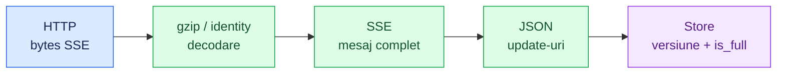
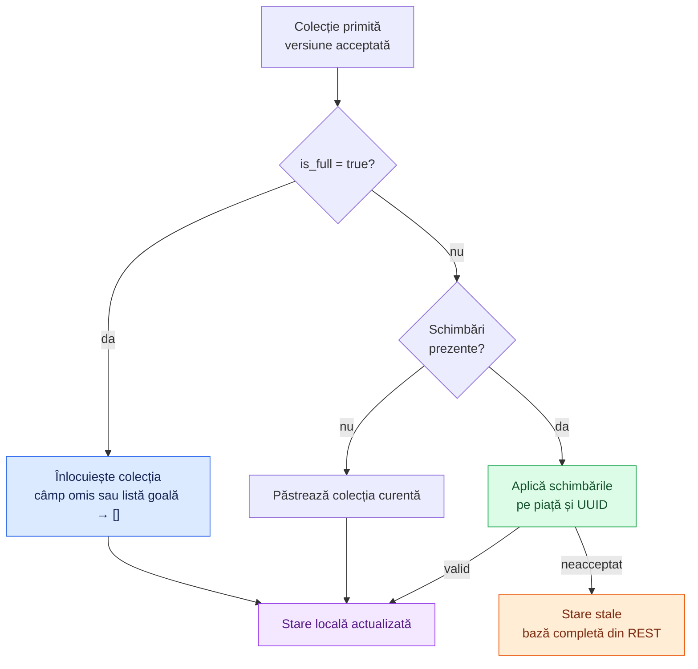

# Contract Superbet — evenimente, SSE și actualizări de cote

[Ansamblu](../../../README.md) · [Arhitectura providerilor](../../architecture/PROVIDERS.md) · [Contract Betano](../betano/CONTRACT.md)

Acest document descrie contractul tehnic folosit de implementarea noastră: endpointurile Superbet, forma evenimentelor și regulile de actualizare a stării locale. API-ul este nedocumentat public; regulile de mai jos descriu comportamentul implementat, fără a reprezenta o specificație oficială Superbet.

Exemplele JSON sunt minime, cu ID-uri și valori fictive. Numele câmpurilor și structurile relevante corespund codului.

## 1. Aceeași formă de eveniment, două căi de livrare

| Sursă          | Ce livrează                                                        | Cum o folosim                                                                                   |
| -------------- | ------------------------------------------------------------------ | ----------------------------------------------------------------------------------------------- |
| REST discovery | Obiect cu `events[]`, filtrat de server la indexul live.           | Identifică meciuri și versiunea de referință. Nu presupunem că piețele din listă sunt complete. |
| REST după ID   | Obiect cu `events[]` pentru meciul cerut.                          | Repară sau completează baza cotelor.                                                            |
| SSE per meci   | `data:` conține un obiect de eveniment sau o listă de actualizări. | Livrează baza inițială și schimbările ulterioare.                                               |

Superbet nu folosește în acest flux un `diff.type` numeric pentru fiecare categorie de schimbare. Semantica este dată de **câmpurile prezente și indicatorii `is_full_*`**, iar ordinea de `increment_id`.



Un fragment HTTP nu este automat un eveniment SSE și nici o actualizare completă. Decoderul păstrează datele incomplete până poate citi întregul mesaj.

## 2. Endpointuri și răspunsuri

Origin implicit: `https://production-superbet-offer-ro.freetls.fastly.net`.

| Scop                  | Request                                                            |
| --------------------- | ------------------------------------------------------------------ |
| Discovery             | `GET /v3/ro-RO/events?index=active-live&startDate=...&endDate=...` |
| Bază completă după ID | `GET /v3/ro-RO/events?events=<event_id>`                           |
| Abonare live per meci | `GET /v3/subscription/ro-RO/events?events=<event_id>`              |

Discovery folosește date ISO UTC: de la începutul zilei de acum șapte zile până la începutul zilei următoare. Se repetă la cinci minute. REST trimite `accept: application/json`, `accept-encoding: gzip`; SSE trimite `accept: text/event-stream`, `accept-encoding: gzip`.

| Răspuns                        | Comportament în implementare                                                              |
| ------------------------------ | ----------------------------------------------------------------------------------------- |
| REST `200`                     | Decodează body-ul și cere un obiect cu `events[]` și identități/versiuni valide.          |
| SSE `200`, `text/event-stream` | Deschide consumul incremental. Sunt acceptate gzip, identity sau absența encoding-ului.   |
| SSE `204`                      | Abonarea se încheie permanent; providerul elimină meciul urmărit fără un restart imediat. |
| EOF SSE curat                  | Reîncearcă abonarea și resincronizează. Nu este automat o eroare de transport.            |
| REST `429` / `503`             | Aplică un cooldown REST comun providerului, după `Retry-After`.                           |
| REST gol pentru ID             | Providerul elimină meciul din starea urmărită.                                            |

Decoderul REST poate gestiona și encoding-urile `deflate` și `br`; decoderul SSE curent acceptă numai gzip/identity. Providerul nu trimite `Last-Event-ID` și nu negociază replay pe baza acelui header. Continuitatea este verificată prin `increment_id`, iar repararea se face din REST.

## 3. Identitate și selecția meciurilor

| Câmp                                  | Rol                                                                   |
| ------------------------------------- | --------------------------------------------------------------------- |
| `event_id`                            | Identitatea meciului; integer sigur, strict pozitiv.                  |
| `increment_id`                        | Versiunea acelui meci; integer sigur, nenegativ.                      |
| `fixture`                             | Descrierea evenimentului: sport, nume, stare ofertă și alte metadate. |
| `inplay_stats`                        | Date live, precum scoruri sau minute.                                 |
| `inplay_stats_metadata`               | Statusul meciului și contoare pentru ofertă.                          |
| `markets`, `superbets`, `priceboosts` | Colecțiile de piețe urmărite separat de store.                        |

În discovery sunt acceptate sporturile `5` = fotbal, `4` = baschet, `2` = tenis, cu nume de eveniment valid și `inplay_stats_metadata.status: "STARTED"`. Evenimentele outright sunt excluse.

`ENDED`, `FINISHED`, `CANCELLED`, `POSTPONED` sau `fixture.offer_state_status["2"] === 2` sunt tratate ca terminare. Cheia `"2"` din starea ofertei și din contoare identifică oferta live în acest contract.

Versiunea aparține unui meci Superbet. Nu se compară cu versiunea altui meci sau cu ID-urile/versiunile Betano.

## 4. Baza completă a cotelor

Contractul de aici descrie starea vendor completă. Modelele filtrate de [fotbal](FOOTBALL.md) și [tenis](TENNIS.md) sunt proiecții separate, aplicate după sincronizare: catalog explicit și exact două rezultate per linie. Nu modifică semantica patchurilor sau API-ul snapshotului brut. `getTennisSnapshot/onTennisSnapshot/onTennisUpdate` expun tenisul prin același processing worker; invalidarea temporară blochează folosirea cotelor, iar eliminarea șterge proiecția.

```json
{
  "event_id": 11,
  "increment_id": 40,
  "fixture": {
    "sport_id": 5,
    "event_name": "Gazde·Oaspeți",
    "offer_state_status": { "2": 1 }
  },
  "inplay_stats_metadata": { "status": "STARTED" },
  "is_full_market_update": true,
  "markets": [
    {
      "id": 547,
      "name": "Final",
      "odds": [
        {
          "uuid": "11111111-1111-4111-8111-111111111111",
          "price": 1.85,
          "status": 1,
          "display": true,
          "metadata": { "name": "1", "offer_state_id": 2 }
        }
      ]
    }
  ]
}
```

Relația este **eveniment → piețe → odds**. Cota unei selecții se află în `odds[].price`, iar identitatea ei în `uuid`.

| Obiect         | Identitate și date importante                                                                                                             |
| -------------- | ----------------------------------------------------------------------------------------------------------------------------------------- |
| Piață          | Cheia locală include **`id` și `name`**, deoarece un ID poate apărea în grupuri cu nume diferite. Conține `odds[]`.                       |
| Odd / selecție | Identificată prin `uuid`; păstrează `price`, `status`, `display`, `metadata` și alte câmpuri vendor.                                      |
| Snapshot local | Are obligatoriu `fixture` și liste pentru toate cele trei colecții de piețe; colecțiile absente sunt reprezentate prin `[]` la instalare. |

Instalarea unei baze cere un eveniment live acceptat și fie `is_full_market_update: true`, fie declarația explicită de ofertă live goală descrisă mai jos. Doar `fixture` sau doar un câmp `markets` nu reprezintă automat o bază completă.

## 5. Înlocuire completă versus modificare parțială

Fiecare colecție are propriul indicator:

| Colecție      | Indicator de înlocuire completă |
| ------------- | ------------------------------- |
| `markets`     | `is_full_market_update`         |
| `superbets`   | `is_full_superbets_update`      |
| `priceboosts` | `is_full_priceboosts_update`    |

Un update complet al piețelor obișnuite nu înlocuiește automat colecția `superbets` sau `priceboosts`.



| Indicator         | Colecție primită   | Efect                                        |
| ----------------- | ------------------ | -------------------------------------------- |
| `true`            | Listă cu piețe     | Înlocuiește acea colecție.                   |
| `true`            | `[]` sau câmp omis | Golește acea colecție.                       |
| Omitere / `false` | Câmp omis sau `[]` | Păstrează acea colecție.                     |
| Omitere / `false` | Listă cu schimbări | Patch peste piețele și selecțiile existente. |

Diagrama descrie regula normală per colecție. Declarația explicită de zero ofertă live poate goli toate colecțiile, conform secțiunii următoare.

### Exemplu de schimbare parțială

```json
{
  "event_id": 11,
  "increment_id": 41,
  "markets": [
    {
      "id": 547,
      "name": "Final",
      "odds": [
        {
          "uuid": "11111111-1111-4111-8111-111111111111",
          "price": 1.9
        }
      ]
    }
  ]
}
```

Piața `547:Final` și selecția din exemplu există deja. Prețul devine `1.90`; `status`, `display` și `metadata` omise se păstrează. Merge-ul este superficial: dacă vine un obiect `metadata` nou, acesta înlocuiește obiectul vechi, fără un deep merge implicit.

| Schimbare parțială                     | Regula store-ului                                                       |
| -------------------------------------- | ----------------------------------------------------------------------- |
| `display: false` pentru un UUID        | Elimină selecția. Dacă piața rămâne fără selecții, elimină și piața.    |
| UUID vizibil necunoscut                | Cere reparare printr-o bază completă.                                   |
| Piață necunoscută cu selecții vizibile | Cere reparare; un patch nu este presupus o definiție completă de piață. |
| Eliminare pentru un UUID deja absent   | Este tolerată; nu se inventează o selecție.                             |

`status` și `offer_state_status` rămân valori vendor. `display` controlează eliminarea din colecție în patch-urile de mai sus; singur nu dovedește că o cotă este activă. Păstrarea unui preț trebuie interpretată împreună cu starea ofertei și a selecției.

## 6. Un meci live poate avea zero cote

Superbet poate omite atât `markets`, cât și indicatorul complet când oferta live este goală:

```json
{
  "event_id": 11,
  "increment_id": 42,
  "fixture": { "sport_id": 5, "event_name": "Gazde·Oaspeți" },
  "inplay_stats_metadata": {
    "status": "STARTED",
    "counts": {
      "markets": { "2": 0 },
      "odds": { "2": 0 }
    }
  }
}
```

Store-ul acceptă oferta goală numai dacă **ambele contoare live sunt zero** și colecțiile primite sunt absente sau goale. Starea validă are atunci `markets: []`, `superbets: []`, `priceboosts: []`.

Lipsa colecției fără acea declarație nu dovedește că oferta este goală. `getSnapshot()` cu liste goale reprezintă o stare sincronizată fără cote; `null` reprezintă un meci absent sau o stare încă indisponibilă pentru consum.

## 7. Ordine, baza inițială și reconectare

| Situație                                              | Comportament                                                             |
| ----------------------------------------------------- | ------------------------------------------------------------------------ |
| Discovery anunță versiunea `40`                       | Reține `40` ca versiune minimă pentru publicare.                         |
| SSE începe cu baza `38`                               | O poate păstra pentru catch-up, dar nu o expune încă drept sincronizată. |
| Sosesc `39`, apoi `40`, complet și în ordine          | Poate publica baza sincronizată.                                         |
| SSE nu ajunge la versiunea minimă în 10 s             | Programează snapshot REST prin coada de reparare.                        |
| După `40` vine `41` valid                             | Aplică schimbarea și avansează versiunea.                                |
| Vine o versiune deja aplicată                         | O ignoră.                                                                |
| Vine `43` fără `42`, ori patch-ul nu poate fi aplicat | Invalidează starea, reține schimbarea și programează reparare.           |
| REST aduce `42`, iar `43` este în buffer              | Instalează baza și reaplică `43`, dacă secvența este completă.           |
| SSE se reconectează                                   | Invalidează baza veche și cere refacerea continuității.                  |

Bufferul este limitat implicit la 256 de versiuni per meci. Golirea bufferului la depășire nu permite publicarea unei versiuni sub ținta deja observată.

O versiune completă mai veche nu înlocuiește o stare locală mai nouă. O nouă conexiune are propria revizie; răspunsurile REST din conexiunea anterioară nu pot revalida acea abonare. Restarturile explicite ignoră și fragmentele vechi rămase în coadă.

### Încadrarea SSE și confirmările locale

Pe fir, exemplul de update este încadrat astfel; linia goală de la final încheie evenimentul:

```text
data: [{"event_id":11,"increment_id":41}]

```

Parserul acceptă liniile `data:` multiple, separatori LF/CRLF/CR și comentarii SSE. Feed-ul verifică faptul că ID-ul fiecărei actualizări corespunde meciului abonării. O înregistrare incompletă la EOF nu este aplicată ca JSON complet.

ACK-ul dintre processing worker și network worker confirmă **consumul fragmentului brut**, nu o confirmare către Superbet și nici aplicarea unei versiuni complete. Este eliberat și când parserul așteaptă alte fragmente; altfel un mesaj mare ar putea bloca propriul flux.

## 8. Unde se verifică acest contract

- [Modelul datelor](../../../src/providers/superbet/model/state.interfaces.ts): eveniment, piață, odd și snapshot local.
- [SSE și gzip](../../../src/providers/superbet/protocol/sse.ts): reasamblare, encoding-uri și limite.
- [Feed](../../../src/providers/superbet/processing/feed.ts): requesturi, filtrare, abonări și recuperare.
- [Store](../../../src/providers/superbet/processing/state.ts): regulile de înlocuire, patch, zero ofertă și versiuni.
- [Teste de stare](../../../test/superbet-state.test.mjs) și [de protocol](../../../test/superbet-protocol.test.mjs): exemple executabile ale regulilor implementate.

Regulile de conectare HTTP/2 și controlul fluxului sunt în [Network](../../architecture/NETWORK.md). Configurările de concurență, credit, retry și timeout sunt în [Providers](../../architecture/PROVIDERS.md#configurări-care-contează).
