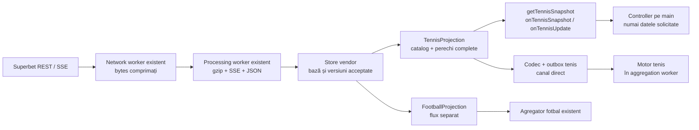

# Superbet tenis — catalogul și modelul filtrat

[Index documentație](../../README.md) · [Provideri](../../architecture/PROVIDERS.md) · [Contract Superbet](CONTRACT.md) · [Superbet fotbal](FOOTBALL.md)

## 1. Domeniu și stare

**Implementat pentru Superbet:** catalog fix cu **48 de definiții** — 32 totaluri, 8 handicapuri și 8 piețe Da/Nu. Proiecția păstrează numai linii complete cu exact două selecții distincte. Include game-uri, seturi, puncte, ași, duble greșeli, tiebreak-uri, seturi la zero și deuce.

Providerul activ urmărește în continuare numai live, inclusiv tenisul deja descoperit prin sport ID `2`. Proiecția poate interpreta separat baze prematch complete, la fel ca cea de fotbal; această schimbare nu adaugă discovery sau abonări prematch.

**Matchingul și oportunitățile de tenis sunt integrate.** Tenisul este disponibil prin API-ul Superbet și prin [proiecția Betano](../betano/TENNIS.md); un codec și un canal de tenis alimentează motorul separat din agregator. [Maparea](../../mapping/TENNIS.md) și [fluxul de agregare](../../architecture/TENNIS.md) descriu cele 25 de corespondențe active și restricțiile. ID-urile piețelor de tenis nu se trimit motorului de fotbal.

## 2. Fluxul și fișierele



Nu se deschid conexiuni sau workeri suplimentari. Filtrarea folosește starea brută deja colectată. Recalcularea unei piețe rulează în processing worker; networkingul livrează în continuare numai bytes.

| Fișier | Rol |
| --- | --- |
| [tennis-markets.config.ts](../../../src/providers/superbet/tennis-markets.config.ts) | Tipuri, nume exacte, parametri și roluri fixe. |
| [tennis-markets.interfaces.ts](../../../src/providers/superbet/model/tennis-markets.interfaces.ts) | Contractul catalogului. |
| [tennis-projection.interfaces.ts](../../../src/providers/superbet/model/tennis-projection.interfaces.ts) | Eveniment, linie, selecții, snapshot și schimbări. |
| [tennis-markets.ts](../../../src/providers/superbet/processing/tennis-markets.ts) | Validarea contextului și extragerea perechilor. |
| [tennis-projection.ts](../../../src/providers/superbet/processing/tennis-projection.ts) | Starea filtrată și recalcularea grupurilor afectate. |
| [feed.ts](../../../src/providers/superbet/processing/feed.ts), [worker.ts](../../../src/providers/superbet/workers/worker.ts), [controller.ts](../../../src/providers/superbet/controller.ts) | Alimentarea proiecției, mesaje și query-uri. |

## 3. Ce păstrăm

| Nivel | Date |
| --- | --- |
| Snapshot | Provider, eveniment, versiunea vendor, timpul local al proiecției, `synchronized`, liniile eligibile. |
| Eveniment | ID, Betradar, cei doi participanți, competiție/categorie, început UTC, fază, status, ofertă, scor la seturi, puncte și server. |
| Scoruri pe set | Numărul setului, game-urile fiecărui participant și `sourceType` primit de la vendor. |
| Linie | Cheie, tip de piață, UUID vendor, fază ofertă, total/handicap, număr de set și de game. |
| Selecție | UUID, outcome ID, rol fix, cotă, status, display și handicapul semnat. |

Participanții au placeholder-ele `<PLAYER_1>` și `<PLAYER_2>`; o echipă de dublu rămâne un participant, fără separarea sau reordonarea numelor. Punctele sunt păstrate ca text: `0`, `15`, `30`, `40`, `A`/`AD` sau puncte numerice de tiebreak. Valorile lipsă/nevalide devin `null`, fără scoruri inventate.

Lista `sets` păstrează perioadele publicate, ordonate după număr. Perioade duplicate sau numerotări nevalide fac contextul pe set necunoscut. Nu deducem formatul „cel mai bun din 3/5” ori existența unui match tiebreak doar din scor, numele jucătorilor sau `sourceType`.

Cheia locală a liniei este `marketId:offerStateId:market_line_uuid`. Numărul setului și game-ului vin din `specifiers.setnr/gamenr`. Înlocuirea lor în șabloane verifică numele primit; nu descoperă dinamic tipuri noi.

`handicap` este orientat către primul participant. Ambele selecții au același `specifiers.hcp` vendor; selecția `player2` primește semnul opus în modelul nostru. La zero nu introducem `-0`.

`points-won`, `points-served` și `points-played` sunt statistici distincte. Denumirile asemănătoare nu justifică o echivalență automată între siteuri.

## 4. Validare și disponibilitate

O linie intră în model numai dacă:

1. Tipul și numele pieței corespund catalogului explicit.
2. Oferta aparține fazei corecte: `1` prematch, `2` live; cele două faze nu se amestecă.
3. UUID-urile sunt valide și distincte, iar grupul are exact două selecții înainte de filtrarea disponibilității.
4. Outcome ID-urile și etichetele selecțiilor corespund rolurilor configurate.
5. Parametrii sunt exact cei declarați și egali pentru ambele selecții; totalul este nenegativ, setul este întreg în 1–5, game-ul este întreg pozitiv.
6. Participanții din nume și semnele handicapului sunt cele așteptate.

Un membru ascuns elimină linia; o a treia selecție ascunsă sau suspendată nu transformă o piață în una binară. O selecție suspendată rămâne într-o pereche completă, cu statusul ei, pentru a publica corect revenirea. Un preț lipsă rămâne `null`, iar zero nu este convertit într-o cotă anterioară.

**Prezența unei linii nu garantează disponibilitatea cotelor.** Un consumator trebuie să verifice sincronizarea, starea meciului/ofertei și pentru selecția folosită `display === true`, `status === 1`, cotă finită > 1. Agregatorul verifică suplimentar maparea și contextul comun de tenis înainte să raporteze oportunități.

Sunt excluse: câștigători simpli neincluși în domeniul ales, scoruri corecte, impar/par, combinații, Super Cote și piețele live cu o singură opțiune de tip „4+”, „5+”. Două praguri „4+ / 5+” nu sunt rezultate opuse.

## 5. Actualizări, recuperare și API

```mermaid
sequenceDiagram
    participant S as Store sincronizat
    participant T as Proiecție tenis
    participant C as Consumator
    S->>T: snapshot complet acceptat
    T-->>C: onTennisSnapshot
    S->>T: update vendor acceptat
    T->>T: reconstruiește numai grupurile afectate
    opt Modificare relevantă
        T-->>C: update: event / upserts / removed
    end
    S->>T: gap sau deconectare
    T-->>C: invalidate
    Note over T,C: Identitate reținută; cote blocate<br/>query-ul public întoarce null
    S->>T: bază reparată și replay continuu
    T-->>C: onTennisSnapshot nou
    S->>T: meci terminat sau retras
    T-->>C: remove
```

| API | Contract |
| --- | --- |
| `getTennisSnapshot(eventId)` | Snapshot filtrat sincronizat sau `null`: meci lipsă, alt sport, deconectat ori în reparare. ID-ul trebuie să fie întreg pozitiv. |
| `onTennisSnapshot(snapshot)` | Bază completă inițială sau după recuperare. Înlocuiește copia consumatorului. |
| `onTennisUpdate(change)` | `update`, `invalidate` sau `remove`. Un upsert conține linia completă cu două selecții. |

Proiecția recalculează piețele atinse de un update parțial; un update integral verifică și liniile dispărute. Schimbările de scor/puncte/server pot publica numai `event`, fără retransmiterea liniilor. O notificare fără efect filtrat avansează versiunea internă fără să emită un update.

`invalidate` blochează datele până la o bază completă, fără să pretindă că meciul a fost retras. `remove` șterge proiecția la terminare, metadate incompatibile sau oprire. Nu se aplică delte unei proiecții invalidate în lipsa unei baze noi.

`sourceVersion` este versiunea vendor și poate sări între notificările filtrate; nu este secvență proprie de livrare. `projectedAt` este timpul local de procesare, nu momentul publicării cotei la Superbet.

Datele filtrate sunt copiate către main numai pentru query-uri sau handlerii înregistrați. Când un consumator păstrează o copie, înregistrează împreună handlerii de snapshot și update și tratează obligatoriu invalidarea/eliminarea.

## 6. Catalogul verificat

`<SET>`, `<GAME>`, `<TOTAL>`, `<HANDICAP>` sunt placeholder-e înlocuite numai din parametrii structurați. Un `X` literal în denumirea vendor rămâne literal. Spațiile, literele și participanții din șabloane sunt validate exact.

| ID | Șablon piață | Parametri | Roluri și outcome ID-uri |
| --- | --- | --- | --- |
| 518 | `Minim 1 set <PLAYER_1>` | — | `yes` 1323 / `no` 1324 |
| 519 | `Va fi un tiebreak?` | — | `yes` 1325 / `no` 1326 |
| 520 | `Handicap game-uri` | `hcp` | `player1` 1327 / `player2` 1328 |
| 522 | `Minim 1 set <PLAYER_2>` | — | `yes` 1331 / `no` 1332 |
| 524 | `Setul <SET> - Total game-uri` | `setnr`, `total` | `under` 1335 / `over` 1336 |
| 548 | `Orice set la zero` | — | `yes` 1473 / `no` 1474 |
| 602 | `Setul X - Va fi tiebreak?` | `setnr` | `yes` 1653 / `no` 1654 |
| 996 | `Total game-uri <PLAYER_2>` | `total` | `under` 4244 / `over` 4245 |
| 999 | `Total game-uri <PLAYER_1>` | `total` | `under` 4253 / `over` 4254 |
| 1000 | `Setul <SET> - Game-ul X - Game la avantaj` | `gamenr`, `setnr` | `yes` 4255 / `no` 4256 |
| 1002 | `Total game-uri` | `total` | `under` 4262 / `over` 4263 |
| 1003 | `Setul <SET> - Handicap game-uri` | `hcp`, `setnr` | `player1` 4264 / `player2` 4265 |
| 2392 | `Total seturi` | `total` | `under` 6016 / `over` 6017 |
| 200504 | `Setul <SET> - Game-ul <GAME> - Total puncte` | `gamenr`, `setnr`, `total` | `under` 151110 / `over` 151109 |
| 200776 | `Handicap seturi` | `hcp` | `player1` 152184 / `player2` 152185 |
| 230641 | `Total tiebreak-uri` | `total` | `under` 4203929 / `over` 4203930 |
| 230648 | `Total seturi câștigate la 0 (6-0)` | `total` | `under` 4203952 / `over` 4203953 |
| 230649 | `Va fi tiebreak sau super tiebreak în setul decisiv?` | — | `yes` 4203954 / `no` 4203955 |
| 230656 | `Setul <SET> - Total game-uri <PLAYER_1>` | `setnr`, `total` | `under` 4203979 / `over` 4203980 |
| 230663 | `Setul <SET> - Total game-uri <PLAYER_2>` | `setnr`, `total` | `under` 4204004 / `over` 4204005 |
| 230678 | `Setul <SET> - Total ași` | `setnr`, `total` | `under` 4204080 / `over` 4204081 |
| 230679 | `Setul <SET> - Total ași <PLAYER_1>` | `setnr`, `total` | `under` 4204082 / `over` 4204083 |
| 230680 | `Setul <SET> - Total ași <PLAYER_2>` | `setnr`, `total` | `under` 4204084 / `over` 4204085 |
| 230682 | `Setul <SET> - Handicap ași` | `hcp`, `setnr` | `player1` 4204089 / `player2` 4204090 |
| 230683 | `Setul <SET> - Total duble greșeli` | `setnr`, `total` | `under` 4204091 / `over` 4204092 |
| 230684 | `Setul <SET> - Total duble greșeli <PLAYER_1>` | `setnr`, `total` | `under` 4204093 / `over` 4204094 |
| 230685 | `Setul <SET> - Total duble greșeli <PLAYER_2>` | `setnr`, `total` | `under` 4204095 / `over` 4204096 |
| 230687 | `Setul <SET>  -  Handicap Duble greșeli` | `hcp`, `setnr` | `player1` 4204100 / `player2` 4204101 |
| 231480 | `Setul <SET> - Total puncte câștigate` | `setnr`, `total` | `under` 4207004 / `over` 4207005 |
| 231481 | `Setul <SET> - Total puncte <PLAYER_1>` | `setnr`, `total` | `under` 4207006 / `over` 4207007 |
| 231482 | `Setul <SET> - Total puncte <PLAYER_2>` | `setnr`, `total` | `under` 4207008 / `over` 4207009 |
| 231484 | `Setul <SET> - Handicap puncte câștigate` | `hcp`, `setnr` | `player1` 4207013 / `player2` 4207014 |
| 232681 | `Total ași <PLAYER_1>` | `total` | `under` 4209693 / `over` 4209694 |
| 232682 | `Total ași <PLAYER_2>` | `total` | `under` 4209695 / `over` 4209696 |
| 232687 | `Total seturi <PLAYER_1>` | `total` | `under` 4209708 / `over` 4209709 |
| 232688 | `Total seturi <PLAYER_2>` | `total` | `under` 4209710 / `over` 4209711 |
| 232690 | `Se va juca setul <SET>` | `setnr` | `yes` 4209718 / `no` 4209719 |
| 233658 | `Total duble greșeli <PLAYER_1>` | `total` | `under` 7475 / `over` 7476 |
| 233659 | `Total duble greșeli <PLAYER_2>` | `total` | `under` 7477 / `over` 7478 |
| 235336 | `Total ași` | `total` | `under` 10998 / `over` 10999 |
| 235337 | `Handicap ași` | `hcp` | `player1` 11007 / `player2` 11008 |
| 235338 | `Total duble greșeli` | `total` | `under` 11020 / `over` 11021 |
| 235344 | `Handicap duble greșeli` | `hcp` | `player1` 11056 / `player2` 11057 |
| 240072 | `Total puncte câștigate <PLAYER_1>` | `total` | `under` 9656 / `over` 9657 |
| 240073 | `Total puncte câștigate <PLAYER_2>` | `total` | `under` 9658 / `over` 9659 |
| 240761 | `Total puncte servite` | `total` | `under` 19062 / `over` 19063 |
| 240762 | `Total puncte servite <PLAYER_1>` | `total` | `under` 19064 / `over` 19065 |
| 240763 | `Total puncte servite <PLAYER_2>` | `total` | `under` 19066 / `over` 19067 |

Cele trei prematch au expus câte 45 dintre tipurile configurate. Eșantionul live a completat cele trei tipuri specifice game-ului sau fluxului live: `519`, `1000`, `200504`. Aceasta este disponibilitatea eșantionului, nu o restricție hardcodată de fază pentru fiecare definiție.

Așii și dublele greșeli prematch au perechi Peste/Sub verificate. În cele două live WTA cercetate existau variante unilaterale separate (`240897`–`240908`), excluse. Catalogul nu inventează selecția complementară lipsă.

## 7. Diferențe care contează la mapare

- Același meci și participant, aceeași statistică, același set/game și același prag; orientarea participantului și semnul handicapului trebuie păstrate.
- Pentru punctele din game trebuie comparat același game, nu „game-ul curent” de la fiecare site. Cotele unui game anterior nu se folosesc după avansarea scorului.
- Match tiebreak-ul în locul setului decisiv trebuie tratat separat de setul obișnuit. Superbet îl consideră setul 3 și un singur game pentru numărarea game-urilor.
- La retragere/descalificare există excepții pentru rezultatele determinate. [Maparea activă](../../mapping/TENNIS.md) documentează regulile consultate, restricția seturilor 1/2 și excluderea totalului de tiebreak-uri neconfirmat.

Aceste reguli sunt descrise în [regulamentul Superbet, secțiunea 7.2](https://superbet.ro/wiki/regulament-de-joc-pariuri-cap-7). Nu declarăm automat echivalente variantele Da/Nu și Peste/Sub pe baza numelor.

## 8. Verificare

[npm test](../../../package.json) include [proiecția și exemplele vendor](../../../test/superbet-tennis.test.mjs) și [integrarea feed-ului](../../../test/superbet-feed.test.mjs). [Fixture-ul redus](../../../test/fixtures/superbet-tennis-markets.json) conține o linie reală per definiție, capturată la 25 octombrie 2026, fără date de cont. Testele verifică separat respingerile, cardinalitatea, fazele, etichetele, parametrii, semnele, scorurile, actualizările și recuperarea.

Validarea pe bazele complete a recunoscut toate cele 48 de definiții și a produs **737 de linii**: 450 în cele trei prematch și 287 în patru live. Alte două meciuri de dublu erau deja terminate la recitire și au fost excluse.

| Fază la verificare | Meci | ID |
| --- | --- | --- |
| Prematch | Elena Rybakina – Leylah Fernandez | 15617251 |
| Prematch | Daniil Medvedev – Nikoloz Basilashvili | 15618310 |
| Prematch | Karen Khachanov – Carlos Alcaraz | 15617104 |
| Live | Tereza Valentova – Shuai Zhang | 15619838 |
| Live | Anastasia Zakharova – Teodora Kostovic | 15619589 |
| Live | Geoffrey Blancaneaux – Imanol Lopez Morillo | 15616053 |
| Live | Keerthivassan Suresh – Sandesh Dattatray Kurale | 15600531 |

Verificarea suplimentară cu controllerul și workerii reali a primit 24 de snapshoturi și 16 actualizări filtrate de tenis, împreună cu 47 de snapshoturi de fotbal, fără erori sau linii cu cardinalitate greșită. Un snapshot public poate fi temporar `null` la reconectare; testul nu stabilește disponibilitatea permanentă a fluxurilor.

Fișierele brute și scripturile temporare ale verificării nu fac parte din proiect. Fixture-ul redus este păstrat intenționat pentru regresii.
