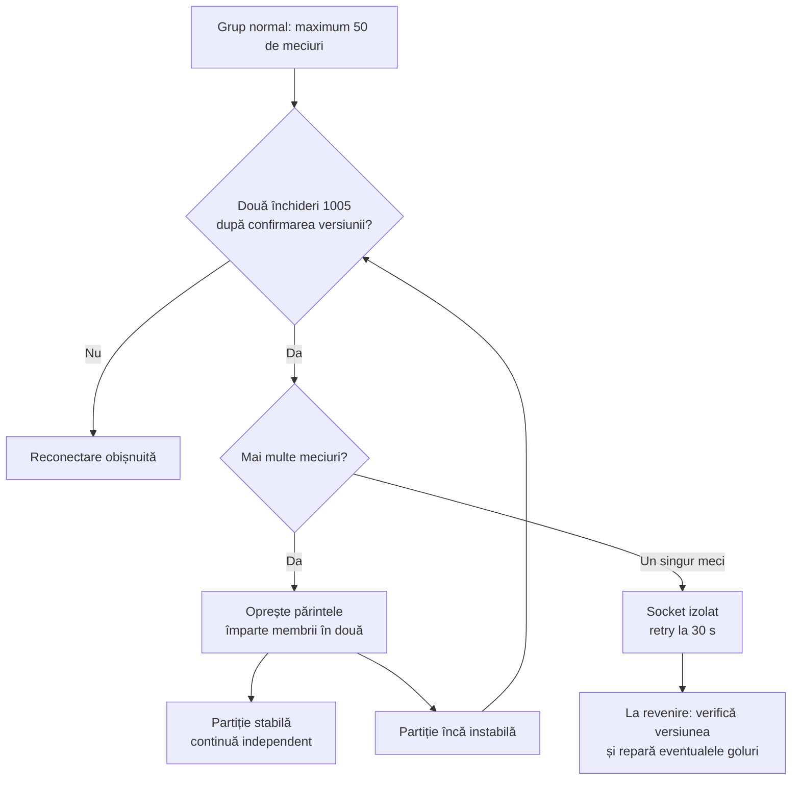

# Betano: izolarea abonamentelor care închid conexiunea

## Ce am reprodus

Logul de aproximativ 30 de minute conținea 162 de închideri `1005` pe `betano:events:5`. Numărul identifică un grup al aplicației, nu un server sau un sport. La diagnostic, aceeași clasă de problemă a apărut pe `events:6`, în timp ce alte cinci grupuri rămâneau conectate.

Împărțirea controlată a grupului a izolat evenimentul `94658007`, Isaac Becroft / Anton Shepp – Moerani Bouzige / Cody Atkinson. Acest ID este un exemplu observat, **nu apare hardcodat în politica de recuperare**.

| Test fără store sau agregator | Rezultat |
| --- | --- |
| Abonament individual în Node | Join și versiune confirmate, apoi închidere `1005`. |
| Același abonament în WebSocket-ul nativ Chrome | Închidere după aproximativ 2,5 s; controlul continuă 25 s. |
| Alte două meciuri testate separat | Ambele rămân conectate 30 s și primesc actualizări. |
| Grupul de 41 de meciuri fără evenimentul problematic | 40 de versiuni confirmate, 143 de mesaje cu diff-uri, 45 s fără închidere. |
| Coadă 3000 în loc de 30 | Închiderea persistă. |
| Doar eveniment, doar piețe sau audiență completă | Închiderea persistă pentru acel meci. |

REST răspundea `200` și descria evenimentul ca live și suspendat. Suspendarea este o stare de disponibilitate, nu o explicație demonstrată pentru închiderea socketului. Serverul nu a transmis motivul intern. Reproducerea în Chrome exclude o cauză exclusivă în biblioteca Node; mesajele mici și reproducerea fără procesare exclud depășirea locală a creditului ca explicație pentru acest caz. Nu putem demonstra retrospectiv că toate cele 162 de închideri din logul anterior provin din același ID.

## Corecția în aplicație

Politica din [socket-recovery.ts](../../src/providers/betano/processing/socket-recovery.ts) recunoaște închideri `1005` repetate numai după confirmarea unui abonament de eveniment. Overview-ul, timeouturile, erorile de deschidere și limita locală de bytes nu împart grupurile.

Doar ramura care continuă să închidă conexiunea se împarte mai departe. Numărul conexiunilor crește în grupurile afectate, cel mult până la câte una per eveniment, plus overview. Cei doi membri ai ultimei împărțiri primesc fiecare un socket izolat; acest marcaj nu declară automat că amândoi au probleme.

Partițiile nu acceptă meciuri noi și nu sunt recombinate în timpul aceleiași rulări. Discovery folosește grupurile normale cu loc liber sau creează un grup normal nou. Eliminarea unui eveniment oprește și socketul devenit gol. Un meci izolat poate reveni și publica din nou date după validarea versiunii, fără o listă permanentă de excluderi.

## Configurație și siguranța datelor

Valorile sunt în [Betano config](../../src/providers/betano/config.ts):

| Opțiune | Implicit | Rol |
| --- | --- | --- |
| `eventsPerSocket` | 50 | Dimensiunea grupurilor normale. |
| `socketFailureThreshold` | 2 | Numărul închiderilor eligibile înaintea izolării sau împărțirii. |
| `socketStableMs` | 60000 | O sesiune stabilă resetează istoricul scurt de eșecuri. |
| `retryDelayMs` | 1000 | Retry pentru grupurile normale și partițiile cu mai mulți membri. |
| `isolatedRetryDelayMs` | 30000 | Retry fix pentru conexiunile separate ale unui singur meci. |

Împărțirea este recuperare de transport: identitățile și liniile sunt păstrate, iar disponibilitatea este invalidată. Nu produce eliminări artificiale de meciuri în agregator. Copiii așteaptă confirmarea audienței și a versiunii, apoi reutilizează baza numai dacă este completă sau cer REST pentru goluri. Răspunsurile HTTP verifică și apartenența actuală la socket; un răspuns al părintelui retras nu poate reactiva datele. Mesajele socketului retras sunt ignorate. Oprirea așteaptă și partiționările în curs, iar acestea nu mai pot deschide copii după stop.

Statisticile adaugă `socketSplits` și `isolatedSockets`. Erorile rămân vizibile; pentru un singleton izolat includ ID-ul evenimentului și retry-ul de 30 s. Împărțirea necesită închideri observate, deci membrii sănătoși ai ramurii afectate pot avea pauze până la izolarea completă. Corecția limitează impactul local și nu repară endpointul remote.

## Verificare

[Testele de recuperare](../../test/betano-socket-recovery.test.mjs) verifică pragul, deduplicarea, stabilitatea, izolarea progresivă, recuperarea membrilor sănătoși fără restart, reutilizarea bazelor, un singleton recuperabil, discovery separat, răspunsurile întârziate, eliminarea unui meci în timpul partiționării și oprirea fără abonamente rămase.

`npm test` a trecut toate cele **204 teste** ale versiunii fără captura temporară în fișier, inclusiv șase teste dedicate politicii și ciclului de viață al izolării. Buildul TypeScript este actualizat.

Rularea live de **221 s**, cu configurația implicită și cei doi workeri reali ai providerului Betano:

- 250 de evenimente inițiale; 249 după eliminarea unuia din discovery.
- Grupul afectat s-a împărțit de șase ori; celelalte grupuri au continuat să primească diff-uri.
- La secunda 153, eroarea a identificat automat meciul `94658007` pe socketul izolat `betano:events:17`, cu retry de 30 s.
- În așteptarea reconectării erau sincronizate **248/249** de evenimente. După reconectare au revenit la **249/249**; nu s-a mai observat o închidere în restul ferestrei testate.
- După eroarea izolată de la secunda 153 nu s-au observat erori suplimentare până la oprirea de la secunda 221. Acest interval scurt nu garantează stabilitatea ulterioară a endpointului.
- La final: 12 socketuri, dintre care trei singletonuri izolate, 334 de snapshoturi, zero erori de snapshot, 6027 de batchuri decodate și 15086 de diff-uri aplicate. Cele trei singletonuri includ și membri sănătoși separați în ultimele partiționări.

Localizarea a necesitat aproximativ două minute și jumătate în această rulare: așteptăm închideri reale, iar membrii ramurii afectate pot fi întrerupți pe parcurs. Nu am pretins eliminarea imediată a tuturor reconectărilor. Diagnosticul și testul live au rulat din stdin, fără capturi brute sau scripturi temporare păstrate în proiect; providerul de test s-a oprit complet.
