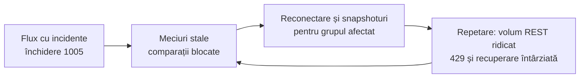
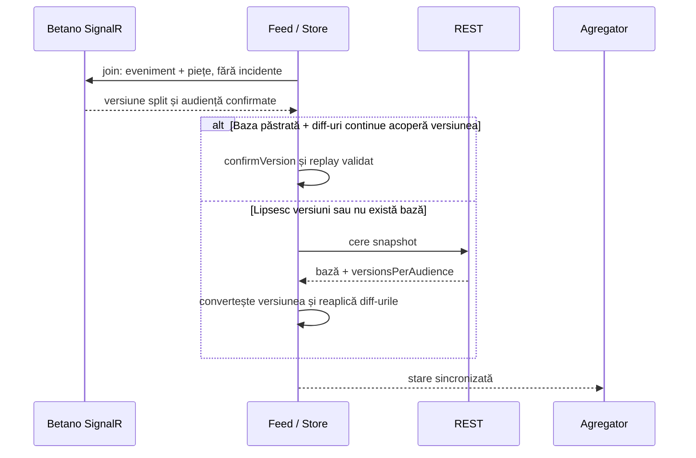

# Betano: închideri WebSocket și recuperare — 25 octombrie 2026

## Problema observată

Logurile arătau închideri repetate `1005`, apoi răspunsuri REST `429`, oportunități în pauză și scăderea perechilor utilizabile. O rulare a providerului anterior a produs, în 40 de secunde, 7 închideri, 339 de răspunsuri de snapshot și 195 de invalidări; la final erau sincronizate 49 din 110 meciuri.



Schimbările recente de transport, heartbeat și dependențe nu explicau diferența față de versiunea anterioară: aceste fișiere și configurații erau neschimbate. Reproducerea fără store, proiecții sau agregator a separat închiderea socketului de procesarea locală.

## Experimente care au separat cauza

Aceleași 115 meciuri, o cerere REST de discovery, conexiuni fără reparații REST automate, observate 35 de secunde:

| Variantă | Rezultat |
| --- | --- |
| `IncludeIncidents: true`, heartbeat 15 s, coadă 30 | Închidere `1005` la aproximativ 10,7 s. |
| Aceleași date, ping inițial și heartbeat 5 s | Închidere `1005` la aproximativ 6,8 s. |
| Aceleași date, coadă mărită la 3000 | Închidere `1005` la aproximativ 10,7 s. |
| `IncludeIncidents: false`, heartbeat 15 s, coadă 30 | Conexiune activă după 35 s, 469 de mesaje, versiuni pentru toate cele 115 meciuri. |

În ultima variantă, serverul a trimis `OnActiveLiveEventSplitVersion` și `NewLiveEventSplitDiff`. Separat, Chrome a reprodus închiderea `1005` pe abonamentul cu incidente pentru 116 meciuri, după aproximativ 10,7 s. Creșterea cozii și pingurile mai dese nu au rezolvat cazul testat.

Configurația publică din pagina Betano și modulul său `use-live-details-provider.DF8SfiuP.js` foloseau încă `IncludeIncidents: true` pentru detaliile unui meci. Nu rezultă că API-ul a eliminat această opțiune sau că există o limită universală de 50 de meciuri. Diferența reproductibilă este comportamentul abonamentului multiplu cu incidente în condițiile testate; serverul nu trimite o explicație în cadrul de închidere. Nu putem stabili din aceste observații dacă infrastructura remote s-a schimbat față de seara precedentă.

## Modificarea implementată

Providerul selectează datele evenimentului și piețele, fără cronologia incidentelor. Acest flux conține în continuare `301` pentru scor/context live, `16` pentru statistici și patchurile de piețe/selecții necesare aplicației. Nu adaugă socketuri sau threaduri.

Schimbarea necesită și alinierea versiunilor. Pentru exemplul REST:

```json
{
  "version": 150,
  "versionsPerAudience": { "1": 33, "2": 17, "4": 91, "7": 9, "8": 0 }
}
```

Fluxul eveniment + piețe are versiunea `33 + 91 + 9 = 133`. Contorul incidentelor `17` nu intră. Contorul `8` observat separat nu intră nici în versiunea completă, nici în cea selectată. Exemple cu `8: 1` sunt acoperite de regresii. Metadatele lipsă, invalide sau contradictorii nu permit publicarea datelor.



Corecții de recuperare asociate:

- Nici handshake-ul, nici ACK-ul de join nu permit singure reutilizarea cotelor; fiecare meci așteaptă audiența și versiunea confirmate.
- Revizia cererilor avansează imediat la deconectare. Un HTTP din încercarea veche nu poate reactiva datele, inclusiv înaintea următoarei conexiuni.
- Versiunile continue din buffer pot repara baza fără REST; golurile cer o bază nouă. Mesajele full și split nu se amestecă.
- Discovery așteaptă cooldownul fără a produce repetat erori 429 locale. `stream-end` și `stream-error` nu dublează notificarea `disconnected`; eroarea identifică socketul.
- Cronologia `incidents` și `incidentFilters` este eliminată din baza publicată, fiindcă nu este întreținută de abonamentul selectat.

Configurația de retry WebSocket nu a fost schimbată pentru a masca problema: testul validează schimbarea fluxului și recuperarea, fără introducerea unui backoff nou.

## Validare live după corecție

### Provider Betano, 65 de secunde

- 4 socketuri active, zero închideri neplanificate, zero erori HTTP/snapshot și zero 429.
- 129 de snapshoturi, 1241 de diff-uri aplicate.
- Au fost atinse 117/117 meciuri sincronizate; la oprire erau 116/117, în timpul reparării unui reset explicit de eveniment. Acest reset legitim este separat de pierderea conexiunii.

### Flux complet Superbet + Betano, aproximativ 120 de secunde

- Toate cele 5 workere au rulat; Betano avea 4 socketuri.
- Zero erori raportate de provideri/agregator, zero 429 și zero închideri WebSocket Betano neplanificate.
- Reconectare Betano forțată la secunda 60: 107 meciuri sincronizate înainte; la verificarea de după recuperare, toate cele 107 erau din nou sincronizate. Contorul de snapshoturi a crescut de la 138 la 142 în următoarele 20 s, nu cu un snapshot pentru fiecare meci.
- La final: 105/105 meciuri Betano sincronizate, 154 de snapshoturi în total, 1937 de diff-uri aplicate.
- Agregator: 50 de perechi confirmate la fotbal și 9 la tenis; 49, respectiv 7, utilizabile în acel moment. 365 de linii comune de fotbal și 110 de tenis; toate cele 4 sesiuni directe conectate, fără resync de protocol.
- O oportunitate de tenis a fost raportată de detector. Aceasta verifică funcționarea fluxului; nu demonstrează disponibilitatea executării unui pariu.

Ofertele s-au schimbat între rulări, deci numerele de snapshoturi nu reprezintă un benchmark cu date identice. Ferestrele scurte nu garantează absența închiderilor pe termen lung. Cauza internă exactă a închiderii de către server rămâne nespecificată; în aceste teste, selectarea fluxului fără incidente a eliminat tiparul repetat.

## Regresii și fișiere

Verificarea finală `npm test` a trecut toate cele 197 de teste și a refăcut buildul.

- [Conversia audienței](../../src/providers/betano/protocol/audience.ts) și [testele ei](../../test/betano-audience.test.mjs).
- [Feed](../../src/providers/betano/processing/feed.ts) și [testele de recuperare](../../test/betano-feed.test.mjs): confirmarea versiunii, HTTP întârziat, reutilizare, goluri și audiență greșită.
- [Store](../../src/providers/betano/processing/state.ts) și [testele de stare](../../test/betano-state.test.mjs): replay și blocarea versiunilor incomplete.
- [Contractul actualizat](../providers/betano/CONTRACT.md) și [arhitectura providerilor](../architecture/PROVIDERS.md).

Scripturile de diagnostic au rulat din stdin; nu au fost salvate capturi brute sau scripturi temporare în proiect. Conexiunea adăugată în browser și procesele de test au fost închise. Exemplele reduse de metadata rămân intenționat în teste.

Investigația ulterioară a identificat și un abonament individual care închide conexiunea independent de audiență. [Raportul de izolare pe eveniment](BETANO-EVENT-ISOLATION-2026-10-25.md) descrie reproducerea în Node și Chrome, partiționarea adaptivă și retry-ul separat de 30 s adăugat ulterior. Rezultatele de mai sus rămân observațiile ferestrelor testate înaintea acelei corecții.
