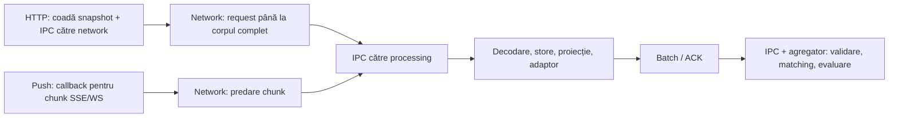

# Test de latență — Superbet și Betano

Testul a fost efectuat **înaintea activării statisticilor P**, cu marcajele D și T (27 de corespondențe active). Configurația curentă D, P și T are 73 de corespondențe; rezultatele de mai jos păstrează măsurătorile rulării originale.

Test temporar efectuat simultan pentru ambii provideri. Interval UTC: **2026-10-24T23:16:27.012Z** → **2026-10-24T23:17:27.026Z**. Fereastră observată: **60014.351 ms**, țintă 60.000 ms; include pornirea inițială. Ambii provideri au confirmat pornirea după **974.376 ms**.

La final: **64 meciuri Superbet**, **50 meciuri Betano**, 35 perechi confirmate, 2 suspecte și 1 candidat doar după nume. Erori raportate de provideri/agregator: **0**.

Mediu: Node.js **v24.13.0**, Windows (build 26100), x64, AMD Ryzen 7 3750H, 8 procesoare logice, aproximativ 22 GiB RAM. Ora locală: **25.10.2026, 02:16:27–02:17:27 EEST**, Europe/Bucharest. Configurațiile implicite au rămas active: batch de 25 ms, maximum 8 snapshoturi REST simultane per provider, discovery la 5 minute, retry la 1 secundă.

## Ce înseamnă latența măsurată

S-a instrumentat o copie separată a buildului, cu timestampuri în network, la primirea în processing, la publicarea stării și la aplicarea batchului în agregator. Intrările au fost corelate după provider, meci și versiune, iar trace-urile au fost transmise împreună cu mesajele/batchurile. Măsurătorile au fost păstrate în memorie și scrise la oprire, fără loguri per update pe calea măsurată. Codul TypeScript de producție nu a primit hookuri de benchmark.

- **HTTP:** de la intrarea în coada locală a snapshotului (sau emiterea comenzii pentru discovery) până la corpul răspunsului, decodare și, când este aplicabil, aplicarea în agregator. Network include așteptarea transportului/poolului și a serverului; nu este timp CPU sau RTT pur. Handshake-urile făcute înainte de request țin de pornire.
- **Push SSE/WebSocket:** de la intrarea în callbackul network a chunkului folosit la completarea/decodarea mesajului urmărit, până la aplicare. Nu se face un request HTTP per update. Pentru mesaje fragmentate nu măsurăm intervalul complet de la primul fragment; fragmentarea sau comprimarea pot implica date primite anterior.
- **Final în processing:** starea ordonată este publicată intern, după proiecție și adaptor. Baschetul/tenisul se opresc aici în arhitectura actuală.
- **Final complet pentru fotbal:** batchul a fost validat și aplicat, matchingul/linkingul necesar și evaluarea incrementală au rulat. Nu înseamnă că s-a găsit o pereche sau oportunitate; acestea pot fi blocate de regulile existente. Main coordonează workerii și nu procesează fiecare cotă. Intervalele periodice ulterioare (settling, sweep, rapoarte către main) nu intră în acest total.
- Ceas comun: <code>process.hrtime.bigint()</code>, același proces/aceeași mașină. Nu există timestamp de emitere verificabil al siteului: **nu putem determina latența server → calculator** sau vârsta reală a unei cote din cache.

## Workerii, separat

| Thread | Rol | Operații | Min ms | Medie ms | P95 ms | Max ms | ELU | CPU thread ms | Loop P95 ms | Loop max ms |
| --- | --- | --- | --- | --- | --- | --- | --- | --- | --- | --- |
| 0 | main | 0 | — | — | — | — | 0.40% | 187.000 | 22.692 | 74.973 |
| 1 | aggregation | 406 | 0.021 | 0.137 | 0.325 | 4.063 | 0.65% | 266.000 | 22.741 | 75.039 |
| 2 | betano processing | 940 | 0.003 | 0.352 | 1.516 | 6.022 | 1.50% | 797.000 | 22.692 | 40.075 |
| 3 | betano network | 79 | 20.155 | 75.307 | 115.617 | 195.860 | 0.91% | 515.000 | 22.692 | 40.075 |
| 4 | superbet processing | 1526 | 0.000 | 0.297 | 1.440 | 13.519 | 7.59% | 3985.000 | 22.708 | 96.666 |
| 5 | superbet network | 57 | 43.926 | 192.721 | 786.450 | 1176.414 | 2.53% | 1500.000 | 22.692 | 43.024 |

Network: o operație este un request HTTP complet; processing: un apel sincron <code>store.receive/install</code>; aggregation: un batch până după commit. Aceste distribuții au unități și cohorte diferite, deci **nu se adună între ele**. Durata apelului sincron include posibile preempții OS; nu este CPU exclusiv. ELU arată ocuparea event loop-ului, nu procentul total de CPU. CPU/ELU includ inițializarea modulului și oprirea, puțin în afara ferestrei principale. Gzip/libuv și componentele native/Rust ale transportului nu sunt workeri JS separați în acest tabel. Monitorul de loop are rezoluție de 10 ms.

## Requesturi HTTP

| Site | Tip | n | Coadă medie ms | Network min | Network medie | Network P95 | Network max | Până la JSON medie | Până la JSON max |
| --- | --- | --- | --- | --- | --- | --- | --- | --- | --- |
| superbet | discovery | 1 | 0.000 | 100.379 | 100.379 | 100.379 | 100.379 | 109.401 | 109.401 |
| superbet | snapshot | 56 | 0.026 | 43.926 | 194.370 | 786.450 | 1176.414 | 199.311 | 1178.648 |
| betano | discovery | 9 | 0.000 | 28.601 | 73.637 | 195.860 | 195.860 | 80.061 | 202.971 |
| betano | snapshot | 70 | 144.285 | 20.155 | 75.521 | 114.429 | 194.885 | 221.428 | 558.885 |

Toți timpii sunt în ms. Discovery este cererea listei live; snapshot este răspunsul individual al unui meci. Coloana până la JSON include coadă locală, IPC, corpul HTTP și decodarea; nu include încă aplicarea în store/agregator.

## Etapele care se adună la total

Au fost decodate 3689 intrări individuale urmărite; 1694 au fost publicate intern în fereastră. Pentru **562 intrări aplicate** s-a observat și finalul în agregator. Separat: 28 trasee de invalidare/control au ajuns la agregator. Duplicate, mesaje overview, versiuni vechi, actualizări tamponate/absorbite într-un snapshot, sporturi fără agregare și schimbări fără efect în catalog nu sunt prezentate drept updateuri complete comparate.

Sunt incluse doar intrările începute și încheiate în fereastra de test. Batchurile pot acoperi mai multe schimbări, iar coalescingul poate păstra numai ultima valoare: finalul măsurat certifică procesarea batchului care acoperă schimbarea, nu procesarea separată a fiecărei valori intermediare. Costul batchului este comun; nu se însumează încă o dată pe meci pentru a estima CPU.

| Site / sursă | n complete | Min total | Medie total | P50 total | P95 total | Max total |
| --- | --- | --- | --- | --- | --- | --- |
| superbet / rest | 32 | 48.145 | 239.035 | 99.465 | 1007.588 | 1179.218 |
| superbet / push | 237 | 0.537 | 31.049 | 28.827 | 40.270 | 751.009 |
| betano / rest | 39 | 38.429 | 216.904 | 199.735 | 449.507 | 451.122 |
| betano / push | 254 | 0.551 | 21.791 | 26.931 | 37.350 | 40.759 |

| Etapă / medie ms | superbet rest (n=32) | superbet push (n=237) | betano rest (n=39) | betano push (n=254) |
| --- | --- | --- | --- | --- |
| Coada REST în processing | 0.024 | 0.000 | 129.032 | 0.000 |
| Processing → network (IPC/coadă) | 0.142 | 0.000 | 0.340 | 0.000 |
| Network: request/body sau predare chunk | 233.783 | 0.005 | 84.598 | 0.046 |
| Network → processing (IPC/coadă) | 0.380 | 0.382 | 0.396 | 1.564 |
| Processing: decodare + așteptare până la JSON | 3.667 | 2.168 | 0.953 | 0.247 |
| Processing: aplicare/ordonare + proiecție + adaptor | 0.670 | 8.108 | 0.820 | 0.948 |
| Processing: așteptare batch/ACK | 0.067 | 20.083 | 0.320 | 18.467 |
| Processing → aggregation (IPC/coadă) | 0.123 | 0.186 | 0.127 | 0.404 |
| Aggregation: validare + matching/linking + evaluare | 0.179 | 0.117 | 0.318 | 0.115 |
| **TOTAL, aceeași cohortă** | **239.035** | **31.049** | **216.904** | **21.791** |

Pentru fiecare traseu: suma celor 9 intervale = timestamp final − timestamp inițial. Audit pe 590 trasee: **0 intervale negative/incomplete**, abatere maximă înainte de rotunjire **0.000e+0 ms**. Mediile se adună deoarece folosesc aceleași intrări; rotunjirea la 0,001 ms poate produce mici diferențe. Minimele, maximele și percentilele etapelor pot proveni din updateuri diferite și nu trebuie adunate.

În interiorul agregatorului, timpul apelurilor de matching/linking este inclus în etapa aggregation, nu este un thread suplimentar și nu este adăugat din nou la total.

## Subetape ale procesării și matchingului

| Apel / subetapă | n | Min ms | Medie ms | P95 ms | Max ms |
| --- | --- | --- | --- | --- | --- |
| Superbet projection.install | 120 | 0.003 | 0.493 | 1.258 | 4.621 |
| Superbet projection.update | 656 | 0.003 | 0.416 | 1.698 | 13.456 |
| Superbet adapter.install | 92 | 0.072 | 0.180 | 0.269 | 2.288 |
| Superbet adapter.update | 373 | 0.001 | 0.044 | 0.123 | 0.301 |
| Betano projection.install | 50 | 0.005 | 0.606 | 1.495 | 5.769 |
| Betano projection.update | 868 | 0.001 | 0.274 | 1.297 | 4.340 |
| Betano adapter.install | 39 | 0.062 | 0.217 | 0.393 | 2.182 |
| Betano adapter.update | 326 | 0.001 | 0.038 | 0.089 | 1.213 |
| Aggregation / matching + linking | 406 | 0.000 | 0.031 | 0.086 | 1.632 |
| Aggregation / restul aplicării | 406 | 0.021 | 0.106 | 0.216 | 3.880 |

Duratele sunt incluse în etapele părinte, deci nu se adună din nou la total. Proiecția apelează adaptorul în același thread; apelurile de matching pot include linkingul declanșat de confirmări. Pentru fiecare batch, matching/linking + restul aplicării = timpul total al agregatorului. Măsurătorile apelurilor processing includ și oprirea; comparațiile complete de mai sus folosesc strict fereastra testului.

## Cel mai rapid și cel mai lent update complet

| Traseu | Meci | Versiune input | Coadă | P→N | Net | N→P | Decode/wait | Store/proj. | Batch/ACK | P→A | Agg. | TOTAL |
| --- | --- | --- | --- | --- | --- | --- | --- | --- | --- | --- | --- | --- |
| superbet rest min | 15561014: Monagas·Academia Puerto Cabello | 1073 | 0.011 | 0.085 | 46.785 | 0.191 | 0.638 | 0.228 | 0.025 | 0.077 | 0.104 | 48.145 |
| superbet rest max | 15370160: Acatlan·Club Ciervos | 535 | 0.159 | 0.441 | 1176.414 | 0.519 | 1.119 | 0.331 | 0.040 | 0.079 | 0.116 | 1179.218 |
| superbet push min | 15117944: Wellington Phoenix (F)·Melbourne Victory (F) | 135 | 0.000 | 0.000 | 0.004 | 0.073 | 0.159 | 0.141 | 0.049 | 0.074 | 0.037 | 0.537 |
| superbet push max | 14231779: Ponte Preta·Fortaleza | 1003060 | 0.000 | 0.000 | 0.003 | 0.043 | 1.614 | 749.080 | 0.037 | 0.102 | 0.130 | 751.009 |
| betano rest min | 90124306: San Lorenzo - Newells Old Boys | 1927 | 0.015 | 0.450 | 28.180 | 0.161 | 2.174 | 6.245 | 0.364 | 0.188 | 0.651 | 38.429 |
| betano rest max | 94569352: Tapachula Soconusco FC - H2O Purepechas FC | 125 | 387.777 | 0.139 | 61.706 | 0.087 | 0.549 | 0.475 | 0.074 | 0.112 | 0.203 | 451.122 |
| betano push min | 94008583: Colegiales - Atletico Rafaela | 241 | 0.000 | 0.000 | 0.009 | 0.198 | 0.040 | 0.102 | 0.047 | 0.092 | 0.062 | 0.551 |
| betano push max | 94024343: Club Leon - Deportivo Toluca FC | 686 | 0.000 | 0.000 | 0.066 | 0.157 | 0.586 | 7.821 | 31.918 | 0.162 | 0.049 | 40.759 |

## Fiecare meci: minim și maxim observat

Formatul unei celule: **număr / minim–maxim ms**. HTTP este de la coada/comanda requestului până la JSON disponibil în processing; push în processing este de la chunkul network corelat până la publicarea stării. Coloanele complete se termină în agregator și privesc doar fotbalul cu schimbări canonice urmărite. Simbolul — înseamnă că nu există un eșantion în acea categorie, nu latență zero. Intervalul scurt poate să nu includă updateuri pentru fiecare meci.

### superbet — 64 meciuri observate în liste

| ID | Meci | Sport | HTTP → JSON | Push → processing | REST → agregator | Push → agregator |
| --- | --- | --- | --- | --- | --- | --- |
| 14231779 | Ponte Preta·Fortaleza | fotbal | 8 / 49.016–68.118 | 23 / 0.328–750.740 | — | 8 / 4.214–751.009 |
| 14231787 | CRB AL·Londrina | fotbal | — | 32 / 0.231–10.540 | — | 11 / 3.349–38.121 |
| 14231799 | New York RB·Inter Miami | fotbal | — | 31 / 0.412–40.472 | — | 7 / 8.157–38.643 |
| 14246807 | Vasco da Gama·Corinthians | fotbal | 1 / 101.524–101.524 | 25 / 0.257–9.804 | 1 / 102.447–102.447 | 5 / 10.151–43.145 |
| 14246809 | Palmeiras·RB Bragantino | fotbal | 1 / 463.767–463.767 | 31 / 0.275–18.565 | 1 / 465.213–465.213 | 6 / 5.773–41.188 |
| 14246815 | Chapecoense·Fluminense | fotbal | 1 / 758.176–758.176 | 41 / 0.366–24.550 | 1 / 760.488–760.488 | 9 / 8.660–51.447 |
| 14331461 | San Lorenzo Almagro·Newell's Old Boys | fotbal | — | 1 / 6.748–6.748 | — | 1 / 7.329–7.329 |
| 14476334 | CS 2 de Mayo·Deportivo Recoleta | fotbal | — | 3 / 0.684–6.099 | — | 2 / 7.143–26.929 |
| 15094968 | Richmond Kickers·Greenville Triumph | fotbal | 4 / 45.318–51.395 | 10 / 0.391–615.486 | 1 / 52.305–52.305 | 5 / 2.572–615.845 |
| 15094969 | Charleston Battery·Indy Eleven | fotbal | 3 / 55.750–377.810 | 13 / 0.294–6.526 | 3 / 56.288–378.630 | 3 / 2.852–28.758 |
| 15095001 | Hartford Athletic·Rhode Island FC | fotbal | — | 11 / 0.251–6.716 | — | 4 / 3.500–35.662 |
| 15095003 | Pittsburgh Riverhounds·Birmingham Legion | fotbal | 1 / 667.337–667.337 | 23 / 0.330–10.226 | 1 / 668.184–668.184 | 11 / 2.098–39.735 |
| 15095004 | Forward Madison·Union Omaha | fotbal | 2 / 57.330–296.841 | 3 / 0.604–5.018 | 2 / 58.484–297.779 | 1 / 5.476–5.476 |
| 15095005 | FC Naples·Spokane Velocity | fotbal | — | 12 / 0.379–7.477 | — | 4 / 2.160–36.488 |
| 15095006 | Louisville City·Detroit City | fotbal | — | 8 / 0.331–5.914 | — | 5 / 3.272–31.321 |
| 15112411 | America de Cali·Cucuta Deportivo | fotbal | 1 / 133.228–133.228 | 12 / 0.198–12.111 | 1 / 134.497–134.497 | 3 / 5.701–39.009 |
| 15117944 | Wellington Phoenix (F)·Melbourne Victory (F) | fotbal | — | 30 / 0.301–3.055 | — | 13 / 0.537–32.920 |
| 15220864 | Denver Summit (F)·Racing Louisville (F) | fotbal | — | 13 / 0.212–90.850 | — | 2 / 1.702–20.341 |
| 15292259 | O'Higgins·Cobresal | fotbal | 1 / 191.772–191.772 | 27 / 0.341–46.202 | 1 / 194.946–194.946 | 9 / 5.562–75.266 |
| 15352831 | Pato·Botafogo | baschet | 2 / 50.251–787.857 | 14 / 0.212–7.664 | — | — |
| 15370160 | Acatlan·Club Ciervos | fotbal | 1 / 1178.648–1178.648 | 9 / 0.185–13.862 | 1 / 1179.218–1179.218 | 4 / 1.669–49.068 |
| 15373215 | Macae EFC·Duque de Caxias | fotbal | — | 2 / 0.575–0.942 | — | 2 / 1.454–25.649 |
| 15373242 | Metropolitano·Nacao SC | fotbal | 4 / 50.125–98.710 | 6 / 0.312–3.731 | 4 / 50.784–99.465 | 3 / 4.299–31.696 |
| 15373490 | Deportivo Madryn·San Telmo | fotbal | — | 14 / 0.183–4.409 | — | 5 / 2.727–32.145 |
| 15373508 | Colegiales·Atletico Rafaela | fotbal | — | 12 / 0.287–16.345 | — | 5 / 1.290–38.736 |
| 15373523 | Real Pilar·CSyD Liniers | fotbal | — | 15 / 0.244–5.512 | — | 5 / 1.217–42.552 |
| 15373679 | Charlotte Hornets·Miami Heat | baschet | — | 2 / 0.490–2.196 | — | — |
| 15373707 | Club Leon·Deportivo Toluca | fotbal | 7 / 137.428–1005.590 | 11 / 0.349–8.490 | 3 / 139.333–1007.588 | 3 / 8.953–37.506 |
| 15373732 | Venados·Alacranes de Durango | fotbal | — | 15 / 0.388–3.837 | — | 5 / 1.624–40.229 |
| 15373751 | Pachuca (F)·Necaxa (F) | fotbal | — | 11 / 0.369–5.128 | — | 5 / 2.292–34.120 |
| 15373752 | Atletico San Luis (F)·Club America (F) | fotbal | — | 13 / 0.341–5.838 | — | 6 / 2.135–37.425 |
| 15373780 | Deportiva Venados·Tigres de Alica FC | fotbal | — | 7 / 0.342–3.375 | — | 4 / 3.730–42.218 |
| 15373782 | Inter Playa del Carmen·Irapuato | fotbal | — | 8 / 0.346–5.199 | — | 5 / 0.952–31.321 |
| 15373788 | Auckland FC (R)·Birkenhead United | fotbal | 1 / 332.579–332.579 | 6 / 0.550–10.382 | 1 / 333.682–333.682 | 4 / 11.454–35.047 |
| 15373794 | San Marcos·Deportivo Matagalpa | fotbal | — | 10 / 0.265–3.090 | — | 4 / 1.711–39.707 |
| 15373805 | Flamengo·Obera TC | baschet | 6 / 50.932–374.859 | 1 / 1.593–1.593 | — | — |
| 15373807 | Real Espana·CD Platense | fotbal | — | 22 / 0.218–2.793 | — | 4 / 0.715–27.952 |
| 15387623 | San Antonio Bulo Bulo·Real Potosi | fotbal | 6 / 50.279–460.031 | 15 / 0.209–3.906 | 5 / 50.862–461.470 | 5 / 4.273–30.400 |
| 15387649 | Tapachula Soconusco FC·H2O Purepechas FC | fotbal | — | 6 / 0.426–3.466 | — | 5 / 2.219–31.586 |
| 15389259 | AD Rosario·AD Sarchi | fotbal | — | 5 / 0.229–2.918 | — | 2 / 3.321–28.043 |
| 15389693 | LDU Quito·CSD Macara | fotbal | 1 / 59.687–59.687 | 22 / 0.301–8.089 | 1 / 60.477–60.477 | 8 / 1.752–39.139 |
| 15389726 | Trasandino de Los Andes·Concon National | fotbal | — | 12 / 0.361–69.424 | — | 8 / 1.469–39.198 |
| 15451412 | Maldonado·Danubio | fotbal | 1 / 86.320–86.320 | 8 / 0.339–3.204 | 1 / 87.464–87.464 | 2 / 3.821–28.827 |
| 15550055 | Plaza Colonia·Tacuarembo | fotbal | — | 13 / 0.287–13.178 | — | 7 / 1.997–37.436 |
| 15550370 | Sao Jose B. U20·FUNDESPORT Araraquara U20 | baschet | — | 8 / 0.206–1.019 | — | — |
| 15550374 | Quetzaltenango Mx Masc·Sacatepquez Mx Masc | baschet | — | 4 / 0.650–1.938 | — | — |
| 15556843 | Caracas FC·Deportivo Tachira | fotbal | 1 / 52.865–52.865 | 8 / 0.486–2.362 | 1 / 53.519–53.519 | 5 / 2.940–37.649 |
| 15561014 | Monagas·Academia Puerto Cabello | fotbal | 2 / 47.700–48.770 | 9 / 0.302–4.412 | 2 / 48.145–49.664 | 3 / 4.846–28.529 |
| 15561015 | Deportivo Lara·Urena SC | fotbal | — | 5 / 0.512–8.929 | — | 4 / 3.211–37.369 |
| 15561045 | CD Universitario·CA Independiente (PAN) | fotbal | — | 17 / 0.299–2.522 | — | 6 / 2.799–34.261 |
| 15575416 | TEC Puebla·CETYS Mexicali | baschet | — | 2 / 0.667–2.832 | — | — |
| 15576676 | Universidad Veracruzana·Universidad Interamericana | baschet | — | 9 / 0.254–1.281 | — | — |
| 15581229 | Flora FC Sur·SV Broki | fotbal | 1 / 167.555–167.555 | 10 / 0.263–3.406 | 1 / 168.505–168.505 | 5 / 1.857–33.102 |
| 15589972 | Tiffany Papazian·Daniella Clara Suryapranata | tenis | — | 1 / 4.641–4.641 | — | — |
| 15590434 | Derrick Chen·Kosuke Nakanishi | tenis | — | 2 / 1.873–3.340 | — | — |
| 15607433 | Jenson Brooksby·Gabriel Debru | tenis | — | 12 / 0.283–6.678 | — | — |
| 15609357 | A.Magadan/R.Pacheco Mendez·F.Zeballos/M.Zormann | tenis | — | 1 / 0.401–0.401 | — | — |
| 15609710 | Fresno Bulldogs·CS Fullerton Titans | baschet | — | 1 / 0.495–0.495 | — | — |
| 15610531 | Hikaru Sato·I Wen Wan | tenis | — | 7 / 0.693–28.290 | — | — |
| 15612764 | Atenao de Piriapolis·San Telmo RS | baschet | — | 7 / 0.182–2.530 | — | — |
| 15613663 | Caimanes Del Llano·Capitanes Bogota | baschet | — | 8 / 0.419–2.843 | — | — |
| 15614597 | Blake Ellis·Isaac Becroft | tenis | — | 9 / 0.412–2.711 | — | — |
| 15615147 | Mia Horvit·Tara Wuerth | tenis | — | 1 / 2.344–2.344 | — | — |
| 15624135 | Arietes FC·Deportivo Independiente Mexiquense | fotbal | — | 8 / 0.298–11.481 | — | 4 / 1.146–31.064 |

### betano — 50 meciuri observate în liste

| ID | Meci | Sport | HTTP → JSON | Push → processing | REST → agregator | Push → agregator |
| --- | --- | --- | --- | --- | --- | --- |
| 90072680 | New York Red Bulls - Inter Miami CF | fotbal | 1 / 71.185–71.185 | 62 / 0.321–10.699 | 1 / 72.865–72.865 | 17 / 3.548–37.890 |
| 90124306 | San Lorenzo - Newells Old Boys | fotbal | 1 / 30.844–30.844 | — | 1 / 38.429–38.429 | — |
| 90661699 | 2 de Mayo - Deportivo Recoleta | fotbal | 1 / 88.283–88.283 | — | 1 / 89.775–89.775 | — |
| 92900632 | Richmond Kickers - Greenville Triumph SC | fotbal | 1 / 113.010–113.010 | 8 / 0.537–4.723 | 1 / 113.942–113.942 | 5 / 5.100–36.297 |
| 92900633 | Forward Madison - Union Omaha SC | fotbal | 1 / 93.007–93.007 | 9 / 0.848–3.174 | 1 / 96.632–96.632 | 4 / 5.238–36.483 |
| 92900634 | FC Naples - Spokane Velocity FC | fotbal | 1 / 95.183–95.183 | 20 / 0.435–3.123 | 1 / 96.594–96.594 | 8 / 7.530–32.264 |
| 92962917 | America de Cali - Cucuta Deportivo | fotbal | 5 / 25.264–107.594 | 26 / 0.708–10.664 | 1 / 109.426–109.426 | 13 / 1.399–35.689 |
| 92985735 | Wellington Phoenix (F) - Melbourne Victory (F) | fotbal | 1 / 91.072–91.072 | 7 / 0.442–2.098 | 1 / 91.792–91.792 | 3 / 26.921–31.695 |
| 93356688 | Denver Summit FC (F) - Racing Louisville FC (F) | fotbal | 1 / 94.069–94.069 | 24 / 0.498–6.900 | 1 / 96.521–96.521 | 10 / 3.438–38.933 |
| 93584420 | O'Higgins - Cobresal | fotbal | 1 / 153.001–153.001 | 15 / 3.111–11.114 | 1 / 159.753–159.753 | 4 / 24.082–33.742 |
| 93881639 | Pato - Botafogo | baschet | 1 / 261.835–261.835 | 51 / 0.352–5.951 | — | — |
| 93939123 | San Antonio Bulo Bulo - Club Real Potosi | fotbal | 1 / 127.540–127.540 | 3 / 0.693–3.319 | 1 / 128.275–128.275 | 3 / 8.754–38.822 |
| 94008407 | Real Pilar - CSYD Liniers | fotbal | 7 / 20.705–156.045 | 4 / 0.455–0.887 | 1 / 110.150–110.150 | 3 / 2.490–26.587 |
| 94008583 | Colegiales - Atletico Rafaela | fotbal | 1 / 157.380–157.380 | 26 / 0.350–17.679 | 1 / 159.726–159.726 | 12 / 0.551–31.501 |
| 94024343 | Club Leon - Deportivo Toluca FC | fotbal | 1 / 213.417–213.417 | 48 / 0.317–15.117 | 1 / 215.499–215.499 | 12 / 2.517–40.759 |
| 94087495 | Charlotte Hornets - Miami Heat | baschet | 1 / 210.638–210.638 | 13 / 0.433–5.966 | — | — |
| 94090040 | Vasco da Gama - Corinthians SP | fotbal | 2 / 96.064–174.308 | 39 / 0.331–11.290 | 1 / 97.129–97.129 | 9 / 3.314–36.233 |
| 94090061 | Palmeiras SP - Bragantino SP | fotbal | 1 / 243.565–243.565 | 51 / 0.223–10.495 | 1 / 244.767–244.767 | 12 / 0.601–36.184 |
| 94090062 | Chapecoense - Fluminense RJ | fotbal | 4 / 27.452–223.847 | 38 / 0.408–15.238 | 1 / 101.155–101.155 | 9 / 5.443–36.071 |
| 94097003 | Deportivo Maldonado - Danubio FC | fotbal | 1 / 246.501–246.501 | 12 / 0.755–3.409 | 1 / 247.385–247.385 | 6 / 1.387–38.971 |
| 94251958 | CF Pachuca (F) - Club Necaxa (F) | fotbal | 1 / 218.313–218.313 | 20 / 1.361–7.070 | 1 / 219.074–219.074 | 10 / 4.667–32.210 |
| 94252837 | Atletico San Luis (F) - Club America (F) | fotbal | 1 / 198.027–198.027 | 13 / 0.952–6.344 | 1 / 199.735–199.735 | 5 / 5.157–32.171 |
| 94252877 | Venados FC - Alacranes de Durango | fotbal | 1 / 256.034–256.034 | 11 / 0.735–8.984 | 1 / 256.905–256.905 | 4 / 23.895–31.533 |
| 94304760 | Auckland FC II - Birkenhead United | fotbal | 1 / 307.647–307.647 | 19 / 1.195–6.192 | 1 / 308.368–308.368 | 9 / 3.823–36.749 |
| 94305524 | Real Espana - CD Platense | fotbal | 1 / 277.302–277.302 | 14 / 0.751–4.841 | 1 / 280.501–280.501 | 5 / 3.416–31.884 |
| 94353851 | Asociación Deportiva Rosario - AD Sarchi | fotbal | 1 / 282.311–282.311 | 7 / 0.798–1.509 | 1 / 284.357–284.357 | 4 / 3.574–31.820 |
| 94360320 | Ponte Preta SP - Fortaleza CE | fotbal | 2 / 90.203–284.849 | 41 / 0.298–10.590 | 1 / 91.086–91.086 | 12 / 5.877–35.612 |
| 94360715 | LDU Quito - CSD Macara | fotbal | 1 / 339.658–339.658 | 12 / 0.629–9.102 | 1 / 340.452–340.452 | 6 / 7.444–30.172 |
| 94402250 | Plaza Colonia - Tacuarembo FC | fotbal | 1 / 354.206–354.206 | 8 / 0.561–6.893 | 1 / 355.128–355.128 | 6 / 6.010–37.013 |
| 94431984 | Caracas FC - Deportivo Tachira | fotbal | 1 / 371.817–371.817 | 6 / 0.581–3.386 | 1 / 372.714–372.714 | 5 / 5.263–39.164 |
| 94453028 | Monagas SC - Academia Puerto Cabello | fotbal | 1 / 318.642–318.642 | 15 / 0.601–3.157 | 1 / 319.313–319.313 | 7 / 3.624–36.697 |
| 94453029 | CD Universitario - CA Independiente de la Chorrera | fotbal | 5 / 22.345–327.299 | 10 / 0.973–4.620 | 1 / 85.300–85.300 | 4 / 25.785–30.209 |
| 94453035 | Deportivo Lara - Urena | fotbal | 1 / 345.441–345.441 | 15 / 0.617–4.298 | 1 / 346.061–346.061 | 5 / 4.508–38.491 |
| 94474239 | CRB - Londrina-PR | fotbal | 1 / 387.243–387.243 | 23 / 0.344–6.161 | 1 / 389.012–389.012 | 6 / 5.182–31.283 |
| 94512281 | Flora FC Sur - SV Broki | fotbal | 1 / 421.002–421.002 | 15 / 0.474–2.400 | 1 / 422.570–422.570 | 7 / 25.768–38.558 |
| 94514074 | Trasandino - Concon National | fotbal | 1 / 388.357–388.357 | 8 / 0.341–8.370 | 1 / 389.006–389.006 | 4 / 8.624–33.924 |
| 94559994 | CA Metropolitano - Nacao Esportes SC | fotbal | 1 / 421.939–421.939 | 13 / 0.669–10.812 | 1 / 422.564–422.564 | 7 / 5.906–31.029 |
| 94564754 | Sao Jose U20 - Araraquara/ABA/Fundesport U20 | baschet | 1 / 428.320–428.320 | 12 / 0.305–1.459 | — | — |
| 94564755 | Quetzaltenango Maxi - Sacatepquez Masc | baschet | 1 / 471.946–471.946 | 17 / 0.364–2.236 | — | — |
| 94566998 | Arietes FC - Deportivo Independiente Mexiquense | fotbal | 1 / 448.727–448.727 | 8 / 0.768–11.018 | 1 / 449.507–449.507 | 4 / 11.702–40.229 |
| 94566999 | Deportiva Venados FC - Tigres De Alica FC | fotbal | 2 / 94.872–426.470 | 17 / 1.463–5.764 | 1 / 95.873–95.873 | 6 / 5.128–31.252 |
| 94569352 | Tapachula Soconusco FC - H2O Purepechas FC | fotbal | 1 / 450.245–450.245 | 10 / 0.639–1.609 | 1 / 451.122–451.122 | 4 / 5.382–29.025 |
| 94569353 | Inter Playa del Carmen - CD Irapuato | fotbal | 1 / 110.108–110.108 | 6 / 1.004–2.090 | 1 / 110.779–110.779 | 4 / 2.479–31.955 |
| 94592554 | Aryna Sabalenka (Simulator) - Jasmine Paolini (Simulator) | tenis | 1 / 476.787–476.787 | 12 / 0.368–10.915 | — | — |
| 94593399 | Jenson Brooksby - Gabriel Debru | tenis | 1 / 510.551–510.551 | 17 / 0.597–3.857 | — | — |
| 94600354 | Alan Magadan / Rodrigo Pacheco Mendez - Federico Zeballos / Marcelo Zormann | tenis | 1 / 522.478–522.478 | — | — | — |
| 94603731 | Hikaru Sato - I Wen Wan | tenis | 1 / 520.096–520.096 | 25 / 0.343–2.401 | — | — |
| 94613942 | ICS Atenao de Piriapolis - San Telmo RS | baschet | 1 / 534.681–534.681 | 11 / 0.351–9.341 | — | — |
| 94614286 | Blake Ellis - Isaac Becroft | tenis | 1 / 539.997–539.997 | 27 / 0.428–6.967 | — | — |
| 94615893 | Mia Horvit - Tara Wurth | tenis | 1 / 558.885–558.885 | — | — | — |

## Ce indică rezultatele

- Latența locală mediană pentru push până la agregator a fost **28,827 ms la Superbet** și **26,931 ms la Betano**. P95: **40,270 ms**, respectiv **37,350 ms**. Acestea nu sunt latențe măsurate de la emiterea pe server.
- Așteptarea batchului/ACK domină parcursul uzual: **20,083 ms medie Superbet**, **18,467 ms Betano**, pe cohortele complete push. Fereastra configurată de 25 ms este o țintă de programare; timerul și încărcarea pot adăuga întârziere.
- Maximul push Superbet, **751,009 ms**, este pentru Ponte Preta–Fortaleza, input 1003060. Apelul inițial de store a durat numai **0,009 ms**. Starea a fost publicată ca snapshot aproximativ **749 ms după decodare**, imediat după un răspuns REST pentru același meci. Aceasta indică așteptare pentru completarea/resincronizarea stării, nu 749 ms de CPU.
- Cel mai lent request Superbet complet până la agregator: **1179,218 ms**, dintre care **1176,414 ms** în transport/HTTP. La Betano, maximul REST complet de **451,122 ms** include **387,777 ms** de așteptare în coada locală, cu numai **61,706 ms** în HTTP.
- Agregatorul a procesat un batch în **0,137 ms medie**, **0,325 ms P95**; event loop-ul său a avut ELU **0,65%**. În acest eșantion, calculele din agregator au contribuit mult mai puțin decât așteptarea batchului sau unele răspunsuri HTTP.

## Starea și limitele testului

| Provider | Urmărite | Sincronizate | Reconectări / resync | Erori snapshot | Erori stream/decode |
| --- | --- | --- | --- | --- | --- |
| Superbet | 64 | 63 | 25 | 0 | 0 / 0 |
| Betano | 50 | 50 | 0 | 0 | vezi erorile raportate: 0 |

- Un minut este un eșantion, nu un benchmark statistic pentru alte ore, alte meciuri sau încărcări mai mari.
- Testul include pornirea/cache replay și traficul live; maximele nu reprezintă automat latența normală a fiecărui update. Așteptarea ordonării/reparării intră în rezidența din processing când trace-ul poate fi corelat.
- Instrumentarea adaugă timestampuri, mapări și metadata între workeri. Nu s-a calibrat separat overheadul: valorile nu sunt o măsurare exactă a rulării fără instrumentare.
- Proiecția, adaptorul și matchingul sunt măsurate ca durate de apel în interiorul etapelor lor; nu se adună peste etapele părinte.
- După test au fost eliminate copia instrumentată, scripturile și fișierele de măsurători. În aplicație rămân numai logurile de pornire pe thread și erorile. Acest document păstrează rezultatele; nu există instrumentare permanentă.
